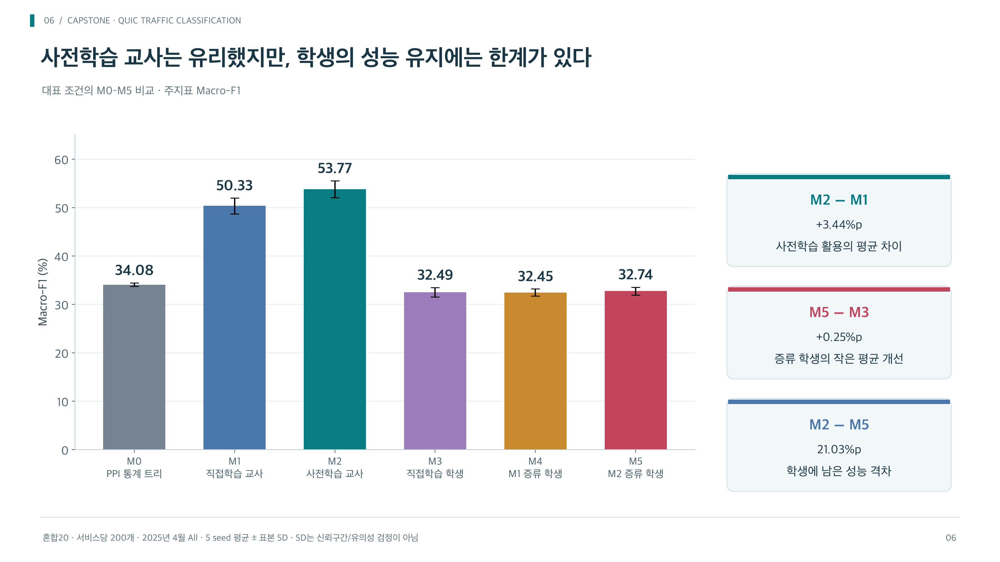
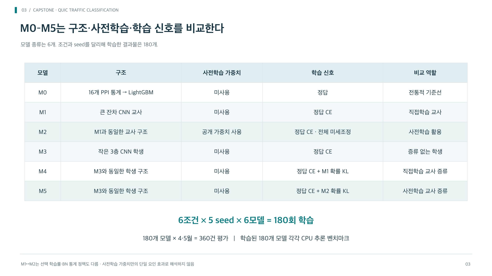

# QUIC 서비스 분류 · 캡스톤 실험 기록

암호화된 내용을 읽지 않고 **첫 최대 30패킷의 간격(IPT)·방향(DIR)·크기(SIZE)**로 서비스를 분류하고, 사전학습 교사의 지식을 작은 학생 모델로 옮기는 캡스톤 실험입니다.

**2026년 10월 30~31일 중간발표 기록**과 **11월 M3 채널 확대 실험**을 보관합니다. 후속 실험은 증류 없이 학습 4회와 보관 모델의 4·5월 평가 8회를 완료했습니다. [최종 평가 보고서](reports/2026-11-08_m3_width_final/README.md)에서 같은 seed·학습량의 기존 M3와 비교할 수 있습니다.

## 어디부터 보면 되나요?

| 목적 | 자료 |
|---|---|
| M3 채널 확대의 4·5월 최종 결과 | [보고서](reports/2026-11-08_m3_width_final/README.md) · [수치 JSON](reports/2026-11-08_m3_width_final/results.json) · [CSV](reports/2026-11-08_m3_width_final/final_summary.csv) |
| M3 채널 64→128→128 실험 실행 | [실행 안내](experiments/2026-11-05_m3_width/README.md) · [학습 노트북](experiments/2026-11-05_m3_width/M3_width_200_1000.ipynb) · [평가 전용 노트북](experiments/2026-11-05_m3_width/M3_width_final_evaluation.ipynb) |
| 발표 흐름과 핵심 결론 | [중간발표 설명·Q&A](reports/2026-10-30_midterm_research_record/midterm_handoff.md) |
| 전체 방법·결과·한계 | [보고서 Markdown](reports/2026-10-31_midterm_report/report.md) · [HTML](reports/2026-10-31_midterm_report/report.html) · [Word](reports/2026-10-31_midterm_report/midterm_report.docx) |
| PPT에 넣을 그림 27종 | [그림 안내](reports/2026-10-31_presentation_assets/README.md) · [PNG](reports/2026-10-31_presentation_assets/png) · [SVG](reports/2026-10-31_presentation_assets/svg) · [수치 CSV](reports/2026-10-31_presentation_assets/data) |
| 실험 설계와 근거 원장 | [연구 기록](reports/2026-10-30_midterm_research_record/research_record.md) · [최종 집계 JSON](experiments/2026-10-30_midterm_restart/continuation_recovered/continuation_summary.json) |
| 학습·평가 구현 | [실험 코드](experiments/2026-10-30_midterm_restart) · [모델](experiments/2026-10-30_midterm_restart/models.py) · [학습·증류](experiments/2026-10-30_midterm_restart/training.py) |
| 데이터 정제·분할 | [데이터 준비 코드](experiments/2026-10-30_midterm_restart/data.py) · [사전 감사](experiments/2026-10-28_data_audit) |
| 팀원 PC/GPU에서 다시 실행 | [데이터·가중치 준비부터 실행까지](REPRODUCE.md) |
| 공개 범위·재현 조건·출처 | [PUBLICATION.md](PUBLICATION.md) · [공개 사본 해시 원장](publication_manifest.json) |

HTML은 GitHub 파일 화면에서 웹페이지로 실행되지 않습니다. 저장소를 내려받은 뒤 다음 명령으로 열 수 있습니다. 학습이나 모델 추론을 실행하지 않는 정적 파일 서버입니다.

```sh
git clone https://github.com/RealOctavision/helloworld.git
cd helloworld
python3 -m http.server 8000 --bind 127.0.0.1
# http://127.0.0.1:8000/reports/2026-10-31_midterm_report/report.html
# http://127.0.0.1:8000/reports/2026-10-31_presentation_assets/index.html
```

## 11월 후속 실험: M3 채널 확대

M3 채널을 `32→64→64`에서 `64→128→128`로 확대했습니다. 파라미터는 20,180개에서 77,204개로 늘었고, 증류 없이 서비스당 200/1,000개 × seed 201/202로 학습했습니다. 2월 검증으로 선택한 모델을 그대로 4·5월에 평가했습니다.

| 평가 월 | 서비스당 학습량 | 정답률: 기존 → 확대 | Macro-F1: 기존 → 확대 |
|---|---:|---:|---:|
| 4월 | 200 | 46.29% → **52.69%** | 33.30% → **38.36%** |
| 4월 | 1,000 | 60.77% → **65.02%** | 46.01% → **50.29%** |
| 5월 | 200 | 45.63% → **52.02%** | 33.57% → **38.50%** |
| 5월 | 1,000 | 59.99% → **64.19%** | 45.84% → **49.94%** |

표는 같은 **두 seed의 평균**입니다. 8회 평가 모두 개선됐고, 공통 미관측 입력에서도 평균 개선이 유지됐습니다. 기존 실험과 GPU·PyTorch 차이가 있고 CPU 비용은 추가 측정하지 않았습니다. 아래 중간발표의 5개 seed 평균과 구분합니다. [검증 범위·환경·한계](reports/2026-11-08_m3_width_final/README.md)를 함께 확인하세요.

## 중간발표에서는 무엇을 비교했나요?

| 모델 | 역할 |
|---|---|
| M0 | PPI로 계산한 16개 통계의 LightGBM 기준선 |
| M1 | 교사 구조를 무작위 초기화해 직접 학습 |
| M2 | 공개 사전학습 교사를 미세조정 |
| M3 | 작은 CNN 학생을 정답으로 직접 학습 |
| M4 | M1의 예측 분포를 참고하는 같은 학생 |
| M5 | M2의 예측 분포를 참고하는 같은 학생 |

1월 학습, 2월 검증·설정 선택, 4월 주평가, 5월 시간차 평가를 구분했습니다. M3/M4/M5는 구조·학습 표본·초기값을 맞췄습니다. Google 포함 20서비스에서는 서비스당 50·100·200·1,000개 라벨을 비교했고, 비Google 13서비스·Google 계열 20서비스에서는 200개 조건을 비교했습니다. 모든 구성과 예산의 전체 조합을 실행한 것은 아닙니다.

중간발표의 최종 완료 범위는 **개발 60회, 본실험 180회, 4·5월 모델 평가 360건, 본실험 모델 180개의 CPU 비용 측정**입니다. 개발 seed는 101/102, 본실험은 201~205입니다. 개발 후보 60개를 같은 조건의 독립 반복 60회로 해석하지 않습니다.

## 중간발표 핵심 결과

대표 조건: Google 포함 20서비스, 서비스당 학습 표본 200개, 4월 자연분포 Macro-F1. 평균 ± **5개 seed의 표본 표준편차**이며 신뢰구간이 아닙니다.

| 모델 | Macro-F1 |
|---|---:|
| 사전학습 교사 M2 | **53.771 ± 1.743%** |
| 일반 학생 M3 | **32.493 ± 0.982%** |
| 사전학습 교사에서 증류한 학생 M5 | **32.743 ± 0.815%** |

M5−M3은 평균 **+0.250%p**, 교사 M2−M5 격차는 **21.028%p**입니다. 교사 대비 2%p 이내 성능 보존 목표에는 미달했습니다. 학생은 파라미터가 **20,180개**로 교사 **695,593개**보다 약 **34.47배 작고**, 지정 CPU batch1 측정 지연은 약 **8.86배 짧았습니다**. 모델 경량화와 성능 보존의 달성 여부를 구분합니다.





## 읽을 때 주의할 점

- 중간발표 결과는 **10/31 보고서·통합 집계**와 [main_frozen.json](experiments/2026-10-30_midterm_restart/main_frozen.json), [continuation_frozen.json](experiments/2026-10-30_midterm_restart/continuation_frozen.json)을 기준으로 봅니다. 초기 실행 README와 `config.json`의 준비 상태 문구는 당시 기록입니다.
- 같은 50epoch라도 라벨 수가 많으면 업데이트 수도 늘어납니다. 순수한 데이터량 효과를 분리한 고정 연산량 비교가 아닙니다.
- M1/M2는 초기화 외 선택 학습률·BN 정책도 다릅니다. 사전학습을 활용하는 적응 정책의 비교입니다.
- 4·5월은 이전 작업에서도 확인한 시간차 평가 월이며 완전히 새로운 외부 블라인드 평가가 아닙니다.
- CPU 시연은 저장된 공개 PPI의 재생입니다. 실시간 패킷 수집·미등록 서비스 탐지·이상탐지까지 구현한 결과가 아닙니다.
- 원시 데이터·개별 흐름 예측·모델 가중치·회수 ZIP은 공개 저장소에 넣지 않았습니다. 원본은 로컬에 보존되어 있으며 이 저장소만으로 전체 원본 ZIP 검증이나 학습을 즉시 재실행할 수는 없습니다.
