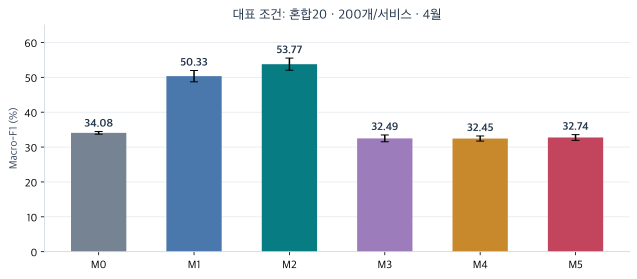
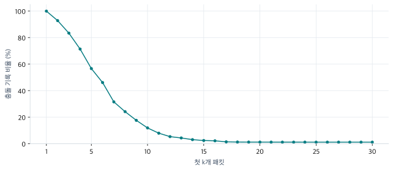
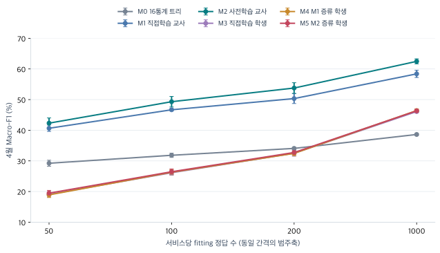
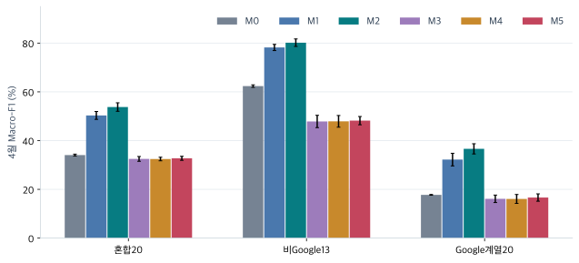
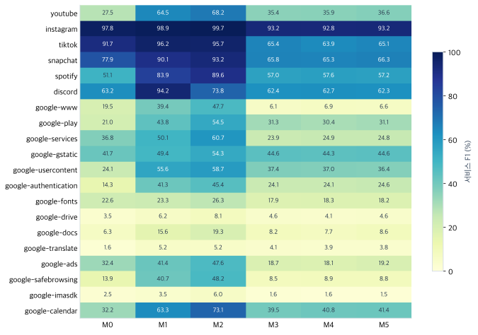
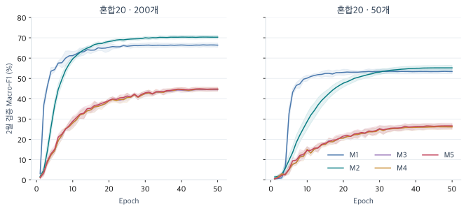
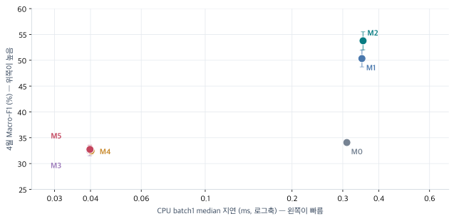

<div class="eyebrow">CAPSTONE · EXPERIMENT REPORT · 2026.10.31</div>

# 암호화 QUIC 트래픽 분류 실험 보고서

<p class="lead">첫 최대 30패킷을 이용한 사전학습과 지식 증류 비교<br>데이터 처리부터 모델 구조와 평가 결과까지</p>

<div class="cover-meta">대상: CESNET-QUICEXT-25-XS의 서비스 분류 · 모델: M0–M5 · 기준일: 2026년 10월 31일</div>

## 1. 연구 요약 — 무엇을 했고, 무엇을 확인했는가

이 연구는 암호화된 네트워크 통신에서 **내용을 읽지 않고 어느 서비스의 통신인지 분류**하는 문제를 다룬다. 서비스 정답이 적을 때 공개 사전학습 모델을 활용하면 분류 성능이 좋아지는지, 그 모델의 예측 정보를 작은 학생 모델에 가르쳐 성능과 실행 비용을 함께 개선할 수 있는지 확인했다.

입력은 한 플로우에서 관측한 첫 최대 30패킷의 간격(IPT), 방향(DIR), 크기(SIZE)다. 큰 교사 모델, 작은 학생 모델, 전통적인 트리 모델을 동일한 관측 정보와 정해진 라벨 예산으로 비교했다. 2025년 1월 자료로 학습하고 2월로 설정과 체크포인트를 선택한 다음, 4월을 주평가, 5월을 시간차 재평가로 사용했다.

<div class="stat-grid"><div><strong>6개</strong><span>비교 모델 M0–M5</span></div><div><strong>180회</strong><span>본실험 학습 · 6조건 × 5반복 × 6모델</span></div><div><strong>360건</strong><span>본실험 모델별 월간 평가</span></div><div><strong>180개</strong><span>학습된 모델의 CPU 비용 측정</span></div></div>

설정 탐색용 개발 학습 60회는 본실험 180회와 별도로 센다. 같은 모델을 두 달에 평가했다고 학습을 두 번 한 것은 아니며, 같은 평가 플로우를 5개 seed의 모델에 넣었다고 평가 데이터가 5배가 되는 것도 아니다.

**모델 번호 읽기:** M0는 통계 기반 트리, M1은 직접 학습한 교사, M2는 사전학습 교사다. 작은 학생은 M3가 직접 학습, M4가 M1에서 증류, M5가 M2에서 증류한 모델이다. 구조와 학습 신호는 7장에서 비교한다.


<figure><figcaption>그림 1. 동일한 혼합20·200개 조건의 4월 All 평가. 막대는5개 seed 평균, 오차막대는표본 SD. M0–M5의 역할은7장에 설명한다.</figcaption></figure>


> **핵심 결론:** 공개 사전학습을 활용한 교사는 비교 조건 전반에서 평균적으로 유리했다. 작은 학생은 훨씬 가볍고 CPU에서 빠르지만, 현재 증류 방법으로 교사의 분류 성능을 충분히 유지하지는 못했다.

대표 조건인 **Google 포함 혼합20 · 서비스당 학습 200개 · 4월 전체 평가**에서 M2 교사의 Macro-F1은 **53.771%**, M3 직접학습 학생은 **32.493%**, M5 증류 학생은 **32.743%**였다. M5의 M3 대비 차이는 평균 **+0.250%p**, 교사 대비 손실은 **21.028%p**다. 학생의 파라미터는 **34.47배 적고**, 지정 CPU에서 batch 1 지연은 평균값 기준 **약 8.86배 짧았다**. 성능 보존과 경량화의 달성 여부는 나누어 판단해야 한다.

**읽는 방법.** 1–3장은 연구 목적과 용어, 4–8장은 데이터를 어떻게 만들고 무엇을 통제했는지, 9–11장은 결과와 의미를 설명한다. 부록에는 모든 실행·서비스별 수치, 설정, 재현 근거와 예상 질문을 넣었다. 표의 **±는 5개 seed의 표본 표준편차(SD)**이며 신뢰구간이나 유의성 표시가 아니다. %p는 두 백분율 점수의 차이다.

## 2. 연구 문제와 비교 질문

### 2.1 무엇을 분류하는가

하나의 입력은 데이터셋에 저장된 **양방향 QUIC 플로우 기록**이다. 출력은 미리 정한 서비스 목록 중 하나다. 예를 들어 Google Drive, YouTube, Instagram 같은 서비스 라벨을 예측한다. 사용자가 한 앱을 실행할 때 발생하는 모든 통신을 그 앱 하나로 묶어 판별하는 과제와는 다르다. 정답은 데이터셋의 APP 라벨 정의를 따른다.

이번 범위는 **폐쇄형 서비스 분류**다. 목록 밖 서비스, 악성 트래픽, 이상 징후를 찾아내는 기능의 성능을 이 실험으로 입증하지 않는다. Background 라벨도 대상에서 제외했다.

### 2.2 왜 이 연구가 필요한가

정답을 붙인 트래픽이 충분하지 않은 상황에서는 큰 신경망을 처음부터 학습하기 어렵다. 반면 많은 통신으로 미리 학습한 모델을 활용하면 목표 서비스의 적은 정답으로도 유용한 표현을 얻을 가능성이 있다. 실제 배포에서는 추론 지연과 메모리도 중요하므로, 성능이 좋은 모델의 예측 분포를 작은 모델에 전달하는 방법까지 함께 비교한다.

이는 연구의 동기다. **사전학습이나 증류가 반드시 성공한다는 것을 전제로 놓지는 않았다.** 특히 같은 사업자의 서비스 사이에서는 제한된 패킷 정보만으로 구분이 어려울 수 있으므로, Google 계열을 따로 평가한다.

|연구 질문|핵심 비교|판단할 내용|
|---|---|---|
|공개 사전학습을 활용하면 적은 목표 라벨에서 유리한가?|M2 대 M1|교사 성능과 적응 비용|
|교사의 확률을 가르치면 작은 학생이 좋아지는가?|M4·M5 대 M3|동일한 학생 구조에서 KD 추가 효과|
|사전학습 교사가 학생에게도 더 유리한가?|M5 대 M4|교사 성능 차이가 학생 성능으로 이어지는지|
|교사의 성능을 유지하면서 가볍게 만들 수 있는가?|M5 대 M2|Macro-F1 손실, 파라미터, CPU 지연|
|정답 입력 수가 늘어나면 어떤 변화가 생기는가?|혼합20의 50·100·200·1000개|라벨 예산별 성능 곡선|
|서비스 구성과 평가 시기가 달라도 경향이 유지되는가?|혼합20·비Google13·Google 계열20, 4월·5월|과제 구성과 시간에 따른 성능 변화|
|작은 신경망이 전통적인 방법보다 유리한가?|학생 대 M0|16통계 기반 LightGBM 기준선과 비교|

대표 조건의 경량화 목표는 **M2 대비 Macro-F1 손실 2%p 이내, 파라미터 5배 이상 축소, CPU 추론 지연 감소**다.

### 2.3 이 연구에서 직접 확인한 점

이 연구는 새로운 사전학습 모델을 제안하기보다, **목표 서비스의 정답이 제한된 상황에서 공개 교사의 이점을 작은 학생에게 옮길 수 있는지**를 동일한 데이터와 대응 반복으로 검증했다. 입력 충돌을 정의해 학습 자료를 정제했고, 라벨 예산·서비스 구성·평가 월을 바꾸어 성능과 비용을 함께 확인했다. 핵심 결과는 교사의 성능 향상, 제한적인 증류 이득, 경량화와 성능 보존 사이의 큰 격차다.

## 3. 처음 읽는 사람을 위한 핵심 개념

|용어|이 보고서에서의 의미|간단한 예|
|---|---|---|
|패킷·플로우|패킷은 전송되는 작은 데이터 단위, 플로우는 데이터셋이 한 통신 흐름으로 묶은 기록|한 플로우에 여러 송신·수신 패킷이 존재|
|PPI|패킷별 간격·방향·크기를 순서대로 나타낸 정보|30개 위치 × 3채널|
|특징(feature)|모델이 예측에 활용하는 관측값 또는 변환값|SIZE 시퀀스, 관측 패킷의 평균 크기|
|라벨(label)|학습이나 평가 때 사용하는 정답 서비스|`google-drive`|
|사전학습|목표 과제에 적응하기 전에 다른 자료·목적으로 모델을 학습하는 단계|공개 QUIC 도메인 인식 가중치|
|전이학습·미세조정|사전학습 가중치를 시작점으로 목표 서비스에 맞게 조정하는 과정|M2를 1월 서비스 정답으로 학습|
|교사·학생|지식을 제공하는 모델과 전달받는 작은 모델|M2 → M5|
|증류(KD)|정답뿐 아니라 교사의 클래스별 확률 분포도 학습 신호로 사용|교사가 Drive와 Docs를 어느 비율로 혼동하는지 전달|
|기준선(baseline)|새 방법의 이점을 판단하기 위한 비교 대상|M0는 전통 모델, M3는 KD 없는 학생 기준선|
|epoch·update|epoch는 학습 자료를 한 번 순회, update는 한 배치로 가중치를 한 번 갱신|4,000개·배치128이면 epoch당 32 update|
|seed|표본 선택·초기값·학습 순서의 난수를 지정하는 값|본실험 201–205의 5회 반복|
|검증·평가|검증은 설정·체크포인트 선택, 평가는 선택이 끝난 모델의 성능 측정|2월 검증, 4·5월 평가|
|파라미터·체크포인트|파라미터는 모델이 학습하는 숫자, 체크포인트는 특정 시점의 모델 상태를 저장한 파일|같은 구조여도 학습 결과에 따라 파라미터 값이 달라짐|
|embedding·pooling|embedding은 관측값을 벡터로 표현하는 것, pooling은 여러 패킷 위치를 하나의 벡터로 요약하는 것|크기→20차원 표현, 30개 위치→플로우 벡터|
|logits·softmax|logits는 클래스별 원시 점수, softmax는 이를 합이1인 확률로 변환하는 함수|학생과 교사의 확률 분포를 비교|
|CE·KL|CE는 정답에 높은 확률을 주도록 하는 손실, KL은 두 확률 분포의 차이를 측정하는 항|실제 정답 학습 + 교사 분포 학습|
|BatchNorm(BN)|특징값의 크기를 정규화하는 층으로 학습 가능한 계수와 누적 통계를 갖는다|M2는 누적 통계를 고정하고 계수는 학습|

**예시 입력.** 실제 측정값이 아닌 설명용 플로우가 패킷 3개라면 IPT는 `[0, 10, 2]`ms, DIR는 `[+1, −1, +1]`, SIZE는 `[1200, 800, 60]`bytes처럼 표현할 수 있다. 나머지 27칸은 0으로 채운다. 첫 패킷의 간격 0ms는 유효한 관측값이므로 IPT가 0이라는 이유만으로 패딩이라고 처리하면 안 된다. 유효 위치는 **DIR ≠ 0**으로 판단한다.

## 4. 데이터와 서비스 구성

### 4.1 출처와 실제 사용 자료

CESNET-QUICEXT-25는 CESNET3 망에서 수집한 QUIC 플로우 데이터셋이다. 공개 원천의 기간은 2024년 6월–2025년 5월이며, 패킷 정보와 플로우 속성 등을 제공한다. 원천 수집 설명과 인용 지침은 [공식 데이터셋 페이지](https://zenodo.org/records/17249078)를 따른다.

우리의 실제 입력 파일은 **`CESNET-QUICEXT-25-XS.h5`**다. 로컬 파일에는 **10,000,000개 기록, 360일**의 자료가 있다. 공개 원천 전체 규모와 이 XS 파일의 규모, 특정 서비스의 후보 수, 모델이 실제 학습한 표본 수를 혼동하지 않는다. 원본 파일은 수정하지 않고 해시로 식별했다.

데이터셋의 APP 라벨을 정답으로 쓰되 **SNI·도메인 문자열·IP 주소·포트·payload를 예측 입력으로 주지 않는다.** 정답 생성에 사용된 정보와 모델 입력은 서로 다른 역할이다. 통신 의미 전체가 아니라 이 데이터셋의 서비스 분류 체계를 학습한다.

### 4.2 세 가지 서비스 구성


|구성|분류 클래스|학습 예산/서비스|목적|
|---|---|---|---|
|혼합20|Google 계열과 비Google 서비스가 함께 있는20개|50·100·200·1000|대표 비교·라벨 곡선|
|비Google13|Google을 제외한13개|200|다른 서비스 구성에서 비교|
|Google계열20|YouTube·Firebase 등을 포함한Google계열20개|200|같은 사업자 내부 구분|


혼합20은 Google 내부 구분을 포함하도록 명시적으로 고정한 서비스 목록이다. 단순히 전체 빈도 상위 20개라고 설명하지 않는다. 비Google은 후보 20서비스 중 **1월 정제 후 고유 입력 1,000개 이상**을 확보한 13개, Google 계열은 후보 24서비스 중 같은 조건을 만족하는 20개를 사용했다. 기준 미달 서비스를 복제해 채우지 않았다. 예를 들어 Microsoft Outlook은 1월 기록이 15,433개지만, 정규화된 30-PPI의 고유 패턴은 909개로 최대 학습 예산을 채우지 못해 제외됐다. 모든 최종 서비스 이름·원본 코드·월별 표본 수는 부록 B에서 확인할 수 있다.

자격 기준은 **1월의 정제 학습 후보 수**다. 4·5월에도 서비스당 1,000개가 보장된다는 뜻은 아니다. Google 계열의 2월 검증에서 Hangouts는 133개뿐이므로 Google 계열20의 검증 크기는 4,000이 아니라 **3,933개**다.

### 4.3 시간 분할과 표본 수

|기간|역할|표본 구성|이 자료로 결정한 것|
|---|---|---|---|
|2025년 1월|학습 후보 및 fitting|중복·충돌 정리 후 서비스당 균등 추출|학습 입력과 클래스 자격|
|2025년 2월|고정 검증|서비스당 최대200, seed20261030, 부족하면 전량|학습률·KD·best 체크포인트|
|2025년 4월|주평가|선택 서비스의 유효 기록 전체, 자연 빈도|동결한 모델의 주 성능|
|2025년 5월|시간차 재평가|선택 서비스의 유효 기록 전체, 자연 빈도|이후 월에서도 경향이 유지되는지|


|구성|1월 정제 후 후보|2월 검증|4월 평가|5월 평가|
|---|---|---|---|---|
|혼합20|560,745|4000|379,194|365,258|
|비Google13|222,826|2600|252,471|225,067|
|Google계열20|450,027|3933|237,389|233,986|


3월 자료는 이번 학습·설정 선택·주평가에 사용하지 않았다. 따라서 이 실험을 매월 연속 성능 추적으로 설명하지 않는다.

학습 표본은 균등하지만 평가는 실제 자료의 불균형을 유지한다. 평가에서 적은 서비스의 기록을 복제하거나 많은 서비스의 기록을 줄여 균형을 맞추지 않았다. **서비스 수가 13과 20으로 다르고 경쟁 클래스도 달라서**, 세 구성의 점수 차이를 Google 포함 여부 하나의 인과효과로 해석할 수는 없다.

## 5. 데이터 처리 — 입력 중복과 평가 겹침을 어떻게 다뤘는가

<div class="flow-strip"><span>원본·서비스 선택</span><b>→</b><span>유효성·단위 확인</span><b>→</b><span>30-PPI 정규화</span><b>→</b><span>1월 중복·충돌 정리</span><b>→</b><span>균등·중첩 추출</span><b>→</b><span>고정 분할·평가 마스크</span></div>

### 5.1 유효성 검사와 모델 입력

중복 정리 전에 NaN·무한값, 음수 IPT, 첫 IPT가 0이 아닌 기록, 허용 범위 밖 방향값, 유효 위치의 0 이하 크기, 패딩의 비영 값, 중간에 끼어 있는 패딩, 빈 PPI를 검사했다. 원본 1,000만 기록에서 **이 8개 결함에 해당하는 기록은 모두 0개**였으므로, 이 단계에서 제거된 기록은 없었다. 이후의 감소는 서비스 선택과 중복·충돌 정리에서 발생한다.

아래 clipping은 공개 교사와 입력 범위를 맞추기 위한 고정 계약이다. 원본 품질 진단에서는 상한을 넘는 IPT·SIZE도 0개였다. 포트 443이 아닌 기록과 빈 SNI는 별도 진단 항목이며 자동 제외 조건으로 사용하지 않았다.

|항목|입력 계약|이유·주의|
|---|---|---|
|텐서|`[B, 3, 30]`|B는 배치의 플로우 수|
|채널 순서|IPT_ms → DIR → SIZE_bytes|설명에서 크기·방향·시간이라 부르더라도 코드 순서는 이 순서|
|관측 범위|처음 최대 30패킷, 별도 첫1초 제한 없음|플로우 전체 패킷을 읽는 입력과 구분|
|IPT|0–65,000ms로 clip|실제0ms 포함, 상한을 넘으면 상한값|
|DIR|유효 +1/−1, 패딩0|같은 순서와 방향 부호 체계 유지|
|SIZE|유효 위치1–1,500bytes로 clip|패딩 위치는 다시0|
|짧은 플로우|포함, 남는 위치를 모든 채널0으로 패딩|길이가 30 미만이라는 이유로 제거하지 않음|
|마스크|DIR ≠ 0|유효0ms와 패딩을 구분|
|학생 수치 변환|`[log1p(IPT)/log1p(65000), DIR, SIZE/1500]`|자료 전체의 평균·표준편차를 추정하지 않는 고정 변환|

교사는 공개 모델의 내부 임베딩 처리를 사용하고 학생은 위의 수치 변환을 사용한다. M0는 이 PPI에서 통계를 만든다. 따라서 **같은 관측 정보를 비교하되, 모델 내부 표현까지 모두 같지는 않다.** 현재 입력 선택의 이유는 암호화 내용에 의존하지 않는 관측 정보, 제한된 관측 길이, 공개 교사와의 호환성, 모델 사이 정보 범위의 통제다. 세 채널의 개별 기여를 이미 입증했다는 뜻은 아니며, SHAP이나 채널 제거 실험은 이번에 수행하지 않았다.

### 5.2 중복의 정의와 처리 규칙

중복 판정 키는 정규화된 PPI 90개 정수 전체다. little-endian int32 기준 **360바이트를 직접 비교**한다. 라벨·ID·전체 FLOWSTATS는 키에 넣지 않는다. 같은 source ID인지와, 다른 ID지만 모델 입력이 같은지는 별도의 검사다.

|상황|1월 학습 후보 처리|의미|
|---|---|---|
|입력 같음 · 라벨 같음|원본 ID가 가장 작은 대표1개 유지|같은 관측값을 반복 학습해 과하게 가중하지 않음|
|입력 같음 · 라벨 다름|해당 입력 그룹 전체 제외|현재 입력만으로 상충하는 학습 신호 격리|
|입력 다름|유지|모델이 잘 구분할 수 있다는 보장은 아님|

충돌을 제거한 것은 라벨을 잘못 붙인 자료만 골라냈다는 뜻이 아니다. 서로 다른 실제 통신도 첫 30패킷만 보면 같을 수 있다. 다수 라벨로 정답을 바꾸지 않았으며, 2·4·5월의 정답을 보고 1월 정제 여부를 결정하지 않았다. 구성별로 정제하므로 같은 서비스도 함께 비교하는 클래스가 달라지면 남는 1월 후보 수가 조금 달라질 수 있다.


|구성|1월 입력|충돌 그룹|충돌 기록 제외|동일라벨 중복 초과분|남은 고유 입력|
|---|---|---|---|---|---|
|혼합20|567,806|934|6,528|533|560,745|
|비Google13|233,433|61|432|10,175|222,826|
|Google계열20|456,690|928|6,306|357|450,027|


위의 동일라벨 중복 초과분은 **충돌 그룹을 제외한 그룹에서 대표1개 외에 제거한 수**다. `입력 수 − 충돌 기록 − 동일라벨 중복 초과분 = 최종 후보 수`가 성립한다. 충돌 그룹 안의 같은 라벨 반복까지 따로 세는 데이터 진단 지표와 정의가 다르므로 두 숫자를 그대로 대체하지 않는다.

### 5.3 패킷 길이에 따른 충돌과 그 해석

데이터 진단에서는 첫1패킷, 첫1–2패킷, …, 첫1–30패킷의 순서 있는 입력을 비교했다. 짧은 플로우도 포함하는 padded 방식과 해당 길이 이상만 포함하는 방식을 구분했다. 이 보고서의 본실험과 같은 **혼합20·정규화 PPI·짧은 플로우 포함**의 1월 결과를 아래에 제시한다.


<figure><figcaption>그림 2. 혼합20·1월567,806개에서 입력 길이만 늘려 비교한 충돌률. 짧은 플로우를 패딩해 분모를 고정했다. 학습 모델의 오분류율 그래프가 아니다.</figcaption></figure>


|첫 k패킷|충돌 그룹|충돌 기록|충돌 기록 비율|경험적 최소 오류 비율|
|---|---|---|---|---|
|1|141|567,437|99.935%|74.622%|
|2|2,849|526,776|92.774%|59.148%|
|5|14,937|321,536|56.628%|31.853%|
|10|10,863|67,425|11.875%|6.219%|
|20|1,027|6,749|1.189%|0.553%|
|30|934|6,528|1.150%|0.536%|


충돌률은 다른 라벨과 같은 입력을 공유하는 그룹에 속한 **기록의 비율**이다. 잘못 분류할 수밖에 없는 기록 비율과는 다르다. 예를 들어 한 입력에 A99개·B1개가 있으면 충돌 기록은 100개지만, 그 그룹에서 다수 라벨만 고르는 경우의 최소 오류는 1개다. 자료 안의 `Σ(그룹 크기−최대 라벨 수)`는 입력의 경험적 모호성 지표이며, 미래 데이터에 대한 보장이나 모델 성능의 직접 예측이 아니다.

30패킷에서 정확히 같은 입력의 충돌이 작아져도 **클래스가 잘 분리된다는 뜻은 아니다.** 비슷하지만 완전히 같지 않은 입력은 남고, 교사의 IPT 구간화나 M0의 통계 요약 과정에서 다른 시퀀스가 같은 표현이 될 수 있다. 모든 개별 패킷을 끝까지 읽어 중복이 0이라고 확인한 것도 아니다. 전체 통계가 추가 정보를 줄지는 별도의 입력 비교로 검증해야 한다.

### 5.4 균등·중첩 샘플링과 라벨 예산

각 seed에서 서비스당 최대1,000개를 중복 없이 순서화한 뒤, `rank < budget`으로 **50 ⊂ 100 ⊂ 200 ⊂ 1000**을 만든다. 같은 구성·예산·seed의 M0–M5는 동일한 fitting 기록을 사용한다. 모델마다 유리한 표본을 새로 뽑지 않는다. 개발은 seed101/102, 본실험은 201–205를 사용하며, 반복마다 표본 선택과 모델 초기화·shuffle이 달라진다.

“200개/서비스”는 **그 모델의 fitting 정답 수**다. 정제에는 1월 후보 라벨을 읽었고, 모델 선택에는 2월 검증 정답과 대표200 조건의 개발 결과를 사용했다. 50개 조건을 연구 전체가 서비스당 50개 정답에만 접근한 실험이라고 표현하면 안 된다. KD에 별도 무라벨 풀도 제공하지 않았다.

### 5.5 평가 입력이 학습과 겹치면 어떻게 하는가

주 결과는 자연 반복과 충돌을 포함한 **All**이다. 여기에 겹침을 제거한 점수를 함께 제시해 현실 빈도와 입력 재등장의 영향을 구분한다. 겹침은 정답을 보지 않고 PPI 값만 비교한다.

|평가 집합|정의|용도|
|---|---|---|
|All|해당 월·구성의 유효 기록 전체|주평가|
|Train-overlap|현재 seed·예산의 fitting PPI와 같은 입력|학습 입력 재등장 부분의 기술적 확인|
|Train-nonoverlap|All에서 위 겹침만 제외|현재 모델에 대한 비겹침 성능|
|Common-unseen|본실험5개 seed의 최대 1000/서비스, 개발2개 seed의 200/서비스, 고정검증 PPI의 합집합과 겹치지 않음|예산·seed를 바꿔도 같은 평가 부분집합|

Common-unseen은 사용하지 않은 1월 후보 전체를 제외하는 방식이 아니다. 비Google과 Google 전용의 준비된1000개 목록도 이 공통 집합 정의에 포함되지만, 해당 구성에서1000개 학습을 수행했다는 뜻은 아니다.

**분리의 범위.** 원본 source ID의 시간 분할 간 중복은 없음을 확인했다. 검증셋은 입력 중복까지 강제로 제거한 집합이 아니며, 일부 seed의 준비된 학습 목록과 같은 PPI가 소수 존재한다. 그 수는 부록 B에 남긴다. 세션·단말·사용자·네트워크 단위의 독립성이나 공개 사전학습 원천과의 완전한 분리는 입증하지 않았다.

## 6. 실험 설계와 평가 기준

### 6.1 실제 수행한 실험 행렬


|구성|50개|100개|200개|1000개|학습 합계|
|---|---|---|---|---|---|
|혼합20|30fit|30fit|30fit|30fit|120fit|
|비Google13|미실행|미실행|30fit|미실행|30fit|
|Google계열20|미실행|미실행|30fit|미실행|30fit|
|합계|30|30|90|30|180fit|


본실험의 각 칸은 **M0–M5 × seed201–205 = 30fit**이다. 대표 혼합20·200개를 포함해 6조건을 실행하여 180fit이다. 각 모델은 4월과 5월에 한 번씩 평가하여360건이 된다. 비Google13과 Google 계열20에서는 200개 조건만 학습했다. 3구성 × 4예산의 모든 조합을 실행한 것은 아니다.

개발60fit에서 설정을 고른 뒤 본실험 설정을 고정했다. 대표 평가를 확인한 뒤 확장 조건을 실행했으므로 모든 평가 결과가 한 번에 완전히 가려진 실행은 아니다. 다만 확장 조건에 새 학습률·KD·구조 탐색을 추가하지 않고 동결된 설정을 유지했다.

### 6.2 어떤 차이를 통제했는가

|공통으로 맞춘 것|내용|
|---|---|
|관측 정보|동일한 첫 최대 30 PPI, 전체 FLOWSTATS 미사용|
|표본|동일 구성·예산·seed에서 같은 학습 입력·정답·순서 규칙|
|검증·평가|구성별 고정2월 검증, 동일한4·5월 입력|
|학생|M3/M4/M5 동일 구조·초기 state·학습률·스케줄|
|증류|같은 구성·예산·seed의 교사, 공통α·T, 동일한 정답 입력|
|본실험 반복|5개 seed 모두 보존, 좋은seed만 선택하지 않음|
|신경망 일정|50 epoch, FP32, 배치128|

맞추지 않은 차이도 있다. M1과 M2의 선택 학습률·BN 통계 정책이 다르고, 교사와 학생은 표현·용량·풀링도 다르다. M0와 신경망의 학습 알고리즘 및 종료 기준도 다르다. 따라서 모든 비교를 엄밀한 단일 요인 실험이라고 부르지는 않는다.

### 6.3 지표를 어떻게 읽는가

서비스 c에 대해 `Precision = TP/(TP+FP)`, `Recall = TP/(TP+FN)`, `F1 = 2TP/(2TP+FP+FN)`이다. Precision은 그 서비스라고 예측한 것의 정확성, Recall은 실제 해당 서비스를 얼마나 찾아냈는지다. Macro-F1은 서비스별 F1을 같은 가중치로 평균한다. 빈도가 큰 서비스만 잘 맞혀도 높아질 수 있는 전체 Accuracy와 함께 보고, **주지표는 Macro-F1**으로 정했다.

GT cross-entropy(정답 CE)는 모델이 실제 정답에 부여한 확률의 음의 로그 평균이다. 낮을수록 좋으며 checkpoint 동점 처리에도 쓴다. 분모0인 클래스의 F1은 0으로 두고 고정된 전체 C개 클래스로 평균한다. 평가 집합 자체가 비면 N/A다. 그래서 몇 개 기록만 있는 overlap 집합의 Macro-F1은 일반적인 분류 능력으로 읽기 어렵다.

각 모델의 점수는 seed별로 계산한 후 **평균 ± 표본 SD(ddof=1)**로 나타낸다. 모델 차이는 같은 seed끼리 먼저 뺀 뒤 다섯 차이를 요약한다. 서비스별 P/R/F 표도 각 seed에서 계산한 값의 평균이므로, 평균 Precision과 평균 Recall에 공식을 다시 적용한 F1과는 다를 수 있다. 다섯 모델은 같은 평가 플로우를 사용하므로 **다섯 개의 독립적인 테스트 데이터셋이 아니다.** SD는 표본 선택과 학습 난수에 따른 변동을 보여 주며, 작은 차이의 통계적 유의성을 보장하지 않는다.

## 7. 모델 구조와 학습 방법


|모델|구조/시작점|학습 신호|비교 역할|
|---|---|---|---|
|M0|16통계 → LightGBM|정답|전통적 기준선|
|M1|큰 CNN, 공개 학습 가중치 미사용|정답 CE|목표 데이터 직접학습 교사|
|M2|M1과 같은 구조, 공개 사전학습 가중치|정답 CE, 전체 미세조정|사전학습 활용 교사|
|M3|작은3층CNN|정답 CE|KD 없는 학생 기준선|
|M4|M3와 동일한 작은CNN|정답 CE + M1 확률 KL|직접학습 교사에서 증류|
|M5|M3와 동일한 작은CNN|정답 CE + M2 확률 KL|사전학습 교사에서 증류|


### 7.1 M0 — 16개 PPI 통계로 학습하는 LightGBM

M0도 정답으로 **학습하는 모델**이다. 사람이 작성한 고정 규칙으로 분류만 하는 방식이 아니다. 여러 결정트리를 순차적으로 학습하는 LightGBM을 사용한다. 이 방법의 기반은 [LightGBM 원 논문](https://papers.nips.cc/paper/2017/hash/6449f44a102fde848669bdd9eb6b76fa-Abstract.html)이며, 이번 입력은 우리 코드에서 정의한16개 통계다.

|통계 묶음|특징|차원|
|---|---|---:|
|길이·방향|유효 패킷 수, +1방향 수, −1방향 수, 인접 유효 패킷의 방향 변경 횟수|4|
|크기|평균, 표준편차, 최솟값, 최댓값, 합, 중앙값|6|
|간격|평균, 표준편차, 최솟값, 최댓값, 합, 중앙값|6|

표준편차는 ddof=0이다. 패딩을 제외하되 유효0ms는 포함한다. **이 16통계는 첫 30 PPI에서 계산한 통계**로, 플로우 전체의 통계·패킷 히스토그램을 쓰는 멀티모달 FLOWSTATS와 다르다. IPT 합도 관측 구간의 간격 합이며 전체 플로우 DURATION이 아니다. 시간 순서를 대부분 요약하므로 계산은 간단하지만 정보를 잃을 수 있다.

### 7.2 M1·M2 — 30pktTCNET 계열 교사

공개 모델의 출발점은 *Universal Embedding Function for Traffic Classification via QUIC Domain Recognition Pretraining: A Transfer Learning Success*와 [공식 CESNET Models](https://github.com/CESNET/cesnet-models) 구현이다. 이 연구의 기반은 QUIC 도메인 인식으로 미리 학습한 트래픽 표현을 목표 분류에 옮기는 접근이다. [원 논문](https://arxiv.org/abs/2502.12930)

M2가 사용하는 파일은 `30pktTCNET_256_CESNET_QUIC22_Week46_Domains.pth`다. 공개 메타데이터의 원천은 **CESNET-QUIC22 · ORIG · W-2022-46**이다. 원천의 도메인 인식 학습과 이번 2025년 서비스 분류는 동일한 과제가 아니다. 이번 연구에서 이 대규모 사전학습 자체를 다시 실행한 것은 아니며, 공개 학습 가중치를 가져와 목표 서비스에 전체 미세조정했다.

원 논문의 사전학습은 도메인 라벨을 이용하는 **지도 표현 학습**이다. ArcFace 계열 손실로 같은 도메인의 표현은 가깝고 다른 도메인의 표현은 더 분리되도록 학습한다. 라벨 없이 사전학습한 모델이라고 소개하면 안 된다. 원 논문 v1은 30 epoch 동안 매 epoch 100만 표본을 반균형 방식으로 뽑고, batch1024·AdamW·cosine 학습률을 사용했다고 설명한다. 이 수치는 원 논문의 사전학습 설명이며, 우리의 목표 서비스 미세조정은 아래의 50 epoch·균등 fitting·batch128·정답 CE 설정을 따른다. [원 논문 사전학습 방법](https://arxiv.org/html/2502.12930v1#S2.SS4)

**이름의 256과 우리가 쓰는 448을 구분해야 한다.** 공개 wrapper의 256차원 최종 embedding을 그대로 분류기에 붙이지 않았다. backbone의 refinement 및 wrapper neck을 제외하고 **global pooling 직후448차원 → 새 C클래스 Linear**를 사용했다. 원래 ArcFace 분류 가중치는 목표 서비스 head로 재사용하지 않는다.

```text
PPI [B,3,30]
 ├─ SIZE embedding: 1501 × 20
 ├─ IPT 구간화 + embedding: 200 × 10
 └─ 방향 two-hot: 양방향 지시값 2개
        ↓ 연결 [B,32,30]
 residual bottleneck: 32 → 192   (중간48, kernel7)
 residual bottleneck: 192 → 256  (중간64, kernel7)
 residual bottleneck: 256 → 384  (중간96, kernel5)
 residual bottleneck: 384 → 448  (중간112, kernel3)
        ↓ 학습 가능한 GeM pooling [B,448]
 새 Linear(448,C) → 서비스별 logits [B,C]
```

<details><summary>교사 구현 세부 사항</summary>

각 블록은 1×1 축소 → 중앙 합성곱 →1×1 확장과 skip projection을 갖는다. stride1로 패킷 축30을 유지하고 BN·ReLU를 쓴다. 실제 패키지의 `drop_path`는 첫 블록 Identity, 이후 Dropout 약0.1/0.2/0.3이다. 이름만 보고 다른 확률적 깊이 구현으로 설명하지 않는다. GeM은 패킷 축을 집계하는 일반화 평균이며 지수 p도 학습한다. 시작 p는 M1=3, M2≈6.281049다.

</details>

|항목|M1|M2|
|---|---|---|
|시작 가중치|공개 학습 checkpoint 미사용|공개 checkpoint 사용|
|목표 head|새 C클래스 head|새 C클래스 head, 같은 seed에서 초기값 대응|
|학습 대상|전체 학습 가능한 가중치|전체 학습 가능한 가중치|
|BatchNorm|running mean/variance 갱신|공개 running 통계 유지, affine γ·β는 학습|
|선택 학습률|0.001|0.0001|
|20클래스 파라미터|695,593|695,593|

M1도 공식 생성자의 데이터 비의존 PLE 임베딩 초기화를 유지하므로 “모든 숫자를 무작위로 만들었다”는 설명은 정확하지 않다. M2의 BN 통계를 고정해도 embedding·CNN·GeM·BN affine·head의 학습 가능한 가중치는 미세조정한다. 모델 전체를 eval로 고정한 것도 아니며 학습 중 dropout은 작동한다.

교사에는 학생의 별도 masked mean을 추가하지 않았다. 이러한 표현·패딩·풀링 차이는 비교의 일부다. CPU 호환성 때문에 forward 입력으로 쓰지 않는 보조 크기 히스토그램 카운터만 비활성화했고, 이 기능을 활용한 임베딩 교체도 사용하지 않았다.

### 7.3 M3·M4·M5 — 동일한 작은 학생

```text
PPI [B,3,30] → 고정 log/scale 변환, DIR에서 유효 마스크
 Conv1d(3,32,k3,pad1) → ReLU → 다시 마스크
 Conv1d(32,64,k3,pad1) → ReLU → 다시 마스크
 Conv1d(64,64,k3,pad1) → ReLU → 다시 마스크
 유효 패킷 위치만 평균 → [B,64]
 Linear(64,C) → [B,C] logits
```

학생은 BN·dropout·residual·dilation·사전학습 embedding 없는 3층 CNN이다. 각 합성곱 뒤에 다시 마스크를 적용해 bias나 인접 연산으로 생긴 패딩 값을 다음 층에 그대로 전달하지 않는다. 마지막에는 30칸 전체 평균이 아니라 유효 위치 수로 나눈다. 다만 합성곱 경계 효과 자체가 없어지는 것은 아니다.

20클래스에서 **20,180개**, 13클래스에서 **19,725개** 파라미터를 갖는다. 작은 구조를 채택한 이유는 배포 비용을 줄이는 명확한 비교 대상과 단순한 기준선을 마련하기 위해서다. 이 구조가 최선이라는 구조 탐색 결과는 없다.

M3/M4/M5는 같은 seed에서 초기 가중치와 학습 순서를 맞췄다. 따라서 이 세 학생의 주된 비교 요인은 학습 신호다.

**학생이 한 번에 보는 문맥도 다르다.** stride 1의 kernel 3 합성곱 세 층에서 pooling 전 한 위치가 직접 참조하는 범위는 최대 7패킷이다. 교사의 kernel 7·7·5·3 경로는 같은 계산으로 최대 19패킷이다. 두 모델 모두 30패킷을 입력받지만, 국소 순서를 조합하는 범위와 pooling 방식은 다르다. 이는 코드 구조에서 계산한 차이이며 성능 격차의 원인을 실험으로 확정한 결과는 아니다.

<details><summary>학생 초기값과 순서의 대응 규칙</summary>

생성자 seed+10000으로 초기 state를 맞추고, 학습 RNG는 seed+30000, epoch별 순열은 seed×100000+epoch로 지정했다. 교사 예측 과정에서 학생의 난수 흐름이 달라지지 않게 다시 설정한다.

</details>

### 7.4 증류는 무엇을 가르치는가

M3는 실제 정답으로만 학습한다. M4는 M1의 확률을, M5는 M2의 확률을 추가로 학습한다. 이는 확률 분포를 활용하는 [Hinton·Vinyals·Dean의 지식 증류](https://arxiv.org/abs/1503.02531) 접근을 바탕으로 한 목표 서비스 실험이다.

<div class="formula">L = (1 − α) · CE(z<sub>s</sub>, y) + α · T² · KL(softmax(z<sub>t</sub>/T) ∥ softmax(z<sub>s</sub>/T))</div>

`y`는 정답, `z_s`·`z_t`는 학생·교사의 logits, T는 확률을 부드럽게 만드는 온도, α는 교사 손실의 가중치다. 정답 CE에는 온도를 적용하지 않는다. KL은 teacher→student 방향이며 batchmean으로 계산한다. 최종 공통 선택은 **α=0.5, T=1**이다. 따라서 정답 CE와 교사 분포 KL의 계수를 각각0.5로 둔 것이며, 두 항의 실제 수치 크기가 항상 같다는 뜻은 아니다.

교사의 가장 큰 확률 클래스만 정답으로 바꾸는 hard pseudo-label 방식은 아니다. 교사 확률이나 정답을 입력 채널에 붙이는 것도 아니다. **교사는 학습 때만 필요하며 추론 때 학생만 실행한다.** 교사 logits는 동일 fitting 입력에서 미리 계산하여 재사용했다.

교사는 구성·클래스 순서·예산·seed·학습 phase·입력/정답/ID 해시가 맞는 checkpoint만 연결했다. 50개 학생에게1000개 교사를 제공하지 않았고, 추가 무라벨 풀도 사용하지 않았다. M5를 새로 만드는 전체 비용에는 M2의 목표 과제 학습 비용도 포함되어야 한다.

## 8. 설정 선택·학습 실행·재현 기록

### 8.1 개발 60회의 역할

설정은 대표 **혼합20·200개/서비스**의 개발seed101/102와 고정2월 검증으로 골랐다. 개발 점수는 4월 성능이 아니다. 선택한 값을 모든 본실험 조건에 공통 적용했다.

|대상|후보|개발 fit 수|선택|
|---|---|---:|---|
|M1 학습률|0.0001 / 0.0003 / 0.001|6|0.001|
|M2 학습률|0.00001 / 0.00003 / 0.0001|6|0.0001|
|M3 및 학생 공통 학습률|0.0003 / 0.001 / 0.003|6|0.003|
|M0 num_leaves|7 / 15 / 31|6|31|
|M4·M5 공통KD|α 0.1/0.25/0.5 × T 1/2/4 × 두 교사 × 두 seed|36|α0.5, T1|
|합계|전체 후보|60|공통 설정 동결|

각 실행의 best는 **검증 Macro-F1 최대 → 동점이면 정답 CE 최소 → 이른 epoch/iteration**으로 선택한다. 학습률·leaves 후보는 개발2개 seed 평균F1, 평균 CE, 작은 후보값 순서로 정한다. 공통KD는 두 교사 × 두 seed에서 만든 **학생4개의 검증 F1 평균**으로 선택하고, 동점이면 평균 CE → 작은α → 작은 T를 따른다. M4와 M5에 각각 유리한 설정을 따로 고르지 않았다.


<details><summary>개발 후보 평균 점수 보기 — 모두2월 검증, 본평가 아님</summary>


|모델|후보|검증 Macro-F1 (%)|정답 CE|
|---|---|---|---|
|M1|0.0001|62.198|1.325|
|M1|0.0003|64.256|1.482|
|M1|0.001|67.374|1.570|
|M2|1e-05|40.700|2.148|
|M2|3e-05|60.212|1.338|
|M2|0.0001|69.894|1.035|
|M3|0.0003|20.511|2.613|
|M3|0.001|30.678|2.275|
|M3|0.003|44.202|1.885|
|M0|7|48.346|1.781|
|M0|15|48.703|1.768|
|M0|31|49.037|1.822|


|α|T|학생4개 평균 검증F1 (%)|평균 정답 CE|
|---|---|---|---|
|0.1|1|44.437|1.871|
|0.1|2|44.189|1.903|
|0.1|4|43.742|1.920|
|0.25|1|44.413|1.868|
|0.25|2|43.694|1.954|
|0.25|4|41.642|2.038|
|0.5|1|44.517|1.867|
|0.5|2|42.652|2.032|
|0.5|4|39.067|2.234|


</details>


공통KD 최고 평균44.517%와 α0.1/T1의 44.437% 차이는 약0.080%p다. 선택 규칙에 따른 최종값이지 보편적인 최적 α·T라고 주장하지 않는다. 개발2개 seed와 같은 검증셋의 반복 사용에 따른 선택 불확실성도 남는다.

### 8.2 본실험에서 고정한 설정

|설정|실제 실행값|
|---|---|
|신경망 optimizer|AdamW, weight decay1e-4, 모든 학습 가능 파라미터에 적용|
|일정|50 epoch, 5 epoch linear warm-up 후 cosine 감소|
|배치|128, 마지막 작은 배치를 버리지 않음|
|정밀도·장비|CUDA FP32, TF32 비활성화, NVIDIA A100-SXM4-40GB|
|종료·선택|NN은 50 epoch 학습, best·last 별도 저장, 평가는검증 best|
|추가 처리|augmentation·gradient clipping·L2SP·LDIFS·계층별학습률 없음|
|M0|multiclass, LR0.05, 최대500round, patience30, min_child_samples20, L2=1, leaves31|
|M0 실행|CPU 1 thread, deterministic·force_col_wise, 검증 F1 기준 조기종료|
|실패 처리|비유한loss/gradient·시간상한·계약 오류를 기록, 실패를 0점 정상 실행으로 평균내지 않음|

신경망의 50 epoch는 동일한 학습 시간이나 업데이트 수를 뜻하지 않는다. 혼합20의 50/100/200/1000개 조건은 각각 **400/800/1600/7850 update**다. 비Google13·200개는 1050 update다. 트리의 round는 신경망 epoch와 다른 단위다. 라벨별 계산량을 고정한 비교는 수행하지 않았다.

<details><summary>손실 곡선을 읽을 때의 집계 단위</summary>

`train_loss`는 epoch 안의 batch 평균 손실을 다시 단순평균한 값이다. 마지막 배치 크기가 달라 sample-weighted epoch loss와 다를 수 있다. 검증CE는 전체 검증 자료 기준이다. M3의 CE와 M4/M5의 혼합손실을 같은 종류의 수치라고 직접 비교하지 않는다.

</details>

### 8.3 실행 환경과 원본 보존

학습 신경망은 A100 CUDA로, M0 트리는 CPU 1 thread로 실행했다. CPU 추론 평가는 학습이 끝난 모델의 비용 측정이다. 신경망 본학습을 로컬 CPU로 수행한 것은 아니다. 본실험의 데이터·입력·설정·코드 해시, 초기 state, 교사 연결, best/last checkpoint, epoch별 곡선, 검증 지표, 월별 예측과 환경 기록을 보존했다.

대표 혼합20·200개 조건의 실행기 기록에서 M2 fit 시간은 평균 **39.81초**, M3는 **6.82초**, M5는 **7.65초**였다. fit에는 초기화·해당 모델의 학습과 검증·checkpoint 저장이 포함되고, 월별 평가와 ZIP 생성은 제외된다. M5의 7.65초에 M2 학습이 포함된 것은 아니므로, 공개 가중치에서 교사를 목표 서비스에 적응시키고 학생까지 학습하는 두 단계는 합계 약 **47.46초**다. 공개 원천 사전학습 비용은 이 합계에 포함되지 않는다. 배포 시 추론 절감과 학생을 만드는 학습 비용을 구분해야 한다.

모든 성과 수치는 로컬에 보존하고 무결성과 입력·교사 대응을 검증한 결과를 기준으로 한다. 회수하지 못한 실행과 단순 속도 점검은 집계에서 제외했다. 평가 예측에 보존한 항목, 검증 범위, 환경 버전, 실행 사건과 원본 경로는 부록 D에 모았다.

## 9. 실험 결과

### 9.1 대표 비교 — 대표 조건의 모델 성능


|모델|4월 F1 (%)|4월 Accuracy (%)|5월 F1 (%)|5월 Accuracy (%)|
|---|---|---|---|---|
|M0|34.075 ± 0.379|47.078 ± 0.493|34.248 ± 0.423|46.162 ± 0.516|
|M1|50.332 ± 1.617|65.000 ± 1.685|50.148 ± 1.661|64.412 ± 1.689|
|M2|53.771 ± 1.743|69.563 ± 1.304|53.680 ± 1.456|69.013 ± 1.099|
|M3|32.493 ± 0.982|45.536 ± 0.920|32.777 ± 0.975|44.757 ± 1.031|
|M4|32.451 ± 0.736|45.347 ± 0.949|32.716 ± 0.697|44.560 ± 1.074|
|M5|32.743 ± 0.815|45.935 ± 0.689|32.990 ± 0.805|45.149 ± 0.736|


위 표는 혼합20·서비스당 200개 조건의 All 평가이며,4월379,194개·5월365,258개 플로우를 사용한다. M2가 M1보다 높은 평균 성능을 보였으나 **초기 가중치뿐 아니라 선택 학습률과 BN 정책도 다르다.** 따라서 사전학습 활용 절차의 비교로 해석한다.

M5는 M3보다 평균적으로 조금 높지만 교사와의 큰 차이는 남았다. 트리 M0는 대표 200개 조건에서 학생보다 높은 Macro-F1을 보였다. “신경망이므로 트리보다 항상 낫다”거나 “증류를 넣으면 항상 개선된다”는 결론은 얻지 못했다.

### 9.2 라벨 예산 — 추가 데이터의 효과가 KD의 추가 이득보다 크다


<figure><figcaption>그림 3. 혼합20의4월 All 평가. 동일 검증·평가 자료에서 학습 예산을 바꿨다. 점과오차막대는평균±SD. 가로축 간격은50/100/200/1000의 범주이며 선형 수치 간격이 아니다.</figcaption></figure>


|서비스당 정답|M0|M1|M2|M3|M4|M5|
|---|---|---|---|---|---|---|
|50|29.233 ± 0.982|40.651 ± 1.032|42.319 ± 1.691|19.088 ± 0.886|18.909 ± 0.866|19.475 ± 0.902|
|100|31.830 ± 0.691|46.675 ± 0.322|49.310 ± 1.721|26.140 ± 0.819|26.310 ± 0.837|26.463 ± 0.921|
|200|34.075 ± 0.379|50.332 ± 1.617|53.771 ± 1.743|32.493 ± 0.982|32.451 ± 0.736|32.743 ± 0.815|
|1000|38.623 ± 0.334|58.396 ± 1.181|62.475 ± 0.820|46.098 ± 0.243|46.423 ± 0.489|46.342 ± 0.599|


혼합20의 4월에서 M5는 50개19.475% →1000개46.342%로 **26.867%p** 높아졌다. M2는 42.319% →62.475%로 **20.156%p** 높아졌다. 관찰 범위에서는 라벨 수를 바꾼 성능 차이가 동일 예산에서KD를 추가한 차이보다 컸다. 하지만 라벨 확보 비용과 학습 계산량까지 같지는 않으므로 어느 선택이 더 경제적인지까지 판정한 결과는 아니다.

M0는 50/100/200개에서 학생보다 높았고,1000개에서는 학생이 M0보다 높았다. 같은 설정을 모든 예산에 적용했으므로 각 예산에서 최적 설정을 따로 찾은 결과가 아니다.

### 9.3 사전학습과 증류 — 같은 seed끼리 비교


|4월 조건|M2−M1 (%p)|M5−M3 (%p)|M5−M4 (%p)|M2−M5 (%p)|
|---|---|---|---|---|
|혼합20 · 50개|+1.667 ± 2.370 (4/5)|+0.387 ± 0.400 (4/5)|+0.566 ± 0.528 (4/5)|+22.844 ± 2.334 (5/5)|
|혼합20 · 100개|+2.636 ± 2.011 (4/5)|+0.323 ± 0.773 (4/5)|+0.153 ± 0.636 (3/5)|+22.847 ± 2.564 (5/5)|
|혼합20 · 200개|+3.439 ± 2.754 (4/5)|+0.250 ± 0.499 (4/5)|+0.292 ± 0.463 (3/5)|+21.028 ± 2.276 (5/5)|
|혼합20 · 1000개|+4.079 ± 1.178 (5/5)|+0.244 ± 0.570 (4/5)|-0.080 ± 0.291 (2/5)|+16.133 ± 1.212 (5/5)|
|비Google13 · 200개|+1.963 ± 1.898 (5/5)|+0.339 ± 1.078 (3/5)|+0.295 ± 0.946 (2/5)|+31.977 ± 2.816 (5/5)|
|Google계열20 · 200개|+4.409 ± 4.303 (4/5)|+0.527 ± 0.435 (5/5)|+0.566 ± 0.533 (4/5)|+19.982 ± 2.669 (5/5)|


괄호는 차이가 양수인 seed 수다. 양수 반복 수는 유의성 검정 결과가 아니다.


M2−M1의 4월 평균 차이는 모든 조건에서 양수였다. 다만 혼합20·200개에서 한 seed는−1.482%p, Google 계열20에서도 한 seed는 음수였다. 평균 경향과 개별 반복의 변동을 함께 봐야 한다.

M5−M3은 4월 여섯 조건에서 평균 **+0.244–+0.527%p**였다. 대표 200개의 seed별 차이는 **−0.593 / +0.378 / +0.333 / +0.739 / +0.394%p**다. 유의성 검정을 하지 않았으므로 작은 평균 개선을 확정적 우위라고 말하지 않는다.

혼합20·1000개에서 M2는 M1보다+4.079%p 높았지만, M5는 M4보다−0.080%p였다. 매우 작은 학생 차이로 M4의 우위를 확정할 수는 없지만, **좋은 교사일수록 반드시 더 좋은 학생이 된다는 가정은 지지하지 않는다.** 학생의 표현·용량·최적화·동일 입력만 사용한KD·교사 오류가 후보 설명이며, 주원인은 아직 분리하지 않았다.

### 9.4 서비스 구성 — Google 내부 구분이 어렵지만 그것만의 문제는 아니다


<figure><figcaption>그림 4. 예산200개에서 서비스 구성을 바꾼 비교. 평균±SD. 클래스 수와 구성이 다른 문제이므로 Google 여부의 단일 요인 효과로 읽지 않는다.</figcaption></figure>


|4월 구성|M0|M1|M2|M3|M4|M5|
|---|---|---|---|---|---|---|
|혼합20 · 200개|34.075 ± 0.379|50.332 ± 1.617|53.771 ± 1.743|32.493 ± 0.982|32.451 ± 0.736|32.743 ± 0.815|
|비Google13 · 200개|62.369 ± 0.503|78.208 ± 1.273|80.171 ± 1.549|47.855 ± 2.517|47.899 ± 2.399|48.194 ± 1.684|
|Google계열20 · 200개|17.746 ± 0.148|32.216 ± 2.591|36.625 ± 2.087|16.116 ± 1.532|16.077 ± 1.824|16.643 ± 1.512|


Google 계열20은 교사 M2도4월36.625%, 학생 M5는 16.643%에 머물렀다. 비Google13에서는 M2가 80.171%까지 높아지지만 M5는 48.194%다. 따라서 학생과 교사의 격차를 Google 서비스의 어려움 하나로 설명할 수 없다.

세 구성의 클래스 수·경쟁 클래스·학습 표본이 다르다. Google 제외 과제의 점수가 높다는 관찰을 “다른 조건을 모두 고정하고 Google을 추가했더니 그만큼 떨어졌다”는 인과적 주장으로 바꾸지 않는다.

### 9.5 서비스별 오류 — 낮은 F1에도 원인은 다르다


<figure><figcaption>그림 5. 대표 혼합20·200개·4월의 서비스별F1. 각 칸은5개 seed 평균(%). 클래스별 support는 다음 표와 부록 C에 제공한다.</figcaption></figure>


|서비스|support|M2 F1 (%)|M5 F1 (%)|M2 정밀도 (%)|M2 재현율 (%)|
|---|---|---|---|---|---|
|youtube|60,171|68.214|36.554|79.540|59.793|
|instagram|53,247|99.718|93.198|99.885|99.552|
|snapchat|57,813|93.154|66.261|95.829|90.637|
|google-www|22,292|47.688|6.568|46.538|49.210|
|google-drive|511|8.089|4.620|4.524|39.256|
|google-translate|518|5.232|3.844|2.828|36.641|
|google-imasdk|551|5.988|1.524|3.356|28.276|


대표 조건의 Drive에서 M2는 실제 Drive의 39.256%를 찾아내지만, Drive라고 예측한 것 중 실제 Drive는 4.524%에 불과하다. F1이 8.089%인 이유에는 다른 서비스를 Drive로 오인하는 문제가 크게 작용한다. 반면 M5의 Google WWW는 재현율4.572%로 실제 WWW를 놓치는 문제가 크다.

Google 계열20의 M5는 Firebase Crashlytics 재현율82.684%지만 정밀도6.810%, F1 12.385%다. 교사 M2도 이 구성에서Ads→WWW 혼동이 남는다. 비Google13 학생도 Facebook Graph와 WhatsApp·Instagram을 자주 혼동한다. 특정 서비스를 과다 예측하는 문제와 실제 서비스를 놓치는 문제를 분리해 보는 이유다.


|4월 구성·모델|실제 → 예측|5개 seed 합산 건수|
|---|---|---|
|혼합20 · 200개 · M2|youtube → google-ads|23,620|
|혼합20 · 200개 · M2|google-ads → google-fonts|20,897|
|비Google13 · 200개 · M5|facebook-graph → whatsapp|63,275|
|비Google13 · 200개 · M5|facebook-graph → instagram|54,354|
|Google계열20 · 200개 · M5|youtube → firebase-crashlytics|40,923|
|Google계열20 · 200개 · M5|google-ads → firebase-crashlytics|38,935|


혼동 건수는 같은 평가 플로우에 대한 **5개 모델의 혼동행렬을 합한 값**이다. 서로 다른 고유 플로우 수가 아니다. 전체 서비스별Precision·Recall·F1·support는 부록 C에 실었다. Google 계열20의 4월 Hangouts는 62개, Photos는 331개로 희소하다. Macro-F1은 이런 클래스도 같은 비중으로 반영하므로 점수와 support를 함께 해석한다.

공통 서버·CDN·QUIC 동작의 유사성은 가능한 설명이지만, 이번 자료로 내부 인프라의 원인을 직접 확인하지 않았다. 관찰한 것은 **현재 PPI 표현에서의 분류 오류 패턴**이다.

### 9.6 학습 입력 재등장이 점수를 설명하는가


|4월 조건|실제 학습 겹침 N (seed201→205)|M5 All F1 (%)|M5 비겹침 F1 (%)|M5 공통미노출 F1 (%)|
|---|---|---|---|---|
|혼합20 · 50개|0/0/0/1/2|19.475 ± 0.902|19.475 ± 0.902|19.578 ± 0.911|
|혼합20 · 100개|0/0/0/3/5|26.463 ± 0.921|26.463 ± 0.921|26.605 ± 0.881|
|혼합20 · 200개|5/1/0/5/7|32.743 ± 0.815|32.743 ± 0.815|32.955 ± 0.700|
|혼합20 · 1000개|21/16/56/23/35|46.342 ± 0.599|46.342 ± 0.599|46.472 ± 0.590|
|비Google13 · 200개|28/22/12/10/6|48.194 ± 1.684|48.192 ± 1.684|48.242 ± 1.687|
|Google계열20 · 200개|1/1/1/6/2|16.643 ± 1.512|16.643 ± 1.512|16.772 ± 1.523|


대표 200개·4월의 실제 학습 겹침은 seed별 **5·1·0·5·7개**다. 일부는 0개이고 몇 개 클래스만 포함하므로 이 부분의 점수로 일반적인 암기 효과를 판단하기 어렵다. 전체6조건·6모델·2개월의 평균 점수에서 All과 Train-nonoverlap의 최대 절대차는 약 **0.006912%p**였다. 이번 결과에서는 정확한 fitting 입력 재등장이 전체 성능 차이를 크게 설명하지 않았다.

더 넓은 노출 집합을 제외한 Common-unseen과 All의 최대 평균 차이는 약 **0.344%p**다. 이 차이에는 평가 집합 구성의 변화도 포함된다. 정확한 입력 재등장 이외의 독립성 한계는 10장에 정리했다.

### 9.7 학습곡선과 월간 변화


<figure><figcaption>그림 6. 본실험의2월 검증곡선. 실선은5개 seed 평균, 음영은±표본 SD. 모든checkpoint는각 seed의검증 best로선택하므로 평균곡선 최고점과 선택epoch가 같을 필요는 없다.</figcaption></figure>


|조건|M2 선택epoch (201→205)|M2 검증 best F1 (%)|M5 검증 best F1 (%)|
|---|---|---|---|
|혼합20 · 50개|50/50/47/45/48|55.202|26.810|
|혼합20 · 100개|46/44/45/50/34|64.796|36.769|
|혼합20 · 200개|43/37/40/35/46|70.465|44.984|
|혼합20 · 1000개|41/34/36/34/33|78.549|60.425|
|비Google13 · 200개|36/31/41/29/43|92.973|65.003|
|Google계열20 · 200개|41/37/44/35/37|63.528|34.772|


대표 M2의 검증 best는 seed별43·37·40·35·46epoch에서 선택됐다. 그러나 혼합20·50개 조건 M2는 50·50·47·45·48epoch에서 best가 나와 일부 실행은 마지막 epoch에 가장 좋았다. **50 epoch로 모든 모델이 전역 최적점에 수렴했다고 볼 수 없다.** 일정이 끝나며 학습률이 작아지는 현상과 성능의 정체도 구분해야 한다.

대표 M2의 2월best 검증 F1 평균은 70.465%,4월은 53.771%다. M5는 44.984%와 32.743%다. 이 차이에는 시간에 따른 변화뿐 아니라 검증의 균형 구성·평가의 자연 빈도·검증 선택 효과가 섞인다. Macro-F1도 클래스 사전확률에 따른 precision 변화에서 자유롭지 않으므로 모두 시간 변화 탓으로 돌리지 않는다.


|조건|M2 4월→5월 (%)|M5 4월→5월 (%)|M2 변화 (%p)|M5 변화 (%p)|
|---|---|---|---|---|
|혼합20 · 50개|42.319 → 42.151|19.475 → 19.689|-0.167|0.215|
|혼합20 · 100개|49.310 → 49.379|26.463 → 26.697|0.069|0.233|
|혼합20 · 200개|53.771 → 53.680|32.743 → 32.990|-0.091|0.247|
|혼합20 · 1000개|62.475 → 62.159|46.342 → 46.176|-0.316|-0.166|
|비Google13 · 200개|80.171 → 79.062|48.194 → 48.453|-1.108|0.259|
|Google계열20 · 200개|36.625 → 36.265|16.643 → 16.346|-0.360|-0.297|


4월과 5월 결과가 비슷한 조건이 있지만 장기 안정성이나 다른 망에서의 일반화를 입증한 것은 아니다. **4·5월은 프로젝트에서 이미 확인한 자료로 완전한 미사용 외부 테스트가 아니며, 이번 설정 선택은 2월 검증에 한정했다.** 새로운 시기·환경에서의 확인이 필요하다.

### 9.8 CPU 실행 비용 — 가벼움과 정확도는 별도의 축


<figure><figcaption>그림 7. 대표 조건의 성능과CPU 지연. 위로갈수록성능이높고 왼쪽일수록빠르다. 세학생의시간은가까워서 라벨을분리해표시했다. 세로오차막대는F1의SD다.</figcaption></figure>


|모델|파라미터|batch1 median (ms)|batch1 p95 (ms)|batch128 (flows/s)|추론파일 MiB|warm RSS MiB|
|---|---|---|---|---|---|---|
|M0|N/A|0.310|0.386|7,571.1|7.229|297.0|
|M1|695,593|0.350|0.417|97.6|2.724|276.0|
|M2|695,593|0.353|0.571|98.8|2.724|276.2|
|M3|20,180|0.040|0.058|6,986.0|0.080|263.4|
|M4|20,180|0.040|0.049|7,100.6|0.080|263.3|
|M5|20,180|0.040|0.065|7,035.8|0.080|263.6|


표는 대표 200개 조건에서 각 모델의 5개 seed 반복 평균이다. Apple M5·macOS27.0.1·CPU 1 thread·FP32에서 모델마다 별도 프로세스를 사용했다. batch1은 100회 warm-up 후1000회, batch128은 10회 warm-up 후100회 측정했다. 입력은 고정된2월 검증 표본128개다.

학생의 고정 변환·교사의 내부 embedding 및 M0 통계 추출은 포함한다. 디스크 읽기·canonicalization·텐서 준비·네트워크 수집·30패킷 도착 대기는 제외한다. 따라서 이 숫자는 실시간 서비스의 종단간 지연이 아니다. p95 열도 각 실행의p95를 5회 평균한 값이며 모든 시간 표본을 합친p95가 아니다.

M2/M5의 파라미터 비는 34.47배, batch1 평균 median 지연 비는 8.86배다. 하지만 프로세스 RSS는 라이브러리·런타임 등을 포함하므로 파라미터 비율만큼 줄지 않는다. 추론용 파일과 재학습을 위한 optimizer 포함 checkpoint 크기도 다르다. 트리에 신경망과 같은 정의의 파라미터 수를 임의로 부여하지 않았다.

교사의 batch 128 처리량은 이 CPU 측정에서 약99flows/s로 낮았고, 다른 조건에서도 비슷한 패턴이 있었다. batch1 수치와 단순 비례하지 않는 **배치 크기·CPU backend 의존 결과**이며 원인은 분리 검증하지 않았다. 일반적인 하드웨어 처리량이라고 확대하지 않는다. 비Google13에서는 M0 처리량이 학생보다 높았다. 호스트 부하·온도를 완전히 통제한 실험도 아니므로 학생끼리의 미세한 시간 차이를 구조적 우위로 해석하지 않는다.

### 9.9 목표 달성 판정

|대표 혼합20·200개·4월 목표|측정 결과|판정|
|---|---|---|
|교사 M2 대비 학생 M5 Macro-F1 손실≤2%p|평균21.028%p 손실,5개 seed 모두기준초과|미달|
|파라미터5배 이상 축소|695,593 →20,180,34.47배 축소|달성|
|CPU batch1 지연 감소|0.352775 →0.039833ms, 약8.86배|지정 환경에서 달성|

**가볍게 만드는 데는 성공했지만 성능 보존까지 성공한 방법은 아니다.** 이 구분이 이번 실험의 가장 중요한 결론이다.

## 10. 해석과 한계 — 결과로 말할 수 있는 범위

|관찰한 사실|현재 가능한 해석|아직 단정할 수 없는 것|
|---|---|---|
|M2−M1 평균이 모든 조건에서 양수|명시한 사전학습 활용 절차가 유리한 경향|초기 가중치 하나만의 순수 효과·모든 seed에서의 우위|
|KD를 추가한 평균 이득이 작음|현재 학생·손실·동일 입력 KD의 효과는 제한적|모든 증류 방법이 효과 없다는 결론|
|라벨 예산 증가 시 큰 향상|이 학습 일정에서 더 많은 목표 정답이 도움|고정 계산량에서의 순수 라벨 효과·비용 최적성|
|Google 전용 구성의 점수가 낮음|해당 서비스 구성이 현재 표현에서 어려움|Google 공통 인프라가 유일한 원인이라는 설명|
|입력 겹침 제외 전후 차이가 매우 작음|정확한 fitting 입력 재등장의 전체 점수 기여가 작음|모든 종류의 누수·근접 중복·의존성이 없다는 결론|
|학생 CPU 지연이 짧음|지정 장비·조건에서 추론 비용이 작음|실시간 망 전체의 처리량·전력·모든 장비에서의 우위|

결과를 발표하거나 후속 연구에 사용할 때 함께 밝혀야 할 한계는 다음과 같다.

1. 단일 공개 데이터와 정해진 서비스 목록에 대한 폐쇄형 분류다. 별도 망·새 서비스·실시간 캡처는 검증하지 않았다.
2. 평가 월은 완전한 미사용 외부 테스트가 아니다. 서비스 목록 선정도 전체 자료 정보에 대해 완전한 맹검 결정은 아니므로 후속 검증이 필요하다.
3. 사전학습 비교에 학습률·BN 정책 차이가 포함되고, 교사와 학생은 용량 외에 표현·풀링도 다르다.
4. 라벨 예산은 fitting 정답 수이며, 정제·검증·개발의 라벨 접근까지 제한한 총 라벨 예산은 아니다.
5. 같은 50 epoch라도 업데이트 수와 계산량이 달라지고, 조건별 최적 설정을 재탐색하지 않았다.
6. 정확한 입력 중복을 관리했지만 근접 중복·세션/단말 독립성·사전학습 원천과의 완전한 분리는 증명하지 않았다.
7. 5개 seed의 변동은 표본 선택과 학습 난수를 함께 반영하며, 통계적 유의성 검정·신뢰구간은 계산하지 않았다.
8. CPU 지표는 측정 환경에 종속된다. 모든 호스트 부하·온도·개별 측정 벽시계 시간을 통제하거나 기록하지 않았다.

## 11. 구현 완료 범위와 다음 연구

### 11.1 이번에 확보한 결과

M0–M5의 입력·구조·학습 코드, 데이터 정제·고정 분할, 개발 60회, 본실험 180회, 월간 평가 360건, CPU 측정 180개, 학습곡선·서비스별 오류·입력 겹침 분석을 확보했다. 원본 결과와 재현 근거를 보존했으며 발표의 비교 논리와 Q&A를 정리했다.

CPU 시연은 저장된 공개 PPI를 넣어 예측하는 **재생 데모**다. 고정 6개 입력 × 6모델의 36개 라벨 예측을 확인했고, 브라우저에서 학생만 추론하는 흐름도 확인했다. 실제 네트워크에서 패킷을 수집하는 시스템, 전체 평가의 플랫폼 간 bitwise 검증 또는 현장 서비스 분류율과는 구분한다.

실시간 패킷 수집, 미등록 서비스 판별과 이상 탐지는 후속 구현 범위다.

### 11.2 다음 실험에서 분리할 질문

후속 작업은 세 단계로 진행할 수 있다. 먼저 **새 평가 자료 확보와 비교 조건 정리**로 결론의 재현성을 확인한다. 다음으로 **학생의 표현·용량·국소 문맥**을 한 요소씩 바꿔 큰 성능 격차를 설명한다. 그 뒤 **추가 입력과 다른 교사 구조**를 비교한다. MoE는 학생의 병목과 비용 기준이 정리된 뒤 검토할 선택 확장이다. 아래 항목은 모두 현재 결과와 구분되는 후속 질문이다.

|다음 질문|실험을 설계한다면 바꿀 것|그대로 유지할 것|현재 상태|
|---|---|---|---|
|학생의 용량·표현이 병목인가?|학생 폭/깊이 또는 입력 embedding을 한 가지씩 변경|데이터·학습 예산·검증 규칙|미실행|
|세 채널이 각각 얼마나 기여하는가?|SIZE/DIR/IPT 한 채널씩 제거 후 재학습|구조·표본·동일 선택 규칙|미실행|
|전체 플로우 정보가 Google 구분에 유용한가?|FLOWSTATS·히스토그램 추가|데이터 분할과 공정한 관측 완료 조건|미실행|
|공개 모델 선택이 결과를 바꾸는가?|30pktTCNET과 mm_cesnet_v2 비교|입력 정보 차이·비용을 명시|미실행|
|전문화된 전문가가 도움 되는가?|MoE와 라우팅 비용·용량 비교|동일 학습 정보와 대응 기준선|미실행|
|길이가 짧을 때의 성능은?|보존된 short/long 마스크로 기존 예측 분해|모델·기존 평가 예측|support 확보, 성능 집계 미실행|
|새 환경에서도 유효한가?|새 시기·별도 망·미등록 서비스 평가|사전에 고정한 모델 선택 규칙|미실행|

여기서 말하는 FLOWSTATS 확장은 PPI에서 만든 통계, 플로우 전체 통계, 전체 패킷 히스토그램의 출처를 구분해야 한다. 전체 플로우 정보를 기다리는 모델과 첫 30패킷만 관측하는 모델은 사용 가능한 시점도 달라진다. 정확도만 비교하면 관측 비용 차이를 놓칠 수 있다.

## 부록 A. 결정표와 개발 60회 전체 기록

읽기 흐름을 위해 접어 두었지만 모든 후보와 반복을 포함했다. 본문 표는 아래의 원본 수치에서 반올림한다. 원본 파일 링크는 프로젝트 폴더 구조가 함께 있을 때 열린다. 그래프와 아래 표는 HTML 자체에 포함된다.

<details><summary>선택한 규칙과 이유</summary>


|결정|목적|해석 조건|
|---|---|---|
|첫30 PPI|제한된 관측 정보·공개 교사 호환·같은정보 비교|전체 FLOWSTATS·payload·도메인 미사용|
|짧은플로우 포함|길이로 쉬운자료만남기는 편향방지|패딩·DIR마스크, 길이별support보존|
|1월 충돌격리·동일라벨대표1개|같은관측값 반복·상충학습 신호 관리|평가의반복과충돌은유지|
|서비스 자격≥1000|최대 fitting예산에서 복제없이비교|1월 정제기준, 후속월조건아님|
|1월/2월/4월/5월|학습·설정선택·시간차평가 구분|4·5월 완전미사용 외부자료아님|
|균등·중첩예산|동일표본에서 예산효과 비교|50⊂100⊂200⊂1000|
|pooled448 교사|실제전이경로를 명시|공개256embedding 끝단과다름|
|M2 전체 미세조정·BN통계유지|선언한저라벨적응정책|최적정책을입증한것은아님|
|단순3층학생|작고명확한경량기준선|최적학생 구조 탐색없음|
|M3/M4/M5 초기값·순열대응|학습 신호차이에초점|교사별독립구조튜닝없음|
|공통α·T|교사별KD선택차이축소|9조합×2교사×2개 seed|
|개발2개 seed·본실험5개 seed|선택과반복평가 분리|seed는표본·초기값·순서를함께변경|
|50 epoch·best 선택|공통 일정과2월선택 규칙|수렴·동일계산량보장은아님|
|M0 CPU1 / 신경망CUDA|트리 기준선과GPU신경망학습|CPU추론측정은본학습과구분|
|All + 겹침분해|자연빈도와입력재등장 함께확인|적은overlap표본 일반화금지|
|5개 seed 평균·SD·짝차이|평균과반복 변동동시에표시|유의성 검정·CI미계산|
|성과와미측정분리|실험완료와목표 달성구분|실시간 캡처·새망·선택확장은별도|


</details>


<details><summary>개발 60회 — 각 후보의2월 검증 best와 원본</summary>


|모델|seed|LR / leaves|α / T|best step|완료step|검증F1 (%)|Accuracy (%)|GT CE|원본|
|---|---|---|---|---|---|---|---|---|---|
|M0|101|leaves=15|0.0 / 1.0|120|150|49.125|49.650|1.763|[metrics](../../experiments/2026-10-30_midterm_restart/colab_recovered/1c41e56d0f3ef16b/extracted/colab_development/fits/M0_s101_c15_a0_t1/metrics.json)|
|M0|101|leaves=31|0.0 / 1.0|91|121|49.755|50.200|1.781|[metrics](../../experiments/2026-10-30_midterm_restart/colab_recovered/1c41e56d0f3ef16b/extracted/colab_development/fits/M0_s101_c31_a0_t1/metrics.json)|
|M0|101|leaves=7|0.0 / 1.0|263|293|48.638|49.275|1.782|[metrics](../../experiments/2026-10-30_midterm_restart/colab_recovered/1c41e56d0f3ef16b/extracted/colab_development/fits/M0_s101_c7_a0_t1/metrics.json)|
|M0|102|leaves=15|0.0 / 1.0|110|140|48.281|48.875|1.772|[metrics](../../experiments/2026-10-30_midterm_restart/colab_recovered/1c41e56d0f3ef16b/extracted/colab_development/fits/M0_s102_c15_a0_t1/metrics.json)|
|M0|102|leaves=31|0.0 / 1.0|137|167|48.318|48.600|1.864|[metrics](../../experiments/2026-10-30_midterm_restart/colab_recovered/1c41e56d0f3ef16b/extracted/colab_development/fits/M0_s102_c31_a0_t1/metrics.json)|
|M0|102|leaves=7|0.0 / 1.0|219|249|48.054|48.750|1.781|[metrics](../../experiments/2026-10-30_midterm_restart/colab_recovered/1c41e56d0f3ef16b/extracted/colab_development/fits/M0_s102_c7_a0_t1/metrics.json)|
|M1|101|0.0001|0.0 / 1.0|38|50|61.752|61.225|1.297|[metrics](../../experiments/2026-10-30_midterm_restart/colab_recovered/1c41e56d0f3ef16b/extracted/colab_development/fits/M1_s101_c0.0001_a0_t1/metrics.json)|
|M1|101|0.0003|0.0 / 1.0|25|50|63.597|63.075|1.443|[metrics](../../experiments/2026-10-30_midterm_restart/colab_recovered/1c41e56d0f3ef16b/extracted/colab_development/fits/M1_s101_c0.0003_a0_t1/metrics.json)|
|M1|101|0.001|0.0 / 1.0|23|50|66.832|66.850|1.531|[metrics](../../experiments/2026-10-30_midterm_restart/colab_recovered/1c41e56d0f3ef16b/extracted/colab_development/fits/M1_s101_c0.001_a0_t1/metrics.json)|
|M1|102|0.0001|0.0 / 1.0|34|50|62.644|61.500|1.353|[metrics](../../experiments/2026-10-30_midterm_restart/colab_recovered/1c41e56d0f3ef16b/extracted/colab_development/fits/M1_s102_c0.0001_a0_t1/metrics.json)|
|M1|102|0.0003|0.0 / 1.0|28|50|64.914|64.025|1.520|[metrics](../../experiments/2026-10-30_midterm_restart/colab_recovered/1c41e56d0f3ef16b/extracted/colab_development/fits/M1_s102_c0.0003_a0_t1/metrics.json)|
|M1|102|0.001|0.0 / 1.0|26|50|67.916|67.250|1.609|[metrics](../../experiments/2026-10-30_midterm_restart/colab_recovered/1c41e56d0f3ef16b/extracted/colab_development/fits/M1_s102_c0.001_a0_t1/metrics.json)|
|M2|101|0.0001|0.0 / 1.0|43|50|69.886|69.750|1.047|[metrics](../../experiments/2026-10-30_midterm_restart/colab_recovered/1c41e56d0f3ef16b/extracted/colab_development/fits/M2_s101_c0.0001_a0_t1/metrics.json)|
|M2|101|1e-05|0.0 / 1.0|50|50|40.509|42.000|2.200|[metrics](../../experiments/2026-10-30_midterm_restart/colab_recovered/1c41e56d0f3ef16b/extracted/colab_development/fits/M2_s101_c1e-05_a0_t1/metrics.json)|
|M2|101|3e-05|0.0 / 1.0|41|50|59.955|59.850|1.356|[metrics](../../experiments/2026-10-30_midterm_restart/colab_recovered/1c41e56d0f3ef16b/extracted/colab_development/fits/M2_s101_c3e-05_a0_t1/metrics.json)|
|M2|102|0.0001|0.0 / 1.0|44|50|69.902|69.625|1.024|[metrics](../../experiments/2026-10-30_midterm_restart/colab_recovered/1c41e56d0f3ef16b/extracted/colab_development/fits/M2_s102_c0.0001_a0_t1/metrics.json)|
|M2|102|1e-05|0.0 / 1.0|50|50|40.891|42.275|2.095|[metrics](../../experiments/2026-10-30_midterm_restart/colab_recovered/1c41e56d0f3ef16b/extracted/colab_development/fits/M2_s102_c1e-05_a0_t1/metrics.json)|
|M2|102|3e-05|0.0 / 1.0|45|50|60.469|60.625|1.320|[metrics](../../experiments/2026-10-30_midterm_restart/colab_recovered/1c41e56d0f3ef16b/extracted/colab_development/fits/M2_s102_c3e-05_a0_t1/metrics.json)|
|M3|101|0.0003|0.0 / 1.0|27|50|19.873|23.500|2.617|[metrics](../../experiments/2026-10-30_midterm_restart/colab_recovered/1c41e56d0f3ef16b/extracted/colab_development/fits/M3_s101_c0.0003_a0_t1/metrics.json)|
|M3|101|0.001|0.0 / 1.0|37|50|31.038|34.025|2.256|[metrics](../../experiments/2026-10-30_midterm_restart/colab_recovered/1c41e56d0f3ef16b/extracted/colab_development/fits/M3_s101_c0.001_a0_t1/metrics.json)|
|M3|101|0.003|0.0 / 1.0|36|50|45.107|45.625|1.859|[metrics](../../experiments/2026-10-30_midterm_restart/colab_recovered/1c41e56d0f3ef16b/extracted/colab_development/fits/M3_s101_c0.003_a0_t1/metrics.json)|
|M3|102|0.0003|0.0 / 1.0|44|50|21.149|24.775|2.609|[metrics](../../experiments/2026-10-30_midterm_restart/colab_recovered/1c41e56d0f3ef16b/extracted/colab_development/fits/M3_s102_c0.0003_a0_t1/metrics.json)|
|M3|102|0.001|0.0 / 1.0|41|50|30.318|32.725|2.295|[metrics](../../experiments/2026-10-30_midterm_restart/colab_recovered/1c41e56d0f3ef16b/extracted/colab_development/fits/M3_s102_c0.001_a0_t1/metrics.json)|
|M3|102|0.003|0.0 / 1.0|40|50|43.296|44.250|1.911|[metrics](../../experiments/2026-10-30_midterm_restart/colab_recovered/1c41e56d0f3ef16b/extracted/colab_development/fits/M3_s102_c0.003_a0_t1/metrics.json)|
|M4|101|0.003|0.1 / 1.0|41|50|45.571|46.375|1.854|[metrics](../../experiments/2026-10-30_midterm_restart/colab_recovered/1c41e56d0f3ef16b/extracted/colab_development/fits/M4_s101_c0.003_a0.1_t1/metrics.json)|
|M4|101|0.003|0.1 / 2.0|43|50|45.045|45.875|1.888|[metrics](../../experiments/2026-10-30_midterm_restart/colab_recovered/1c41e56d0f3ef16b/extracted/colab_development/fits/M4_s101_c0.003_a0.1_t2/metrics.json)|
|M4|101|0.003|0.1 / 4.0|46|50|43.940|45.025|1.935|[metrics](../../experiments/2026-10-30_midterm_restart/colab_recovered/1c41e56d0f3ef16b/extracted/colab_development/fits/M4_s101_c0.003_a0.1_t4/metrics.json)|
|M4|101|0.003|0.25 / 1.0|44|50|45.367|46.200|1.844|[metrics](../../experiments/2026-10-30_midterm_restart/colab_recovered/1c41e56d0f3ef16b/extracted/colab_development/fits/M4_s101_c0.003_a0.25_t1/metrics.json)|
|M4|101|0.003|0.25 / 2.0|50|50|44.546|45.400|1.961|[metrics](../../experiments/2026-10-30_midterm_restart/colab_recovered/1c41e56d0f3ef16b/extracted/colab_development/fits/M4_s101_c0.003_a0.25_t2/metrics.json)|
|M4|101|0.003|0.25 / 4.0|46|50|42.264|43.925|2.097|[metrics](../../experiments/2026-10-30_midterm_restart/colab_recovered/1c41e56d0f3ef16b/extracted/colab_development/fits/M4_s101_c0.003_a0.25_t4/metrics.json)|
|M4|101|0.003|0.5 / 1.0|46|50|45.341|46.200|1.842|[metrics](../../experiments/2026-10-30_midterm_restart/colab_recovered/1c41e56d0f3ef16b/extracted/colab_development/fits/M4_s101_c0.003_a0.5_t1/metrics.json)|
|M4|101|0.003|0.5 / 2.0|46|50|43.285|44.400|2.061|[metrics](../../experiments/2026-10-30_midterm_restart/colab_recovered/1c41e56d0f3ef16b/extracted/colab_development/fits/M4_s101_c0.003_a0.5_t2/metrics.json)|
|M4|101|0.003|0.5 / 4.0|44|50|40.898|42.950|2.355|[metrics](../../experiments/2026-10-30_midterm_restart/colab_recovered/1c41e56d0f3ef16b/extracted/colab_development/fits/M4_s101_c0.003_a0.5_t4/metrics.json)|
|M4|102|0.003|0.1 / 1.0|40|50|43.287|44.275|1.913|[metrics](../../experiments/2026-10-30_midterm_restart/colab_recovered/1c41e56d0f3ef16b/extracted/colab_development/fits/M4_s102_c0.003_a0.1_t1/metrics.json)|
|M4|102|0.003|0.1 / 2.0|40|50|43.408|44.300|1.955|[metrics](../../experiments/2026-10-30_midterm_restart/colab_recovered/1c41e56d0f3ef16b/extracted/colab_development/fits/M4_s102_c0.003_a0.1_t2/metrics.json)|
|M4|102|0.003|0.1 / 4.0|40|50|43.034|43.925|1.984|[metrics](../../experiments/2026-10-30_midterm_restart/colab_recovered/1c41e56d0f3ef16b/extracted/colab_development/fits/M4_s102_c0.003_a0.1_t4/metrics.json)|
|M4|102|0.003|0.25 / 1.0|40|50|43.577|44.675|1.909|[metrics](../../experiments/2026-10-30_midterm_restart/colab_recovered/1c41e56d0f3ef16b/extracted/colab_development/fits/M4_s102_c0.003_a0.25_t1/metrics.json)|
|M4|102|0.003|0.25 / 2.0|40|50|42.918|43.800|2.032|[metrics](../../experiments/2026-10-30_midterm_restart/colab_recovered/1c41e56d0f3ef16b/extracted/colab_development/fits/M4_s102_c0.003_a0.25_t2/metrics.json)|
|M4|102|0.003|0.25 / 4.0|49|50|41.613|43.250|2.143|[metrics](../../experiments/2026-10-30_midterm_restart/colab_recovered/1c41e56d0f3ef16b/extracted/colab_development/fits/M4_s102_c0.003_a0.25_t4/metrics.json)|
|M4|102|0.003|0.5 / 1.0|40|50|43.560|44.575|1.900|[metrics](../../experiments/2026-10-30_midterm_restart/colab_recovered/1c41e56d0f3ef16b/extracted/colab_development/fits/M4_s102_c0.003_a0.5_t1/metrics.json)|
|M4|102|0.003|0.5 / 2.0|40|50|41.759|42.725|2.159|[metrics](../../experiments/2026-10-30_midterm_restart/colab_recovered/1c41e56d0f3ef16b/extracted/colab_development/fits/M4_s102_c0.003_a0.5_t2/metrics.json)|
|M4|102|0.003|0.5 / 4.0|42|50|38.530|40.725|2.415|[metrics](../../experiments/2026-10-30_midterm_restart/colab_recovered/1c41e56d0f3ef16b/extracted/colab_development/fits/M4_s102_c0.003_a0.5_t4/metrics.json)|
|M5|101|0.003|0.1 / 1.0|39|50|45.239|45.975|1.845|[metrics](../../experiments/2026-10-30_midterm_restart/colab_recovered/1c41e56d0f3ef16b/extracted/colab_development/fits/M5_s101_c0.003_a0.1_t1/metrics.json)|
|M5|101|0.003|0.1 / 2.0|46|50|45.173|46.050|1.856|[metrics](../../experiments/2026-10-30_midterm_restart/colab_recovered/1c41e56d0f3ef16b/extracted/colab_development/fits/M5_s101_c0.003_a0.1_t2/metrics.json)|
|M5|101|0.003|0.1 / 4.0|43|50|44.842|45.900|1.853|[metrics](../../experiments/2026-10-30_midterm_restart/colab_recovered/1c41e56d0f3ef16b/extracted/colab_development/fits/M5_s101_c0.003_a0.1_t4/metrics.json)|
|M5|101|0.003|0.25 / 1.0|44|50|45.698|46.525|1.832|[metrics](../../experiments/2026-10-30_midterm_restart/colab_recovered/1c41e56d0f3ef16b/extracted/colab_development/fits/M5_s101_c0.003_a0.25_t1/metrics.json)|
|M5|101|0.003|0.25 / 2.0|43|50|43.796|44.875|1.897|[metrics](../../experiments/2026-10-30_midterm_restart/colab_recovered/1c41e56d0f3ef16b/extracted/colab_development/fits/M5_s101_c0.003_a0.25_t2/metrics.json)|
|M5|101|0.003|0.25 / 4.0|43|50|42.502|44.025|1.931|[metrics](../../experiments/2026-10-30_midterm_restart/colab_recovered/1c41e56d0f3ef16b/extracted/colab_development/fits/M5_s101_c0.003_a0.25_t4/metrics.json)|
|M5|101|0.003|0.5 / 1.0|46|50|45.667|46.550|1.837|[metrics](../../experiments/2026-10-30_midterm_restart/colab_recovered/1c41e56d0f3ef16b/extracted/colab_development/fits/M5_s101_c0.003_a0.5_t1/metrics.json)|
|M5|101|0.003|0.5 / 2.0|46|50|43.071|44.500|1.952|[metrics](../../experiments/2026-10-30_midterm_restart/colab_recovered/1c41e56d0f3ef16b/extracted/colab_development/fits/M5_s101_c0.003_a0.5_t2/metrics.json)|
|M5|101|0.003|0.5 / 4.0|30|50|39.393|41.225|2.069|[metrics](../../experiments/2026-10-30_midterm_restart/colab_recovered/1c41e56d0f3ef16b/extracted/colab_development/fits/M5_s101_c0.003_a0.5_t4/metrics.json)|
|M5|102|0.003|0.1 / 1.0|43|50|43.651|45.150|1.873|[metrics](../../experiments/2026-10-30_midterm_restart/colab_recovered/1c41e56d0f3ef16b/extracted/colab_development/fits/M5_s102_c0.003_a0.1_t1/metrics.json)|
|M5|102|0.003|0.1 / 2.0|40|50|43.131|44.225|1.913|[metrics](../../experiments/2026-10-30_midterm_restart/colab_recovered/1c41e56d0f3ef16b/extracted/colab_development/fits/M5_s102_c0.003_a0.1_t2/metrics.json)|
|M5|102|0.003|0.1 / 4.0|43|50|43.150|44.550|1.907|[metrics](../../experiments/2026-10-30_midterm_restart/colab_recovered/1c41e56d0f3ef16b/extracted/colab_development/fits/M5_s102_c0.003_a0.1_t4/metrics.json)|
|M5|102|0.003|0.25 / 1.0|47|50|43.011|44.250|1.886|[metrics](../../experiments/2026-10-30_midterm_restart/colab_recovered/1c41e56d0f3ef16b/extracted/colab_development/fits/M5_s102_c0.003_a0.25_t1/metrics.json)|
|M5|102|0.003|0.25 / 2.0|40|50|43.517|44.750|1.924|[metrics](../../experiments/2026-10-30_midterm_restart/colab_recovered/1c41e56d0f3ef16b/extracted/colab_development/fits/M5_s102_c0.003_a0.25_t2/metrics.json)|
|M5|102|0.003|0.25 / 4.0|49|50|40.188|42.175|1.979|[metrics](../../experiments/2026-10-30_midterm_restart/colab_recovered/1c41e56d0f3ef16b/extracted/colab_development/fits/M5_s102_c0.003_a0.25_t4/metrics.json)|
|M5|102|0.003|0.5 / 1.0|40|50|43.499|44.600|1.891|[metrics](../../experiments/2026-10-30_midterm_restart/colab_recovered/1c41e56d0f3ef16b/extracted/colab_development/fits/M5_s102_c0.003_a0.5_t1/metrics.json)|
|M5|102|0.003|0.5 / 2.0|46|50|42.493|44.250|1.958|[metrics](../../experiments/2026-10-30_midterm_restart/colab_recovered/1c41e56d0f3ef16b/extracted/colab_development/fits/M5_s102_c0.003_a0.5_t2/metrics.json)|
|M5|102|0.003|0.5 / 4.0|43|50|37.446|40.075|2.099|[metrics](../../experiments/2026-10-30_midterm_restart/colab_recovered/1c41e56d0f3ef16b/extracted/colab_development/fits/M5_s102_c0.003_a0.5_t4/metrics.json)|


</details>

## 부록 B. 서비스·표본 수와 데이터 진단

클래스별 행의 순서는 실제 출력 인덱스 순서다. 1월 입력은 정제 전, 1월 고유 후보는 정제 후다. 2월 전체와 실제 검증 표본을 구분한다.

<details><summary>혼합20 — 전체 서비스 목록·월별support</summary>


|index|서비스|APP코드|1월입력|1월고유후보|2월전체|검증사용|4월|5월|
|---|---|---|---|---|---|---|---|---|
|0|youtube|14|82344|80741|54731|200|60171|61631|
|1|instagram|31|34775|34769|33191|200|53247|45256|
|2|tiktok|35|11451|11392|10114|200|11933|13193|
|3|snapchat|36|50007|49865|49787|200|57813|53748|
|4|spotify|48|16429|16183|15311|200|17181|16916|
|5|discord|50|5034|5032|4192|200|5770|6035|
|6|google-www|1|32849|32362|23463|200|22292|22661|
|7|google-play|2|72703|72542|16038|200|12556|12307|
|8|google-services|3|29999|29682|20482|200|16790|16838|
|9|google-gstatic|4|36884|36134|21492|200|16310|15724|
|10|google-usercontent|5|22056|21883|17036|200|19125|18222|
|11|google-authentication|6|12046|11918|8072|200|7616|6976|
|12|google-fonts|8|17358|16559|10520|200|7884|7762|
|13|google-drive|9|1238|1190|598|200|511|504|
|14|google-docs|10|1310|1302|974|200|973|879|
|15|google-translate|13|1373|1365|774|200|518|466|
|16|google-ads|16|112841|110983|53786|200|41712|39760|
|17|google-safebrowsing|17|5953|5948|1712|200|1657|1587|
|18|google-imasdk|20|1310|1173|858|200|551|640|
|19|google-calendar|21|19846|19722|19849|200|24584|24153|


</details>


<details><summary>비Google13 — 전체 서비스 목록·월별support</summary>


|index|서비스|APP코드|1월입력|1월고유후보|2월전체|검증사용|4월|5월|
|---|---|---|---|---|---|---|---|---|
|0|snapchat|36|50007|49872|49787|200|57813|53748|
|1|apple-privaterelay|40|42185|32263|54422|200|17001|17680|
|2|facebook-graph|25|36206|36115|33535|200|51424|40486|
|3|instagram|31|34775|34769|33191|200|53247|45256|
|4|spotify|48|16429|16177|15311|200|17181|16916|
|5|facebook-media|26|12685|12668|10224|200|14312|11620|
|6|facebook-web|27|12305|12252|10948|200|16175|13415|
|7|tiktok|35|11451|11392|10114|200|11933|13193|
|8|discord|50|5034|5032|4192|200|5770|6035|
|9|whatsapp|32|4133|4133|8518|200|1563|1482|
|10|unitygames|37|3937|3900|4075|200|4104|3489|
|11|openx|43|2419|2395|902|200|598|568|
|12|facebook-connect|28|1867|1858|1224|200|1350|1179|


</details>


<details><summary>Google계열20 — 전체 서비스 목록·월별support</summary>


|index|서비스|APP코드|1월입력|1월고유후보|2월전체|검증사용|4월|5월|
|---|---|---|---|---|---|---|---|---|
|0|google-www|1|32849|32362|23463|200|22292|22661|
|1|google-play|2|72703|72542|16038|200|12556|12307|
|2|google-services|3|29999|29683|20482|200|16790|16838|
|3|google-gstatic|4|36884|36134|21492|200|16310|15724|
|4|google-usercontent|5|22056|21883|17036|200|19125|18222|
|5|google-authentication|6|12046|11918|8072|200|7616|6976|
|6|google-fonts|8|17358|16558|10520|200|7884|7762|
|7|google-drive|9|1238|1190|598|200|511|504|
|8|google-docs|10|1310|1302|974|200|973|879|
|9|google-photos|11|1792|1772|397|200|331|361|
|10|google-translate|13|1373|1365|774|200|518|466|
|11|youtube|14|82344|80743|54731|200|60171|61631|
|12|google-hangouts|15|1193|1187|133|133|62|61|
|13|google-ads|16|112841|110983|53786|200|41712|39760|
|14|google-safebrowsing|17|5953|5948|1712|200|1657|1587|
|15|google-recaptcha|18|1081|1071|946|200|1016|992|
|16|google-imasdk|20|1310|1173|858|200|551|640|
|17|google-calendar|21|19846|19723|19849|200|24584|24153|
|18|google-autofill|22|1034|1034|850|200|532|543|
|19|firebase-crashlytics|23|1480|1456|1774|200|2198|1919|


</details>


<details><summary>2월 검증과 준비된 학습목록의 입력 겹침</summary>

아래는 검증 기록 중 해당 준비 목록에 포함된 PPI와 같은 입력의 수다. main행은 최대 1000개/서비스 목록 기준이므로 실제 200개 학습과의 겹침 수로 그대로 읽으면 안 된다. 원본 ID 겹침과는 다르며, 이 표가0이 아닌데 검증 입력이 완전히 독립이라고 표현하지 않는다.

|구성|준비목록|목록기록수|최대개수/서비스|같은PPI 검증기록|
|---|---|---|---|---|
|혼합20|development_seed101|4000|200|0|
|혼합20|development_seed102|4000|200|0|
|혼합20|main_seed201|20000|1000|0|
|혼합20|main_seed202|20000|1000|0|
|혼합20|main_seed203|20000|1000|1|
|혼합20|main_seed204|20000|1000|0|
|혼합20|main_seed205|20000|1000|0|
|비Google13|development_seed101|2600|200|1|
|비Google13|development_seed102|2600|200|0|
|비Google13|main_seed201|13000|1000|1|
|비Google13|main_seed202|13000|1000|5|
|비Google13|main_seed203|13000|1000|5|
|비Google13|main_seed204|13000|1000|2|
|비Google13|main_seed205|13000|1000|4|
|Google계열20|development_seed101|4000|200|0|
|Google계열20|development_seed102|4000|200|0|
|Google계열20|main_seed201|20000|1000|1|
|Google계열20|main_seed202|20000|1000|2|
|Google계열20|main_seed203|20000|1000|0|
|Google계열20|main_seed204|20000|1000|0|
|Google계열20|main_seed205|20000|1000|0|


</details>


<details><summary>길이가30 미만인 평가기록과 공통미노출 support</summary>

short는 기록된 유효 패킷 수<30이다. short/long별 성능은 아직 집계하지 않았다.

|구성|월|All|short|long|Common-unseen|검증PPI와겹침|
|---|---|---|---|---|---|---|
|혼합20|202504|379194|149978|229216|376465|2644|
|혼합20|202505|365258|143176|222082|362640|2531|
|비Google13|202504|252471|103208|149263|251691|399|
|비Google13|202505|225067|92529|132538|223930|538|
|Google계열20|202504|237389|92895|144494|235128|2230|
|Google계열20|202505|233986|89955|144031|232107|1840|


</details>


<details><summary>첫1–30패킷 충돌 — 혼합20의12개월 및 월통합 진단</summary>

정규화 PPI·padded 정책만 제시한다. 월 통합 ALL은 월 내 충돌을 더한 값이 아니라 여러 달을 함께 그룹화한 결과다. 이 진단의 후속 월 라벨을 1월 학습 정제에 교차 사용하지 않았다.

|기간|k|기록수|고유패턴|충돌그룹|충돌기록|충돌률 (%)|경험적 최소 오류수|
|---|---|---|---|---|---|---|---|
|ALL|1|5172979|1093|849|5172614|99.993|3768721|
|202406|1|376626|374|92|372338|98.861|272765|
|202407|1|318051|297|52|315334|99.146|228291|
|202408|1|306587|241|41|306343|99.920|221548|
|202409|1|546905|448|136|546531|99.932|406833|
|202410|1|619698|557|207|619282|99.933|466555|
|202411|1|651644|569|209|651005|99.902|476222|
|202412|1|354804|395|114|354446|99.899|266036|
|202501|1|567806|437|141|567437|99.935|423710|
|202502|1|362980|297|65|362703|99.924|229651|
|202503|1|323426|213|40|323207|99.932|180725|
|202504|1|379194|247|52|378949|99.935|209367|
|202505|1|365258|207|47|365074|99.950|205330|
|ALL|2|5172979|48384|15238|4740238|91.635|2992014|
|202406|2|376626|9478|2561|344844|91.561|219678|
|202407|2|318051|7149|2285|293257|92.204|189762|
|202408|2|306587|6503|2074|286749|93.529|187359|
|202409|2|546905|12574|3310|504675|92.278|317449|
|202410|2|619698|15532|3779|550442|88.824|351383|
|202411|2|651644|15918|3793|562152|86.267|367691|
|202412|2|354804|9890|2433|318375|89.733|208229|
|202501|2|567806|9751|2849|526776|92.774|335844|
|202502|2|362980|6576|1541|328194|90.417|200035|
|202503|2|323426|4315|883|283255|87.580|164798|
|202504|2|379194|4434|914|328221|86.558|187077|
|202505|2|365258|4100|908|320593|87.772|183362|
|ALL|3|5172979|322152|64409|4350726|84.105|2412762|
|202406|3|376626|55813|9192|289667|76.911|161049|
|202407|3|318051|40719|7076|259650|81.638|143897|
|202408|3|306587|35487|6138|255946|83.482|145975|
|202409|3|546905|64717|10681|433894|79.336|246275|
|202410|3|619698|80842|12441|479301|77.344|271115|
|202411|3|651644|83653|12751|487467|74.806|279247|
|202412|3|354804|48937|7250|275719|77.710|157301|
|202501|3|567806|50868|8756|473240|83.345|261671|
|202502|3|362980|33283|5229|284905|78.491|164498|
|202503|3|323426|25741|3908|251402|77.731|139951|
|202504|3|379194|28164|4120|288447|76.068|161571|
|202505|3|365258|26880|4221|282805|77.426|156713|
|ALL|4|5172979|699006|89096|3738120|72.262|2096586|
|202406|4|376626|102564|11769|236946|62.913|129309|
|202407|4|318051|74102|10411|224895|70.710|120435|
|202408|4|306587|63291|8845|226842|73.989|124928|
|202409|4|546905|119241|14696|363003|66.374|205627|
|202410|4|619698|149831|15832|384613|62.065|220814|
|202411|4|651644|155519|16919|392342|60.208|226045|
|202412|4|354804|86755|10006|224475|63.267|128678|
|202501|4|567806|95405|13824|405083|71.342|227627|
|202502|4|362980|60545|7266|240969|66.386|146471|
|202503|4|323426|47657|5381|206967|63.992|126816|
|202504|4|379194|53095|5680|237902|62.739|146829|
|202505|4|365258|51930|5604|234786|64.279|142722|
|ALL|5|5172979|1280662|103861|3109295|60.106|1702690|
|202406|5|376626|164600|11492|180386|47.895|95500|
|202407|5|318051|120437|10881|180569|56.774|93727|
|202408|5|306587|104121|9739|187045|61.009|99836|
|202409|5|546905|199878|15986|289244|52.887|160617|
|202410|5|619698|244469|16307|299625|48.350|167442|
|202411|5|651644|254442|17484|298129|45.750|164176|
|202412|5|354804|142656|9747|169532|47.782|95416|
|202501|5|567806|174602|14937|321536|56.628|180863|
|202502|5|362980|113147|8473|200604|55.266|125217|
|202503|5|323426|94903|6142|173824|53.745|110691|
|202504|5|379194|104965|6532|202198|53.323|129632|
|202505|5|365258|102791|6363|198608|54.375|126545|
|ALL|6|5172979|2022449|104335|2440774|47.183|1364161|
|202406|6|376626|222646|10675|134123|35.612|75555|
|202407|6|318051|166584|10765|140894|44.299|77708|
|202408|6|306587|146320|9832|149967|48.915|84924|
|202409|6|546905|282492|15977|228073|41.702|132271|
|202410|6|619698|337440|15736|232224|37.474|135392|
|202411|6|651644|352385|15685|226326|34.732|131725|
|202412|6|354804|194116|8479|132080|37.226|79428|
|202501|6|567806|252748|13177|261660|46.083|158400|
|202502|6|362980|171403|8665|157417|43.368|95768|
|202503|6|323426|152336|6954|123866|38.298|69290|
|202504|6|379194|169719|7817|146792|38.712|82700|
|202505|6|365258|166383|7669|145540|39.846|81661|
|ALL|7|5172979|2881649|106292|1678704|32.451|961058|
|202406|7|376626|287816|8900|74352|19.742|42237|
|202407|7|318051|224203|8986|82558|25.957|45214|
|202408|7|306587|201792|8770|91423|29.820|51258|
|202409|7|546905|382521|14193|135495|24.775|78814|
|202410|7|619698|442273|14079|137683|22.218|80215|
|202411|7|651644|460249|13418|135022|20.720|79274|
|202412|7|354804|251894|7508|83620|23.568|49943|
|202501|7|567806|350336|12968|179027|31.530|108170|
|202502|7|362980|226038|7347|113785|31.347|71258|
|202503|7|323426|199024|5465|97546|30.160|60521|
|202504|7|379194|225379|6358|116928|30.836|72829|
|202505|7|365258|216475|6213|117449|32.155|72723|
|ALL|8|5172979|3541072|91851|1220697|23.598|698426|
|202406|8|376626|320484|5568|49523|13.149|28746|
|202407|8|318051|255387|6271|58559|18.412|32484|
|202408|8|306587|233021|6400|67151|21.903|38328|
|202409|8|546905|437978|9620|92413|16.897|55110|
|202410|8|619698|502294|9212|92776|14.971|54806|
|202411|8|651644|529119|9057|90809|13.935|53706|
|202412|8|354804|282629|5446|59763|16.844|35536|
|202501|8|567806|405349|10860|137174|24.159|82911|
|202502|8|362980|262934|7912|88658|24.425|52859|
|202503|8|323426|232471|6804|77845|24.069|38083|
|202504|8|379194|266665|8121|93928|24.770|45842|
|202505|8|365258|255997|8594|94378|25.839|46081|
|ALL|9|5172979|4042337|85563|894007|17.282|503226|
|202406|9|376626|342461|4698|32572|8.648|18278|
|202407|9|318051|278856|5333|38050|11.963|21043|
|202408|9|306587|257795|5767|46007|15.006|25872|
|202409|9|546905|474031|8083|64593|11.811|37428|
|202410|9|619698|538981|7787|67591|10.907|38641|
|202411|9|651644|568950|7790|65485|10.049|37319|
|202412|9|354804|304904|5162|44002|12.402|24882|
|202501|9|567806|456549|11057|99941|17.601|57991|
|202502|9|362980|296599|8546|63671|17.541|35865|
|202503|9|323426|263364|8505|54263|16.778|24557|
|202504|9|379194|305719|10220|65409|17.249|29475|
|202505|9|365258|293444|10581|65875|18.035|29329|
|ALL|10|5172979|4411805|75925|629100|12.161|315701|
|202406|10|376626|355963|3820|20278|5.384|10564|
|202407|10|318051|292979|4440|24728|7.775|12912|
|202408|10|306587|271766|4962|32804|10.700|17822|
|202409|10|546905|496690|7254|44925|8.214|24203|
|202410|10|619698|565618|7509|46053|7.432|24195|
|202411|10|651644|597135|7443|43180|6.626|22452|
|202412|10|354804|323013|4938|28367|7.995|14548|
|202501|10|567806|495056|10863|67425|11.875|35311|
|202502|10|362980|324384|6608|37185|10.244|18305|
|202503|10|323426|288804|5590|30641|9.474|13129|
|202504|10|379194|336808|6828|37443|9.874|15648|
|202505|10|365258|323202|6899|37677|10.315|15771|
|ALL|11|5172979|4654241|57976|425980|8.235|214393|
|202406|11|376626|363143|2505|13222|3.511|6697|
|202407|11|318051|301139|3003|16655|5.237|8667|
|202408|11|306587|281981|3680|23223|7.575|12465|
|202409|11|546905|511814|4774|30413|5.561|16548|
|202410|11|619698|581802|4906|30650|4.946|16376|
|202411|11|651644|613420|4708|28618|4.392|15100|
|202412|11|354804|332646|3075|18963|5.345|9994|
|202501|11|567806|518211|7405|44910|7.909|23229|
|202502|11|362980|338816|3796|22849|6.295|11807|
|202503|11|323426|303722|2701|15618|4.829|7227|
|202504|11|379194|354148|3404|19061|5.027|8455|
|202505|11|365258|339644|3696|20271|5.550|8893|
|ALL|12|5172979|4810245|35033|279651|5.406|149924|
|202406|12|376626|367306|1510|9147|2.429|4960|
|202407|12|318051|306033|1957|11896|3.740|6578|
|202408|12|306587|288652|2365|16570|5.405|9607|
|202409|12|546905|521131|3005|21896|4.004|12960|
|202410|12|619698|592403|2799|21276|3.433|12349|
|202411|12|651644|623900|2606|19448|2.984|11285|
|202412|12|354804|339173|1749|13174|3.713|7568|
|202501|12|567806|533313|4129|30159|5.311|16952|
|202502|12|362980|346333|2098|15571|4.290|8652|
|202503|12|323426|309300|1735|11917|3.685|5498|
|202504|12|379194|361872|2196|14094|3.717|6307|
|202505|12|365258|347360|2386|14764|4.042|6530|
|ALL|13|5172979|4894931|22319|217365|4.202|123717|
|202406|13|376626|369269|1094|7632|2.026|4270|
|202407|13|318051|308472|1427|9759|3.068|5713|
|202408|13|306587|291964|1753|14196|4.630|8540|
|202409|13|546905|525701|2132|18409|3.366|11338|
|202410|13|619698|597401|1869|17587|2.838|10592|
|202411|13|651644|629727|1701|16181|2.483|9793|
|202412|13|354804|341857|1141|11131|3.137|6681|
|202501|13|567806|539881|2655|24505|4.316|14788|
|202502|13|362980|348916|1490|13632|3.756|7742|
|202503|13|323426|311615|1370|10461|3.234|4613|
|202504|13|379194|365228|1633|12066|3.182|5167|
|202505|13|365258|350584|1809|12671|3.469|5346|
|ALL|14|5172979|4981630|21179|172197|3.329|84037|
|202406|14|376626|371757|1106|5369|1.426|2446|
|202407|14|318051|311704|1437|6939|2.182|3338|
|202408|14|306587|296726|1936|10515|3.430|5260|
|202409|14|546905|533318|2313|13783|2.520|6841|
|202410|14|619698|606136|2079|13231|2.135|6462|
|202411|14|651644|637886|2085|11668|1.791|5552|
|202412|14|354804|347229|1495|7856|2.214|3578|
|202501|14|567806|550852|3007|17272|3.042|8288|
|202502|14|362980|353414|1561|9997|2.754|4431|
|202503|14|323426|314487|1236|8949|2.767|3850|
|202504|14|379194|368651|1468|10488|2.766|4394|
|202505|14|365258|353842|1596|10891|2.982|4462|
|ALL|15|5172979|5028796|18497|135177|2.613|62825|
|202406|15|376626|372441|875|4597|1.221|2057|
|202407|15|318051|312854|1139|5730|1.802|2695|
|202408|15|306587|299028|1625|8309|2.710|3895|
|202409|15|546905|536491|1861|10693|1.955|4941|
|202410|15|619698|609050|1672|10534|1.700|4750|
|202411|15|651644|641970|1511|8796|1.350|3901|
|202412|15|354804|349093|1053|5903|1.664|2528|
|202501|15|567806|554938|2278|13570|2.390|6197|
|202502|15|362980|355905|1056|7237|1.994|3118|
|202503|15|323426|317302|896|5734|1.773|2395|
|202504|15|379194|371550|1154|7181|1.894|2901|
|202505|15|365258|356736|1272|7612|2.084|2999|
|ALL|16|5172979|5059349|14473|107891|2.086|50503|
|202406|16|376626|373014|658|3404|0.904|1593|
|202407|16|318051|313731|840|4272|1.343|2000|
|202408|16|306587|300250|1311|7022|2.290|3282|
|202409|16|546905|538257|1571|9093|1.663|4167|
|202410|16|619698|610822|1435|9025|1.456|4059|
|202411|16|651644|643334|1210|7727|1.186|3401|
|202412|16|354804|349769|837|5199|1.465|2204|
|202501|16|567806|556346|1873|12250|2.157|5548|
|202502|16|362980|357202|745|5889|1.622|2549|
|202503|16|323426|319370|446|3787|1.171|1683|
|202504|16|379194|374104|607|4666|1.231|2014|
|202505|16|365258|359869|597|4373|1.197|1833|
|ALL|17|5172979|5081307|11154|79702|1.541|37382|
|202406|17|376626|373623|597|3106|0.825|1525|
|202407|17|318051|314691|685|3480|1.094|1806|
|202408|17|306587|302278|983|4402|1.436|2151|
|202409|17|546905|540580|1253|6060|1.108|2852|
|202410|17|619698|612961|1119|6235|1.006|2859|
|202411|17|651644|645525|893|5167|0.793|2309|
|202412|17|354804|351395|594|3164|0.892|1425|
|202501|17|567806|559729|1402|7817|1.377|3578|
|202502|17|362980|358687|495|4156|1.145|1870|
|202503|17|323426|319899|249|3317|1.026|1460|
|202504|17|379194|374803|335|3981|1.050|1698|
|202505|17|365258|360631|320|3674|1.006|1508|
|ALL|18|5172979|5093351|9035|70150|1.356|33637|
|202406|18|376626|373770|574|3058|0.812|1502|
|202407|18|318051|314921|643|3385|1.064|1763|
|202408|18|306587|302932|816|3875|1.264|1923|
|202409|18|546905|541589|1000|5163|0.944|2457|
|202410|18|619698|613926|906|5382|0.868|2496|
|202411|18|651644|646156|715|4659|0.715|2093|
|202412|18|354804|351831|469|2829|0.797|1284|
|202501|18|567806|560772|1172|7076|1.246|3296|
|202502|18|362980|359013|421|3962|1.092|1788|
|202503|18|323426|320121|190|3171|0.980|1398|
|202504|18|379194|375127|260|3763|0.992|1617|
|202505|18|365258|360953|236|3464|0.948|1422|
|ALL|19|5172979|5099321|7709|64961|1.256|31304|
|202406|19|376626|373790|565|3037|0.806|1492|
|202407|19|318051|314976|623|3333|1.048|1737|
|202408|19|306587|303147|731|3661|1.194|1828|
|202409|19|546905|542006|851|4732|0.865|2264|
|202410|19|619698|614475|725|4766|0.769|2217|
|202411|19|651644|646382|620|4429|0.680|1986|
|202412|19|354804|351973|413|2701|0.761|1226|
|202501|19|567806|561037|1052|6816|1.200|3168|
|202502|19|362980|359126|379|3871|1.066|1745|
|202503|19|323426|320243|164|3102|0.959|1371|
|202504|19|379194|375327|219|3664|0.966|1574|
|202505|19|365258|361143|200|3373|0.923|1382|
|ALL|20|5172979|5102173|7010|62786|1.214|30414|
|202406|20|376626|373804|560|3027|0.804|1487|
|202407|20|318051|314998|614|3314|1.042|1728|
|202408|20|306587|303244|690|3551|1.158|1783|
|202409|20|546905|542172|793|4567|0.835|2200|
|202410|20|619698|614639|669|4602|0.743|2148|
|202411|20|651644|646480|584|4345|0.667|1948|
|202412|20|354804|352024|396|2663|0.751|1209|
|202501|20|567806|561157|1027|6749|1.189|3139|
|202502|20|362980|359184|363|3835|1.057|1727|
|202503|20|323426|320321|147|3067|0.948|1354|
|202504|20|379194|375450|195|3609|0.952|1549|
|202505|20|365258|361330|174|3315|0.908|1355|
|ALL|21|5172979|5105701|6558|60998|1.179|29805|
|202406|21|376626|373839|558|3023|0.803|1485|
|202407|21|318051|315056|609|3302|1.038|1721|
|202408|21|306587|303399|661|3461|1.129|1747|
|202409|21|546905|542374|753|4421|0.808|2156|
|202410|21|619698|614819|626|4464|0.720|2097|
|202411|21|651644|646591|549|4263|0.654|1913|
|202412|21|354804|352098|375|2607|0.735|1186|
|202501|21|567806|561382|988|6649|1.171|3098|
|202502|21|362980|359233|355|3816|1.051|1719|
|202503|21|323426|320346|141|3055|0.945|1348|
|202504|21|379194|375518|182|3578|0.944|1536|
|202505|21|365258|361405|164|3295|0.902|1345|
|ALL|22|5172979|5108136|6213|59605|1.152|29380|
|202406|22|376626|373883|558|3023|0.803|1485|
|202407|22|318051|315102|608|3300|1.038|1720|
|202408|22|306587|303515|642|3387|1.105|1726|
|202409|22|546905|542555|736|4345|0.794|2136|
|202410|22|619698|614995|600|4366|0.705|2067|
|202411|22|651644|646660|537|4236|0.650|1901|
|202412|22|354804|352160|367|2588|0.729|1178|
|202501|22|567806|561559|964|6591|1.161|3074|
|202502|22|362980|359272|347|3800|1.047|1711|
|202503|22|323426|320369|126|3024|0.935|1333|
|202504|22|379194|375561|160|3534|0.932|1514|
|202505|22|365258|361457|152|3271|0.896|1333|
|ALL|23|5172979|5109413|6004|58960|1.140|29145|
|202406|23|376626|373900|558|3023|0.803|1485|
|202407|23|318051|315120|607|3298|1.037|1719|
|202408|23|306587|303569|631|3361|1.096|1714|
|202409|23|546905|542637|719|4303|0.787|2119|
|202410|23|619698|615062|586|4334|0.699|2052|
|202411|23|651644|646686|532|4226|0.649|1896|
|202412|23|354804|352193|363|2579|0.727|1174|
|202501|23|567806|561619|952|6565|1.156|3062|
|202502|23|362980|359284|345|3796|1.046|1709|
|202503|23|323426|320378|122|3016|0.933|1329|
|202504|23|379194|375580|152|3518|0.928|1506|
|202505|23|365258|361482|143|3252|0.890|1324|
|ALL|24|5172979|5110225|5887|58575|1.132|29011|
|202406|24|376626|373910|558|3023|0.803|1485|
|202407|24|318051|315125|607|3298|1.037|1719|
|202408|24|306587|303603|623|3341|1.090|1706|
|202409|24|546905|542698|711|4282|0.783|2109|
|202410|24|619698|615127|576|4305|0.695|2042|
|202411|24|651644|646699|530|4222|0.648|1894|
|202412|24|354804|352209|363|2579|0.727|1174|
|202501|24|567806|561656|947|6554|1.154|3057|
|202502|24|362980|359297|344|3794|1.045|1708|
|202503|24|323426|320380|120|3012|0.931|1327|
|202504|24|379194|375586|150|3514|0.927|1504|
|202505|24|365258|361488|141|3248|0.889|1322|
|ALL|25|5172979|5110703|5783|58288|1.127|28898|
|202406|25|376626|373915|557|3021|0.802|1484|
|202407|25|318051|315127|607|3298|1.037|1719|
|202408|25|306587|303623|614|3323|1.084|1697|
|202409|25|546905|542728|704|4268|0.780|2102|
|202410|25|619698|615168|567|4284|0.691|2033|
|202411|25|651644|646711|524|4210|0.646|1888|
|202412|25|354804|352217|360|2573|0.725|1171|
|202501|25|567806|561668|941|6542|1.152|3051|
|202502|25|362980|359299|344|3794|1.045|1708|
|202503|25|323426|320382|118|3008|0.930|1325|
|202504|25|379194|375586|150|3514|0.927|1504|
|202505|25|365258|361490|141|3248|0.889|1322|
|ALL|26|5172979|5111093|5608|57897|1.119|28714|
|202406|26|376626|373915|557|3021|0.802|1484|
|202407|26|318051|315128|607|3298|1.037|1719|
|202408|26|306587|303629|612|3319|1.083|1695|
|202409|26|546905|542750|693|4246|0.776|2091|
|202410|26|619698|615200|547|4244|0.685|2013|
|202411|26|651644|646716|521|4204|0.645|1885|
|202412|26|354804|352226|359|2571|0.725|1170|
|202501|26|567806|561675|937|6534|1.151|3047|
|202502|26|362980|359301|343|3792|1.045|1707|
|202503|26|323426|320382|118|3008|0.930|1325|
|202504|26|379194|375586|150|3514|0.927|1504|
|202505|26|365258|361490|141|3248|0.889|1322|
|ALL|27|5172979|5111221|5547|57771|1.117|28652|
|202406|27|376626|373916|556|3019|0.802|1483|
|202407|27|318051|315130|606|3296|1.036|1718|
|202408|27|306587|303631|610|3315|1.081|1693|
|202409|27|546905|542756|690|4240|0.775|2088|
|202410|27|619698|615203|547|4244|0.685|2013|
|202411|27|651644|646717|520|4202|0.645|1884|
|202412|27|354804|352230|359|2571|0.725|1170|
|202501|27|567806|561677|935|6530|1.150|3045|
|202502|27|362980|359302|343|3792|1.045|1707|
|202503|27|323426|320382|118|3008|0.930|1325|
|202504|27|379194|375586|150|3514|0.927|1504|
|202505|27|365258|361493|141|3248|0.889|1322|
|ALL|28|5172979|5111249|5539|57755|1.116|28644|
|202406|28|376626|373916|556|3019|0.802|1483|
|202407|28|318051|315130|606|3296|1.036|1718|
|202408|28|306587|303631|610|3315|1.081|1693|
|202409|28|546905|542758|690|4240|0.775|2088|
|202410|28|619698|615203|547|4244|0.685|2013|
|202411|28|651644|646717|520|4202|0.645|1884|
|202412|28|354804|352230|359|2571|0.725|1170|
|202501|28|567806|561678|934|6528|1.150|3044|
|202502|28|362980|359302|343|3792|1.045|1707|
|202503|28|323426|320382|118|3008|0.930|1325|
|202504|28|379194|375587|150|3514|0.927|1504|
|202505|28|365258|361495|141|3248|0.889|1322|
|ALL|29|5172979|5111268|5538|57753|1.116|28643|
|202406|29|376626|373916|556|3019|0.802|1483|
|202407|29|318051|315130|606|3296|1.036|1718|
|202408|29|306587|303631|610|3315|1.081|1693|
|202409|29|546905|542759|690|4240|0.775|2088|
|202410|29|619698|615204|547|4244|0.685|2013|
|202411|29|651644|646718|520|4202|0.645|1884|
|202412|29|354804|352230|359|2571|0.725|1170|
|202501|29|567806|561679|934|6528|1.150|3044|
|202502|29|362980|359302|343|3792|1.045|1707|
|202503|29|323426|320383|118|3008|0.930|1325|
|202504|29|379194|375588|150|3514|0.927|1504|
|202505|29|365258|361497|141|3248|0.889|1322|
|ALL|30|5172979|5111276|5534|57745|1.116|28639|
|202406|30|376626|373916|556|3019|0.802|1483|
|202407|30|318051|315131|605|3294|1.036|1717|
|202408|30|306587|303631|610|3315|1.081|1693|
|202409|30|546905|542759|690|4240|0.775|2088|
|202410|30|619698|615204|547|4244|0.685|2013|
|202411|30|651644|646718|520|4202|0.645|1884|
|202412|30|354804|352230|359|2571|0.725|1170|
|202501|30|567806|561679|934|6528|1.150|3044|
|202502|30|362980|359302|343|3792|1.045|1707|
|202503|30|323426|320384|118|3008|0.930|1325|
|202504|30|379194|375590|149|3512|0.926|1503|
|202505|30|365258|361497|141|3248|0.889|1322|


</details>


<details><summary>다른 후보 구성·원본 PPI·통계 결합 진단 자료</summary>

서비스 자격을 확정하기 전의 비Google20·Google계열24와 최종 비Google13·Google계열20은 클래스 구성이 다르다. 아래 진단 자료는 후보 구성, raw/clipped 표현, padded/최소길이 정책, 월별 분석을 모두 보존한다. 진단 결과를 최종 본실험 점수와 섞지 않는다. 통계 결합의 충돌 검사는 입력 모호성 진단이며, FLOWSTATS 모델을 학습해 성능을 비교했다는 뜻은 아니다.

[원본 PPI의1–30패킷 진단](../../experiments/2026-10-28_data_audit/raw_summary.csv) · [정규화 PPI의1–30패킷 진단](../../experiments/2026-10-28_data_audit/clipped_summary.csv) · [서비스별 진단](../../experiments/2026-10-28_data_audit/clipped_by_service.csv) · [월·서비스별 패킷 길이](../../experiments/2026-10-28_data_audit/packet_length_by_month_service.csv) · [통계 결합 진단의 정의·검사 결과](../../experiments/2026-10-28_data_audit/flowstats_collision_check.json)
</details>


<details><summary>원본 자료 품질진단 범위와 검사항목</summary>

로컬 원본10,000,000기록의 ID는 모두 고유했다. 아래는 품질 진단 CSV의 일자×서비스 행에서 각 항목을 합산한 값이다. 항목이 서로 배타적이지 않으므로 합을 제외 기록 수로 해석하지 않는다. `port_not_443`·`empty_sni` 등은 진단 항목이며 자동 제거 기준은 아니다.

|진단 항목|기록수 합|
|---|---|
|nonfinite|0|
|negative_ipt|0|
|first_ipt_nonzero|0|
|invalid_direction|0|
|nonpositive_active_size|0|
|nonzero_padding|0|
|nontrailing_padding|0|
|empty_ppi|0|
|ppi_len_mismatch|0|
|total_packets_below_observed|0|
|non_udp|0|
|port_not_443|720|
|empty_sni|185163|
|ipt_clipped|0|
|size_clipped|0|

[일자·서비스별 품질원본](../../experiments/2026-10-28_data_audit/quality_by_day_service.csv) · [진단·유효성 처리 코드](../../experiments/2026-10-28_data_audit/analyze.py)

원본 HDF5 크기: 3,544,625,537 bytes. 원본 자료의 날짜 누락: 2024-10-31, 2024-12-11~14. 본실험의 월별 개수는 이 보고서의 고정 manifest를 따른다. 원본10,000,000개 중 진단 대상 서비스 합집합 캐시는6,456,131개이며 이를 실제 학습 표본 수로 세지 않는다.
</details>

## 부록 C. 본실험 180회·360월평가·180CPU측정 전체 결과

세 자리 반올림 표와 더 정밀한 기계 판독 값을 함께 제공한다. <button class="inline-button" id="export-data">이 보고서의 수치·학습곡선 JSON 저장</button> 새 모델을 학습하거나 다시 측정한 것이 아니라 검증된 결과의 보고용 복사본이다.

<details><summary>혼합20 · 50개 — 30개 학습 및60개 월평가</summary>


|모델|seed|best/완료 step|2월F1 (%)|4월F1 (%)|4월Acc (%)|4월CE|5월F1 (%)|5월Acc (%)|5월CE|fit초|원본|
|---|---|---|---|---|---|---|---|---|---|---|---|
|M0|201|65/95|40.568|30.759|44.193|1.980|30.926|43.384|2.004|5.71|[metrics](../../experiments/2026-10-30_midterm_restart/continuation_recovered/mixed_n50/training_51a644691955d138/extracted/continuation/mixed_n50/training/fits/M0_s201_n50/metrics.json)|
|M0|202|203/233|39.956|28.099|39.557|2.334|28.331|38.601|2.381|6.16|[metrics](../../experiments/2026-10-30_midterm_restart/continuation_recovered/mixed_n50/training_51a644691955d138/extracted/continuation/mixed_n50/training/fits/M0_s202_n50/metrics.json)|
|M0|203|107/137|39.727|28.749|41.284|2.104|29.164|40.429|2.133|3.61|[metrics](../../experiments/2026-10-30_midterm_restart/continuation_recovered/mixed_n50/training_51a644691955d138/extracted/continuation/mixed_n50/training/fits/M0_s203_n50/metrics.json)|
|M0|204|67/97|40.634|29.233|42.225|2.106|29.548|41.383|2.136|2.45|[metrics](../../experiments/2026-10-30_midterm_restart/continuation_recovered/mixed_n50/training_51a644691955d138/extracted/continuation/mixed_n50/training/fits/M0_s204_n50/metrics.json)|
|M0|205|150/180|41.060|29.324|41.056|2.240|29.594|40.215|2.258|4.82|[metrics](../../experiments/2026-10-30_midterm_restart/continuation_recovered/mixed_n50/training_51a644691955d138/extracted/continuation/mixed_n50/training/fits/M0_s205_n50/metrics.json)|
|M1|201|33/50|55.476|40.663|54.651|1.795|40.800|53.946|1.815|21.76|[metrics](../../experiments/2026-10-30_midterm_restart/continuation_recovered/mixed_n50/training_51a644691955d138/extracted/continuation/mixed_n50/training/fits/M1_s201_n50/metrics.json)|
|M1|202|31/50|52.198|39.170|52.565|1.850|39.694|52.439|1.846|14.12|[metrics](../../experiments/2026-10-30_midterm_restart/continuation_recovered/mixed_n50/training_51a644691955d138/extracted/continuation/mixed_n50/training/fits/M1_s202_n50/metrics.json)|
|M1|203|21/50|54.175|41.850|55.045|1.719|41.775|54.315|1.741|13.54|[metrics](../../experiments/2026-10-30_midterm_restart/continuation_recovered/mixed_n50/training_51a644691955d138/extracted/continuation/mixed_n50/training/fits/M1_s203_n50/metrics.json)|
|M1|204|25/50|53.716|41.331|55.068|1.732|41.328|54.507|1.744|13.56|[metrics](../../experiments/2026-10-30_midterm_restart/continuation_recovered/mixed_n50/training_51a644691955d138/extracted/continuation/mixed_n50/training/fits/M1_s204_n50/metrics.json)|
|M1|205|28/50|53.378|40.242|51.674|1.963|40.237|50.773|1.996|13.66|[metrics](../../experiments/2026-10-30_midterm_restart/continuation_recovered/mixed_n50/training_51a644691955d138/extracted/continuation/mixed_n50/training/fits/M1_s205_n50/metrics.json)|
|M2|201|50/50|56.133|43.541|59.399|1.443|43.578|58.758|1.462|14.35|[metrics](../../experiments/2026-10-30_midterm_restart/continuation_recovered/mixed_n50/training_51a644691955d138/extracted/continuation/mixed_n50/training/fits/M2_s201_n50/metrics.json)|
|M2|202|50/50|56.597|42.897|59.071|1.392|42.779|58.517|1.407|14.43|[metrics](../../experiments/2026-10-30_midterm_restart/continuation_recovered/mixed_n50/training_51a644691955d138/extracted/continuation/mixed_n50/training/fits/M2_s202_n50/metrics.json)|
|M2|203|47/50|54.390|42.226|58.028|1.465|41.519|56.498|1.506|14.67|[metrics](../../experiments/2026-10-30_midterm_restart/continuation_recovered/mixed_n50/training_51a644691955d138/extracted/continuation/mixed_n50/training/fits/M2_s203_n50/metrics.json)|
|M2|204|45/50|53.731|39.447|53.942|1.546|39.761|53.914|1.555|14.28|[metrics](../../experiments/2026-10-30_midterm_restart/continuation_recovered/mixed_n50/training_51a644691955d138/extracted/continuation/mixed_n50/training/fits/M2_s204_n50/metrics.json)|
|M2|205|48/50|55.158|43.482|60.874|1.366|43.120|59.873|1.395|14.19|[metrics](../../experiments/2026-10-30_midterm_restart/continuation_recovered/mixed_n50/training_51a644691955d138/extracted/continuation/mixed_n50/training/fits/M2_s205_n50/metrics.json)|
|M3|201|46/50|28.514|20.090|29.484|2.397|20.241|28.819|2.424|2.68|[metrics](../../experiments/2026-10-30_midterm_restart/continuation_recovered/mixed_n50/training_51a644691955d138/extracted/continuation/mixed_n50/training/fits/M3_s201_n50/metrics.json)|
|M3|202|35/50|26.454|19.201|26.902|2.450|19.361|26.501|2.457|2.57|[metrics](../../experiments/2026-10-30_midterm_restart/continuation_recovered/mixed_n50/training_51a644691955d138/extracted/continuation/mixed_n50/training/fits/M3_s202_n50/metrics.json)|
|M3|203|44/50|25.750|18.605|25.990|2.427|18.844|25.593|2.436|2.60|[metrics](../../experiments/2026-10-30_midterm_restart/continuation_recovered/mixed_n50/training_51a644691955d138/extracted/continuation/mixed_n50/training/fits/M3_s203_n50/metrics.json)|
|M3|204|47/50|26.663|19.690|29.102|2.463|19.978|28.404|2.482|2.59|[metrics](../../experiments/2026-10-30_midterm_restart/continuation_recovered/mixed_n50/training_51a644691955d138/extracted/continuation/mixed_n50/training/fits/M3_s204_n50/metrics.json)|
|M3|205|45/50|25.229|17.853|25.505|2.512|18.071|25.238|2.519|2.60|[metrics](../../experiments/2026-10-30_midterm_restart/continuation_recovered/mixed_n50/training_51a644691955d138/extracted/continuation/mixed_n50/training/fits/M3_s205_n50/metrics.json)|
|M4|201|46/50|28.714|20.282|29.667|2.387|20.432|29.030|2.414|2.97|[metrics](../../experiments/2026-10-30_midterm_restart/continuation_recovered/mixed_n50/training_51a644691955d138/extracted/continuation/mixed_n50/training/fits/M4_s201_n50/metrics.json)|
|M4|202|42/50|25.636|18.336|26.272|2.484|18.533|25.907|2.493|2.95|[metrics](../../experiments/2026-10-30_midterm_restart/continuation_recovered/mixed_n50/training_51a644691955d138/extracted/continuation/mixed_n50/training/fits/M4_s202_n50/metrics.json)|
|M4|203|46/50|25.621|18.463|25.955|2.402|18.746|25.606|2.411|2.89|[metrics](../../experiments/2026-10-30_midterm_restart/continuation_recovered/mixed_n50/training_51a644691955d138/extracted/continuation/mixed_n50/training/fits/M4_s203_n50/metrics.json)|
|M4|204|49/50|26.265|19.242|27.703|2.481|19.565|27.152|2.500|2.99|[metrics](../../experiments/2026-10-30_midterm_restart/continuation_recovered/mixed_n50/training_51a644691955d138/extracted/continuation/mixed_n50/training/fits/M4_s204_n50/metrics.json)|
|M4|205|46/50|25.062|18.220|26.290|2.496|18.387|25.870|2.506|2.99|[metrics](../../experiments/2026-10-30_midterm_restart/continuation_recovered/mixed_n50/training_51a644691955d138/extracted/continuation/mixed_n50/training/fits/M4_s205_n50/metrics.json)|
|M5|201|47/50|28.782|20.266|29.872|2.364|20.423|29.108|2.389|2.94|[metrics](../../experiments/2026-10-30_midterm_restart/continuation_recovered/mixed_n50/training_51a644691955d138/extracted/continuation/mixed_n50/training/fits/M5_s201_n50/metrics.json)|
|M5|202|43/50|25.930|19.015|27.803|2.422|19.248|27.236|2.435|2.97|[metrics](../../experiments/2026-10-30_midterm_restart/continuation_recovered/mixed_n50/training_51a644691955d138/extracted/continuation/mixed_n50/training/fits/M5_s202_n50/metrics.json)|
|M5|203|37/50|26.281|19.303|28.369|2.346|19.563|27.740|2.354|2.91|[metrics](../../experiments/2026-10-30_midterm_restart/continuation_recovered/mixed_n50/training_51a644691955d138/extracted/continuation/mixed_n50/training/fits/M5_s203_n50/metrics.json)|
|M5|204|44/50|27.233|20.485|31.122|2.396|20.743|30.379|2.415|2.91|[metrics](../../experiments/2026-10-30_midterm_restart/continuation_recovered/mixed_n50/training_51a644691955d138/extracted/continuation/mixed_n50/training/fits/M5_s204_n50/metrics.json)|
|M5|205|43/50|25.822|18.305|26.874|2.440|18.470|26.258|2.452|2.93|[metrics](../../experiments/2026-10-30_midterm_restart/continuation_recovered/mixed_n50/training_51a644691955d138/extracted/continuation/mixed_n50/training/fits/M5_s205_n50/metrics.json)|


fit초는 초기화·교사 예측·학습/검증·checkpoint I/O를 포함하고 archive 생성을 제외한 실행기 기록이다. M4/M5행에 이미 완료된 교사의 fit시간이 자동으로 더해지는 것은 아니다. M0 step은 round, 신경망 step은 epoch다.
</details>


<details><summary>혼합20 · 100개 — 30개 학습 및60개 월평가</summary>


|모델|seed|best/완료 step|2월F1 (%)|4월F1 (%)|4월Acc (%)|4월CE|5월F1 (%)|5월Acc (%)|5월CE|fit초|원본|
|---|---|---|---|---|---|---|---|---|---|---|---|
|M0|201|136/166|45.357|32.449|45.299|2.064|32.540|44.347|2.084|5.89|[metrics](../../experiments/2026-10-30_midterm_restart/continuation_recovered/mixed_n100/training_a752b18aebfd41e5/extracted/continuation/mixed_n100/training/fits/M0_s201_n100/metrics.json)|
|M0|202|176/206|45.135|31.959|44.912|2.121|32.097|43.877|2.152|7.36|[metrics](../../experiments/2026-10-30_midterm_restart/continuation_recovered/mixed_n100/training_a752b18aebfd41e5/extracted/continuation/mixed_n100/training/fits/M0_s202_n100/metrics.json)|
|M0|203|77/107|43.317|31.626|44.749|1.940|32.065|44.003|1.962|3.61|[metrics](../../experiments/2026-10-30_midterm_restart/continuation_recovered/mixed_n100/training_a752b18aebfd41e5/extracted/continuation/mixed_n100/training/fits/M0_s203_n100/metrics.json)|
|M0|204|99/129|44.217|30.746|43.591|2.052|31.021|42.752|2.083|4.49|[metrics](../../experiments/2026-10-30_midterm_restart/continuation_recovered/mixed_n100/training_a752b18aebfd41e5/extracted/continuation/mixed_n100/training/fits/M0_s204_n100/metrics.json)|
|M0|205|159/189|45.881|32.369|44.928|2.166|32.520|43.922|2.190|6.72|[metrics](../../experiments/2026-10-30_midterm_restart/continuation_recovered/mixed_n100/training_a752b18aebfd41e5/extracted/continuation/mixed_n100/training/fits/M0_s205_n100/metrics.json)|
|M1|201|43/50|61.436|46.533|60.677|1.732|46.461|60.069|1.751|22.88|[metrics](../../experiments/2026-10-30_midterm_restart/continuation_recovered/mixed_n100/training_a752b18aebfd41e5/extracted/continuation/mixed_n100/training/fits/M1_s201_n100/metrics.json)|
|M1|202|30/50|60.464|46.453|60.635|1.747|46.565|60.114|1.753|22.50|[metrics](../../experiments/2026-10-30_midterm_restart/continuation_recovered/mixed_n100/training_a752b18aebfd41e5/extracted/continuation/mixed_n100/training/fits/M1_s202_n100/metrics.json)|
|M1|203|27/50|60.011|46.764|61.423|1.638|46.459|60.602|1.674|22.63|[metrics](../../experiments/2026-10-30_midterm_restart/continuation_recovered/mixed_n100/training_a752b18aebfd41e5/extracted/continuation/mixed_n100/training/fits/M1_s203_n100/metrics.json)|
|M1|204|24/50|61.405|47.199|60.300|1.709|46.994|59.694|1.726|22.59|[metrics](../../experiments/2026-10-30_midterm_restart/continuation_recovered/mixed_n100/training_a752b18aebfd41e5/extracted/continuation/mixed_n100/training/fits/M1_s204_n100/metrics.json)|
|M1|205|34/50|61.612|46.424|60.267|1.734|46.186|59.479|1.756|22.46|[metrics](../../experiments/2026-10-30_midterm_restart/continuation_recovered/mixed_n100/training_a752b18aebfd41e5/extracted/continuation/mixed_n100/training/fits/M1_s205_n100/metrics.json)|
|M2|201|46/50|64.872|49.278|64.328|1.187|49.645|64.262|1.191|22.84|[metrics](../../experiments/2026-10-30_midterm_restart/continuation_recovered/mixed_n100/training_a752b18aebfd41e5/extracted/continuation/mixed_n100/training/fits/M2_s201_n100/metrics.json)|
|M2|202|44/50|65.325|49.592|65.814|1.149|49.383|65.153|1.160|22.85|[metrics](../../experiments/2026-10-30_midterm_restart/continuation_recovered/mixed_n100/training_a752b18aebfd41e5/extracted/continuation/mixed_n100/training/fits/M2_s202_n100/metrics.json)|
|M2|203|45/50|63.917|49.811|64.790|1.175|49.671|63.843|1.213|22.74|[metrics](../../experiments/2026-10-30_midterm_restart/continuation_recovered/mixed_n100/training_a752b18aebfd41e5/extracted/continuation/mixed_n100/training/fits/M2_s203_n100/metrics.json)|
|M2|204|50/50|63.916|46.565|62.788|1.239|47.053|63.052|1.230|23.00|[metrics](../../experiments/2026-10-30_midterm_restart/continuation_recovered/mixed_n100/training_a752b18aebfd41e5/extracted/continuation/mixed_n100/training/fits/M2_s204_n100/metrics.json)|
|M2|205|34/50|65.950|51.305|66.975|1.100|51.143|66.395|1.118|22.57|[metrics](../../experiments/2026-10-30_midterm_restart/continuation_recovered/mixed_n100/training_a752b18aebfd41e5/extracted/continuation/mixed_n100/training/fits/M2_s205_n100/metrics.json)|
|M3|201|45/50|37.434|26.450|37.546|2.114|26.766|36.789|2.138|4.02|[metrics](../../experiments/2026-10-30_midterm_restart/continuation_recovered/mixed_n100/training_a752b18aebfd41e5/extracted/continuation/mixed_n100/training/fits/M3_s201_n100/metrics.json)|
|M3|202|44/50|34.719|25.033|35.995|2.203|25.292|35.496|2.218|4.02|[metrics](../../experiments/2026-10-30_midterm_restart/continuation_recovered/mixed_n100/training_a752b18aebfd41e5/extracted/continuation/mixed_n100/training/fits/M3_s202_n100/metrics.json)|
|M3|203|46/50|35.603|25.533|37.378|2.140|25.727|36.583|2.152|3.98|[metrics](../../experiments/2026-10-30_midterm_restart/continuation_recovered/mixed_n100/training_a752b18aebfd41e5/extracted/continuation/mixed_n100/training/fits/M3_s203_n100/metrics.json)|
|M3|204|44/50|37.603|26.795|39.168|2.105|26.939|38.233|2.127|4.09|[metrics](../../experiments/2026-10-30_midterm_restart/continuation_recovered/mixed_n100/training_a752b18aebfd41e5/extracted/continuation/mixed_n100/training/fits/M3_s204_n100/metrics.json)|
|M3|205|39/50|37.506|26.890|38.492|2.124|27.204|37.701|2.142|4.00|[metrics](../../experiments/2026-10-30_midterm_restart/continuation_recovered/mixed_n100/training_a752b18aebfd41e5/extracted/continuation/mixed_n100/training/fits/M3_s205_n100/metrics.json)|
|M4|201|46/50|37.986|26.960|38.649|2.087|27.231|37.949|2.110|4.56|[metrics](../../experiments/2026-10-30_midterm_restart/continuation_recovered/mixed_n100/training_a752b18aebfd41e5/extracted/continuation/mixed_n100/training/fits/M4_s201_n100/metrics.json)|
|M4|202|43/50|34.425|25.182|36.457|2.187|25.454|35.968|2.205|4.56|[metrics](../../experiments/2026-10-30_midterm_restart/continuation_recovered/mixed_n100/training_a752b18aebfd41e5/extracted/continuation/mixed_n100/training/fits/M4_s202_n100/metrics.json)|
|M4|203|42/50|35.820|25.683|37.499|2.129|25.932|36.806|2.140|4.51|[metrics](../../experiments/2026-10-30_midterm_restart/continuation_recovered/mixed_n100/training_a752b18aebfd41e5/extracted/continuation/mixed_n100/training/fits/M4_s203_n100/metrics.json)|
|M4|204|40/50|37.397|27.092|40.144|2.079|27.270|39.213|2.104|4.53|[metrics](../../experiments/2026-10-30_midterm_restart/continuation_recovered/mixed_n100/training_a752b18aebfd41e5/extracted/continuation/mixed_n100/training/fits/M4_s204_n100/metrics.json)|
|M4|205|39/50|37.242|26.633|38.131|2.132|27.003|37.354|2.148|4.50|[metrics](../../experiments/2026-10-30_midterm_restart/continuation_recovered/mixed_n100/training_a752b18aebfd41e5/extracted/continuation/mixed_n100/training/fits/M4_s205_n100/metrics.json)|
|M5|201|38/50|37.959|26.625|37.837|2.118|26.976|37.138|2.140|4.47|[metrics](../../experiments/2026-10-30_midterm_restart/continuation_recovered/mixed_n100/training_a752b18aebfd41e5/extracted/continuation/mixed_n100/training/fits/M5_s201_n100/metrics.json)|
|M5|202|42/50|35.013|25.873|36.432|2.159|26.036|35.746|2.175|4.57|[metrics](../../experiments/2026-10-30_midterm_restart/continuation_recovered/mixed_n100/training_a752b18aebfd41e5/extracted/continuation/mixed_n100/training/fits/M5_s202_n100/metrics.json)|
|M5|203|42/50|35.611|25.752|37.620|2.113|25.915|36.842|2.124|4.59|[metrics](../../experiments/2026-10-30_midterm_restart/continuation_recovered/mixed_n100/training_a752b18aebfd41e5/extracted/continuation/mixed_n100/training/fits/M5_s203_n100/metrics.json)|
|M5|204|40/50|38.683|27.998|40.878|2.024|28.115|39.910|2.044|4.49|[metrics](../../experiments/2026-10-30_midterm_restart/continuation_recovered/mixed_n100/training_a752b18aebfd41e5/extracted/continuation/mixed_n100/training/fits/M5_s204_n100/metrics.json)|
|M5|205|34/50|36.580|26.067|36.060|2.212|26.440|35.366|2.223|4.45|[metrics](../../experiments/2026-10-30_midterm_restart/continuation_recovered/mixed_n100/training_a752b18aebfd41e5/extracted/continuation/mixed_n100/training/fits/M5_s205_n100/metrics.json)|


fit초는 초기화·교사 예측·학습/검증·checkpoint I/O를 포함하고 archive 생성을 제외한 실행기 기록이다. M4/M5행에 이미 완료된 교사의 fit시간이 자동으로 더해지는 것은 아니다. M0 step은 round, 신경망 step은 epoch다.
</details>


<details><summary>혼합20 · 200개 — 30개 학습 및60개 월평가</summary>


|모델|seed|best/완료 step|2월F1 (%)|4월F1 (%)|4월Acc (%)|4월CE|5월F1 (%)|5월Acc (%)|5월CE|fit초|원본|
|---|---|---|---|---|---|---|---|---|---|---|---|
|M0|201|138/168|49.229|34.566|47.190|1.914|34.724|46.280|1.935|10.49|[metrics](../../experiments/2026-10-30_midterm_restart/main_recovered/training_0a6ed0ab2a84e29c/extracted/main_training/fits/M0_s201_n200/metrics.json)|
|M0|202|94/124|48.532|33.828|47.272|1.879|33.871|46.244|1.901|5.22|[metrics](../../experiments/2026-10-30_midterm_restart/main_recovered/training_0a6ed0ab2a84e29c/extracted/main_training/fits/M0_s202_n200/metrics.json)|
|M0|203|102/132|49.488|34.251|47.662|1.855|34.559|46.844|1.878|5.57|[metrics](../../experiments/2026-10-30_midterm_restart/main_recovered/training_0a6ed0ab2a84e29c/extracted/main_training/fits/M0_s203_n200/metrics.json)|
|M0|204|81/111|48.566|33.587|46.937|1.822|33.756|46.031|1.850|4.56|[metrics](../../experiments/2026-10-30_midterm_restart/main_recovered/training_0a6ed0ab2a84e29c/extracted/main_training/fits/M0_s204_n200/metrics.json)|
|M0|205|180/210|50.340|34.145|46.330|2.042|34.330|45.412|2.060|9.20|[metrics](../../experiments/2026-10-30_midterm_restart/main_recovered/training_0a6ed0ab2a84e29c/extracted/main_training/fits/M0_s205_n200/metrics.json)|
|M1|201|20/50|66.123|48.588|63.206|1.730|48.400|62.672|1.757|49.23|[metrics](../../experiments/2026-10-30_midterm_restart/main_recovered/training_0a6ed0ab2a84e29c/extracted/main_training/fits/M1_s201_n200/metrics.json)|
|M1|202|49/50|67.009|49.269|63.796|1.817|49.099|63.250|1.817|40.54|[metrics](../../experiments/2026-10-30_midterm_restart/main_recovered/training_0a6ed0ab2a84e29c/extracted/main_training/fits/M1_s202_n200/metrics.json)|
|M1|203|24/50|65.772|49.942|65.300|1.626|49.681|64.626|1.659|40.15|[metrics](../../experiments/2026-10-30_midterm_restart/main_recovered/training_0a6ed0ab2a84e29c/extracted/main_training/fits/M1_s203_n200/metrics.json)|
|M1|204|20/50|66.888|52.648|67.566|1.426|52.596|67.055|1.437|40.31|[metrics](../../experiments/2026-10-30_midterm_restart/main_recovered/training_0a6ed0ab2a84e29c/extracted/main_training/fits/M1_s204_n200/metrics.json)|
|M1|205|33/50|68.412|51.212|65.129|1.684|50.964|64.457|1.715|40.33|[metrics](../../experiments/2026-10-30_midterm_restart/main_recovered/training_0a6ed0ab2a84e29c/extracted/main_training/fits/M1_s205_n200/metrics.json)|
|M2|201|43/50|70.474|53.319|69.200|1.033|53.496|68.925|1.031|39.68|[metrics](../../experiments/2026-10-30_midterm_restart/main_recovered/training_0a6ed0ab2a84e29c/extracted/main_training/fits/M2_s201_n200/metrics.json)|
|M2|202|37/50|70.435|54.044|69.468|1.042|53.952|68.960|1.050|39.82|[metrics](../../experiments/2026-10-30_midterm_restart/main_recovered/training_0a6ed0ab2a84e29c/extracted/main_training/fits/M2_s202_n200/metrics.json)|
|M2|203|40/50|70.569|54.388|69.792|1.060|53.823|68.758|1.094|39.78|[metrics](../../experiments/2026-10-30_midterm_restart/main_recovered/training_0a6ed0ab2a84e29c/extracted/main_training/fits/M2_s203_n200/metrics.json)|
|M2|204|35/50|69.144|51.166|67.864|1.103|51.525|67.681|1.102|39.84|[metrics](../../experiments/2026-10-30_midterm_restart/main_recovered/training_0a6ed0ab2a84e29c/extracted/main_training/fits/M2_s204_n200/metrics.json)|
|M2|205|46/50|71.703|55.940|71.493|0.979|55.605|70.739|1.002|39.92|[metrics](../../experiments/2026-10-30_midterm_restart/main_recovered/training_0a6ed0ab2a84e29c/extracted/main_training/fits/M2_s205_n200/metrics.json)|
|M3|201|40/50|46.274|33.737|46.353|1.794|33.947|45.540|1.818|6.83|[metrics](../../experiments/2026-10-30_midterm_restart/main_recovered/training_0a6ed0ab2a84e29c/extracted/main_training/fits/M3_s201_n200/metrics.json)|
|M3|202|46/50|44.302|32.862|46.235|1.835|33.189|45.727|1.850|6.82|[metrics](../../experiments/2026-10-30_midterm_restart/main_recovered/training_0a6ed0ab2a84e29c/extracted/main_training/fits/M3_s202_n200/metrics.json)|
|M3|203|46/50|44.009|31.066|44.042|1.837|31.288|43.127|1.855|6.84|[metrics](../../experiments/2026-10-30_midterm_restart/main_recovered/training_0a6ed0ab2a84e29c/extracted/main_training/fits/M3_s203_n200/metrics.json)|
|M3|204|39/50|45.099|32.643|45.538|1.818|32.880|44.819|1.835|6.80|[metrics](../../experiments/2026-10-30_midterm_restart/main_recovered/training_0a6ed0ab2a84e29c/extracted/main_training/fits/M3_s204_n200/metrics.json)|
|M3|205|47/50|44.021|32.156|45.510|1.826|32.583|44.571|1.850|6.80|[metrics](../../experiments/2026-10-30_midterm_restart/main_recovered/training_0a6ed0ab2a84e29c/extracted/main_training/fits/M3_s205_n200/metrics.json)|
|M4|201|40/50|46.189|33.324|45.761|1.805|33.476|44.898|1.830|7.60|[metrics](../../experiments/2026-10-30_midterm_restart/main_recovered/training_0a6ed0ab2a84e29c/extracted/main_training/fits/M4_s201_n200/metrics.json)|
|M4|202|44/50|44.338|32.799|45.906|1.838|33.106|45.345|1.855|7.64|[metrics](../../experiments/2026-10-30_midterm_restart/main_recovered/training_0a6ed0ab2a84e29c/extracted/main_training/fits/M4_s202_n200/metrics.json)|
|M4|203|40/50|43.701|31.611|44.849|1.831|31.818|43.933|1.851|7.68|[metrics](../../experiments/2026-10-30_midterm_restart/main_recovered/training_0a6ed0ab2a84e29c/extracted/main_training/fits/M4_s203_n200/metrics.json)|
|M4|204|39/50|45.464|32.762|46.285|1.813|33.023|45.610|1.828|7.66|[metrics](../../experiments/2026-10-30_midterm_restart/main_recovered/training_0a6ed0ab2a84e29c/extracted/main_training/fits/M4_s204_n200/metrics.json)|
|M4|205|37/50|44.571|31.758|43.936|1.914|32.155|43.014|1.941|7.63|[metrics](../../experiments/2026-10-30_midterm_restart/main_recovered/training_0a6ed0ab2a84e29c/extracted/main_training/fits/M4_s205_n200/metrics.json)|
|M5|201|44/50|45.778|33.143|46.121|1.792|33.290|45.391|1.815|7.62|[metrics](../../experiments/2026-10-30_midterm_restart/main_recovered/training_0a6ed0ab2a84e29c/extracted/main_training/fits/M5_s201_n200/metrics.json)|
|M5|202|46/50|45.222|33.240|46.303|1.807|33.550|45.646|1.823|7.70|[metrics](../../experiments/2026-10-30_midterm_restart/main_recovered/training_0a6ed0ab2a84e29c/extracted/main_training/fits/M5_s202_n200/metrics.json)|
|M5|203|45/50|43.817|31.399|44.738|1.861|31.654|43.918|1.882|7.60|[metrics](../../experiments/2026-10-30_midterm_restart/main_recovered/training_0a6ed0ab2a84e29c/extracted/main_training/fits/M5_s203_n200/metrics.json)|
|M5|204|39/50|45.776|33.383|46.469|1.797|33.610|45.732|1.815|7.66|[metrics](../../experiments/2026-10-30_midterm_restart/main_recovered/training_0a6ed0ab2a84e29c/extracted/main_training/fits/M5_s204_n200/metrics.json)|
|M5|205|45/50|44.327|32.550|46.047|1.809|32.847|45.059|1.835|7.66|[metrics](../../experiments/2026-10-30_midterm_restart/main_recovered/training_0a6ed0ab2a84e29c/extracted/main_training/fits/M5_s205_n200/metrics.json)|


fit초는 초기화·교사 예측·학습/검증·checkpoint I/O를 포함하고 archive 생성을 제외한 실행기 기록이다. M4/M5행에 이미 완료된 교사의 fit시간이 자동으로 더해지는 것은 아니다. M0 step은 round, 신경망 step은 epoch다.
</details>


<details><summary>혼합20 · 1000개 — 30개 학습 및60개 월평가</summary>


|모델|seed|best/완료 step|2월F1 (%)|4월F1 (%)|4월Acc (%)|4월CE|5월F1 (%)|5월Acc (%)|5월CE|fit초|원본|
|---|---|---|---|---|---|---|---|---|---|---|---|
|M0|201|201/231|55.919|38.381|51.930|1.683|38.454|50.931|1.704|16.61|[metrics](../../experiments/2026-10-30_midterm_restart/continuation_recovered/mixed_n1000/training_df150d74a25ff1f5/extracted/continuation/mixed_n1000/training/fits/M0_s201_n1000/metrics.json)|
|M0|202|284/314|56.658|38.904|52.649|1.648|39.033|51.687|1.670|23.01|[metrics](../../experiments/2026-10-30_midterm_restart/continuation_recovered/mixed_n1000/training_df150d74a25ff1f5/extracted/continuation/mixed_n1000/training/fits/M0_s202_n1000/metrics.json)|
|M0|203|184/214|55.949|38.349|51.977|1.657|38.591|51.125|1.672|15.61|[metrics](../../experiments/2026-10-30_midterm_restart/continuation_recovered/mixed_n1000/training_df150d74a25ff1f5/extracted/continuation/mixed_n1000/training/fits/M0_s203_n1000/metrics.json)|
|M0|204|181/211|55.385|38.419|52.150|1.669|38.492|51.154|1.694|15.29|[metrics](../../experiments/2026-10-30_midterm_restart/continuation_recovered/mixed_n1000/training_df150d74a25ff1f5/extracted/continuation/mixed_n1000/training/fits/M0_s204_n1000/metrics.json)|
|M0|205|324/354|57.572|39.063|52.396|1.731|39.235|51.489|1.751|24.84|[metrics](../../experiments/2026-10-30_midterm_restart/continuation_recovered/mixed_n1000/training_df150d74a25ff1f5/extracted/continuation/mixed_n1000/training/fits/M0_s205_n1000/metrics.json)|
|M1|201|36/50|75.343|58.079|71.998|1.931|57.244|71.004|2.012|183.47|[metrics](../../experiments/2026-10-30_midterm_restart/continuation_recovered/mixed_n1000/training_df150d74a25ff1f5/extracted/continuation/mixed_n1000/training/fits/M1_s201_n1000/metrics.json)|
|M1|202|30/50|74.745|56.843|69.864|1.951|57.049|70.095|1.904|184.41|[metrics](../../experiments/2026-10-30_midterm_restart/continuation_recovered/mixed_n1000/training_df150d74a25ff1f5/extracted/continuation/mixed_n1000/training/fits/M1_s202_n1000/metrics.json)|
|M1|203|26/50|75.381|60.061|74.943|1.529|59.550|74.320|1.564|182.93|[metrics](../../experiments/2026-10-30_midterm_restart/continuation_recovered/mixed_n1000/training_df150d74a25ff1f5/extracted/continuation/mixed_n1000/training/fits/M1_s203_n1000/metrics.json)|
|M1|204|49/50|74.899|58.869|73.556|1.891|58.104|72.631|1.948|183.07|[metrics](../../experiments/2026-10-30_midterm_restart/continuation_recovered/mixed_n1000/training_df150d74a25ff1f5/extracted/continuation/mixed_n1000/training/fits/M1_s204_n1000/metrics.json)|
|M1|205|10/50|75.744|58.130|73.603|0.986|57.233|72.462|1.020|182.62|[metrics](../../experiments/2026-10-30_midterm_restart/continuation_recovered/mixed_n1000/training_df150d74a25ff1f5/extracted/continuation/mixed_n1000/training/fits/M1_s205_n1000/metrics.json)|
|M2|201|41/50|79.420|62.522|77.320|0.864|62.309|76.955|0.865|178.73|[metrics](../../experiments/2026-10-30_midterm_restart/continuation_recovered/mixed_n1000/training_df150d74a25ff1f5/extracted/continuation/mixed_n1000/training/fits/M2_s201_n1000/metrics.json)|
|M2|202|34/50|77.810|61.492|76.282|0.891|61.407|75.958|0.889|179.43|[metrics](../../experiments/2026-10-30_midterm_restart/continuation_recovered/mixed_n1000/training_df150d74a25ff1f5/extracted/continuation/mixed_n1000/training/fits/M2_s202_n1000/metrics.json)|
|M2|203|36/50|77.637|62.712|77.274|0.868|61.962|76.545|0.888|178.07|[metrics](../../experiments/2026-10-30_midterm_restart/continuation_recovered/mixed_n1000/training_df150d74a25ff1f5/extracted/continuation/mixed_n1000/training/fits/M2_s203_n1000/metrics.json)|
|M2|204|34/50|78.564|61.984|76.810|0.861|61.862|76.539|0.863|178.31|[metrics](../../experiments/2026-10-30_midterm_restart/continuation_recovered/mixed_n1000/training_df150d74a25ff1f5/extracted/continuation/mixed_n1000/training/fits/M2_s204_n1000/metrics.json)|
|M2|205|33/50|79.312|63.667|78.154|0.808|63.256|77.613|0.821|178.98|[metrics](../../experiments/2026-10-30_midterm_restart/continuation_recovered/mixed_n1000/training_df150d74a25ff1f5/extracted/continuation/mixed_n1000/training/fits/M2_s205_n1000/metrics.json)|
|M3|201|45/50|60.199|46.294|60.953|1.287|46.053|60.210|1.305|29.00|[metrics](../../experiments/2026-10-30_midterm_restart/continuation_recovered/mixed_n1000/training_df150d74a25ff1f5/extracted/continuation/mixed_n1000/training/fits/M3_s201_n1000/metrics.json)|
|M3|202|42/50|61.289|45.721|60.592|1.292|45.627|59.778|1.316|29.76|[metrics](../../experiments/2026-10-30_midterm_restart/continuation_recovered/mixed_n1000/training_df150d74a25ff1f5/extracted/continuation/mixed_n1000/training/fits/M3_s202_n1000/metrics.json)|
|M3|203|41/50|59.297|45.991|61.115|1.258|45.753|60.331|1.276|29.54|[metrics](../../experiments/2026-10-30_midterm_restart/continuation_recovered/mixed_n1000/training_df150d74a25ff1f5/extracted/continuation/mixed_n1000/training/fits/M3_s203_n1000/metrics.json)|
|M3|204|42/50|60.772|46.283|60.777|1.283|46.212|60.177|1.298|29.22|[metrics](../../experiments/2026-10-30_midterm_restart/continuation_recovered/mixed_n1000/training_df150d74a25ff1f5/extracted/continuation/mixed_n1000/training/fits/M3_s204_n1000/metrics.json)|
|M3|205|44/50|59.824|46.200|61.332|1.260|45.818|60.297|1.285|29.10|[metrics](../../experiments/2026-10-30_midterm_restart/continuation_recovered/mixed_n1000/training_df150d74a25ff1f5/extracted/continuation/mixed_n1000/training/fits/M3_s205_n1000/metrics.json)|
|M4|201|37/50|60.117|46.767|61.308|1.294|46.569|60.564|1.308|33.11|[metrics](../../experiments/2026-10-30_midterm_restart/continuation_recovered/mixed_n1000/training_df150d74a25ff1f5/extracted/continuation/mixed_n1000/training/fits/M4_s201_n1000/metrics.json)|
|M4|202|41/50|61.416|46.496|61.396|1.261|46.276|60.483|1.286|32.65|[metrics](../../experiments/2026-10-30_midterm_restart/continuation_recovered/mixed_n1000/training_df150d74a25ff1f5/extracted/continuation/mixed_n1000/training/fits/M4_s202_n1000/metrics.json)|
|M4|203|49/50|59.417|46.785|61.868|1.246|46.503|61.049|1.263|33.02|[metrics](../../experiments/2026-10-30_midterm_restart/continuation_recovered/mixed_n1000/training_df150d74a25ff1f5/extracted/continuation/mixed_n1000/training/fits/M4_s203_n1000/metrics.json)|
|M4|204|36/50|60.181|46.479|60.276|1.295|46.430|59.670|1.307|32.69|[metrics](../../experiments/2026-10-30_midterm_restart/continuation_recovered/mixed_n1000/training_df150d74a25ff1f5/extracted/continuation/mixed_n1000/training/fits/M4_s204_n1000/metrics.json)|
|M4|205|44/50|60.290|45.587|60.634|1.283|45.190|59.610|1.309|32.78|[metrics](../../experiments/2026-10-30_midterm_restart/continuation_recovered/mixed_n1000/training_df150d74a25ff1f5/extracted/continuation/mixed_n1000/training/fits/M4_s205_n1000/metrics.json)|
|M5|201|45/50|60.271|46.997|62.149|1.263|46.588|61.161|1.287|33.27|[metrics](../../experiments/2026-10-30_midterm_restart/continuation_recovered/mixed_n1000/training_df150d74a25ff1f5/extracted/continuation/mixed_n1000/training/fits/M5_s201_n1000/metrics.json)|
|M5|202|49/50|60.902|46.062|60.753|1.269|45.944|59.920|1.293|33.22|[metrics](../../experiments/2026-10-30_midterm_restart/continuation_recovered/mixed_n1000/training_df150d74a25ff1f5/extracted/continuation/mixed_n1000/training/fits/M5_s202_n1000/metrics.json)|
|M5|203|50/50|60.070|46.516|61.558|1.240|46.476|60.987|1.254|32.79|[metrics](../../experiments/2026-10-30_midterm_restart/continuation_recovered/mixed_n1000/training_df150d74a25ff1f5/extracted/continuation/mixed_n1000/training/fits/M5_s203_n1000/metrics.json)|
|M5|204|44/50|60.982|46.681|60.848|1.266|46.723|60.229|1.279|32.63|[metrics](../../experiments/2026-10-30_midterm_restart/continuation_recovered/mixed_n1000/training_df150d74a25ff1f5/extracted/continuation/mixed_n1000/training/fits/M5_s204_n1000/metrics.json)|
|M5|205|43/50|59.900|45.456|60.302|1.284|45.151|59.320|1.313|32.66|[metrics](../../experiments/2026-10-30_midterm_restart/continuation_recovered/mixed_n1000/training_df150d74a25ff1f5/extracted/continuation/mixed_n1000/training/fits/M5_s205_n1000/metrics.json)|


fit초는 초기화·교사 예측·학습/검증·checkpoint I/O를 포함하고 archive 생성을 제외한 실행기 기록이다. M4/M5행에 이미 완료된 교사의 fit시간이 자동으로 더해지는 것은 아니다. M0 step은 round, 신경망 step은 epoch다.
</details>


<details><summary>비Google13 · 200개 — 30개 학습 및60개 월평가</summary>


|모델|seed|best/완료 step|2월F1 (%)|4월F1 (%)|4월Acc (%)|4월CE|5월F1 (%)|5월Acc (%)|5월CE|fit초|원본|
|---|---|---|---|---|---|---|---|---|---|---|---|
|M0|201|84/114|78.286|62.296|74.505|0.741|62.754|75.489|0.723|1.90|[metrics](../../experiments/2026-10-30_midterm_restart/continuation_recovered/nongoogle_n200/training_ce7744b1f97a6366/extracted/continuation/nongoogle_n200/training/fits/M0_s201_n200/metrics.json)|
|M0|202|131/161|79.321|63.161|75.358|0.766|63.344|76.135|0.742|2.82|[metrics](../../experiments/2026-10-30_midterm_restart/continuation_recovered/nongoogle_n200/training_ce7744b1f97a6366/extracted/continuation/nongoogle_n200/training/fits/M0_s202_n200/metrics.json)|
|M0|203|150/180|78.326|61.890|74.180|0.809|62.616|75.283|0.776|3.28|[metrics](../../experiments/2026-10-30_midterm_restart/continuation_recovered/nongoogle_n200/training_ce7744b1f97a6366/extracted/continuation/nongoogle_n200/training/fits/M0_s203_n200/metrics.json)|
|M0|204|103/133|77.403|62.004|73.416|0.814|62.919|75.168|0.766|2.32|[metrics](../../experiments/2026-10-30_midterm_restart/continuation_recovered/nongoogle_n200/training_ce7744b1f97a6366/extracted/continuation/nongoogle_n200/training/fits/M0_s204_n200/metrics.json)|
|M0|205|67/97|78.227|62.496|74.197|0.770|63.035|75.627|0.728|1.59|[metrics](../../experiments/2026-10-30_midterm_restart/continuation_recovered/nongoogle_n200/training_ce7744b1f97a6366/extracted/continuation/nongoogle_n200/training/fits/M0_s205_n200/metrics.json)|
|M1|201|41/50|91.469|78.230|87.305|0.549|76.374|86.279|0.614|27.67|[metrics](../../experiments/2026-10-30_midterm_restart/continuation_recovered/nongoogle_n200/training_ce7744b1f97a6366/extracted/continuation/nongoogle_n200/training/fits/M1_s201_n200/metrics.json)|
|M1|202|29/50|91.234|79.418|87.997|0.522|77.540|86.778|0.589|27.48|[metrics](../../experiments/2026-10-30_midterm_restart/continuation_recovered/nongoogle_n200/training_ce7744b1f97a6366/extracted/continuation/nongoogle_n200/training/fits/M1_s202_n200/metrics.json)|
|M1|203|17/50|91.233|76.322|86.430|0.518|75.232|85.690|0.577|27.29|[metrics](../../experiments/2026-10-30_midterm_restart/continuation_recovered/nongoogle_n200/training_ce7744b1f97a6366/extracted/continuation/nongoogle_n200/training/fits/M1_s203_n200/metrics.json)|
|M1|204|25/50|91.528|77.742|86.795|0.588|76.487|85.823|0.655|27.46|[metrics](../../experiments/2026-10-30_midterm_restart/continuation_recovered/nongoogle_n200/training_ce7744b1f97a6366/extracted/continuation/nongoogle_n200/training/fits/M1_s204_n200/metrics.json)|
|M1|205|31/50|91.464|79.326|87.567|0.557|77.626|86.605|0.627|27.57|[metrics](../../experiments/2026-10-30_midterm_restart/continuation_recovered/nongoogle_n200/training_ce7744b1f97a6366/extracted/continuation/nongoogle_n200/training/fits/M1_s205_n200/metrics.json)|
|M2|201|36/50|93.057|78.411|87.633|0.379|77.517|86.642|0.412|27.12|[metrics](../../experiments/2026-10-30_midterm_restart/continuation_recovered/nongoogle_n200/training_ce7744b1f97a6366/extracted/continuation/nongoogle_n200/training/fits/M2_s201_n200/metrics.json)|
|M2|202|31/50|93.078|81.605|90.113|0.306|80.589|89.060|0.346|26.96|[metrics](../../experiments/2026-10-30_midterm_restart/continuation_recovered/nongoogle_n200/training_ce7744b1f97a6366/extracted/continuation/nongoogle_n200/training/fits/M2_s202_n200/metrics.json)|
|M2|203|41/50|92.791|81.407|89.318|0.320|80.968|88.869|0.344|27.33|[metrics](../../experiments/2026-10-30_midterm_restart/continuation_recovered/nongoogle_n200/training_ce7744b1f97a6366/extracted/continuation/nongoogle_n200/training/fits/M2_s203_n200/metrics.json)|
|M2|204|29/50|92.956|78.597|87.721|0.363|77.071|86.591|0.396|26.96|[metrics](../../experiments/2026-10-30_midterm_restart/continuation_recovered/nongoogle_n200/training_ce7744b1f97a6366/extracted/continuation/nongoogle_n200/training/fits/M2_s204_n200/metrics.json)|
|M2|205|43/50|92.984|80.833|89.647|0.334|79.168|88.447|0.389|27.07|[metrics](../../experiments/2026-10-30_midterm_restart/continuation_recovered/nongoogle_n200/training_ce7744b1f97a6366/extracted/continuation/nongoogle_n200/training/fits/M2_s205_n200/metrics.json)|
|M3|201|39/50|64.463|48.943|56.859|1.203|49.013|57.557|1.190|4.65|[metrics](../../experiments/2026-10-30_midterm_restart/continuation_recovered/nongoogle_n200/training_ce7744b1f97a6366/extracted/continuation/nongoogle_n200/training/fits/M3_s201_n200/metrics.json)|
|M3|202|42/50|65.536|50.032|59.379|1.127|50.257|60.242|1.133|4.59|[metrics](../../experiments/2026-10-30_midterm_restart/continuation_recovered/nongoogle_n200/training_ce7744b1f97a6366/extracted/continuation/nongoogle_n200/training/fits/M3_s202_n200/metrics.json)|
|M3|203|47/50|63.642|47.308|57.004|1.190|47.727|57.909|1.178|4.62|[metrics](../../experiments/2026-10-30_midterm_restart/continuation_recovered/nongoogle_n200/training_ce7744b1f97a6366/extracted/continuation/nongoogle_n200/training/fits/M3_s203_n200/metrics.json)|
|M3|204|45/50|66.826|49.272|58.211|1.192|49.519|58.886|1.181|4.60|[metrics](../../experiments/2026-10-30_midterm_restart/continuation_recovered/nongoogle_n200/training_ce7744b1f97a6366/extracted/continuation/nongoogle_n200/training/fits/M3_s204_n200/metrics.json)|
|M3|205|45/50|61.585|43.719|52.901|1.270|44.169|53.852|1.258|4.62|[metrics](../../experiments/2026-10-30_midterm_restart/continuation_recovered/nongoogle_n200/training_ce7744b1f97a6366/extracted/continuation/nongoogle_n200/training/fits/M3_s205_n200/metrics.json)|
|M4|201|39/50|64.498|49.061|57.260|1.195|49.082|57.946|1.183|5.21|[metrics](../../experiments/2026-10-30_midterm_restart/continuation_recovered/nongoogle_n200/training_ce7744b1f97a6366/extracted/continuation/nongoogle_n200/training/fits/M4_s201_n200/metrics.json)|
|M4|202|41/50|65.242|49.544|58.648|1.145|49.799|59.443|1.147|5.24|[metrics](../../experiments/2026-10-30_midterm_restart/continuation_recovered/nongoogle_n200/training_ce7744b1f97a6366/extracted/continuation/nongoogle_n200/training/fits/M4_s202_n200/metrics.json)|
|M4|203|50/50|64.394|47.923|57.826|1.178|48.365|58.702|1.170|5.23|[metrics](../../experiments/2026-10-30_midterm_restart/continuation_recovered/nongoogle_n200/training_ce7744b1f97a6366/extracted/continuation/nongoogle_n200/training/fits/M4_s203_n200/metrics.json)|
|M4|204|45/50|66.289|49.217|58.577|1.186|49.613|59.277|1.175|5.21|[metrics](../../experiments/2026-10-30_midterm_restart/continuation_recovered/nongoogle_n200/training_ce7744b1f97a6366/extracted/continuation/nongoogle_n200/training/fits/M4_s204_n200/metrics.json)|
|M4|205|49/50|61.909|43.749|53.490|1.263|44.225|54.474|1.250|5.28|[metrics](../../experiments/2026-10-30_midterm_restart/continuation_recovered/nongoogle_n200/training_ce7744b1f97a6366/extracted/continuation/nongoogle_n200/training/fits/M4_s205_n200/metrics.json)|
|M5|201|39/50|65.743|49.790|58.097|1.167|49.852|58.781|1.155|5.22|[metrics](../../experiments/2026-10-30_midterm_restart/continuation_recovered/nongoogle_n200/training_ce7744b1f97a6366/extracted/continuation/nongoogle_n200/training/fits/M5_s201_n200/metrics.json)|
|M5|202|42/50|65.034|48.972|57.346|1.160|49.351|58.411|1.150|5.18|[metrics](../../experiments/2026-10-30_midterm_restart/continuation_recovered/nongoogle_n200/training_ce7744b1f97a6366/extracted/continuation/nongoogle_n200/training/fits/M5_s202_n200/metrics.json)|
|M5|203|48/50|64.084|47.693|57.467|1.185|47.926|58.164|1.176|5.25|[metrics](../../experiments/2026-10-30_midterm_restart/continuation_recovered/nongoogle_n200/training_ce7744b1f97a6366/extracted/continuation/nongoogle_n200/training/fits/M5_s203_n200/metrics.json)|
|M5|204|49/50|66.765|49.016|57.794|1.201|49.309|58.557|1.191|5.27|[metrics](../../experiments/2026-10-30_midterm_restart/continuation_recovered/nongoogle_n200/training_ce7744b1f97a6366/extracted/continuation/nongoogle_n200/training/fits/M5_s204_n200/metrics.json)|
|M5|205|47/50|63.389|45.500|55.437|1.221|45.825|56.258|1.210|5.28|[metrics](../../experiments/2026-10-30_midterm_restart/continuation_recovered/nongoogle_n200/training_ce7744b1f97a6366/extracted/continuation/nongoogle_n200/training/fits/M5_s205_n200/metrics.json)|


fit초는 초기화·교사 예측·학습/검증·checkpoint I/O를 포함하고 archive 생성을 제외한 실행기 기록이다. M4/M5행에 이미 완료된 교사의 fit시간이 자동으로 더해지는 것은 아니다. M0 step은 round, 신경망 step은 epoch다.
</details>


<details><summary>Google계열20 · 200개 — 30개 학습 및60개 월평가</summary>


|모델|seed|best/완료 step|2월F1 (%)|4월F1 (%)|4월Acc (%)|4월CE|5월F1 (%)|5월Acc (%)|5월CE|fit초|원본|
|---|---|---|---|---|---|---|---|---|---|---|---|
|M0|201|159/189|39.698|17.781|24.408|2.781|17.176|23.815|2.790|8.69|[metrics](../../experiments/2026-10-30_midterm_restart/continuation_recovered/googleonly_n200/training_7e6253252c0ee856/extracted/continuation/googleonly_n200/training/fits/M0_s201_n200/metrics.json)|
|M0|202|101/131|40.315|17.861|24.213|2.676|17.368|23.812|2.681|5.85|[metrics](../../experiments/2026-10-30_midterm_restart/continuation_recovered/googleonly_n200/training_7e6253252c0ee856/extracted/continuation/googleonly_n200/training/fits/M0_s202_n200/metrics.json)|
|M0|203|79/109|39.751|17.862|25.562|2.537|17.452|25.146|2.541|4.69|[metrics](../../experiments/2026-10-30_midterm_restart/continuation_recovered/googleonly_n200/training_7e6253252c0ee856/extracted/continuation/googleonly_n200/training/fits/M0_s203_n200/metrics.json)|
|M0|204|99/129|39.405|17.725|24.806|2.548|17.091|24.089|2.567|5.73|[metrics](../../experiments/2026-10-30_midterm_restart/continuation_recovered/googleonly_n200/training_7e6253252c0ee856/extracted/continuation/googleonly_n200/training/fits/M0_s204_n200/metrics.json)|
|M0|205|157/187|40.239|17.503|25.287|2.804|16.940|24.747|2.827|8.57|[metrics](../../experiments/2026-10-30_midterm_restart/continuation_recovered/googleonly_n200/training_7e6253252c0ee856/extracted/continuation/googleonly_n200/training/fits/M0_s205_n200/metrics.json)|
|M1|201|27/50|59.376|30.659|43.632|2.599|30.144|43.845|2.592|40.71|[metrics](../../experiments/2026-10-30_midterm_restart/continuation_recovered/googleonly_n200/training_7e6253252c0ee856/extracted/continuation/googleonly_n200/training/fits/M1_s201_n200/metrics.json)|
|M1|202|34/50|59.970|32.613|46.181|2.598|31.790|45.599|2.635|40.35|[metrics](../../experiments/2026-10-30_midterm_restart/continuation_recovered/googleonly_n200/training_7e6253252c0ee856/extracted/continuation/googleonly_n200/training/fits/M1_s202_n200/metrics.json)|
|M1|203|32/50|59.689|32.026|48.505|2.474|31.522|48.308|2.503|40.51|[metrics](../../experiments/2026-10-30_midterm_restart/continuation_recovered/googleonly_n200/training_7e6253252c0ee856/extracted/continuation/googleonly_n200/training/fits/M1_s203_n200/metrics.json)|
|M1|204|35/50|57.696|29.476|42.999|2.866|28.883|42.413|2.911|40.29|[metrics](../../experiments/2026-10-30_midterm_restart/continuation_recovered/googleonly_n200/training_7e6253252c0ee856/extracted/continuation/googleonly_n200/training/fits/M1_s204_n200/metrics.json)|
|M1|205|15/50|60.377|36.305|52.004|2.022|35.474|51.301|2.053|40.45|[metrics](../../experiments/2026-10-30_midterm_restart/continuation_recovered/googleonly_n200/training_7e6253252c0ee856/extracted/continuation/googleonly_n200/training/fits/M1_s205_n200/metrics.json)|
|M2|201|41/50|63.414|38.622|54.632|1.567|37.775|54.695|1.540|40.05|[metrics](../../experiments/2026-10-30_midterm_restart/continuation_recovered/googleonly_n200/training_7e6253252c0ee856/extracted/continuation/googleonly_n200/training/fits/M2_s201_n200/metrics.json)|
|M2|202|37/50|62.569|34.727|50.699|1.730|34.382|50.809|1.701|39.68|[metrics](../../experiments/2026-10-30_midterm_restart/continuation_recovered/googleonly_n200/training_7e6253252c0ee856/extracted/continuation/googleonly_n200/training/fits/M2_s202_n200/metrics.json)|
|M2|203|44/50|65.409|38.619|54.706|1.602|37.771|54.290|1.584|39.84|[metrics](../../experiments/2026-10-30_midterm_restart/continuation_recovered/googleonly_n200/training_7e6253252c0ee856/extracted/continuation/googleonly_n200/training/fits/M2_s203_n200/metrics.json)|
|M2|204|35/50|63.760|36.931|53.065|1.682|36.740|53.241|1.648|39.88|[metrics](../../experiments/2026-10-30_midterm_restart/continuation_recovered/googleonly_n200/training_7e6253252c0ee856/extracted/continuation/googleonly_n200/training/fits/M2_s204_n200/metrics.json)|
|M2|205|37/50|62.490|34.225|48.825|1.721|34.657|48.995|1.686|40.03|[metrics](../../experiments/2026-10-30_midterm_restart/continuation_recovered/googleonly_n200/training_7e6253252c0ee856/extracted/continuation/googleonly_n200/training/fits/M2_s205_n200/metrics.json)|
|M3|201|38/50|35.092|17.302|24.366|2.457|17.027|24.228|2.457|6.88|[metrics](../../experiments/2026-10-30_midterm_restart/continuation_recovered/googleonly_n200/training_7e6253252c0ee856/extracted/continuation/googleonly_n200/training/fits/M3_s201_n200/metrics.json)|
|M3|202|45/50|35.119|17.979|26.998|2.393|17.687|26.841|2.394|6.82|[metrics](../../experiments/2026-10-30_midterm_restart/continuation_recovered/googleonly_n200/training_7e6253252c0ee856/extracted/continuation/googleonly_n200/training/fits/M3_s202_n200/metrics.json)|
|M3|203|43/50|34.069|15.924|21.531|2.484|15.827|21.318|2.492|6.82|[metrics](../../experiments/2026-10-30_midterm_restart/continuation_recovered/googleonly_n200/training_7e6253252c0ee856/extracted/continuation/googleonly_n200/training/fits/M3_s203_n200/metrics.json)|
|M3|204|46/50|33.232|15.125|21.348|2.463|14.873|20.879|2.471|6.92|[metrics](../../experiments/2026-10-30_midterm_restart/continuation_recovered/googleonly_n200/training_7e6253252c0ee856/extracted/continuation/googleonly_n200/training/fits/M3_s204_n200/metrics.json)|
|M3|205|49/50|32.691|14.248|19.086|2.519|13.825|18.456|2.538|6.99|[metrics](../../experiments/2026-10-30_midterm_restart/continuation_recovered/googleonly_n200/training_7e6253252c0ee856/extracted/continuation/googleonly_n200/training/fits/M3_s205_n200/metrics.json)|
|M4|201|38/50|34.311|17.444|24.007|2.466|17.280|23.870|2.467|7.75|[metrics](../../experiments/2026-10-30_midterm_restart/continuation_recovered/googleonly_n200/training_7e6253252c0ee856/extracted/continuation/googleonly_n200/training/fits/M4_s201_n200/metrics.json)|
|M4|202|33/50|34.969|18.367|26.694|2.427|18.093|26.602|2.429|7.73|[metrics](../../experiments/2026-10-30_midterm_restart/continuation_recovered/googleonly_n200/training_7e6253252c0ee856/extracted/continuation/googleonly_n200/training/fits/M4_s202_n200/metrics.json)|
|M4|203|45/50|34.171|15.900|21.071|2.510|15.819|20.781|2.518|7.81|[metrics](../../experiments/2026-10-30_midterm_restart/continuation_recovered/googleonly_n200/training_7e6253252c0ee856/extracted/continuation/googleonly_n200/training/fits/M4_s203_n200/metrics.json)|
|M4|204|47/50|32.738|14.569|20.067|2.476|14.175|19.420|2.486|7.79|[metrics](../../experiments/2026-10-30_midterm_restart/continuation_recovered/googleonly_n200/training_7e6253252c0ee856/extracted/continuation/googleonly_n200/training/fits/M4_s204_n200/metrics.json)|
|M4|205|39/50|32.784|14.105|18.168|2.560|13.768|17.692|2.580|7.72|[metrics](../../experiments/2026-10-30_midterm_restart/continuation_recovered/googleonly_n200/training_7e6253252c0ee856/extracted/continuation/googleonly_n200/training/fits/M4_s205_n200/metrics.json)|
|M5|201|40/50|35.494|17.342|24.820|2.434|17.016|24.560|2.436|7.67|[metrics](../../experiments/2026-10-30_midterm_restart/continuation_recovered/googleonly_n200/training_7e6253252c0ee856/extracted/continuation/googleonly_n200/training/fits/M5_s201_n200/metrics.json)|
|M5|202|33/50|35.602|18.941|28.093|2.401|18.693|27.887|2.404|7.73|[metrics](../../experiments/2026-10-30_midterm_restart/continuation_recovered/googleonly_n200/training_7e6253252c0ee856/extracted/continuation/googleonly_n200/training/fits/M5_s202_n200/metrics.json)|
|M5|203|44/50|34.908|16.082|22.164|2.481|15.912|21.762|2.491|7.84|[metrics](../../experiments/2026-10-30_midterm_restart/continuation_recovered/googleonly_n200/training_7e6253252c0ee856/extracted/continuation/googleonly_n200/training/fits/M5_s203_n200/metrics.json)|
|M5|204|48/50|34.167|15.633|21.909|2.431|15.369|21.386|2.436|7.72|[metrics](../../experiments/2026-10-30_midterm_restart/continuation_recovered/googleonly_n200/training_7e6253252c0ee856/extracted/continuation/googleonly_n200/training/fits/M5_s204_n200/metrics.json)|
|M5|205|47/50|33.688|15.215|20.444|2.499|14.739|19.855|2.520|7.72|[metrics](../../experiments/2026-10-30_midterm_restart/continuation_recovered/googleonly_n200/training_7e6253252c0ee856/extracted/continuation/googleonly_n200/training/fits/M5_s205_n200/metrics.json)|


fit초는 초기화·교사 예측·학습/검증·checkpoint I/O를 포함하고 archive 생성을 제외한 실행기 기록이다. M4/M5행에 이미 완료된 교사의 fit시간이 자동으로 더해지는 것은 아니다. M0 step은 round, 신경망 step은 epoch다.
</details>


<details><summary>혼합20 · 50개 — All·겹침·비겹침·공통미노출 전체 집계</summary>


|월|집합|모델|N (201→205)|정답등장클래스 수|F1 평균±SD (%)|Acc 평균±SD (%)|GT CE 평균±SD|
|---|---|---|---|---|---|---|---|
|202504|all|M0|379194/379194/379194/379194/379194|20/20/20/20/20|29.233 ± 0.982|41.663 ± 1.707|2.153 ± 0.137|
|202504|all|M1|379194/379194/379194/379194/379194|20/20/20/20/20|40.651 ± 1.032|53.801 ± 1.575|1.812 ± 0.099|
|202504|all|M2|379194/379194/379194/379194/379194|20/20/20/20/20|42.319 ± 1.691|58.263 ± 2.621|1.442 ± 0.070|
|202504|all|M3|379194/379194/379194/379194/379194|20/20/20/20/20|19.088 ± 0.886|27.396 ± 1.807|2.450 ± 0.043|
|202504|all|M4|379194/379194/379194/379194/379194|20/20/20/20/20|18.909 ± 0.866|27.177 ± 1.547|2.450 ± 0.052|
|202504|all|M5|379194/379194/379194/379194/379194|20/20/20/20/20|19.475 ± 0.902|28.808 ± 1.691|2.394 ± 0.039|
|202504|train_overlap|M0|0/0/0/1/2|0/0/0/1/1|N/A|N/A|N/A|
|202504|train_overlap|M1|0/0/0/1/2|0/0/0/1/1|N/A|N/A|N/A|
|202504|train_overlap|M2|0/0/0/1/2|0/0/0/1/1|N/A|N/A|N/A|
|202504|train_overlap|M3|0/0/0/1/2|0/0/0/1/1|N/A|N/A|N/A|
|202504|train_overlap|M4|0/0/0/1/2|0/0/0/1/1|N/A|N/A|N/A|
|202504|train_overlap|M5|0/0/0/1/2|0/0/0/1/1|N/A|N/A|N/A|
|202504|train_nonoverlap|M0|379194/379194/379194/379193/379192|20/20/20/20/20|29.233 ± 0.982|41.663 ± 1.707|2.153 ± 0.137|
|202504|train_nonoverlap|M1|379194/379194/379194/379193/379192|20/20/20/20/20|40.651 ± 1.032|53.801 ± 1.575|1.812 ± 0.099|
|202504|train_nonoverlap|M2|379194/379194/379194/379193/379192|20/20/20/20/20|42.319 ± 1.691|58.263 ± 2.621|1.442 ± 0.070|
|202504|train_nonoverlap|M3|379194/379194/379194/379193/379192|20/20/20/20/20|19.088 ± 0.886|27.397 ± 1.807|2.450 ± 0.043|
|202504|train_nonoverlap|M4|379194/379194/379194/379193/379192|20/20/20/20/20|18.909 ± 0.866|27.177 ± 1.547|2.450 ± 0.052|
|202504|train_nonoverlap|M5|379194/379194/379194/379193/379192|20/20/20/20/20|19.475 ± 0.902|28.808 ± 1.690|2.394 ± 0.039|
|202504|common_unseen|M0|376465/376465/376465/376465/376465|20/20/20/20/20|29.357 ± 0.993|41.923 ± 1.714|2.145 ± 0.138|
|202504|common_unseen|M1|376465/376465/376465/376465/376465|20/20/20/20/20|40.778 ± 1.031|54.163 ± 1.568|1.796 ± 0.102|
|202504|common_unseen|M2|376465/376465/376465/376465/376465|20/20/20/20/20|42.514 ± 1.720|58.658 ± 2.629|1.430 ± 0.069|
|202504|common_unseen|M3|376465/376465/376465/376465/376465|20/20/20/20/20|19.162 ± 0.896|27.574 ± 1.814|2.440 ± 0.044|
|202504|common_unseen|M4|376465/376465/376465/376465/376465|20/20/20/20/20|18.977 ± 0.866|27.357 ± 1.561|2.440 ± 0.053|
|202504|common_unseen|M5|376465/376465/376465/376465/376465|20/20/20/20/20|19.578 ± 0.911|28.992 ± 1.689|2.383 ± 0.044|
|202505|all|M0|365258/365258/365258/365258/365258|20/20/20/20/20|29.513 ± 0.939|40.802 ± 1.756|2.182 ± 0.143|
|202505|all|M1|365258/365258/365258/365258/365258|20/20/20/20/20|40.766 ± 0.831|53.196 ± 1.579|1.828 ± 0.104|
|202505|all|M2|365258/365258/365258/365258/365258|20/20/20/20/20|42.151 ± 1.540|57.512 ± 2.351|1.465 ± 0.067|
|202505|all|M3|365258/365258/365258/365258/365258|20/20/20/20/20|19.299 ± 0.876|26.911 ± 1.626|2.464 ± 0.038|
|202505|all|M4|365258/365258/365258/365258/365258|20/20/20/20/20|19.133 ± 0.858|26.713 ± 1.427|2.465 ± 0.048|
|202505|all|M5|365258/365258/365258/365258/365258|20/20/20/20/20|19.689 ± 0.914|28.144 ± 1.618|2.409 ± 0.039|
|202505|train_overlap|M0|0/0/1/0/6|0/0/1/0/2|N/A|N/A|N/A|
|202505|train_overlap|M1|0/0/1/0/6|0/0/1/0/2|N/A|N/A|N/A|
|202505|train_overlap|M2|0/0/1/0/6|0/0/1/0/2|N/A|N/A|N/A|
|202505|train_overlap|M3|0/0/1/0/6|0/0/1/0/2|N/A|N/A|N/A|
|202505|train_overlap|M4|0/0/1/0/6|0/0/1/0/2|N/A|N/A|N/A|
|202505|train_overlap|M5|0/0/1/0/6|0/0/1/0/2|N/A|N/A|N/A|
|202505|train_nonoverlap|M0|365258/365258/365257/365258/365252|20/20/20/20/20|29.513 ± 0.939|40.802 ± 1.756|2.182 ± 0.143|
|202505|train_nonoverlap|M1|365258/365258/365257/365258/365252|20/20/20/20/20|40.766 ± 0.831|53.196 ± 1.579|1.828 ± 0.104|
|202505|train_nonoverlap|M2|365258/365258/365257/365258/365252|20/20/20/20/20|42.151 ± 1.540|57.512 ± 2.351|1.465 ± 0.067|
|202505|train_nonoverlap|M3|365258/365258/365257/365258/365252|20/20/20/20/20|19.299 ± 0.876|26.911 ± 1.626|2.464 ± 0.038|
|202505|train_nonoverlap|M4|365258/365258/365257/365258/365252|20/20/20/20/20|19.132 ± 0.858|26.713 ± 1.427|2.465 ± 0.048|
|202505|train_nonoverlap|M5|365258/365258/365257/365258/365252|20/20/20/20/20|19.689 ± 0.914|28.144 ± 1.618|2.409 ± 0.039|
|202505|common_unseen|M0|362640/362640/362640/362640/362640|20/20/20/20/20|29.629 ± 0.946|41.027 ± 1.761|2.176 ± 0.144|
|202505|common_unseen|M1|362640/362640/362640/362640/362640|20/20/20/20/20|40.906 ± 0.831|53.551 ± 1.572|1.813 ± 0.106|
|202505|common_unseen|M2|362640/362640/362640/362640/362640|20/20/20/20/20|42.341 ± 1.550|57.883 ± 2.353|1.453 ± 0.066|
|202505|common_unseen|M3|362640/362640/362640/362640/362640|20/20/20/20/20|19.379 ± 0.888|27.087 ± 1.632|2.454 ± 0.039|
|202505|common_unseen|M4|362640/362640/362640/362640/362640|20/20/20/20/20|19.208 ± 0.861|26.891 ± 1.439|2.455 ± 0.050|
|202505|common_unseen|M5|362640/362640/362640/362640/362640|20/20/20/20/20|19.801 ± 0.926|28.327 ± 1.618|2.399 ± 0.044|


</details>


<details><summary>혼합20 · 100개 — All·겹침·비겹침·공통미노출 전체 집계</summary>


|월|집합|모델|N (201→205)|정답등장클래스 수|F1 평균±SD (%)|Acc 평균±SD (%)|GT CE 평균±SD|
|---|---|---|---|---|---|---|---|
|202504|all|M0|379194/379194/379194/379194/379194|20/20/20/20/20|31.830 ± 0.691|44.696 ± 0.650|2.069 ± 0.085|
|202504|all|M1|379194/379194/379194/379194/379194|20/20/20/20/20|46.675 ± 0.322|60.660 ± 0.466|1.712 ± 0.043|
|202504|all|M2|379194/379194/379194/379194/379194|20/20/20/20/20|49.310 ± 1.721|64.939 ± 1.576|1.170 ± 0.051|
|202504|all|M3|379194/379194/379194/379194/379194|20/20/20/20/20|26.140 ± 0.819|37.716 ± 1.206|2.137 ± 0.039|
|202504|all|M4|379194/379194/379194/379194/379194|20/20/20/20/20|26.310 ± 0.837|38.176 ± 1.370|2.123 ± 0.043|
|202504|all|M5|379194/379194/379194/379194/379194|20/20/20/20/20|26.463 ± 0.921|37.765 ± 1.897|2.125 ± 0.069|
|202504|train_overlap|M0|0/0/0/3/5|0/0/0/2/2|N/A|N/A|N/A|
|202504|train_overlap|M1|0/0/0/3/5|0/0/0/2/2|N/A|N/A|N/A|
|202504|train_overlap|M2|0/0/0/3/5|0/0/0/2/2|N/A|N/A|N/A|
|202504|train_overlap|M3|0/0/0/3/5|0/0/0/2/2|N/A|N/A|N/A|
|202504|train_overlap|M4|0/0/0/3/5|0/0/0/2/2|N/A|N/A|N/A|
|202504|train_overlap|M5|0/0/0/3/5|0/0/0/2/2|N/A|N/A|N/A|
|202504|train_nonoverlap|M0|379194/379194/379194/379191/379189|20/20/20/20/20|31.830 ± 0.691|44.696 ± 0.650|2.069 ± 0.085|
|202504|train_nonoverlap|M1|379194/379194/379194/379191/379189|20/20/20/20/20|46.675 ± 0.322|60.660 ± 0.466|1.712 ± 0.043|
|202504|train_nonoverlap|M2|379194/379194/379194/379191/379189|20/20/20/20/20|49.310 ± 1.721|64.939 ± 1.576|1.170 ± 0.051|
|202504|train_nonoverlap|M3|379194/379194/379194/379191/379189|20/20/20/20/20|26.140 ± 0.819|37.716 ± 1.206|2.137 ± 0.039|
|202504|train_nonoverlap|M4|379194/379194/379194/379191/379189|20/20/20/20/20|26.310 ± 0.837|38.176 ± 1.370|2.123 ± 0.043|
|202504|train_nonoverlap|M5|379194/379194/379194/379191/379189|20/20/20/20/20|26.463 ± 0.921|37.765 ± 1.897|2.125 ± 0.069|
|202504|common_unseen|M0|376465/376465/376465/376465/376465|20/20/20/20/20|31.935 ± 0.716|44.904 ± 0.643|2.059 ± 0.085|
|202504|common_unseen|M1|376465/376465/376465/376465/376465|20/20/20/20/20|46.902 ± 0.433|61.013 ± 0.478|1.696 ± 0.048|
|202504|common_unseen|M2|376465/376465/376465/376465/376465|20/20/20/20/20|49.547 ± 1.735|65.339 ± 1.566|1.155 ± 0.050|
|202504|common_unseen|M3|376465/376465/376465/376465/376465|20/20/20/20/20|26.280 ± 0.788|37.972 ± 1.223|2.116 ± 0.042|
|202504|common_unseen|M4|376465/376465/376465/376465/376465|20/20/20/20/20|26.459 ± 0.817|38.427 ± 1.382|2.102 ± 0.045|
|202504|common_unseen|M5|376465/376465/376465/376465/376465|20/20/20/20/20|26.605 ± 0.881|38.022 ± 1.925|2.104 ± 0.073|
|202505|all|M0|365258/365258/365258/365258/365258|20/20/20/20/20|32.049 ± 0.617|43.780 ± 0.604|2.094 ± 0.087|
|202505|all|M1|365258/365258/365258/365258/365258|20/20/20/20/20|46.533 ± 0.294|59.991 ± 0.432|1.732 ± 0.034|
|202505|all|M2|365258/365258/365258/365258/365258|20/20/20/20/20|49.379 ± 1.473|64.541 ± 1.284|1.182 ± 0.044|
|202505|all|M3|365258/365258/365258/365258/365258|20/20/20/20/20|26.386 ± 0.829|36.961 ± 1.059|2.156 ± 0.036|
|202505|all|M4|365258/365258/365258/365258/365258|20/20/20/20/20|26.578 ± 0.832|37.458 ± 1.223|2.141 ± 0.040|
|202505|all|M5|365258/365258/365258/365258/365258|20/20/20/20/20|26.697 ± 0.895|37.000 ± 1.786|2.141 ± 0.066|
|202505|train_overlap|M0|0/2/3/0/6|0/1/2/0/2|N/A|N/A|N/A|
|202505|train_overlap|M1|0/2/3/0/6|0/1/2/0/2|N/A|N/A|N/A|
|202505|train_overlap|M2|0/2/3/0/6|0/1/2/0/2|N/A|N/A|N/A|
|202505|train_overlap|M3|0/2/3/0/6|0/1/2/0/2|N/A|N/A|N/A|
|202505|train_overlap|M4|0/2/3/0/6|0/1/2/0/2|N/A|N/A|N/A|
|202505|train_overlap|M5|0/2/3/0/6|0/1/2/0/2|N/A|N/A|N/A|
|202505|train_nonoverlap|M0|365258/365256/365255/365258/365252|20/20/20/20/20|32.049 ± 0.617|43.780 ± 0.604|2.094 ± 0.087|
|202505|train_nonoverlap|M1|365258/365256/365255/365258/365252|20/20/20/20/20|46.533 ± 0.293|59.992 ± 0.432|1.732 ± 0.034|
|202505|train_nonoverlap|M2|365258/365256/365255/365258/365252|20/20/20/20/20|49.379 ± 1.473|64.541 ± 1.284|1.182 ± 0.044|
|202505|train_nonoverlap|M3|365258/365256/365255/365258/365252|20/20/20/20/20|26.386 ± 0.829|36.961 ± 1.059|2.156 ± 0.036|
|202505|train_nonoverlap|M4|365258/365256/365255/365258/365252|20/20/20/20/20|26.578 ± 0.832|37.458 ± 1.223|2.141 ± 0.040|
|202505|train_nonoverlap|M5|365258/365256/365255/365258/365252|20/20/20/20/20|26.697 ± 0.895|37.000 ± 1.786|2.141 ± 0.066|
|202505|common_unseen|M0|362640/362640/362640/362640/362640|20/20/20/20/20|32.144 ± 0.641|43.949 ± 0.611|2.086 ± 0.087|
|202505|common_unseen|M1|362640/362640/362640/362640/362640|20/20/20/20/20|46.767 ± 0.386|60.329 ± 0.436|1.717 ± 0.039|
|202505|common_unseen|M2|362640/362640/362640/362640/362640|20/20/20/20/20|49.600 ± 1.497|64.908 ± 1.286|1.168 ± 0.044|
|202505|common_unseen|M3|362640/362640/362640/362640/362640|20/20/20/20/20|26.537 ± 0.798|37.212 ± 1.072|2.135 ± 0.039|
|202505|common_unseen|M4|362640/362640/362640/362640/362640|20/20/20/20/20|26.733 ± 0.812|37.699 ± 1.235|2.122 ± 0.042|
|202505|common_unseen|M5|362640/362640/362640/362640/362640|20/20/20/20/20|26.849 ± 0.852|37.252 ± 1.811|2.121 ± 0.070|


</details>


<details><summary>혼합20 · 200개 — All·겹침·비겹침·공통미노출 전체 집계</summary>


|월|집합|모델|N (201→205)|정답등장클래스 수|F1 평균±SD (%)|Acc 평균±SD (%)|GT CE 평균±SD|
|---|---|---|---|---|---|---|---|
|202504|all|M0|379194/379194/379194/379194/379194|20/20/20/20/20|34.075 ± 0.379|47.078 ± 0.493|1.902 ± 0.085|
|202504|all|M1|379194/379194/379194/379194/379194|20/20/20/20/20|50.332 ± 1.617|65.000 ± 1.685|1.656 ± 0.146|
|202504|all|M2|379194/379194/379194/379194/379194|20/20/20/20/20|53.771 ± 1.743|69.563 ± 1.304|1.043 ± 0.045|
|202504|all|M3|379194/379194/379194/379194/379194|20/20/20/20/20|32.493 ± 0.982|45.536 ± 0.920|1.822 ± 0.017|
|202504|all|M4|379194/379194/379194/379194/379194|20/20/20/20/20|32.451 ± 0.736|45.347 ± 0.949|1.840 ± 0.043|
|202504|all|M5|379194/379194/379194/379194/379194|20/20/20/20/20|32.743 ± 0.815|45.935 ± 0.689|1.813 ± 0.028|
|202504|train_overlap|M0|5/1/0/5/7|4/1/0/3/3|N/A|N/A|N/A|
|202504|train_overlap|M1|5/1/0/5/7|4/1/0/3/3|N/A|N/A|N/A|
|202504|train_overlap|M2|5/1/0/5/7|4/1/0/3/3|N/A|N/A|N/A|
|202504|train_overlap|M3|5/1/0/5/7|4/1/0/3/3|N/A|N/A|N/A|
|202504|train_overlap|M4|5/1/0/5/7|4/1/0/3/3|N/A|N/A|N/A|
|202504|train_overlap|M5|5/1/0/5/7|4/1/0/3/3|N/A|N/A|N/A|
|202504|train_nonoverlap|M0|379189/379193/379194/379189/379187|20/20/20/20/20|34.075 ± 0.380|47.078 ± 0.493|1.902 ± 0.085|
|202504|train_nonoverlap|M1|379189/379193/379194/379189/379187|20/20/20/20/20|50.332 ± 1.617|65.000 ± 1.685|1.656 ± 0.146|
|202504|train_nonoverlap|M2|379189/379193/379194/379189/379187|20/20/20/20/20|53.771 ± 1.743|69.564 ± 1.305|1.043 ± 0.045|
|202504|train_nonoverlap|M3|379189/379193/379194/379189/379187|20/20/20/20/20|32.493 ± 0.982|45.536 ± 0.920|1.822 ± 0.017|
|202504|train_nonoverlap|M4|379189/379193/379194/379189/379187|20/20/20/20/20|32.451 ± 0.736|45.348 ± 0.949|1.840 ± 0.043|
|202504|train_nonoverlap|M5|379189/379193/379194/379189/379187|20/20/20/20/20|32.743 ± 0.815|45.936 ± 0.690|1.813 ± 0.028|
|202504|common_unseen|M0|376465/376465/376465/376465/376465|20/20/20/20/20|34.215 ± 0.414|47.373 ± 0.496|1.891 ± 0.084|
|202504|common_unseen|M1|376465/376465/376465/376465/376465|20/20/20/20/20|50.575 ± 1.678|65.335 ± 1.777|1.637 ± 0.143|
|202504|common_unseen|M2|376465/376465/376465/376465/376465|20/20/20/20/20|54.020 ± 1.634|69.968 ± 1.287|1.027 ± 0.046|
|202504|common_unseen|M3|376465/376465/376465/376465/376465|20/20/20/20/20|32.702 ± 0.942|45.767 ± 0.920|1.803 ± 0.018|
|202504|common_unseen|M4|376465/376465/376465/376465/376465|20/20/20/20/20|32.698 ± 0.717|45.666 ± 0.952|1.821 ± 0.041|
|202504|common_unseen|M5|376465/376465/376465/376465/376465|20/20/20/20/20|32.955 ± 0.700|46.191 ± 0.640|1.792 ± 0.022|
|202505|all|M0|365258/365258/365258/365258/365258|20/20/20/20/20|34.248 ± 0.423|46.162 ± 0.516|1.925 ± 0.082|
|202505|all|M1|365258/365258/365258/365258/365258|20/20/20/20/20|50.148 ± 1.661|64.412 ± 1.689|1.677 ± 0.146|
|202505|all|M2|365258/365258/365258/365258/365258|20/20/20/20/20|53.680 ± 1.456|69.013 ± 1.099|1.056 ± 0.042|
|202505|all|M3|365258/365258/365258/365258/365258|20/20/20/20/20|32.777 ± 0.975|44.757 ± 1.031|1.842 ± 0.015|
|202505|all|M4|365258/365258/365258/365258/365258|20/20/20/20/20|32.716 ± 0.697|44.560 ± 1.074|1.861 ± 0.046|
|202505|all|M5|365258/365258/365258/365258/365258|20/20/20/20/20|32.990 ± 0.805|45.149 ± 0.736|1.834 ± 0.028|
|202505|train_overlap|M0|3/2/4/4/6|2/1/2/4/2|4.000 ± 4.183|35.000 ± 41.833|3.150 ± 2.625|
|202505|train_overlap|M1|3/2/4/4/6|2/1/2/4/2|4.000 ± 4.183|35.000 ± 41.833|6.812 ± 5.468|
|202505|train_overlap|M2|3/2/4/4/6|2/1/2/4/2|4.000 ± 4.183|35.000 ± 41.833|3.164 ± 2.603|
|202505|train_overlap|M3|3/2/4/4/6|2/1/2/4/2|3.000 ± 4.472|30.000 ± 44.721|3.008 ± 1.661|
|202505|train_overlap|M4|3/2/4/4/6|2/1/2/4/2|3.000 ± 4.472|30.000 ± 44.721|3.069 ± 1.572|
|202505|train_overlap|M5|3/2/4/4/6|2/1/2/4/2|3.000 ± 4.472|30.000 ± 44.721|2.931 ± 1.607|
|202505|train_nonoverlap|M0|365255/365256/365254/365254/365252|20/20/20/20/20|34.248 ± 0.422|46.162 ± 0.516|1.925 ± 0.082|
|202505|train_nonoverlap|M1|365255/365256/365254/365254/365252|20/20/20/20/20|50.148 ± 1.661|64.413 ± 1.689|1.677 ± 0.146|
|202505|train_nonoverlap|M2|365255/365256/365254/365254/365252|20/20/20/20/20|53.681 ± 1.456|69.013 ± 1.099|1.056 ± 0.042|
|202505|train_nonoverlap|M3|365255/365256/365254/365254/365252|20/20/20/20/20|32.777 ± 0.975|44.757 ± 1.031|1.842 ± 0.015|
|202505|train_nonoverlap|M4|365255/365256/365254/365254/365252|20/20/20/20/20|32.716 ± 0.698|44.560 ± 1.074|1.861 ± 0.046|
|202505|train_nonoverlap|M5|365255/365256/365254/365254/365252|20/20/20/20/20|32.990 ± 0.805|45.149 ± 0.737|1.834 ± 0.028|
|202505|common_unseen|M0|362640/362640/362640/362640/362640|20/20/20/20/20|34.377 ± 0.447|46.420 ± 0.515|1.915 ± 0.081|
|202505|common_unseen|M1|362640/362640/362640/362640/362640|20/20/20/20/20|50.381 ± 1.717|64.724 ± 1.777|1.659 ± 0.144|
|202505|common_unseen|M2|362640/362640/362640/362640/362640|20/20/20/20/20|53.909 ± 1.382|69.392 ± 1.103|1.040 ± 0.043|
|202505|common_unseen|M3|362640/362640/362640/362640/362640|20/20/20/20/20|32.983 ± 0.939|44.976 ± 1.025|1.823 ± 0.014|
|202505|common_unseen|M4|362640/362640/362640/362640/362640|20/20/20/20/20|32.964 ± 0.688|44.873 ± 1.079|1.843 ± 0.043|
|202505|common_unseen|M5|362640/362640/362640/362640/362640|20/20/20/20/20|33.205 ± 0.704|45.398 ± 0.685|1.814 ± 0.021|


</details>


<details><summary>혼합20 · 1000개 — All·겹침·비겹침·공통미노출 전체 집계</summary>


|월|집합|모델|N (201→205)|정답등장클래스 수|F1 평균±SD (%)|Acc 평균±SD (%)|GT CE 평균±SD|
|---|---|---|---|---|---|---|---|
|202504|all|M0|379194/379194/379194/379194/379194|20/20/20/20/20|38.623 ± 0.334|52.220 ± 0.301|1.677 ± 0.033|
|202504|all|M1|379194/379194/379194/379194/379194|20/20/20/20/20|58.396 ± 1.181|72.793 ± 1.941|1.657 ± 0.413|
|202504|all|M2|379194/379194/379194/379194/379194|20/20/20/20/20|62.475 ± 0.820|77.168 ± 0.693|0.858 ± 0.030|
|202504|all|M3|379194/379194/379194/379194/379194|20/20/20/20/20|46.098 ± 0.243|60.954 ± 0.288|1.276 ± 0.016|
|202504|all|M4|379194/379194/379194/379194/379194|20/20/20/20/20|46.423 ± 0.489|61.096 ± 0.636|1.276 ± 0.022|
|202504|all|M5|379194/379194/379194/379194/379194|20/20/20/20/20|46.342 ± 0.599|61.122 ± 0.729|1.264 ± 0.016|
|202504|train_overlap|M0|21/16/56/23/35|9/6/8/8/7|20.357 ± 3.337|55.862 ± 19.550|1.745 ± 0.681|
|202504|train_overlap|M1|21/16/56/23/35|9/6/8/8/7|19.324 ± 6.396|46.612 ± 24.782|3.599 ± 1.942|
|202504|train_overlap|M2|21/16/56/23/35|9/6/8/8/7|20.957 ± 4.568|57.518 ± 18.677|1.625 ± 0.644|
|202504|train_overlap|M3|21/16/56/23/35|9/6/8/8/7|16.257 ± 1.943|41.849 ± 13.709|1.686 ± 0.498|
|202504|train_overlap|M4|21/16/56/23/35|9/6/8/8/7|15.224 ± 2.464|42.123 ± 13.389|1.877 ± 0.354|
|202504|train_overlap|M5|21/16/56/23/35|9/6/8/8/7|19.000 ± 4.704|53.254 ± 20.961|1.654 ± 0.613|
|202504|train_nonoverlap|M0|379173/379178/379138/379171/379159|20/20/20/20/20|38.622 ± 0.335|52.220 ± 0.302|1.678 ± 0.033|
|202504|train_nonoverlap|M1|379173/379178/379138/379171/379159|20/20/20/20/20|58.398 ± 1.181|72.795 ± 1.941|1.657 ± 0.413|
|202504|train_nonoverlap|M2|379173/379178/379138/379171/379159|20/20/20/20/20|62.477 ± 0.820|77.169 ± 0.692|0.858 ± 0.030|
|202504|train_nonoverlap|M3|379173/379178/379138/379171/379159|20/20/20/20/20|46.099 ± 0.243|60.956 ± 0.288|1.276 ± 0.016|
|202504|train_nonoverlap|M4|379173/379178/379138/379171/379159|20/20/20/20/20|46.424 ± 0.491|61.098 ± 0.637|1.276 ± 0.022|
|202504|train_nonoverlap|M5|379173/379178/379138/379171/379159|20/20/20/20/20|46.342 ± 0.599|61.122 ± 0.729|1.264 ± 0.016|
|202504|common_unseen|M0|376465/376465/376465/376465/376465|20/20/20/20/20|38.765 ± 0.339|52.524 ± 0.293|1.667 ± 0.031|
|202504|common_unseen|M1|376465/376465/376465/376465/376465|20/20/20/20/20|58.706 ± 1.153|73.232 ± 1.984|1.630 ± 0.404|
|202504|common_unseen|M2|376465/376465/376465/376465/376465|20/20/20/20/20|62.667 ± 0.918|77.411 ± 0.807|0.845 ± 0.037|
|202504|common_unseen|M3|376465/376465/376465/376465/376465|20/20/20/20/20|46.216 ± 0.265|61.193 ± 0.428|1.256 ± 0.019|
|202504|common_unseen|M4|376465/376465/376465/376465/376465|20/20/20/20/20|46.529 ± 0.501|61.310 ± 0.705|1.258 ± 0.024|
|202504|common_unseen|M5|376465/376465/376465/376465/376465|20/20/20/20/20|46.472 ± 0.590|61.423 ± 0.701|1.245 ± 0.019|
|202505|all|M0|365258/365258/365258/365258/365258|20/20/20/20/20|38.761 ± 0.352|51.277 ± 0.304|1.698 ± 0.033|
|202505|all|M1|365258/365258/365258/365258/365258|20/20/20/20/20|57.836 ± 1.042|72.102 ± 1.625|1.690 ± 0.413|
|202505|all|M2|365258/365258/365258/365258/365258|20/20/20/20/20|62.159 ± 0.693|76.722 ± 0.612|0.865 ± 0.028|
|202505|all|M3|365258/365258/365258/365258/365258|20/20/20/20/20|45.893 ± 0.236|60.159 ± 0.222|1.296 ± 0.016|
|202505|all|M4|365258/365258/365258/365258/365258|20/20/20/20/20|46.194 ± 0.571|60.275 ± 0.619|1.295 ± 0.020|
|202505|all|M5|365258/365258/365258/365258/365258|20/20/20/20/20|46.176 ± 0.645|60.323 ± 0.762|1.285 ± 0.021|
|202505|train_overlap|M0|19/20/160/27/46|7/7/8/9/8|15.610 ± 4.192|49.242 ± 26.148|2.007 ± 0.943|
|202505|train_overlap|M1|19/20/160/27/46|7/7/8/9/8|14.752 ± 5.623|40.366 ± 30.461|4.361 ± 3.256|
|202505|train_overlap|M2|19/20/160/27/46|7/7/8/9/8|16.410 ± 3.314|53.687 ± 21.960|1.908 ± 0.950|
|202505|train_overlap|M3|19/20/160/27/46|7/7/8/9/8|13.069 ± 4.591|37.315 ± 17.009|1.730 ± 0.463|
|202505|train_overlap|M4|19/20/160/27/46|7/7/8/9/8|13.590 ± 2.065|35.768 ± 15.041|2.032 ± 0.250|
|202505|train_overlap|M5|19/20/160/27/46|7/7/8/9/8|15.600 ± 1.949|52.821 ± 22.145|1.749 ± 0.736|
|202505|train_nonoverlap|M0|365239/365238/365098/365231/365212|20/20/20/20/20|38.760 ± 0.352|51.274 ± 0.306|1.698 ± 0.033|
|202505|train_nonoverlap|M1|365239/365238/365098/365231/365212|20/20/20/20/20|57.838 ± 1.041|72.104 ± 1.623|1.690 ± 0.412|
|202505|train_nonoverlap|M2|365239/365238/365098/365231/365212|20/20/20/20/20|62.161 ± 0.693|76.722 ± 0.612|0.865 ± 0.028|
|202505|train_nonoverlap|M3|365239/365238/365098/365231/365212|20/20/20/20/20|45.900 ± 0.231|60.164 ± 0.226|1.296 ± 0.016|
|202505|train_nonoverlap|M4|365239/365238/365098/365231/365212|20/20/20/20/20|46.200 ± 0.576|60.280 ± 0.625|1.294 ± 0.020|
|202505|train_nonoverlap|M5|365239/365238/365098/365231/365212|20/20/20/20/20|46.176 ± 0.644|60.322 ± 0.759|1.285 ± 0.021|
|202505|common_unseen|M0|362640/362640/362640/362640/362640|20/20/20/20/20|38.891 ± 0.353|51.546 ± 0.298|1.689 ± 0.031|
|202505|common_unseen|M1|362640/362640/362640/362640/362640|20/20/20/20/20|58.123 ± 1.016|72.504 ± 1.677|1.665 ± 0.403|
|202505|common_unseen|M2|362640/362640/362640/362640/362640|20/20/20/20/20|62.340 ± 0.781|76.932 ± 0.726|0.853 ± 0.035|
|202505|common_unseen|M3|362640/362640/362640/362640/362640|20/20/20/20/20|46.003 ± 0.229|60.363 ± 0.352|1.278 ± 0.019|
|202505|common_unseen|M4|362640/362640/362640/362640/362640|20/20/20/20/20|46.299 ± 0.587|60.465 ± 0.680|1.279 ± 0.022|
|202505|common_unseen|M5|362640/362640/362640/362640/362640|20/20/20/20/20|46.294 ± 0.630|60.584 ± 0.729|1.268 ± 0.023|


</details>


<details><summary>비Google13 · 200개 — All·겹침·비겹침·공통미노출 전체 집계</summary>


|월|집합|모델|N (201→205)|정답등장클래스 수|F1 평균±SD (%)|Acc 평균±SD (%)|GT CE 평균±SD|
|---|---|---|---|---|---|---|---|
|202504|all|M0|252471/252471/252471/252471/252471|13/13/13/13/13|62.369 ± 0.503|74.331 ± 0.701|0.780 ± 0.031|
|202504|all|M1|252471/252471/252471/252471/252471|13/13/13/13/13|78.208 ± 1.273|87.219 ± 0.620|0.547 ± 0.029|
|202504|all|M2|252471/252471/252471/252471/252471|13/13/13/13/13|80.171 ± 1.549|88.886 ± 1.140|0.341 ± 0.030|
|202504|all|M3|252471/252471/252471/252471/252471|13/13/13/13/13|47.855 ± 2.517|56.871 ± 2.443|1.196 ± 0.051|
|202504|all|M4|252471/252471/252471/252471/252471|13/13/13/13/13|47.899 ± 2.399|57.160 ± 2.130|1.193 ± 0.043|
|202504|all|M5|252471/252471/252471/252471/252471|13/13/13/13/13|48.194 ± 1.684|57.228 ± 1.043|1.187 ± 0.025|
|202504|train_overlap|M0|28/22/12/10/6|3/3/4/4/3|18.901 ± 3.916|82.026 ± 10.501|0.694 ± 0.419|
|202504|train_overlap|M1|28/22/12/10/6|3/3/4/4/3|18.901 ± 3.916|82.026 ± 10.501|1.511 ± 0.813|
|202504|train_overlap|M2|28/22/12/10/6|3/3/4/4/3|18.462 ± 4.213|81.117 ± 11.190|0.612 ± 0.438|
|202504|train_overlap|M3|28/22/12/10/6|3/3/4/4/3|15.175 ± 0.469|73.165 ± 9.660|1.028 ± 0.924|
|202504|train_overlap|M4|28/22/12/10/6|3/3/4/4/3|14.021 ± 3.049|73.165 ± 9.660|1.072 ± 1.001|
|202504|train_overlap|M5|28/22/12/10/6|3/3/4/4/3|15.385 ± 0.000|77.450 ± 12.906|1.025 ± 0.857|
|202504|train_nonoverlap|M0|252443/252449/252459/252461/252465|13/13/13/13/13|62.367 ± 0.503|74.331 ± 0.701|0.780 ± 0.031|
|202504|train_nonoverlap|M1|252443/252449/252459/252461/252465|13/13/13/13/13|78.208 ± 1.273|87.219 ± 0.620|0.547 ± 0.029|
|202504|train_nonoverlap|M2|252443/252449/252459/252461/252465|13/13/13/13/13|80.172 ± 1.550|88.887 ± 1.141|0.341 ± 0.030|
|202504|train_nonoverlap|M3|252443/252449/252459/252461/252465|13/13/13/13/13|47.854 ± 2.517|56.870 ± 2.443|1.196 ± 0.051|
|202504|train_nonoverlap|M4|252443/252449/252459/252461/252465|13/13/13/13/13|47.897 ± 2.399|57.159 ± 2.130|1.193 ± 0.043|
|202504|train_nonoverlap|M5|252443/252449/252459/252461/252465|13/13/13/13/13|48.192 ± 1.684|57.227 ± 1.043|1.187 ± 0.025|
|202504|common_unseen|M0|251691/251691/251691/251691/251691|13/13/13/13/13|62.474 ± 0.499|74.378 ± 0.702|0.778 ± 0.032|
|202504|common_unseen|M1|251691/251691/251691/251691/251691|13/13/13/13/13|78.420 ± 1.240|87.292 ± 0.611|0.541 ± 0.031|
|202504|common_unseen|M2|251691/251691/251691/251691/251691|13/13/13/13/13|80.384 ± 1.551|88.960 ± 1.123|0.337 ± 0.029|
|202504|common_unseen|M3|251691/251691/251691/251691/251691|13/13/13/13/13|47.902 ± 2.520|56.897 ± 2.438|1.190 ± 0.048|
|202504|common_unseen|M4|251691/251691/251691/251691/251691|13/13/13/13/13|47.949 ± 2.402|57.188 ± 2.122|1.187 ± 0.041|
|202504|common_unseen|M5|251691/251691/251691/251691/251691|13/13/13/13/13|48.242 ± 1.687|57.250 ± 1.033|1.181 ± 0.023|
|202505|all|M0|225067/225067/225067/225067/225067|13/13/13/13/13|62.934 ± 0.279|75.541 ± 0.377|0.747 ± 0.023|
|202505|all|M1|225067/225067/225067/225067/225067|13/13/13/13/13|76.652 ± 0.982|86.235 ± 0.474|0.612 ± 0.031|
|202505|all|M2|225067/225067/225067/225067/225067|13/13/13/13/13|79.062 ± 1.756|87.922 ± 1.212|0.377 ± 0.031|
|202505|all|M3|225067/225067/225067/225067/225067|13/13/13/13/13|48.137 ± 2.402|57.689 ± 2.384|1.188 ± 0.045|
|202505|all|M4|225067/225067/225067/225067/225067|13/13/13/13/13|48.217 ± 2.300|57.969 ± 2.039|1.185 ± 0.039|
|202505|all|M5|225067/225067/225067/225067/225067|13/13/13/13/13|48.453 ± 1.634|58.034 ± 1.018|1.176 ± 0.025|
|202505|train_overlap|M0|31/15/12/11/5|3/3/3/3/3|13.846 ± 6.436|86.731 ± 8.531|0.494 ± 0.361|
|202505|train_overlap|M1|31/15/12/11/5|3/3/3/3/3|13.846 ± 6.436|86.731 ± 8.531|1.119 ± 0.849|
|202505|train_overlap|M2|31/15/12/11/5|3/3/3/3/3|13.846 ± 6.436|86.731 ± 8.531|0.432 ± 0.243|
|202505|train_overlap|M3|31/15/12/11/5|3/3/3/3/3|12.280 ± 4.252|82.450 ± 2.949|0.579 ± 0.298|
|202505|train_overlap|M4|31/15/12/11/5|3/3/3/3/3|12.280 ± 4.252|82.450 ± 2.949|0.597 ± 0.322|
|202505|train_overlap|M5|31/15/12/11/5|3/3/3/3/3|12.308 ± 4.213|83.095 ± 4.274|0.654 ± 0.310|
|202505|train_nonoverlap|M0|225036/225052/225055/225056/225062|13/13/13/13/13|62.932 ± 0.281|75.540 ± 0.377|0.747 ± 0.023|
|202505|train_nonoverlap|M1|225036/225052/225055/225056/225062|13/13/13/13/13|76.652 ± 0.983|86.235 ± 0.475|0.612 ± 0.031|
|202505|train_nonoverlap|M2|225036/225052/225055/225056/225062|13/13/13/13/13|79.063 ± 1.756|87.922 ± 1.213|0.377 ± 0.031|
|202505|train_nonoverlap|M3|225036/225052/225055/225056/225062|13/13/13/13/13|48.136 ± 2.403|57.688 ± 2.384|1.188 ± 0.045|
|202505|train_nonoverlap|M4|225036/225052/225055/225056/225062|13/13/13/13/13|48.216 ± 2.300|57.967 ± 2.039|1.185 ± 0.039|
|202505|train_nonoverlap|M5|225036/225052/225055/225056/225062|13/13/13/13/13|48.451 ± 1.635|58.032 ± 1.017|1.176 ± 0.025|
|202505|common_unseen|M0|223930/223930/223930/223930/223930|13/13/13/13/13|63.041 ± 0.280|75.543 ± 0.378|0.746 ± 0.024|
|202505|common_unseen|M1|223930/223930/223930/223930/223930|13/13/13/13/13|76.995 ± 1.022|86.330 ± 0.498|0.607 ± 0.034|
|202505|common_unseen|M2|223930/223930/223930/223930/223930|13/13/13/13/13|79.285 ± 1.786|87.979 ± 1.203|0.374 ± 0.030|
|202505|common_unseen|M3|223930/223930/223930/223930/223930|13/13/13/13/13|48.214 ± 2.414|57.709 ± 2.378|1.180 ± 0.044|
|202505|common_unseen|M4|223930/223930/223930/223930/223930|13/13/13/13/13|48.299 ± 2.306|57.989 ± 2.024|1.177 ± 0.037|
|202505|common_unseen|M5|223930/223930/223930/223930/223930|13/13/13/13/13|48.533 ± 1.646|58.048 ± 1.004|1.169 ± 0.022|


</details>


<details><summary>Google계열20 · 200개 — All·겹침·비겹침·공통미노출 전체 집계</summary>


|월|집합|모델|N (201→205)|정답등장클래스 수|F1 평균±SD (%)|Acc 평균±SD (%)|GT CE 평균±SD|
|---|---|---|---|---|---|---|---|
|202504|all|M0|237389/237389/237389/237389/237389|20/20/20/20/20|17.746 ± 0.148|24.855 ± 0.570|2.669 ± 0.126|
|202504|all|M1|237389/237389/237389/237389/237389|20/20/20/20/20|32.216 ± 2.591|46.664 ± 3.700|2.512 ± 0.309|
|202504|all|M2|237389/237389/237389/237389/237389|20/20/20/20/20|36.625 ± 2.087|52.385 ± 2.570|1.660 ± 0.073|
|202504|all|M3|237389/237389/237389/237389/237389|20/20/20/20/20|16.116 ± 1.532|22.666 ± 3.062|2.463 ± 0.046|
|202504|all|M4|237389/237389/237389/237389/237389|20/20/20/20/20|16.077 ± 1.824|22.001 ± 3.367|2.488 ± 0.050|
|202504|all|M5|237389/237389/237389/237389/237389|20/20/20/20/20|16.643 ± 1.512|23.486 ± 3.021|2.449 ± 0.040|
|202504|train_overlap|M0|1/1/1/6/2|1/1/1/5/1|0.000 ± 0.000|0.000 ± 0.000|3.902 ± 1.524|
|202504|train_overlap|M1|1/1/1/6/2|1/1/1/5/1|0.000 ± 0.000|0.000 ± 0.000|6.113 ± 2.880|
|202504|train_overlap|M2|1/1/1/6/2|1/1/1/5/1|0.000 ± 0.000|0.000 ± 0.000|3.507 ± 1.095|
|202504|train_overlap|M3|1/1/1/6/2|1/1/1/5/1|0.000 ± 0.000|0.000 ± 0.000|3.611 ± 1.318|
|202504|train_overlap|M4|1/1/1/6/2|1/1/1/5/1|0.000 ± 0.000|0.000 ± 0.000|3.415 ± 1.366|
|202504|train_overlap|M5|1/1/1/6/2|1/1/1/5/1|1.000 ± 2.236|20.000 ± 44.721|3.763 ± 1.612|
|202504|train_nonoverlap|M0|237388/237388/237388/237383/237387|20/20/20/20/20|17.746 ± 0.148|24.856 ± 0.570|2.669 ± 0.126|
|202504|train_nonoverlap|M1|237388/237388/237388/237383/237387|20/20/20/20/20|32.216 ± 2.591|46.665 ± 3.700|2.512 ± 0.309|
|202504|train_nonoverlap|M2|237388/237388/237388/237383/237387|20/20/20/20/20|36.625 ± 2.087|52.386 ± 2.570|1.660 ± 0.073|
|202504|train_nonoverlap|M3|237388/237388/237388/237383/237387|20/20/20/20/20|16.116 ± 1.532|22.666 ± 3.062|2.463 ± 0.046|
|202504|train_nonoverlap|M4|237388/237388/237388/237383/237387|20/20/20/20/20|16.077 ± 1.824|22.002 ± 3.367|2.488 ± 0.050|
|202504|train_nonoverlap|M5|237388/237388/237388/237383/237387|20/20/20/20/20|16.643 ± 1.512|23.486 ± 3.020|2.449 ± 0.040|
|202504|common_unseen|M0|235128/235128/235128/235128/235128|20/20/20/20/20|17.772 ± 0.194|24.870 ± 0.498|2.665 ± 0.123|
|202504|common_unseen|M1|235128/235128/235128/235128/235128|20/20/20/20/20|32.435 ± 2.692|46.937 ± 3.681|2.495 ± 0.299|
|202504|common_unseen|M2|235128/235128/235128/235128/235128|20/20/20/20/20|36.810 ± 2.107|52.826 ± 2.610|1.647 ± 0.078|
|202504|common_unseen|M3|235128/235128/235128/235128/235128|20/20/20/20/20|16.253 ± 1.562|22.882 ± 3.091|2.453 ± 0.047|
|202504|common_unseen|M4|235128/235128/235128/235128/235128|20/20/20/20/20|16.202 ± 1.837|22.202 ± 3.392|2.477 ± 0.050|
|202504|common_unseen|M5|235128/235128/235128/235128/235128|20/20/20/20/20|16.772 ± 1.523|23.698 ± 3.036|2.436 ± 0.038|
|202505|all|M0|233986/233986/233986/233986/233986|20/20/20/20/20|17.205 ± 0.207|24.322 ± 0.598|2.681 ± 0.128|
|202505|all|M1|233986/233986/233986/233986/233986|20/20/20/20/20|31.563 ± 2.477|46.293 ± 3.559|2.539 ± 0.311|
|202505|all|M2|233986/233986/233986/233986/233986|20/20/20/20/20|36.265 ± 1.651|52.406 ± 2.433|1.632 ± 0.068|
|202505|all|M3|233986/233986/233986/233986/233986|20/20/20/20/20|15.848 ± 1.567|22.344 ± 3.244|2.470 ± 0.052|
|202505|all|M4|233986/233986/233986/233986/233986|20/20/20/20/20|15.827 ± 1.885|21.673 ± 3.565|2.496 ± 0.057|
|202505|all|M5|233986/233986/233986/233986/233986|20/20/20/20/20|16.346 ± 1.556|23.090 ± 3.174|2.457 ± 0.047|
|202505|train_overlap|M0|5/1/2/3/5|3/1/1/3/3|0.800 ± 1.789|8.000 ± 17.889|4.054 ± 0.470|
|202505|train_overlap|M1|5/1/2/3/5|3/1/1/3/3|0.800 ± 1.789|8.000 ± 17.889|7.274 ± 3.773|
|202505|train_overlap|M2|5/1/2/3/5|3/1/1/3/3|0.800 ± 1.789|8.000 ± 17.889|3.493 ± 0.428|
|202505|train_overlap|M3|5/1/2/3/5|3/1/1/3/3|0.000 ± 0.000|0.000 ± 0.000|3.586 ± 0.793|
|202505|train_overlap|M4|5/1/2/3/5|3/1/1/3/3|0.000 ± 0.000|0.000 ± 0.000|3.446 ± 0.632|
|202505|train_overlap|M5|5/1/2/3/5|3/1/1/3/3|0.000 ± 0.000|0.000 ± 0.000|3.500 ± 0.730|
|202505|train_nonoverlap|M0|233981/233985/233984/233983/233981|20/20/20/20/20|17.205 ± 0.207|24.322 ± 0.598|2.681 ± 0.128|
|202505|train_nonoverlap|M1|233981/233985/233984/233983/233981|20/20/20/20/20|31.563 ± 2.477|46.293 ± 3.559|2.538 ± 0.311|
|202505|train_nonoverlap|M2|233981/233985/233984/233983/233981|20/20/20/20/20|36.265 ± 1.651|52.407 ± 2.433|1.632 ± 0.069|
|202505|train_nonoverlap|M3|233981/233985/233984/233983/233981|20/20/20/20/20|15.848 ± 1.567|22.345 ± 3.244|2.470 ± 0.052|
|202505|train_nonoverlap|M4|233981/233985/233984/233983/233981|20/20/20/20/20|15.827 ± 1.885|21.673 ± 3.565|2.496 ± 0.057|
|202505|train_nonoverlap|M5|233981/233985/233984/233983/233981|20/20/20/20/20|16.346 ± 1.556|23.090 ± 3.174|2.457 ± 0.047|
|202505|common_unseen|M0|232107/232107/232107/232107/232107|20/20/20/20/20|17.221 ± 0.239|24.320 ± 0.561|2.678 ± 0.127|
|202505|common_unseen|M1|232107/232107/232107/232107/232107|20/20/20/20/20|31.740 ± 2.551|46.514 ± 3.532|2.525 ± 0.303|
|202505|common_unseen|M2|232107/232107/232107/232107/232107|20/20/20/20/20|36.416 ± 1.671|52.778 ± 2.463|1.620 ± 0.073|
|202505|common_unseen|M3|232107/232107/232107/232107/232107|20/20/20/20/20|15.953 ± 1.580|22.521 ± 3.269|2.462 ± 0.053|
|202505|common_unseen|M4|232107/232107/232107/232107/232107|20/20/20/20/20|15.930 ± 1.892|21.838 ± 3.587|2.487 ± 0.057|
|202505|common_unseen|M5|232107/232107/232107/232107/232107|20/20/20/20/20|16.452 ± 1.564|23.266 ± 3.190|2.446 ± 0.045|


</details>


<details><summary>짝지은 모델 차이60개 — 5개 seed를 모두 표시</summary>


|조건|월|차이|201|202|203|204|205|평균±SD (%p)|양수반복|
|---|---|---|---|---|---|---|---|---|---|
|혼합20 · 200개|202504|M2−M1|4.731|4.775|4.446|-1.482|4.728|3.439 ± 2.754|4/5|
|혼합20 · 200개|202504|M4−M3|-0.412|-0.063|0.545|0.118|-0.398|-0.042 ± 0.398|2/5|
|혼합20 · 200개|202504|M5−M3|-0.593|0.378|0.333|0.739|0.394|0.250 ± 0.499|4/5|
|혼합20 · 200개|202504|M5−M4|-0.181|0.441|-0.212|0.621|0.792|0.292 ± 0.463|3/5|
|혼합20 · 200개|202504|M2−M5|20.176|20.804|22.989|17.783|23.390|21.028 ± 2.276|5/5|
|혼합20 · 200개|202505|M2−M1|5.096|4.853|4.142|-1.071|4.641|3.532 ± 2.597|4/5|
|혼합20 · 200개|202505|M4−M3|-0.471|-0.082|0.530|0.143|-0.427|-0.062 ± 0.417|2/5|
|혼합20 · 200개|202505|M5−M3|-0.658|0.361|0.366|0.730|0.264|0.213 ± 0.518|4/5|
|혼합20 · 200개|202505|M5−M4|-0.186|0.443|-0.163|0.587|0.692|0.274 ± 0.420|3/5|
|혼합20 · 200개|202505|M2−M5|20.207|20.402|22.169|17.915|22.758|20.690 ± 1.903|5/5|
|혼합20 · 50개|202504|M2−M1|2.878|3.728|0.377|-1.884|3.239|1.667 ± 2.370|4/5|
|혼합20 · 50개|202504|M4−M3|0.191|-0.865|-0.142|-0.448|0.367|-0.179 ± 0.495|2/5|
|혼합20 · 50개|202504|M5−M3|0.175|-0.187|0.698|0.795|0.452|0.387 ± 0.400|4/5|
|혼합20 · 50개|202504|M5−M4|-0.016|0.678|0.840|1.243|0.085|0.566 ± 0.528|4/5|
|혼합20 · 50개|202504|M2−M5|23.276|23.883|22.924|18.961|25.177|22.844 ± 2.334|5/5|
|혼합20 · 50개|202505|M2−M1|2.778|3.085|-0.255|-1.567|2.883|1.385 ± 2.149|3/5|
|혼합20 · 50개|202505|M4−M3|0.191|-0.828|-0.098|-0.413|0.316|-0.167 ± 0.465|2/5|
|혼합20 · 50개|202505|M5−M3|0.182|-0.113|0.718|0.765|0.399|0.390 ± 0.369|4/5|
|혼합20 · 50개|202505|M5−M4|-0.009|0.716|0.817|1.178|0.083|0.557 ± 0.506|4/5|
|혼합20 · 50개|202505|M2−M5|23.155|23.531|21.956|19.018|24.650|22.462 ± 2.152|5/5|
|혼합20 · 100개|202504|M2−M1|2.745|3.139|3.047|-0.634|4.882|2.636 ± 2.011|4/5|
|혼합20 · 100개|202504|M4−M3|0.510|0.149|0.150|0.298|-0.257|0.170 ± 0.281|4/5|
|혼합20 · 100개|202504|M5−M3|0.176|0.840|0.219|1.204|-0.824|0.323 ± 0.773|4/5|
|혼합20 · 100개|202504|M5−M4|-0.335|0.691|0.069|0.906|-0.567|0.153 ± 0.636|3/5|
|혼합20 · 100개|202504|M2−M5|22.653|23.719|24.059|18.567|25.239|22.847 ± 2.564|5/5|
|혼합20 · 100개|202505|M2−M1|3.184|2.819|3.212|0.059|4.958|2.846 ± 1.766|5/5|
|혼합20 · 100개|202505|M4−M3|0.465|0.162|0.205|0.331|-0.201|0.193 ± 0.249|4/5|
|혼합20 · 100개|202505|M5−M3|0.211|0.745|0.188|1.176|-0.765|0.311 ± 0.728|4/5|
|혼합20 · 100개|202505|M5−M4|-0.254|0.582|-0.017|0.845|-0.564|0.119 ± 0.584|2/5|
|혼합20 · 100개|202505|M2−M5|22.669|23.347|23.755|18.937|24.704|22.682 ± 2.219|5/5|
|혼합20 · 1000개|202504|M2−M1|4.443|4.649|2.651|3.115|5.537|4.079 ± 1.178|5/5|
|혼합20 · 1000개|202504|M4−M3|0.473|0.775|0.794|0.195|-0.613|0.325 ± 0.579|4/5|
|혼합20 · 1000개|202504|M5−M3|0.702|0.341|0.525|0.398|-0.744|0.244 ± 0.570|4/5|
|혼합20 · 1000개|202504|M5−M4|0.230|-0.434|-0.269|0.202|-0.131|-0.080 ± 0.291|2/5|
|혼합20 · 1000개|202504|M2−M5|15.525|15.430|16.196|15.303|18.212|16.133 ± 1.212|5/5|
|혼합20 · 1000개|202505|M2−M1|5.065|4.358|2.412|3.758|6.023|4.323 ± 1.361|5/5|
|혼합20 · 1000개|202505|M4−M3|0.515|0.650|0.750|0.218|-0.628|0.301 ± 0.556|4/5|
|혼합20 · 1000개|202505|M5−M3|0.535|0.317|0.723|0.511|-0.667|0.284 ± 0.551|4/5|
|혼합20 · 1000개|202505|M5−M4|0.020|-0.333|-0.027|0.293|-0.039|-0.017 ± 0.222|2/5|
|혼합20 · 1000개|202505|M2−M5|15.720|15.463|15.486|15.139|18.105|15.983 ± 1.204|5/5|
|비Google13 · 200개|202504|M2−M1|0.181|2.187|5.085|0.855|1.508|1.963 ± 1.898|5/5|
|비Google13 · 200개|202504|M4−M3|0.117|-0.489|0.615|-0.055|0.030|0.044 ± 0.395|3/5|
|비Google13 · 200개|202504|M5−M3|0.846|-1.060|0.385|-0.256|1.780|0.339 ± 1.078|3/5|
|비Google13 · 200개|202504|M5−M4|0.729|-0.571|-0.230|-0.201|1.750|0.295 ± 0.946|2/5|
|비Google13 · 200개|202504|M2−M5|28.621|32.633|33.714|29.581|35.334|31.977 ± 2.816|5/5|
|비Google13 · 200개|202505|M2−M1|1.142|3.050|5.736|0.583|1.542|2.411 ± 2.072|5/5|
|비Google13 · 200개|202505|M4−M3|0.069|-0.458|0.638|0.094|0.055|0.080 ± 0.388|4/5|
|비Google13 · 200개|202505|M5−M3|0.840|-0.906|0.199|-0.210|1.655|0.316 ± 0.981|3/5|
|비Google13 · 200개|202505|M5−M4|0.771|-0.448|-0.439|-0.304|1.600|0.236 ± 0.917|2/5|
|비Google13 · 200개|202505|M2−M5|27.664|31.238|33.042|27.762|33.343|30.610 ± 2.764|5/5|
|Google계열20 · 200개|202504|M2−M1|7.963|2.114|6.593|7.455|-2.081|4.409 ± 4.303|4/5|
|Google계열20 · 200개|202504|M4−M3|0.142|0.388|-0.024|-0.557|-0.143|-0.039 ± 0.351|2/5|
|Google계열20 · 200개|202504|M5−M3|0.040|0.962|0.158|0.508|0.967|0.527 ± 0.435|5/5|
|Google계열20 · 200개|202504|M5−M4|-0.101|0.574|0.183|1.064|1.110|0.566 ± 0.533|4/5|
|Google계열20 · 200개|202504|M2−M5|21.280|15.786|22.537|21.298|19.009|19.982 ± 2.669|5/5|
|Google계열20 · 200개|202505|M2−M1|7.631|2.593|6.249|7.857|-0.818|4.702 ± 3.736|4/5|
|Google계열20 · 200개|202505|M4−M3|0.252|0.406|-0.008|-0.698|-0.057|-0.021 ± 0.424|2/5|
|Google계열20 · 200개|202505|M5−M3|-0.011|1.006|0.085|0.496|0.914|0.498 ± 0.464|4/5|
|Google계열20 · 200개|202505|M5−M4|-0.263|0.600|0.093|1.194|0.971|0.519 ± 0.604|4/5|
|Google계열20 · 200개|202505|M2−M5|20.759|15.689|21.859|21.371|19.918|19.919 ± 2.473|5/5|


</details>


<details><summary>혼합20 · 50개 — 모든 서비스 Precision·Recall·F1</summary>

각 P/R/F는5개 seed 평균(%). support는 평가 기록 수이며5배 하지 않는다.

|월|서비스|support|M0 P / R / F|M1 P / R / F|M2 P / R / F|M3 P / R / F|M4 P / R / F|M5 P / R / F|
|---|---|---|---|---|---|---|---|---|
|202504|youtube|60171|44.781 / 15.957 / 23.437|63.126 / 36.217 / 45.758|68.723 / 46.651 / 55.350|36.702 / 13.646 / 19.833|36.184 / 12.904 / 18.967|39.722 / 11.241 / 17.408|
|202504|instagram|53247|92.454 / 95.857 / 94.120|98.102 / 96.520 / 97.290|99.787 / 96.189 / 97.922|82.512 / 53.317 / 64.626|81.892 / 53.232 / 64.446|83.786 / 60.859 / 70.456|
|202504|tiktok|11933|97.197 / 86.712 / 91.655|92.590 / 89.210 / 90.849|96.622 / 88.756 / 92.476|36.119 / 63.134 / 45.920|35.869 / 63.381 / 45.779|34.450 / 65.388 / 45.007|
|202504|snapchat|57813|83.378 / 59.222 / 69.160|88.086 / 70.823 / 78.218|91.032 / 82.209 / 86.379|49.493 / 20.231 / 27.930|47.085 / 18.898 / 25.657|54.243 / 20.982 / 29.032|
|202504|spotify|17181|31.228 / 53.723 / 39.424|63.336 / 88.870 / 73.726|72.916 / 88.108 / 79.771|22.161 / 54.465 / 31.448|22.030 / 55.224 / 31.379|22.078 / 56.040 / 31.605|
|202504|discord|5770|32.780 / 79.574 / 46.344|76.217 / 94.028 / 83.909|55.095 / 89.237 / 67.379|18.273 / 65.113 / 28.391|16.991 / 65.282 / 26.888|19.031 / 65.445 / 29.255|
|202504|google-www|22292|18.206 / 13.942 / 15.567|26.278 / 20.178 / 22.262|31.202 / 26.863 / 28.453|7.678 / 0.984 / 1.676|7.926 / 1.198 / 1.972|9.823 / 0.735 / 1.346|
|202504|google-play|12556|15.828 / 15.170 / 15.450|30.952 / 23.601 / 25.544|25.575 / 20.374 / 22.302|20.706 / 22.840 / 21.445|20.003 / 23.592 / 21.513|19.004 / 22.724 / 20.568|
|202504|google-services|16790|32.843 / 19.537 / 24.359|40.052 / 23.169 / 28.268|32.833 / 23.581 / 27.317|12.911 / 1.722 / 3.015|13.760 / 1.691 / 2.991|18.577 / 1.665 / 2.969|
|202504|google-gstatic|16310|36.887 / 31.430 / 33.734|46.178 / 47.166 / 46.548|46.088 / 44.334 / 43.864|35.287 / 33.931 / 34.325|35.080 / 34.341 / 34.458|34.957 / 38.272 / 36.351|
|202504|google-usercontent|19125|21.323 / 23.086 / 22.003|51.901 / 50.613 / 50.960|49.692 / 53.805 / 51.628|22.752 / 32.566 / 26.730|22.980 / 32.289 / 26.752|23.417 / 32.115 / 27.032|
|202504|google-authentication|7616|9.386 / 20.720 / 12.874|24.906 / 36.998 / 28.949|31.531 / 41.166 / 35.256|13.847 / 13.543 / 13.231|14.993 / 13.921 / 14.064|14.303 / 14.785 / 14.166|
|202504|google-fonts|7884|13.704 / 23.871 / 16.962|12.762 / 31.824 / 17.931|13.851 / 32.714 / 19.189|7.749 / 6.268 / 6.773|8.489 / 6.824 / 7.376|8.915 / 6.824 / 7.584|
|202504|google-drive|511|1.307 / 21.252 / 2.462|1.844 / 25.401 / 3.416|1.946 / 27.476 / 3.612|1.229 / 21.096 / 2.320|1.243 / 20.509 / 2.341|1.297 / 18.082 / 2.410|
|202504|google-docs|973|2.485 / 29.949 / 4.574|4.065 / 41.953 / 7.313|5.305 / 33.525 / 8.810|1.317 / 5.242 / 1.901|1.168 / 4.317 / 1.726|1.155 / 5.262 / 1.826|
|202504|google-translate|518|0.586 / 14.247 / 1.123|1.430 / 21.892 / 2.666|1.710 / 24.324 / 3.184|1.319 / 11.931 / 2.347|1.465 / 11.969 / 2.572|1.485 / 13.205 / 2.634|
|202504|google-ads|41712|36.135 / 20.824 / 26.172|43.673 / 23.147 / 29.697|45.061 / 25.319 / 32.369|16.519 / 6.762 / 9.405|15.956 / 6.383 / 9.051|17.833 / 5.784 / 8.669|
|202504|google-safebrowsing|1657|6.006 / 38.914 / 10.378|14.848 / 59.300 / 23.668|15.789 / 63.368 / 24.911|2.840 / 36.017 / 5.201|2.799 / 35.196 / 5.147|2.767 / 35.957 / 5.074|
|202504|google-imasdk|551|1.005 / 17.060 / 1.889|0.695 / 20.327 / 1.344|1.230 / 20.944 / 2.319|0.679 / 18.621 / 1.306|0.632 / 18.367 / 1.220|0.696 / 17.967 / 1.332|
|202504|google-calendar|24584|34.978 / 31.488 / 32.967|56.487 / 53.230 / 54.711|67.746 / 61.726 / 63.882|23.891 / 59.125 / 33.937|23.701 / 60.037 / 33.872|23.755 / 65.354 / 34.771|
|202505|youtube|61631|46.583 / 16.066 / 23.793|65.389 / 36.606 / 46.619|69.709 / 46.738 / 55.722|38.336 / 14.458 / 20.950|37.828 / 13.745 / 20.119|41.495 / 11.976 / 18.479|
|202505|instagram|45256|91.731 / 94.698 / 93.181|97.882 / 96.076 / 96.953|99.771 / 94.954 / 97.276|79.299 / 50.993 / 61.941|78.819 / 50.985 / 61.826|80.905 / 58.067 / 67.549|
|202505|tiktok|13193|98.126 / 94.847 / 96.458|93.551 / 91.667 / 92.584|97.557 / 93.845 / 95.647|41.741 / 66.322 / 51.204|41.543 / 66.655 / 51.153|40.069 / 69.012 / 50.589|
|202505|snapchat|53748|82.675 / 60.273 / 69.637|88.110 / 71.976 / 78.935|90.817 / 83.426 / 86.943|49.253 / 20.921 / 28.536|46.597 / 19.511 / 26.104|53.464 / 21.381 / 29.283|
|202505|spotify|16916|31.482 / 52.576 / 39.288|63.763 / 89.038 / 74.105|73.803 / 88.156 / 80.310|22.709 / 53.550 / 31.835|22.556 / 54.311 / 31.750|22.696 / 55.348 / 32.118|
|202505|discord|6035|35.610 / 80.348 / 49.246|78.879 / 94.333 / 85.729|56.184 / 89.210 / 68.203|20.307 / 64.616 / 30.673|18.883 / 64.971 / 29.140|20.777 / 65.100 / 31.200|
|202505|google-www|22661|19.087 / 14.249 / 16.076|27.140 / 20.921 / 23.036|32.427 / 26.185 / 28.493|8.863 / 1.142 / 1.949|8.875 / 1.362 / 2.250|10.770 / 0.833 / 1.524|
|202505|google-play|12307|16.025 / 15.086 / 15.492|30.176 / 23.019 / 24.987|25.514 / 19.278 / 21.642|19.442 / 21.186 / 20.021|18.720 / 21.844 / 20.054|17.990 / 21.490 / 19.465|
|202505|google-services|16838|32.988 / 18.933 / 23.908|41.582 / 23.504 / 28.832|31.930 / 23.132 / 26.674|11.658 / 1.703 / 2.957|11.968 / 1.632 / 2.859|16.565 / 1.599 / 2.843|
|202505|google-gstatic|15724|37.559 / 31.685 / 34.115|45.342 / 46.177 / 45.612|44.920 / 42.577 / 42.264|35.242 / 32.276 / 33.430|34.982 / 32.789 / 33.610|34.836 / 36.547 / 35.495|
|202505|google-usercontent|18222|20.616 / 22.763 / 21.496|50.754 / 50.284 / 50.317|47.131 / 53.699 / 50.124|21.463 / 32.505 / 25.799|21.646 / 32.285 / 25.833|21.988 / 31.991 / 26.016|
|202505|google-authentication|6976|8.357 / 20.708 / 11.869|23.735 / 38.188 / 28.469|26.966 / 42.876 / 32.953|13.517 / 14.364 / 13.429|14.722 / 14.765 / 14.348|13.987 / 15.702 / 14.463|
|202505|google-fonts|7762|13.781 / 23.767 / 17.040|12.672 / 30.528 / 17.630|13.806 / 31.538 / 19.006|8.193 / 6.503 / 7.105|9.108 / 7.130 / 7.814|9.529 / 7.148 / 8.018|
|202505|google-drive|504|1.328 / 21.071 / 2.497|1.698 / 22.540 / 3.135|1.929 / 24.722 / 3.551|1.144 / 21.944 / 2.171|1.166 / 21.627 / 2.209|1.117 / 18.571 / 2.098|
|202505|google-docs|879|2.449 / 31.968 / 4.534|3.914 / 42.981 / 7.066|4.987 / 31.149 / 8.351|0.966 / 4.573 / 1.446|0.904 / 4.050 / 1.390|1.092 / 5.643 / 1.749|
|202505|google-translate|466|0.540 / 14.464 / 1.040|1.333 / 22.489 / 2.500|1.619 / 24.592 / 3.017|1.434 / 13.305 / 2.557|1.566 / 13.219 / 2.757|1.545 / 14.034 / 2.746|
|202505|google-ads|39760|35.484 / 20.506 / 25.698|42.956 / 22.818 / 29.282|43.518 / 24.727 / 31.441|16.929 / 6.837 / 9.557|16.292 / 6.456 / 9.182|18.229 / 5.895 / 8.844|
|202505|google-safebrowsing|1587|5.710 / 41.374 / 10.015|14.630 / 59.319 / 23.403|15.431 / 63.151 / 24.401|2.966 / 37.719 / 5.427|2.921 / 36.824 / 5.367|2.907 / 37.530 / 5.318|
|202505|google-imasdk|640|1.172 / 17.062 / 2.179|0.797 / 19.625 / 1.532|1.253 / 17.875 / 2.335|0.672 / 15.375 / 1.284|0.631 / 15.375 / 1.210|0.690 / 15.094 / 1.312|
|202505|google-calendar|24153|34.603 / 31.291 / 32.690|55.599 / 53.837 / 54.603|68.209 / 62.897 / 64.673|23.817 / 58.245 / 33.709|23.657 / 59.153 / 33.674|23.733 / 64.909 / 34.676|


</details>


<details><summary>혼합20 · 100개 — 모든 서비스 Precision·Recall·F1</summary>

각 P/R/F는5개 seed 평균(%). support는 평가 기록 수이며5배 하지 않는다.

|월|서비스|support|M0 P / R / F|M1 P / R / F|M2 P / R / F|M3 P / R / F|M4 P / R / F|M5 P / R / F|
|---|---|---|---|---|---|---|---|---|
|202504|youtube|60171|46.872 / 16.770 / 24.533|76.746 / 47.962 / 58.768|74.952 / 54.912 / 63.269|42.866 / 21.492 / 28.453|43.500 / 23.994 / 30.669|43.512 / 20.396 / 27.453|
|202504|instagram|53247|95.126 / 98.434 / 96.748|99.087 / 98.872 / 98.978|99.824 / 99.346 / 99.585|92.261 / 77.956 / 84.488|92.067 / 78.667 / 84.818|92.787 / 76.587 / 83.860|
|202504|tiktok|11933|97.071 / 86.982 / 91.742|95.165 / 92.451 / 93.732|96.989 / 90.209 / 93.427|45.438 / 71.732 / 55.500|45.942 / 72.252 / 55.955|46.514 / 72.196 / 56.321|
|202504|snapchat|57813|87.158 / 64.593 / 74.192|93.424 / 79.024 / 85.576|94.861 / 86.003 / 90.204|64.933 / 39.232 / 48.822|65.513 / 40.237 / 49.807|65.613 / 40.226 / 49.817|
|202504|spotify|17181|36.514 / 67.803 / 47.294|70.085 / 91.626 / 79.295|77.966 / 93.976 / 85.149|35.478 / 69.266 / 46.875|35.172 / 69.528 / 46.637|35.492 / 69.141 / 46.817|
|202504|discord|5770|41.058 / 84.461 / 55.115|89.891 / 97.764 / 93.653|59.921 / 98.343 / 73.855|30.612 / 77.899 / 43.873|30.849 / 77.678 / 44.119|31.044 / 76.860 / 44.205|
|202504|google-www|22292|19.482 / 15.737 / 17.362|33.062 / 35.569 / 34.212|41.050 / 38.700 / 39.217|12.325 / 2.237 / 3.510|12.458 / 2.280 / 3.633|13.325 / 2.165 / 3.488|
|202504|google-play|12556|19.189 / 17.334 / 18.183|40.757 / 29.430 / 33.955|46.402 / 41.897 / 43.593|27.539 / 28.310 / 27.704|26.808 / 28.090 / 27.326|28.098 / 28.461 / 28.227|
|202504|google-services|16790|39.032 / 26.802 / 31.622|55.296 / 32.160 / 39.864|61.896 / 41.310 / 49.345|35.873 / 6.609 / 10.619|35.368 / 7.179 / 11.453|36.573 / 8.216 / 12.554|
|202504|google-gstatic|16310|42.048 / 35.494 / 38.324|54.388 / 48.210 / 50.502|46.596 / 54.590 / 49.742|43.349 / 39.807 / 41.186|44.104 / 39.805 / 41.476|44.245 / 40.093 / 41.850|
|202504|google-usercontent|19125|25.298 / 20.298 / 22.471|62.220 / 53.201 / 57.169|63.630 / 50.237 / 55.934|25.617 / 40.702 / 31.178|25.200 / 40.119 / 30.764|26.294 / 39.187 / 31.069|
|202504|google-authentication|7616|9.378 / 23.682 / 13.365|30.427 / 45.835 / 36.124|39.182 / 44.832 / 40.926|19.345 / 20.491 / 19.400|18.084 / 20.714 / 19.031|23.399 / 21.867 / 20.949|
|202504|google-fonts|7884|15.260 / 30.000 / 20.143|13.819 / 43.488 / 20.808|15.630 / 42.775 / 22.833|11.375 / 10.758 / 10.932|11.382 / 11.233 / 11.095|11.011 / 13.511 / 11.759|
|202504|google-drive|511|1.381 / 24.853 / 2.617|2.261 / 38.043 / 4.265|3.782 / 39.961 / 6.882|1.782 / 21.918 / 3.262|1.687 / 20.470 / 3.095|1.579 / 22.035 / 2.926|
|202504|google-docs|973|3.317 / 35.971 / 6.068|6.556 / 43.350 / 11.371|11.461 / 44.255 / 17.562|3.482 / 18.129 / 5.702|3.550 / 19.856 / 5.890|3.290 / 16.999 / 5.426|
|202504|google-translate|518|0.691 / 16.641 / 1.325|1.924 / 27.915 / 3.586|2.303 / 32.780 / 4.274|2.254 / 14.981 / 3.886|2.263 / 14.015 / 3.818|2.273 / 15.753 / 3.915|
|202504|google-ads|41712|38.273 / 22.919 / 28.269|56.991 / 25.698 / 35.349|51.330 / 33.374 / 40.362|21.368 / 8.530 / 12.061|22.206 / 8.134 / 11.818|21.648 / 8.991 / 12.511|
|202504|google-safebrowsing|1657|6.999 / 41.038 / 11.945|19.451 / 64.345 / 29.573|25.411 / 70.151 / 37.221|3.200 / 43.947 / 5.962|3.249 / 43.887 / 6.048|3.282 / 42.836 / 6.095|
|202504|google-imasdk|551|1.045 / 17.532 / 1.971|1.355 / 37.132 / 2.596|2.085 / 26.352 / 3.850|0.795 / 17.423 / 1.511|0.824 / 17.387 / 1.569|0.774 / 19.383 / 1.480|
|202504|google-calendar|24584|35.217 / 31.773 / 33.305|65.050 / 63.785 / 64.119|74.279 / 64.443 / 68.981|28.193 / 58.340 / 37.877|28.059 / 55.604 / 37.181|28.419 / 60.362 / 38.540|
|202505|youtube|61631|48.345 / 16.471 / 24.440|78.122 / 48.031 / 59.283|75.530 / 55.045 / 63.530|44.842 / 22.264 / 29.553|45.437 / 24.634 / 31.637|45.392 / 20.926 / 28.269|
|202505|instagram|45256|94.638 / 98.038 / 96.303|98.988 / 98.658 / 98.820|99.817 / 98.915 / 99.363|90.529 / 75.219 / 82.149|90.536 / 75.970 / 82.597|91.163 / 73.773 / 81.500|
|202505|tiktok|13193|97.983 / 94.970 / 96.449|95.762 / 93.313 / 94.501|97.738 / 94.887 / 96.285|51.011 / 76.005 / 60.926|51.749 / 76.907 / 61.671|52.210 / 76.686 / 61.896|
|202505|snapchat|53748|86.380 / 65.249 / 74.333|93.478 / 79.761 / 86.032|94.793 / 86.894 / 90.665|64.724 / 40.117 / 49.445|65.218 / 41.155 / 50.420|65.608 / 41.117 / 50.497|
|202505|spotify|16916|37.276 / 67.362 / 47.794|70.322 / 91.804 / 79.503|78.709 / 94.384 / 85.771|36.552 / 69.058 / 47.745|36.335 / 69.299 / 47.580|36.631 / 68.714 / 47.678|
|202505|discord|6035|43.923 / 84.885 / 57.744|90.283 / 97.684 / 93.833|61.016 / 98.512 / 74.740|33.298 / 77.717 / 46.514|33.629 / 77.697 / 46.877|33.650 / 76.739 / 46.754|
|202505|google-www|22661|20.514 / 16.130 / 18.014|33.546 / 36.040 / 34.683|42.678 / 38.741 / 39.753|13.803 / 2.365 / 3.784|14.040 / 2.480 / 4.007|14.694 / 2.350 / 3.816|
|202505|google-play|12307|19.303 / 16.898 / 17.984|39.297 / 28.137 / 32.622|45.317 / 39.441 / 41.702|25.535 / 26.941 / 26.009|24.906 / 27.108 / 25.852|25.979 / 27.095 / 26.486|
|202505|google-services|16838|39.443 / 26.142 / 31.259|55.733 / 31.529 / 39.433|61.616 / 41.324 / 49.362|33.381 / 6.672 / 10.561|32.904 / 7.326 / 11.563|35.254 / 8.335 / 12.646|
|202505|google-gstatic|15724|41.997 / 35.946 / 38.508|54.056 / 46.874 / 49.586|46.976 / 52.927 / 49.003|43.181 / 37.901 / 40.062|44.027 / 37.891 / 40.352|44.017 / 38.134 / 40.660|
|202505|google-usercontent|18222|24.420 / 19.921 / 21.885|61.264 / 52.101 / 56.134|62.563 / 50.638 / 55.751|24.539 / 40.633 / 30.394|24.078 / 40.046 / 29.932|25.409 / 39.428 / 30.575|
|202505|google-authentication|6976|8.408 / 23.753 / 12.362|29.202 / 47.190 / 35.665|34.867 / 47.956 / 39.822|18.833 / 22.153 / 19.853|17.466 / 22.543 / 19.422|22.466 / 23.377 / 21.287|
|202505|google-fonts|7762|14.955 / 29.011 / 19.646|13.749 / 41.945 / 20.559|16.016 / 41.170 / 22.995|11.748 / 10.814 / 11.125|11.311 / 10.974 / 10.906|11.227 / 13.545 / 11.887|
|202505|google-drive|504|1.329 / 23.016 / 2.512|2.193 / 35.476 / 4.127|3.551 / 34.921 / 6.418|1.751 / 24.087 / 3.240|1.649 / 21.984 / 3.052|1.533 / 23.810 / 2.864|
|202505|google-docs|879|3.359 / 38.476 / 6.173|6.332 / 45.142 / 11.089|12.097 / 40.501 / 17.835|3.035 / 17.019 / 5.037|3.028 / 18.225 / 5.086|2.684 / 15.267 / 4.506|
|202505|google-translate|466|0.670 / 17.253 / 1.288|1.781 / 27.597 / 3.333|2.124 / 31.416 / 3.943|2.331 / 17.296 / 4.071|2.442 / 16.309 / 4.155|2.299 / 17.940 / 4.015|
|202505|google-ads|39760|37.280 / 22.498 / 27.671|55.683 / 25.694 / 35.078|50.178 / 33.142 / 39.858|21.703 / 8.563 / 12.153|22.407 / 8.108 / 11.826|22.106 / 9.081 / 12.659|
|202505|google-safebrowsing|1587|6.478 / 43.554 / 11.264|19.277 / 64.197 / 29.366|24.940 / 69.905 / 36.642|3.276 / 45.495 / 6.110|3.273 / 44.776 / 6.099|3.397 / 44.928 / 6.314|
|202505|google-imasdk|640|1.201 / 16.969 / 2.241|1.510 / 35.562 / 2.874|2.107 / 22.656 / 3.847|0.826 / 15.437 / 1.557|0.863 / 15.219 / 1.629|0.795 / 17.031 / 1.508|
|202505|google-calendar|24153|34.848 / 31.739 / 33.108|63.700 / 65.211 / 64.136|74.465 / 66.769 / 70.297|27.806 / 57.865 / 37.422|27.797 / 55.428 / 36.898|28.032 / 59.983 / 38.114|


</details>


<details><summary>혼합20 · 200개 — 모든 서비스 Precision·Recall·F1</summary>

각 P/R/F는5개 seed 평균(%). support는 평가 기록 수이며5배 하지 않는다.

|월|서비스|support|M0 P / R / F|M1 P / R / F|M2 P / R / F|M3 P / R / F|M4 P / R / F|M5 P / R / F|
|---|---|---|---|---|---|---|---|---|
|202504|youtube|60171|50.289 / 18.990 / 27.544|82.544 / 52.975 / 64.487|79.540 / 59.793 / 68.214|46.357 / 28.929 / 35.385|47.999 / 29.396 / 35.905|48.111 / 29.715 / 36.554|
|202504|instagram|53247|96.637 / 98.896 / 97.752|98.627 / 99.156 / 98.887|99.885 / 99.552 / 99.718|96.524 / 90.165 / 93.235|96.546 / 89.293 / 92.773|96.774 / 89.892 / 93.198|
|202504|tiktok|11933|97.199 / 86.751 / 91.676|97.088 / 95.305 / 96.168|97.134 / 94.426 / 95.738|55.837 / 79.668 / 65.408|54.062 / 78.409 / 63.894|55.388 / 79.740 / 65.105|
|202504|snapchat|57813|89.518 / 68.911 / 77.861|93.766 / 86.857 / 90.136|95.829 / 90.637 / 93.154|76.664 / 57.800 / 65.820|76.348 / 57.166 / 65.321|76.155 / 58.684 / 66.261|
|202504|spotify|17181|39.650 / 72.408 / 51.129|75.758 / 94.206 / 83.913|84.227 / 95.888 / 89.623|44.782 / 78.290 / 56.957|45.612 / 78.127 / 57.551|44.981 / 78.559 / 57.175|
|202504|discord|5770|49.876 / 86.724 / 63.189|89.929 / 98.867 / 94.172|59.687 / 99.445 / 73.805|48.189 / 89.161 / 62.439|48.706 / 88.447 / 62.707|47.753 / 89.591 / 62.259|
|202504|google-www|22292|21.334 / 18.273 / 19.533|37.098 / 43.178 / 39.439|46.538 / 49.210 / 47.688|14.070 / 4.221 / 6.088|13.877 / 4.851 / 6.925|14.931 / 4.572 / 6.568|
|202504|google-play|12556|22.881 / 19.493 / 21.016|49.054 / 40.201 / 43.792|61.652 / 49.584 / 54.536|32.873 / 30.083 / 31.293|33.527 / 28.090 / 30.364|33.199 / 29.549 / 31.076|
|202504|google-services|16790|45.959 / 30.753 / 36.781|65.706 / 41.645 / 50.137|75.982 / 50.980 / 60.743|43.562 / 17.170 / 23.876|43.005 / 18.175 / 24.926|43.753 / 17.626 / 24.805|
|202504|google-gstatic|16310|46.396 / 38.060 / 41.699|43.715 / 58.148 / 49.413|51.225 / 59.584 / 54.283|51.351 / 39.722 / 44.613|50.853 / 39.433 / 44.303|51.738 / 39.380 / 44.608|
|202504|google-usercontent|19125|27.552 / 21.616 / 24.146|60.977 / 52.277 / 55.605|73.391 / 49.371 / 58.688|30.558 / 49.148 / 37.448|30.211 / 48.976 / 37.049|30.520 / 45.562 / 36.436|
|202504|google-authentication|7616|9.728 / 27.563 / 14.311|37.075 / 47.797 / 41.301|44.225 / 48.051 / 45.435|22.522 / 28.065 / 24.087|23.336 / 27.130 / 24.051|24.020 / 27.135 / 24.611|
|202504|google-fonts|7884|16.647 / 35.162 / 22.563|17.230 / 37.755 / 23.336|18.392 / 46.786 / 26.278|13.882 / 25.492 / 17.885|14.331 / 26.220 / 18.302|14.006 / 26.456 / 18.225|
|202504|google-drive|511|1.846 / 29.628 / 3.473|3.335 / 43.992 / 6.189|4.524 / 39.256 / 8.089|2.536 / 27.084 / 4.629|2.227 / 26.888 / 4.110|2.540 / 26.027 / 4.620|
|202504|google-docs|973|3.435 / 39.486 / 6.313|9.373 / 48.201 / 15.565|11.727 / 56.958 / 19.298|5.074 / 22.569 / 8.237|4.569 / 25.961 / 7.670|5.211 / 25.529 / 8.618|
|202504|google-translate|518|0.844 / 18.880 / 1.614|2.815 / 32.548 / 5.173|2.828 / 36.641 / 5.232|2.362 / 16.680 / 4.105|2.222 / 16.486 / 3.901|2.168 / 17.722 / 3.844|
|202504|google-ads|41712|41.890 / 26.487 / 32.399|56.577 / 32.884 / 41.428|55.122 / 41.992 / 47.602|25.816 / 14.930 / 18.671|26.238 / 13.937 / 18.097|25.605 / 15.415 / 19.176|
|202504|google-safebrowsing|1657|8.179 / 45.842 / 13.867|29.079 / 68.920 / 40.660|35.170 / 77.658 / 48.203|4.688 / 47.870 / 8.531|4.876 / 48.183 / 8.855|4.866 / 47.773 / 8.825|
|202504|google-imasdk|551|1.323 / 20.218 / 2.479|1.869 / 35.354 / 3.543|3.356 / 28.276 / 5.988|0.852 / 17.314 / 1.623|0.809 / 19.528 / 1.551|0.799 / 17.132 / 1.524|
|202504|google-calendar|24584|34.929 / 29.882 / 32.162|68.170 / 59.568 / 63.293|79.150 / 68.122 / 73.112|37.546 / 42.897 / 39.525|38.290 / 44.752 / 40.759|37.553 / 47.035 / 41.373|
|202505|youtube|61631|51.714 / 18.681 / 27.422|83.523 / 52.889 / 64.731|79.585 / 59.982 / 68.371|47.968 / 29.300 / 36.083|49.718 / 29.838 / 36.669|50.091 / 30.113 / 37.397|
|202505|instagram|45256|96.221 / 98.501 / 97.346|98.503 / 99.109 / 98.801|99.882 / 99.295 / 99.587|95.867 / 87.772 / 91.639|95.649 / 86.698 / 90.942|95.835 / 87.254 / 91.333|
|202505|tiktok|13193|98.124 / 94.815 / 96.440|97.587 / 96.022 / 96.779|97.819 / 96.601 / 97.201|60.835 / 83.854 / 70.337|59.509 / 82.961 / 69.226|60.538 / 83.670 / 70.043|
|202505|snapchat|53748|88.841 / 69.597 / 78.036|93.650 / 87.303 / 90.328|95.811 / 90.935 / 93.305|76.926 / 59.072 / 66.722|76.701 / 58.452 / 66.285|76.347 / 60.019 / 67.168|
|202505|spotify|16916|40.292 / 71.768 / 51.492|76.217 / 94.603 / 84.354|84.554 / 96.239 / 89.969|46.159 / 78.306 / 58.066|47.192 / 78.102 / 58.784|46.484 / 78.464 / 58.355|
|202505|discord|6035|52.630 / 87.347 / 65.547|90.977 / 98.930 / 94.774|62.315 / 99.543 / 75.968|51.951 / 88.921 / 65.446|52.213 / 88.408 / 65.537|50.889 / 89.276 / 64.788|
|202505|google-www|22661|22.289 / 18.629 / 20.143|37.413 / 44.311 / 40.171|47.274 / 48.715 / 47.797|15.296 / 4.528 / 6.563|14.865 / 5.264 / 7.503|16.654 / 4.988 / 7.198|
|202505|google-play|12307|22.642 / 18.927 / 20.580|47.200 / 38.359 / 41.910|59.288 / 47.172 / 52.092|30.503 / 29.192 / 29.723|31.031 / 27.009 / 28.682|30.560 / 28.810 / 29.475|
|202505|google-services|16838|46.825 / 30.802 / 37.086|66.548 / 41.058 / 50.010|76.107 / 51.236 / 61.038|45.988 / 17.737 / 24.773|45.699 / 18.545 / 25.641|46.594 / 18.231 / 25.756|
|202505|google-gstatic|15724|47.193 / 38.307 / 42.123|43.987 / 55.864 / 48.590|52.941 / 58.770 / 54.539|50.965 / 37.959 / 43.338|50.381 / 37.586 / 42.940|51.465 / 37.468 / 43.255|
|202505|google-usercontent|18222|26.470 / 20.988 / 23.343|59.801 / 51.757 / 54.783|73.039 / 49.742 / 58.817|29.129 / 48.606 / 36.172|28.909 / 48.416 / 35.870|29.200 / 45.125 / 35.336|
|202505|google-authentication|6976|8.619 / 27.190 / 13.029|35.465 / 50.470 / 41.217|39.684 / 50.780 / 43.949|21.108 / 30.318 / 24.100|21.628 / 28.974 / 23.858|22.491 / 29.364 / 24.647|
|202505|google-fonts|7762|16.312 / 33.922 / 21.998|17.482 / 36.406 / 23.272|18.758 / 45.243 / 26.401|14.014 / 25.357 / 17.978|14.225 / 25.684 / 18.100|13.906 / 25.867 / 18.010|
|202505|google-drive|504|1.784 / 27.976 / 3.351|3.046 / 39.802 / 5.647|4.286 / 34.087 / 7.591|2.251 / 26.984 / 4.145|2.027 / 27.579 / 3.770|2.299 / 26.230 / 4.217|
|202505|google-docs|879|3.334 / 40.614 / 6.157|8.815 / 48.077 / 14.775|11.971 / 53.197 / 19.427|4.317 / 20.114 / 7.064|3.964 / 23.663 / 6.701|4.425 / 22.981 / 7.383|
|202505|google-translate|466|0.822 / 19.356 / 1.577|2.426 / 30.644 / 4.489|2.566 / 35.966 / 4.761|2.439 / 19.099 / 4.289|2.240 / 18.627 / 3.982|2.161 / 19.700 / 3.869|
|202505|google-ads|39760|41.087 / 26.319 / 32.027|55.441 / 32.490 / 40.815|52.340 / 41.547 / 46.288|26.123 / 15.149 / 18.921|26.341 / 14.113 / 18.267|25.736 / 15.598 / 19.357|
|202505|google-safebrowsing|1587|7.424 / 47.839 / 12.838|27.799 / 67.410 / 39.155|33.917 / 76.446 / 46.695|4.784 / 48.733 / 8.707|4.976 / 48.986 / 9.031|4.973 / 48.708 / 9.018|
|202505|google-imasdk|640|1.418 / 18.344 / 2.626|2.104 / 33.406 / 3.950|3.452 / 24.281 / 6.034|0.951 / 16.250 / 1.794|0.902 / 18.000 / 1.716|0.874 / 15.594 / 1.652|
|202505|google-calendar|24153|34.471 / 29.595 / 31.803|67.219 / 62.318 / 64.411|79.360 / 69.290 / 73.777|37.538 / 43.290 / 39.684|38.095 / 45.133 / 40.810|37.498 / 47.567 / 41.545|


</details>


<details><summary>혼합20 · 1000개 — 모든 서비스 Precision·Recall·F1</summary>

각 P/R/F는5개 seed 평균(%). support는 평가 기록 수이며5배 하지 않는다.

|월|서비스|support|M0 P / R / F|M1 P / R / F|M2 P / R / F|M3 P / R / F|M4 P / R / F|M5 P / R / F|
|---|---|---|---|---|---|---|---|---|
|202504|youtube|60171|57.211 / 24.026 / 33.796|82.194 / 62.448 / 70.463|83.933 / 66.954 / 74.465|68.793 / 47.995 / 56.532|66.881 / 48.938 / 56.380|69.253 / 46.878 / 55.870|
|202504|instagram|53247|99.172 / 99.490 / 99.331|99.770 / 99.516 / 99.642|99.960 / 99.832 / 99.896|98.467 / 96.385 / 97.414|98.468 / 96.287 / 97.364|98.672 / 96.368 / 97.506|
|202504|tiktok|11933|97.507 / 86.590 / 91.725|98.717 / 98.180 / 98.443|98.722 / 98.228 / 98.474|87.401 / 95.399 / 91.186|87.258 / 95.160 / 90.986|88.362 / 95.445 / 91.732|
|202504|snapchat|57813|91.081 / 78.810 / 84.500|97.414 / 93.979 / 95.656|98.297 / 97.127 / 97.707|88.435 / 79.473 / 83.706|89.687 / 78.996 / 83.977|86.988 / 80.200 / 83.434|
|202504|spotify|17181|44.817 / 81.374 / 57.756|89.141 / 96.906 / 92.793|92.477 / 98.971 / 95.607|71.449 / 90.358 / 79.724|71.401 / 90.534 / 79.748|71.512 / 91.006 / 80.074|
|202504|discord|5770|66.710 / 92.267 / 77.395|92.514 / 99.490 / 95.857|80.058 / 99.813 / 88.809|75.661 / 96.721 / 84.878|76.422 / 96.232 / 85.155|77.459 / 96.672 / 85.976|
|202504|google-www|22292|27.194 / 22.720 / 24.675|45.494 / 59.865 / 51.222|54.737 / 64.091 / 58.872|29.457 / 21.196 / 24.562|28.561 / 22.858 / 25.239|29.357 / 21.504 / 24.719|
|202504|google-play|12556|33.814 / 26.695 / 29.822|68.980 / 57.746 / 62.556|76.689 / 64.176 / 69.630|44.056 / 35.596 / 39.178|47.439 / 31.924 / 38.117|44.654 / 34.219 / 38.532|
|202504|google-services|16790|56.881 / 35.747 / 43.851|82.021 / 56.691 / 66.752|82.990 / 63.376 / 71.842|52.112 / 32.942 / 40.109|52.014 / 33.637 / 40.661|53.512 / 30.158 / 38.421|
|202504|google-gstatic|16310|51.344 / 42.793 / 46.458|54.544 / 66.240 / 58.534|58.010 / 71.713 / 63.965|54.470 / 45.510 / 49.352|56.092 / 45.338 / 49.888|56.296 / 46.467 / 50.844|
|202504|google-usercontent|19125|34.794 / 26.992 / 30.323|70.446 / 57.379 / 63.123|81.448 / 67.585 / 73.390|57.943 / 48.094 / 52.557|60.692 / 55.863 / 58.075|58.449 / 52.724 / 55.333|
|202504|google-authentication|7616|10.253 / 38.259 / 16.144|50.889 / 64.252 / 55.397|62.110 / 59.622 / 60.321|30.322 / 53.025 / 38.440|29.686 / 54.210 / 38.234|30.199 / 53.556 / 38.558|
|202504|google-fonts|7884|20.339 / 41.400 / 27.206|29.112 / 61.484 / 38.824|29.399 / 62.854 / 39.955|18.236 / 53.361 / 27.043|19.419 / 49.901 / 27.516|18.729 / 52.788 / 27.537|
|202504|google-drive|511|2.979 / 35.421 / 5.495|4.694 / 51.076 / 8.526|7.881 / 47.984 / 13.428|3.542 / 38.982 / 6.486|3.422 / 40.509 / 6.290|3.719 / 39.961 / 6.788|
|202504|google-docs|973|5.424 / 45.961 / 9.702|13.280 / 52.826 / 21.204|16.335 / 60.802 / 25.258|8.414 / 36.814 / 13.678|8.919 / 36.567 / 14.190|7.825 / 38.582 / 12.994|
|202504|google-translate|518|1.279 / 22.857 / 2.419|5.470 / 39.653 / 9.501|5.094 / 44.479 / 9.131|2.524 / 27.027 / 4.604|2.777 / 26.486 / 5.016|2.613 / 26.834 / 4.759|
|202504|google-ads|41712|50.489 / 32.935 / 39.815|64.438 / 37.995 / 47.586|62.184 / 52.700 / 56.815|50.229 / 33.678 / 40.293|51.335 / 32.884 / 39.973|50.961 / 33.946 / 40.694|
|202504|google-safebrowsing|1657|10.551 / 54.086 / 17.651|39.050 / 78.962 / 51.111|57.609 / 80.772 / 67.081|12.823 / 66.156 / 21.391|12.333 / 66.482 / 20.708|13.933 / 63.223 / 22.823|
|202504|google-imasdk|551|1.589 / 21.561 / 2.958|3.667 / 39.564 / 6.696|5.100 / 33.684 / 8.850|1.513 / 25.554 / 2.852|1.546 / 34.664 / 2.959|1.503 / 30.163 / 2.859|
|202504|google-calendar|24584|34.229 / 29.073 / 31.438|80.884 / 69.296 / 74.046|85.468 / 68.572 / 76.010|67.330 / 68.842 / 67.973|70.356 / 65.989 / 67.975|65.332 / 69.694 / 67.391|
|202505|youtube|61631|58.561 / 23.125 / 33.112|82.686 / 63.205 / 71.209|84.028 / 66.958 / 74.508|70.121 / 47.645 / 56.725|68.408 / 48.320 / 56.509|70.319 / 46.253 / 55.755|
|202505|instagram|45256|99.122 / 99.269 / 99.196|99.764 / 99.455 / 99.608|99.958 / 99.788 / 99.873|98.116 / 95.301 / 96.686|98.075 / 95.354 / 96.694|98.304 / 95.388 / 96.824|
|202505|tiktok|13193|98.411 / 94.706 / 96.523|99.014 / 98.807 / 98.907|99.015 / 99.051 / 99.033|88.800 / 95.273 / 91.885|88.664 / 95.116 / 91.737|89.528 / 96.057 / 92.656|
|202505|snapchat|53748|90.485 / 79.026 / 84.365|97.124 / 94.063 / 95.560|98.345 / 97.240 / 97.788|88.568 / 80.687 / 84.434|89.461 / 80.184 / 84.546|87.090 / 81.345 / 84.098|
|202505|spotify|16916|46.037 / 80.726 / 58.593|89.071 / 96.950 / 92.780|92.893 / 99.072 / 95.876|72.323 / 90.422 / 80.305|72.370 / 90.550 / 80.361|72.854 / 90.959 / 80.890|
|202505|discord|6035|68.985 / 92.918 / 79.154|93.150 / 99.510 / 96.210|81.561 / 99.874 / 89.746|78.234 / 96.978 / 86.578|79.063 / 96.610 / 86.932|79.746 / 97.041 / 87.519|
|202505|google-www|22661|28.293 / 22.870 / 25.216|44.837 / 59.386 / 50.666|54.381 / 65.924 / 59.494|30.588 / 22.847 / 26.084|29.404 / 24.076 / 26.280|30.006 / 23.028 / 25.910|
|202505|google-play|12307|33.185 / 26.105 / 29.204|65.651 / 54.598 / 59.380|74.725 / 61.146 / 67.010|41.413 / 34.276 / 37.297|44.317 / 30.545 / 36.073|42.060 / 32.658 / 36.585|
|202505|google-services|16838|58.113 / 36.938 / 45.127|81.619 / 54.328 / 64.887|83.226 / 64.320 / 72.547|54.917 / 32.131 / 40.288|54.504 / 33.359 / 41.233|56.506 / 29.537 / 38.608|
|202505|google-gstatic|15724|51.357 / 44.218 / 47.303|55.830 / 63.948 / 58.516|62.122 / 69.644 / 65.294|53.974 / 43.966 / 48.210|54.928 / 43.695 / 48.416|55.740 / 45.211 / 49.833|
|202505|google-usercontent|18222|33.840 / 26.405 / 29.585|69.083 / 56.775 / 62.216|80.491 / 66.396 / 72.267|55.201 / 47.559 / 51.083|57.671 / 55.192 / 56.319|55.935 / 52.261 / 53.944|
|202505|google-authentication|6976|9.154 / 38.492 / 14.768|48.754 / 65.981 / 54.723|57.823 / 62.018 / 59.425|28.092 / 56.055 / 37.297|27.253 / 57.133 / 36.765|27.944 / 56.511 / 37.345|
|202505|google-fonts|7762|20.448 / 40.167 / 27.017|29.956 / 59.616 / 39.187|30.177 / 61.402 / 40.324|18.361 / 52.211 / 27.029|19.379 / 48.292 / 27.246|18.884 / 51.786 / 27.571|
|202505|google-drive|504|2.596 / 30.040 / 4.779|4.309 / 46.667 / 7.815|7.472 / 42.262 / 12.607|3.268 / 35.556 / 5.974|3.316 / 38.056 / 6.071|3.485 / 36.627 / 6.338|
|202505|google-docs|879|5.021 / 45.688 / 9.047|11.520 / 53.811 / 18.955|16.114 / 56.974 / 24.800|7.230 / 33.561 / 11.877|8.070 / 34.312 / 12.924|7.039 / 36.337 / 11.775|
|202505|google-translate|466|1.147 / 21.931 / 2.179|4.696 / 36.953 / 8.225|4.548 / 43.262 / 8.220|2.257 / 27.511 / 4.161|2.548 / 26.524 / 4.641|2.385 / 27.124 / 4.382|
|202505|google-ads|39760|49.369 / 32.938 / 39.464|62.368 / 37.298 / 46.400|59.705 / 51.790 / 55.183|50.236 / 33.366 / 40.075|51.304 / 32.704 / 39.825|51.144 / 33.758 / 40.614|
|202505|google-safebrowsing|1587|9.661 / 55.312 / 16.445|37.254 / 75.602 / 48.747|51.917 / 78.841 / 62.234|12.507 / 66.238 / 20.963|11.953 / 66.200 / 20.163|13.610 / 64.071 / 22.443|
|202505|google-imasdk|640|1.595 / 18.438 / 2.933|4.014 / 36.906 / 7.222|5.361 / 29.750 / 9.077|1.736 / 24.562 / 3.234|1.788 / 33.781 / 3.396|1.774 / 29.781 / 3.343|
|202505|google-calendar|24153|34.071 / 28.794 / 31.207|80.798 / 71.616 / 75.505|85.458 / 71.632 / 77.876|66.331 / 69.269 / 67.669|69.388 / 66.459 / 67.743|64.353 / 70.213 / 67.096|


</details>


<details><summary>비Google13 · 200개 — 모든 서비스 Precision·Recall·F1</summary>

각 P/R/F는5개 seed 평균(%). support는 평가 기록 수이며5배 하지 않는다.

|월|서비스|support|M0 P / R / F|M1 P / R / F|M2 P / R / F|M3 P / R / F|M4 P / R / F|M5 P / R / F|
|---|---|---|---|---|---|---|---|---|
|202504|snapchat|57813|96.287 / 83.825 / 89.616|98.667 / 94.857 / 96.719|99.307 / 95.084 / 97.149|83.817 / 66.826 / 74.342|84.551 / 66.830 / 74.641|84.092 / 66.988 / 74.564|
|202504|apple-privaterelay|17001|90.097 / 99.796 / 94.694|99.672 / 99.091 / 99.378|99.618 / 99.702 / 99.660|92.659 / 89.258 / 90.905|92.983 / 88.997 / 90.923|91.730 / 89.544 / 90.580|
|202504|facebook-graph|51424|77.229 / 63.494 / 69.669|92.771 / 76.965 / 84.111|94.022 / 81.719 / 87.372|63.437 / 29.692 / 40.185|63.771 / 30.964 / 41.641|63.188 / 30.878 / 41.231|
|202504|instagram|53247|81.117 / 72.017 / 76.252|90.791 / 86.276 / 88.454|92.865 / 88.428 / 90.583|70.023 / 62.399 / 65.839|70.906 / 62.515 / 66.362|70.158 / 61.674 / 65.518|
|202504|spotify|17181|73.917 / 61.793 / 67.189|90.371 / 83.056 / 86.377|88.909 / 88.753 / 88.785|46.805 / 35.545 / 40.375|47.341 / 35.925 / 40.793|47.426 / 37.720 / 41.845|
|202504|facebook-media|14312|52.107 / 61.522 / 56.330|64.185 / 78.802 / 70.676|77.698 / 71.959 / 74.681|52.108 / 47.606 / 49.689|53.135 / 48.735 / 50.773|53.199 / 48.400 / 50.655|
|202504|facebook-web|16175|52.432 / 65.925 / 58.281|63.764 / 79.657 / 70.762|64.959 / 82.519 / 72.423|45.407 / 60.495 / 51.746|45.680 / 59.179 / 51.331|46.254 / 60.503 / 52.301|
|202504|tiktok|11933|99.678 / 86.431 / 92.583|97.590 / 98.740 / 98.143|99.798 / 96.397 / 98.062|60.434 / 72.510 / 65.848|60.741 / 72.818 / 66.175|62.368 / 72.783 / 67.063|
|202504|discord|5770|65.509 / 92.395 / 76.522|96.988 / 99.099 / 98.015|93.557 / 99.688 / 96.358|51.817 / 81.910 / 63.305|47.620 / 81.449 / 59.900|49.870 / 82.530 / 62.072|
|202504|whatsapp|1563|9.699 / 50.569 / 16.252|38.959 / 94.012 / 54.975|22.622 / 96.481 / 36.478|3.709 / 45.528 / 6.856|3.646 / 45.848 / 6.754|3.860 / 47.716 / 7.140|
|202504|unitygames|4104|49.892 / 84.074 / 62.558|74.836 / 96.218 / 83.944|84.369 / 98.109 / 90.678|34.674 / 80.058 / 48.308|34.385 / 80.906 / 48.190|34.926 / 78.635 / 48.214|
|202504|openx|598|6.654 / 49.064 / 11.705|18.801 / 78.963 / 29.933|24.874 / 85.786 / 38.515|2.915 / 45.452 / 5.468|3.040 / 45.351 / 5.688|2.984 / 45.452 / 5.586|
|202504|facebook-connect|1350|27.005 / 72.207 / 39.151|41.643 / 87.022 / 55.213|61.045 / 87.807 / 71.476|11.270 / 68.578 / 19.251|11.464 / 68.119 / 19.512|11.581 / 68.815 / 19.754|
|202505|snapchat|53748|95.941 / 84.413 / 89.798|98.746 / 94.641 / 96.643|99.349 / 94.877 / 97.061|85.121 / 67.567 / 75.316|85.782 / 67.491 / 75.532|85.343 / 67.870 / 75.602|
|202505|apple-privaterelay|17680|94.938 / 99.799 / 97.304|99.359 / 99.037 / 99.192|99.435 / 99.760 / 99.597|93.684 / 89.393 / 91.467|93.940 / 89.138 / 91.454|92.916 / 89.734 / 91.259|
|202505|facebook-graph|40486|76.242 / 64.566 / 69.901|89.305 / 73.751 / 80.759|90.888 / 77.930 / 83.835|59.462 / 28.505 / 38.259|59.952 / 29.867 / 39.833|59.116 / 29.594 / 39.178|
|202505|instagram|45256|82.162 / 69.439 / 75.211|88.497 / 81.613 / 84.888|90.866 / 83.723 / 87.137|71.158 / 59.450 / 64.608|71.890 / 59.559 / 65.051|71.103 / 58.751 / 64.208|
|202505|spotify|16916|76.335 / 61.354 / 67.910|90.376 / 82.673 / 86.177|89.396 / 88.775 / 89.040|47.898 / 34.256 / 39.901|48.568 / 34.872 / 40.532|48.906 / 36.477 / 41.609|
|202505|facebook-media|11620|50.846 / 63.723 / 56.482|62.369 / 81.059 / 70.430|75.806 / 75.747 / 75.735|49.520 / 50.059 / 49.726|50.194 / 51.021 / 50.536|50.306 / 50.766 / 50.505|
|202505|facebook-web|13415|53.123 / 65.498 / 58.529|63.999 / 78.418 / 70.373|64.315 / 80.362 / 71.181|45.156 / 59.714 / 51.281|45.346 / 58.549 / 50.894|45.607 / 59.271 / 51.408|
|202505|tiktok|13193|99.745 / 94.676 / 97.144|97.761 / 97.376 / 97.540|99.813 / 97.697 / 98.742|65.558 / 77.293 / 70.873|65.882 / 77.650 / 71.225|67.343 / 77.267 / 71.862|
|202505|discord|6035|68.878 / 92.620 / 78.869|97.033 / 99.304 / 98.138|93.703 / 99.745 / 96.494|57.638 / 82.731 / 67.802|53.581 / 82.154 / 64.706|55.491 / 83.118 / 66.478|
|202505|whatsapp|1482|9.950 / 47.935 / 16.451|34.115 / 90.877 / 49.473|21.166 / 95.965 / 34.608|3.839 / 43.563 / 7.053|3.821 / 44.035 / 7.031|4.039 / 45.803 / 7.421|
|202505|unitygames|3489|46.618 / 84.666 / 60.073|72.055 / 96.400 / 82.185|82.152 / 97.094 / 88.935|31.523 / 79.702 / 45.108|31.369 / 80.762 / 45.131|31.914 / 78.854 / 45.300|
|202505|openx|568|7.086 / 52.993 / 12.486|17.400 / 78.134 / 28.037|24.881 / 86.127 / 38.555|2.928 / 45.986 / 5.495|3.039 / 45.599 / 5.687|3.008 / 46.056 / 5.635|
|202505|facebook-connect|1179|26.170 / 69.669 / 37.979|38.909 / 84.614 / 52.639|56.009 / 85.038 / 66.893|11.106 / 65.649 / 18.892|11.324 / 65.649 / 19.206|11.428 / 66.073 / 19.420|


</details>


<details><summary>Google계열20 · 200개 — 모든 서비스 Precision·Recall·F1</summary>

각 P/R/F는5개 seed 평균(%). support는 평가 기록 수이며5배 하지 않는다.

|월|서비스|support|M0 P / R / F|M1 P / R / F|M2 P / R / F|M3 P / R / F|M4 P / R / F|M5 P / R / F|
|---|---|---|---|---|---|---|---|---|
|202504|google-www|22292|24.139 / 18.566 / 20.930|38.716 / 38.436 / 38.373|43.947 / 44.144 / 43.847|20.909 / 3.465 / 5.806|20.449 / 3.272 / 5.540|16.963 / 3.134 / 5.156|
|202504|google-play|12556|39.785 / 20.545 / 26.983|51.269 / 41.945 / 46.104|60.628 / 54.694 / 56.793|36.195 / 30.919 / 33.330|36.225 / 31.722 / 33.662|36.361 / 32.338 / 33.999|
|202504|google-services|16790|50.325 / 29.390 / 36.939|70.498 / 33.584 / 45.239|71.845 / 45.152 / 55.390|49.252 / 16.856 / 25.053|46.933 / 16.438 / 24.240|49.839 / 16.680 / 24.883|
|202504|google-gstatic|16310|54.920 / 34.502 / 42.342|59.759 / 51.584 / 54.423|58.812 / 60.249 / 59.410|58.655 / 26.683 / 36.416|59.433 / 28.570 / 38.401|58.831 / 28.408 / 38.118|
|202504|google-usercontent|19125|30.920 / 19.364 / 23.779|69.422 / 58.555 / 63.292|67.538 / 47.879 / 54.297|40.306 / 40.610 / 40.233|40.077 / 43.191 / 41.436|39.075 / 44.688 / 41.624|
|202504|google-authentication|7616|10.799 / 32.637 / 16.173|43.293 / 51.949 / 46.762|46.129 / 50.659 / 47.838|22.250 / 29.018 / 24.859|21.180 / 30.173 / 24.464|21.809 / 29.803 / 24.903|
|202504|google-fonts|7884|18.829 / 36.350 / 24.773|21.153 / 49.843 / 29.633|23.456 / 51.362 / 32.123|15.078 / 18.440 / 16.486|15.147 / 23.856 / 17.717|15.546 / 24.893 / 18.191|
|202504|google-drive|511|2.065 / 30.646 / 3.868|2.752 / 47.515 / 5.185|5.033 / 44.305 / 9.010|3.245 / 23.053 / 5.671|3.328 / 21.761 / 5.758|3.231 / 19.530 / 5.525|
|202504|google-docs|973|4.867 / 39.363 / 8.660|10.366 / 41.316 / 16.433|15.824 / 47.297 / 23.234|5.203 / 24.173 / 8.532|5.150 / 23.885 / 8.439|4.833 / 26.619 / 8.138|
|202504|google-photos|331|0.865 / 17.644 / 1.640|4.040 / 40.604 / 7.306|7.087 / 33.112 / 11.630|0.449 / 22.900 / 0.880|0.442 / 23.021 / 0.867|0.478 / 23.565 / 0.937|
|202504|google-translate|518|1.185 / 17.954 / 2.214|3.072 / 28.533 / 5.521|3.462 / 31.931 / 6.224|2.761 / 12.201 / 4.408|2.870 / 13.398 / 4.646|3.111 / 13.436 / 4.857|
|202504|youtube|60171|52.264 / 18.294 / 27.019|79.588 / 55.358 / 64.976|79.570 / 60.201 / 68.426|52.928 / 24.953 / 33.685|52.164 / 23.231 / 32.076|53.589 / 24.848 / 33.701|
|202504|google-hangouts|62|0.670 / 23.548 / 1.301|1.895 / 30.323 / 3.524|3.282 / 31.935 / 5.935|0.147 / 19.355 / 0.292|0.162 / 22.258 / 0.322|0.155 / 20.968 / 0.308|
|202504|google-ads|41712|49.749 / 28.298 / 36.002|59.880 / 23.686 / 33.784|54.853 / 39.502 / 45.653|34.976 / 9.087 / 14.268|32.828 / 6.851 / 11.242|35.135 / 9.198 / 14.498|
|202504|google-safebrowsing|1657|11.119 / 46.820 / 17.953|32.637 / 68.232 / 44.004|33.927 / 75.088 / 46.677|5.321 / 47.556 / 9.552|6.558 / 45.613 / 11.406|6.378 / 46.168 / 11.099|
|202504|google-recaptcha|1016|8.965 / 48.346 / 15.100|6.613 / 22.933 / 10.197|9.049 / 29.370 / 13.496|6.821 / 32.087 / 11.153|6.688 / 32.264 / 10.887|6.729 / 30.236 / 10.898|
|202504|google-imasdk|551|1.419 / 19.383 / 2.643|2.126 / 34.483 / 3.992|2.741 / 31.325 / 5.025|1.209 / 17.532 / 2.255|1.131 / 17.205 / 2.109|1.181 / 16.298 / 2.173|
|202504|google-calendar|24584|31.605 / 28.287 / 29.843|74.407 / 64.566 / 69.056|76.984 / 62.813 / 68.717|33.541 / 31.811 / 32.512|33.524 / 28.426 / 30.720|35.702 / 33.241 / 34.223|
|202504|google-autofill|532|6.449 / 50.602 / 11.427|19.304 / 85.789 / 31.265|34.596 / 88.910 / 49.566|3.404 / 64.699 / 6.464|3.736 / 60.188 / 6.978|3.871 / 60.564 / 7.239|
|202504|firebase-crashlytics|2198|2.989 / 25.259 / 5.339|16.586 / 81.265 / 25.249|17.685 / 84.868 / 29.206|5.582 / 84.386 / 10.456|5.713 / 83.330 / 10.626|6.810 / 82.684 / 12.385|
|202505|google-www|22661|24.422 / 18.457 / 20.978|38.793 / 39.249 / 38.850|42.994 / 46.387 / 44.432|20.109 / 3.483 / 5.792|20.004 / 3.341 / 5.610|16.739 / 3.262 / 5.310|
|202505|google-play|12307|37.395 / 19.196 / 25.240|48.880 / 39.850 / 43.867|58.451 / 50.899 / 53.893|33.867 / 30.721 / 32.201|33.783 / 31.218 / 32.301|33.902 / 31.905 / 32.694|
|202505|google-services|16838|50.822 / 29.621 / 37.246|69.901 / 32.474 / 44.095|70.680 / 46.610 / 56.080|51.395 / 17.640 / 26.169|48.847 / 17.190 / 25.341|52.406 / 17.501 / 26.161|
|202505|google-gstatic|15724|53.210 / 33.531 / 41.096|59.104 / 49.472 / 52.940|61.356 / 57.900 / 59.175|57.210 / 24.519 / 34.068|58.064 / 26.422 / 36.104|57.708 / 26.294 / 35.920|
|202505|google-usercontent|18222|30.038 / 19.182 / 23.378|69.149 / 58.123 / 62.945|65.580 / 47.523 / 53.237|38.914 / 40.344 / 39.348|38.900 / 42.817 / 40.599|37.751 / 44.231 / 40.646|
|202505|google-authentication|6976|9.445 / 31.864 / 14.528|41.118 / 53.641 / 46.135|41.614 / 53.764 / 46.376|20.930 / 30.659 / 24.544|19.993 / 32.222 / 24.288|20.249 / 31.485 / 24.348|
|202505|google-fonts|7762|18.889 / 36.169 / 24.785|21.104 / 48.900 / 29.434|23.886 / 49.232 / 31.944|15.642 / 18.944 / 17.011|15.774 / 24.267 / 18.233|16.230 / 25.295 / 18.772|
|202505|google-drive|504|1.932 / 27.579 / 3.610|2.483 / 43.810 / 4.679|4.750 / 38.571 / 8.420|2.846 / 22.143 / 5.029|2.953 / 21.865 / 5.190|2.641 / 18.730 / 4.615|
|202505|google-docs|879|4.462 / 39.022 / 8.006|9.597 / 41.593 / 15.464|14.721 / 47.031 / 21.938|4.631 / 22.321 / 7.641|4.690 / 22.389 / 7.718|4.298 / 24.619 / 7.273|
|202505|google-photos|361|0.786 / 14.294 / 1.482|4.509 / 39.889 / 8.046|6.907 / 31.690 / 11.301|0.515 / 23.380 / 1.008|0.533 / 24.543 / 1.043|0.546 / 23.657 / 1.066|
|202505|google-translate|466|1.098 / 18.112 / 2.063|2.756 / 27.382 / 4.985|3.040 / 32.618 / 5.542|3.328 / 14.378 / 5.268|3.198 / 15.279 / 5.195|3.489 / 15.708 / 5.479|
|202505|youtube|61631|53.447 / 17.669 / 26.465|80.071 / 55.129 / 65.002|78.978 / 60.916 / 68.670|54.053 / 24.188 / 33.144|53.512 / 22.568 / 31.640|54.859 / 23.940 / 33.053|
|202505|google-hangouts|61|0.402 / 15.410 / 0.784|1.469 / 23.934 / 2.737|2.661 / 26.557 / 4.826|0.087 / 11.148 / 0.172|0.088 / 12.131 / 0.174|0.083 / 11.148 / 0.164|
|202505|google-ads|39760|48.746 / 28.105 / 35.597|58.339 / 23.104 / 32.955|53.096 / 38.621 / 44.411|34.704 / 9.023 / 14.159|32.436 / 6.746 / 11.072|34.334 / 8.972 / 14.151|
|202505|google-safebrowsing|1587|10.200 / 48.393 / 16.834|31.207 / 66.894 / 42.367|32.979 / 74.216 / 45.568|5.424 / 48.381 / 9.735|6.697 / 46.692 / 11.644|6.573 / 47.020 / 11.411|
|202505|google-recaptcha|992|8.100 / 43.286 / 13.627|6.377 / 21.351 / 9.753|8.254 / 26.129 / 12.155|6.270 / 32.460 / 10.439|6.265 / 33.448 / 10.396|6.141 / 31.169 / 10.178|
|202505|google-imasdk|640|1.663 / 19.406 / 3.061|2.355 / 32.125 / 4.372|2.829 / 27.719 / 5.113|1.363 / 16.250 / 2.505|1.288 / 16.469 / 2.375|1.307 / 15.094 / 2.371|
|202505|google-calendar|24153|31.508 / 28.157 / 29.729|73.119 / 64.873 / 68.631|77.232 / 63.027 / 68.963|33.720 / 32.332 / 32.844|33.590 / 28.869 / 30.996|35.978 / 33.942 / 34.711|
|202505|google-autofill|543|5.978 / 48.545 / 10.634|19.266 / 79.779 / 30.774|33.308 / 81.473 / 47.114|3.541 / 63.462 / 6.702|3.952 / 60.221 / 7.344|4.127 / 60.074 / 7.678|
|202505|firebase-crashlytics|1919|2.747 / 26.128 / 4.966|15.241 / 79.656 / 23.222|23.401 / 83.064 / 36.141|4.861 / 84.294 / 9.179|4.946 / 82.689 / 9.280|5.935 / 82.678 / 10.918|


</details>


<details><summary>M2·M5 주요 혼동 쌍 — 조건·월별 상위10개</summary>

건수는 동일 평가 플로우의5개 seed 예측을 합한 값이다. 전체 행렬과 seed별 상세는 월별 원본 평가 지표에 보존되어 있다.

|조건|월|모델|실제|예측|합산건수|
|---|---|---|---|---|---|
|혼합20 · 200개|202504|M2|youtube|google-ads|23620|
|혼합20 · 200개|202504|M2|google-ads|google-fonts|20897|
|혼합20 · 200개|202504|M2|google-ads|google-www|20313|
|혼합20 · 200개|202504|M2|google-usercontent|google-calendar|17759|
|혼합20 · 200개|202504|M2|youtube|google-fonts|17265|
|혼합20 · 200개|202504|M2|youtube|google-www|17031|
|혼합20 · 200개|202504|M2|google-ads|google-gstatic|15328|
|혼합20 · 200개|202504|M2|google-ads|youtube|13535|
|혼합20 · 200개|202504|M2|google-www|google-fonts|12622|
|혼합20 · 200개|202504|M2|google-usercontent|youtube|11267|
|혼합20 · 200개|202504|M5|youtube|google-usercontent|36337|
|혼합20 · 200개|202504|M5|snapchat|spotify|36275|
|혼합20 · 200개|202504|M5|google-usercontent|google-calendar|30259|
|혼합20 · 200개|202504|M5|youtube|google-ads|28930|
|혼합20 · 200개|202504|M5|google-ads|spotify|23997|
|혼합20 · 200개|202504|M5|google-ads|google-calendar|22773|
|혼합20 · 200개|202504|M5|google-www|youtube|20413|
|혼합20 · 200개|202504|M5|google-ads|youtube|20373|
|혼합20 · 200개|202504|M5|snapchat|google-safebrowsing|18473|
|혼합20 · 200개|202504|M5|google-services|google-usercontent|18410|
|혼합20 · 200개|202505|M2|youtube|google-ads|25067|
|혼합20 · 200개|202505|M2|google-ads|google-fonts|20695|
|혼합20 · 200개|202505|M2|google-ads|google-www|19578|
|혼합20 · 200개|202505|M2|youtube|google-www|17263|
|혼합20 · 200개|202505|M2|google-usercontent|google-calendar|17139|
|혼합20 · 200개|202505|M2|youtube|google-fonts|15675|
|혼합20 · 200개|202505|M2|google-ads|google-gstatic|14764|
|혼합20 · 200개|202505|M2|google-ads|youtube|13479|
|혼합20 · 200개|202505|M2|youtube|google-authentication|11802|
|혼합20 · 200개|202505|M2|google-www|google-fonts|11460|
|혼합20 · 200개|202505|M5|youtube|google-usercontent|37216|
|혼합20 · 200개|202505|M5|snapchat|spotify|34791|
|혼합20 · 200개|202505|M5|google-usercontent|google-calendar|29443|
|혼합20 · 200개|202505|M5|youtube|google-ads|28799|
|혼합20 · 200개|202505|M5|google-ads|google-calendar|21974|
|혼합20 · 200개|202505|M5|google-ads|spotify|21137|
|혼합20 · 200개|202505|M5|google-ads|youtube|19730|
|혼합20 · 200개|202505|M5|google-www|youtube|19494|
|혼합20 · 200개|202505|M5|google-services|google-usercontent|18032|
|혼합20 · 200개|202505|M5|youtube|google-calendar|17073|
|혼합20 · 50개|202504|M2|google-ads|google-gstatic|24962|
|혼합20 · 50개|202504|M2|google-usercontent|google-calendar|23223|
|혼합20 · 50개|202504|M2|youtube|google-usercontent|20577|
|혼합20 · 50개|202504|M2|youtube|google-fonts|19620|
|혼합20 · 50개|202504|M2|google-ads|google-fonts|19532|
|혼합20 · 50개|202504|M2|google-ads|google-www|18902|
|혼합20 · 50개|202504|M2|google-services|google-usercontent|15192|
|혼합20 · 50개|202504|M2|youtube|google-imasdk|14418|
|혼합20 · 50개|202504|M2|youtube|google-www|14135|
|혼합20 · 50개|202504|M2|google-ads|youtube|14125|
|혼합20 · 50개|202504|M5|youtube|google-calendar|81635|
|혼합20 · 50개|202504|M5|snapchat|spotify|74856|
|혼합20 · 50개|202504|M5|google-ads|google-calendar|48703|
|혼합20 · 50개|202504|M5|google-usercontent|google-calendar|43136|
|혼합20 · 50개|202504|M5|youtube|google-usercontent|41978|
|혼합20 · 50개|202504|M5|google-ads|spotify|36739|
|혼합20 · 50개|202504|M5|google-www|google-calendar|31752|
|혼합20 · 50개|202504|M5|snapchat|google-safebrowsing|31362|
|혼합20 · 50개|202504|M5|youtube|google-safebrowsing|25319|
|혼합20 · 50개|202504|M5|instagram|discord|23078|
|혼합20 · 50개|202505|M2|google-ads|google-gstatic|23878|
|혼합20 · 50개|202505|M2|youtube|google-usercontent|22113|
|혼합20 · 50개|202505|M2|google-usercontent|google-calendar|22108|
|혼합20 · 50개|202505|M2|google-ads|google-fonts|19188|
|혼합20 · 50개|202505|M2|google-ads|google-www|17724|
|혼합20 · 50개|202505|M2|youtube|google-fonts|17472|
|혼합20 · 50개|202505|M2|google-services|google-usercontent|15621|
|혼합20 · 50개|202505|M2|youtube|google-imasdk|14865|
|혼합20 · 50개|202505|M2|youtube|google-authentication|14293|
|혼합20 · 50개|202505|M2|youtube|google-www|14154|
|혼합20 · 50개|202505|M5|youtube|google-calendar|84257|
|혼합20 · 50개|202505|M5|snapchat|spotify|71992|
|혼합20 · 50개|202505|M5|google-ads|google-calendar|46843|
|혼합20 · 50개|202505|M5|youtube|google-usercontent|43443|
|혼합20 · 50개|202505|M5|google-usercontent|google-calendar|41188|
|혼합20 · 50개|202505|M5|google-ads|spotify|33913|
|혼합20 · 50개|202505|M5|google-www|google-calendar|32042|
|혼합20 · 50개|202505|M5|snapchat|google-safebrowsing|28937|
|혼합20 · 50개|202505|M5|youtube|google-safebrowsing|24550|
|혼합20 · 50개|202505|M5|instagram|discord|19295|
|혼합20 · 100개|202504|M2|google-ads|google-fonts|23281|
|혼합20 · 100개|202504|M2|google-ads|google-gstatic|22191|
|혼합20 · 100개|202504|M2|google-usercontent|google-calendar|20446|
|혼합20 · 100개|202504|M2|google-ads|google-www|20240|
|혼합20 · 100개|202504|M2|youtube|google-fonts|18737|
|혼합20 · 100개|202504|M2|youtube|google-www|16016|
|혼합20 · 100개|202504|M2|youtube|google-ads|15107|
|혼합20 · 100개|202504|M2|google-ads|youtube|14251|
|혼합20 · 100개|202504|M2|google-www|google-fonts|13088|
|혼합20 · 100개|202504|M2|youtube|google-authentication|12319|
|혼합20 · 100개|202504|M5|youtube|google-calendar|53617|
|혼합20 · 100개|202504|M5|snapchat|spotify|48022|
|혼합20 · 100개|202504|M5|google-ads|google-calendar|42888|
|혼합20 · 100개|202504|M5|youtube|google-usercontent|41292|
|혼합20 · 100개|202504|M5|google-usercontent|google-calendar|35738|
|혼합20 · 100개|202504|M5|snapchat|google-safebrowsing|29717|
|혼합20 · 100개|202504|M5|google-ads|spotify|28883|
|혼합20 · 100개|202504|M5|google-www|google-calendar|23935|
|혼합20 · 100개|202504|M5|youtube|google-safebrowsing|21297|
|혼합20 · 100개|202504|M5|google-ads|google-imasdk|18585|
|혼합20 · 100개|202505|M2|google-ads|google-fonts|23079|
|혼합20 · 100개|202505|M2|google-ads|google-gstatic|21163|
|혼합20 · 100개|202505|M2|google-usercontent|google-calendar|19570|
|혼합20 · 100개|202505|M2|google-ads|google-www|19294|
|혼합20 · 100개|202505|M2|youtube|google-www|16654|
|혼합20 · 100개|202505|M2|youtube|google-fonts|16642|
|혼합20 · 100개|202505|M2|youtube|google-ads|15537|
|혼합20 · 100개|202505|M2|youtube|google-authentication|14135|
|혼합20 · 100개|202505|M2|google-ads|youtube|13684|
|혼합20 · 100개|202505|M2|youtube|google-usercontent|11230|
|혼합20 · 100개|202505|M5|youtube|google-calendar|56555|
|혼합20 · 100개|202505|M5|snapchat|spotify|45972|
|혼합20 · 100개|202505|M5|youtube|google-usercontent|42009|
|혼합20 · 100개|202505|M5|google-ads|google-calendar|41881|
|혼합20 · 100개|202505|M5|google-usercontent|google-calendar|34427|
|혼합20 · 100개|202505|M5|snapchat|google-safebrowsing|27456|
|혼합20 · 100개|202505|M5|google-ads|spotify|26006|
|혼합20 · 100개|202505|M5|google-www|google-calendar|24323|
|혼합20 · 100개|202505|M5|youtube|google-safebrowsing|21188|
|혼합20 · 100개|202505|M5|google-ads|google-imasdk|17791|
|혼합20 · 1000개|202504|M2|youtube|google-ads|26338|
|혼합20 · 1000개|202504|M2|youtube|google-www|17802|
|혼합20 · 1000개|202504|M2|google-ads|youtube|17738|
|혼합20 · 1000개|202504|M2|google-ads|google-www|17290|
|혼합20 · 1000개|202504|M2|google-ads|google-fonts|13993|
|혼합20 · 1000개|202504|M2|google-ads|google-gstatic|13725|
|혼합20 · 1000개|202504|M2|google-calendar|google-ads|11117|
|혼합20 · 1000개|202504|M2|youtube|google-fonts|10457|
|혼합20 · 1000개|202504|M2|google-usercontent|google-calendar|10348|
|혼합20 · 1000개|202504|M2|google-usercontent|youtube|9609|
|혼합20 · 1000개|202504|M5|google-ads|google-fonts|25975|
|혼합20 · 1000개|202504|M5|google-usercontent|google-calendar|22004|
|혼합20 · 1000개|202504|M5|youtube|google-fonts|20860|
|혼합20 · 1000개|202504|M5|snapchat|spotify|20857|
|혼합20 · 1000개|202504|M5|youtube|google-authentication|20258|
|혼합20 · 1000개|202504|M5|google-ads|google-imasdk|18998|
|혼합20 · 1000개|202504|M5|youtube|google-ads|16802|
|혼합20 · 1000개|202504|M5|google-www|google-fonts|14693|
|혼합20 · 1000개|202504|M5|youtube|google-usercontent|14670|
|혼합20 · 1000개|202504|M5|youtube|google-www|14460|
|혼합20 · 1000개|202505|M2|youtube|google-ads|28592|
|혼합20 · 1000개|202505|M2|youtube|google-www|20205|
|혼합20 · 1000개|202505|M2|google-ads|google-www|17271|
|혼합20 · 1000개|202505|M2|google-ads|youtube|16784|
|혼합20 · 1000개|202505|M2|google-ads|google-fonts|14272|
|혼합20 · 1000개|202505|M2|google-ads|google-gstatic|13203|
|혼합20 · 1000개|202505|M2|google-calendar|google-ads|10760|
|혼합20 · 1000개|202505|M2|google-usercontent|google-calendar|10644|
|혼합20 · 1000개|202505|M2|youtube|google-fonts|9335|
|혼합20 · 1000개|202505|M2|google-www|google-ads|9306|
|혼합20 · 1000개|202505|M5|google-ads|google-fonts|24880|
|혼합20 · 1000개|202505|M5|youtube|google-authentication|22547|
|혼합20 · 1000개|202505|M5|google-usercontent|google-calendar|21488|
|혼합20 · 1000개|202505|M5|youtube|google-fonts|19950|
|혼합20 · 1000개|202505|M5|snapchat|spotify|19478|
|혼합20 · 1000개|202505|M5|google-ads|google-imasdk|18017|
|혼합20 · 1000개|202505|M5|youtube|google-ads|16755|
|혼합20 · 1000개|202505|M5|youtube|google-usercontent|15726|
|혼합20 · 1000개|202505|M5|youtube|google-www|15693|
|혼합20 · 1000개|202505|M5|google-www|google-fonts|14266|
|비Google13 · 200개|202504|M2|facebook-graph|facebook-web|27990|
|비Google13 · 200개|202504|M2|instagram|facebook-media|11686|
|비Google13 · 200개|202504|M2|facebook-graph|whatsapp|9328|
|비Google13 · 200개|202504|M2|facebook-media|instagram|9013|
|비Google13 · 200개|202504|M2|snapchat|spotify|8111|
|비Google13 · 200개|202504|M2|instagram|whatsapp|7330|
|비Google13 · 200개|202504|M2|facebook-graph|instagram|6959|
|비Google13 · 200개|202504|M2|instagram|facebook-web|6588|
|비Google13 · 200개|202504|M2|facebook-web|facebook-graph|6299|
|비Google13 · 200개|202504|M2|spotify|openx|5519|
|비Google13 · 200개|202504|M5|facebook-graph|whatsapp|63275|
|비Google13 · 200개|202504|M5|facebook-graph|instagram|54354|
|비Google13 · 200개|202504|M5|instagram|facebook-graph|28463|
|비Google13 · 200개|202504|M5|facebook-graph|facebook-web|28338|
|비Google13 · 200개|202504|M5|snapchat|spotify|26088|
|비Google13 · 200개|202504|M5|spotify|unitygames|24813|
|비Google13 · 200개|202504|M5|snapchat|openx|20882|
|비Google13 · 200개|202504|M5|instagram|facebook-web|15975|
|비Google13 · 200개|202504|M5|instagram|facebook-media|15915|
|비Google13 · 200개|202504|M5|instagram|facebook-connect|13404|
|비Google13 · 200개|202505|M2|facebook-graph|facebook-web|22444|
|비Google13 · 200개|202505|M2|instagram|facebook-media|11328|
|비Google13 · 200개|202505|M2|facebook-graph|whatsapp|10684|
|비Google13 · 200개|202505|M2|facebook-graph|instagram|9330|
|비Google13 · 200개|202505|M2|instagram|whatsapp|9000|
|비Google13 · 200개|202505|M2|instagram|facebook-graph|8462|
|비Google13 · 200개|202505|M2|snapchat|spotify|7942|
|비Google13 · 200개|202505|M2|facebook-media|instagram|7823|
|비Google13 · 200개|202505|M2|instagram|facebook-web|6655|
|비Google13 · 200개|202505|M2|spotify|openx|5533|
|비Google13 · 200개|202505|M5|facebook-graph|whatsapp|53632|
|비Google13 · 200개|202505|M5|facebook-graph|instagram|39535|
|비Google13 · 200개|202505|M5|instagram|facebook-graph|24740|
|비Google13 · 200개|202505|M5|spotify|unitygames|24721|
|비Google13 · 200개|202505|M5|snapchat|spotify|23319|
|비Google13 · 200개|202505|M5|facebook-graph|facebook-web|22641|
|비Google13 · 200개|202505|M5|snapchat|openx|18910|
|비Google13 · 200개|202505|M5|instagram|facebook-media|15249|
|비Google13 · 200개|202505|M5|instagram|facebook-web|14892|
|비Google13 · 200개|202505|M5|snapchat|tiktok|11660|
|Google계열20 · 200개|202504|M2|google-ads|google-www|30243|
|Google계열20 · 200개|202504|M2|youtube|google-ads|22646|
|Google계열20 · 200개|202504|M2|google-ads|youtube|20053|
|Google계열20 · 200개|202504|M2|google-usercontent|google-calendar|18575|
|Google계열20 · 200개|202504|M2|google-ads|google-fonts|16818|
|Google계열20 · 200개|202504|M2|google-calendar|firebase-crashlytics|11997|
|Google계열20 · 200개|202504|M2|google-ads|google-imasdk|11902|
|Google계열20 · 200개|202504|M2|youtube|google-fonts|11848|
|Google계열20 · 200개|202504|M2|youtube|firebase-crashlytics|11514|
|Google계열20 · 200개|202504|M2|youtube|google-www|11027|
|Google계열20 · 200개|202504|M5|youtube|firebase-crashlytics|40923|
|Google계열20 · 200개|202504|M5|google-ads|firebase-crashlytics|38935|
|Google계열20 · 200개|202504|M5|google-usercontent|google-calendar|30841|
|Google계열20 · 200개|202504|M5|youtube|google-usercontent|28415|
|Google계열20 · 200개|202504|M5|google-calendar|firebase-crashlytics|27093|
|Google계열20 · 200개|202504|M5|youtube|google-safebrowsing|19832|
|Google계열20 · 200개|202504|M5|youtube|google-authentication|19346|
|Google계열20 · 200개|202504|M5|youtube|google-photos|18543|
|Google계열20 · 200개|202504|M5|google-ads|google-photos|18430|
|Google계열20 · 200개|202504|M5|google-ads|youtube|16736|
|Google계열20 · 200개|202505|M2|google-ads|google-www|29976|
|Google계열20 · 200개|202505|M2|youtube|google-ads|23336|
|Google계열20 · 200개|202505|M2|google-ads|youtube|19287|
|Google계열20 · 200개|202505|M2|google-usercontent|google-calendar|18200|
|Google계열20 · 200개|202505|M2|google-ads|google-fonts|16560|
|Google계열20 · 200개|202505|M2|youtube|google-www|13129|
|Google계열20 · 200개|202505|M2|google-ads|google-imasdk|11240|
|Google계열20 · 200개|202505|M2|youtube|google-fonts|11223|
|Google계열20 · 200개|202505|M2|youtube|google-authentication|10840|
|Google계열20 · 200개|202505|M2|google-gstatic|google-fonts|10726|
|Google계열20 · 200개|202505|M5|youtube|firebase-crashlytics|44302|
|Google계열20 · 200개|202505|M5|google-ads|firebase-crashlytics|37973|
|Google계열20 · 200개|202505|M5|google-usercontent|google-calendar|29722|
|Google계열20 · 200개|202505|M5|youtube|google-usercontent|29234|
|Google계열20 · 200개|202505|M5|google-calendar|firebase-crashlytics|27089|
|Google계열20 · 200개|202505|M5|youtube|google-authentication|19964|
|Google계열20 · 200개|202505|M5|youtube|google-safebrowsing|19054|
|Google계열20 · 200개|202505|M5|youtube|google-photos|18878|
|Google계열20 · 200개|202505|M5|google-ads|google-photos|17560|
|Google계열20 · 200개|202505|M5|google-www|firebase-crashlytics|17271|


</details>


<details><summary>CPU180개 측정 — seed별 비용</summary>


|조건|모델|seed|batch1 median ms|batch1 p95 ms|batch128 flows/s|파일 MiB|warm RSS MiB|
|---|---|---|---|---|---|---|---|
|혼합20 · 200개|M0|201|0.3462|0.4178|5,562.88|8.38|299.05|
|혼합20 · 200개|M0|202|0.2801|0.3681|8,697.68|5.70|294.61|
|혼합20 · 200개|M0|203|0.2697|0.3079|8,921.24|6.16|294.91|
|혼합20 · 200개|M0|204|0.2427|0.2903|10,465.00|4.89|292.94|
|혼합20 · 200개|M0|205|0.4105|0.5465|4,208.58|11.01|303.66|
|혼합20 · 200개|M1|201|0.3517|0.4028|91.48|2.72|275.30|
|혼합20 · 200개|M1|202|0.3536|0.4408|94.09|2.72|276.16|
|혼합20 · 200개|M1|203|0.3495|0.3853|102.01|2.72|275.73|
|혼합20 · 200개|M1|204|0.3451|0.3987|99.61|2.72|275.98|
|혼합20 · 200개|M1|205|0.3477|0.4569|100.81|2.72|276.78|
|혼합20 · 200개|M2|201|0.3584|0.4821|89.20|2.72|276.34|
|혼합20 · 200개|M2|202|0.3602|0.4502|101.60|2.72|276.06|
|혼합20 · 200개|M2|203|0.3512|0.3933|99.95|2.72|276.03|
|혼합20 · 200개|M2|204|0.3463|0.5603|100.12|2.72|276.30|
|혼합20 · 200개|M2|205|0.3478|0.9691|103.06|2.72|276.22|
|혼합20 · 200개|M3|201|0.0406|0.0468|6,779.03|0.08|262.91|
|혼합20 · 200개|M3|202|0.0392|0.0452|7,369.73|0.08|263.39|
|혼합20 · 200개|M3|203|0.0389|0.1079|6,854.91|0.08|263.61|
|혼합20 · 200개|M3|204|0.0405|0.0472|6,741.89|0.08|263.41|
|혼합20 · 200개|M3|205|0.0396|0.0434|7,184.58|0.08|263.72|
|혼합20 · 200개|M4|201|0.0405|0.0546|6,749.67|0.08|263.22|
|혼합20 · 200개|M4|202|0.0403|0.0436|7,426.40|0.08|263.19|
|혼합20 · 200개|M4|203|0.0401|0.0518|7,083.05|0.08|263.44|
|혼합20 · 200개|M4|204|0.0404|0.0502|6,977.49|0.08|263.30|
|혼합20 · 200개|M4|205|0.0396|0.0446|7,266.34|0.08|263.58|
|혼합20 · 200개|M5|201|0.0397|0.0583|6,773.77|0.08|263.66|
|혼합20 · 200개|M5|202|0.0397|0.0426|7,419.29|0.08|263.47|
|혼합20 · 200개|M5|203|0.0398|0.0480|6,861.99|0.08|263.58|
|혼합20 · 200개|M5|204|0.0404|0.1314|6,972.38|0.08|263.92|
|혼합20 · 200개|M5|205|0.0397|0.0428|7,151.37|0.08|263.30|
|혼합20 · 50개|M0|201|0.1976|0.2194|22,898.71|2.54|288.55|
|혼합20 · 50개|M0|202|0.3119|0.3412|6,579.62|8.33|300.20|
|혼합20 · 50개|M0|203|0.2354|0.2586|12,060.40|4.33|292.09|
|혼합20 · 50개|M0|204|0.2067|0.2272|20,681.31|2.63|288.94|
|혼합20 · 50개|M0|205|0.2722|0.2988|8,555.78|6.05|295.77|
|혼합20 · 50개|M1|201|0.3435|0.3647|106.00|2.72|275.97|
|혼합20 · 50개|M1|202|0.3404|0.3629|105.00|2.72|275.44|
|혼합20 · 50개|M1|203|0.3386|0.3620|105.42|2.72|275.73|
|혼합20 · 50개|M1|204|0.3399|0.3652|106.46|2.72|275.78|
|혼합20 · 50개|M1|205|0.3417|0.3643|106.94|2.72|275.88|
|혼합20 · 50개|M2|201|0.3403|0.3635|106.26|2.72|276.38|
|혼합20 · 50개|M2|202|0.3395|0.3652|106.22|2.72|276.25|
|혼합20 · 50개|M2|203|0.3409|0.3684|105.89|2.72|276.39|
|혼합20 · 50개|M2|204|0.3432|0.3615|105.29|2.72|276.12|
|혼합20 · 50개|M2|205|0.3420|0.3650|105.63|2.72|276.33|
|혼합20 · 50개|M3|201|0.0394|0.0423|7,153.50|0.08|263.59|
|혼합20 · 50개|M3|202|0.0394|0.0426|7,140.61|0.08|263.14|
|혼합20 · 50개|M3|203|0.0396|0.0436|7,402.02|0.08|262.77|
|혼합20 · 50개|M3|204|0.0392|0.0430|7,518.40|0.08|263.62|
|혼합20 · 50개|M3|205|0.0395|0.0435|7,426.79|0.08|263.47|
|혼합20 · 50개|M4|201|0.0414|0.0437|7,398.86|0.08|263.44|
|혼합20 · 50개|M4|202|0.0384|0.1384|7,282.49|0.08|261.97|
|혼합20 · 50개|M4|203|0.0394|0.0421|7,253.84|0.08|263.36|
|혼합20 · 50개|M4|204|0.0400|0.0446|7,326.07|0.08|263.52|
|혼합20 · 50개|M4|205|0.0396|0.0439|7,510.36|0.08|263.44|
|혼합20 · 50개|M5|201|0.0403|0.0445|7,375.23|0.08|263.33|
|혼합20 · 50개|M5|202|0.0402|0.0432|7,435.09|0.08|263.48|
|혼합20 · 50개|M5|203|0.0394|0.0422|7,395.17|0.08|263.39|
|혼합20 · 50개|M5|204|0.0400|0.0442|7,414.18|0.08|263.31|
|혼합20 · 50개|M5|205|0.0395|0.0434|7,404.75|0.08|263.53|
|혼합20 · 100개|M0|201|0.3248|0.8246|7,127.27|7.98|298.42|
|혼합20 · 100개|M0|202|0.3381|0.3756|5,713.65|10.33|303.12|
|혼합20 · 100개|M0|203|0.2367|0.3019|13,758.04|4.40|292.17|
|혼합20 · 100개|M0|204|0.2553|0.2805|10,335.27|5.74|294.45|
|혼합20 · 100개|M0|205|0.3194|0.3592|6,521.27|9.31|299.98|
|혼합20 · 100개|M1|201|0.3420|0.3744|105.54|2.72|275.97|
|혼합20 · 100개|M1|202|0.3401|0.3594|105.62|2.72|275.84|
|혼합20 · 100개|M1|203|0.3399|0.3630|106.48|2.72|275.95|
|혼합20 · 100개|M1|204|0.3423|0.3657|106.37|2.72|275.30|
|혼합20 · 100개|M1|205|0.3483|0.3890|105.91|2.72|275.94|
|혼합20 · 100개|M2|201|0.3405|0.3712|104.92|2.72|276.22|
|혼합20 · 100개|M2|202|0.3427|0.4532|104.71|2.72|275.66|
|혼합20 · 100개|M2|203|0.3417|0.3666|105.36|2.72|276.20|
|혼합20 · 100개|M2|204|0.3427|0.3680|104.85|2.72|276.06|
|혼합20 · 100개|M2|205|0.3410|0.3638|98.17|2.72|276.03|
|혼합20 · 100개|M3|201|0.0393|0.0432|7,500.82|0.08|263.14|
|혼합20 · 100개|M3|202|0.0395|0.0428|7,548.54|0.08|263.73|
|혼합20 · 100개|M3|203|0.0400|0.0422|7,546.24|0.08|262.88|
|혼합20 · 100개|M3|204|0.0393|0.0429|7,497.45|0.08|263.28|
|혼합20 · 100개|M3|205|0.0396|0.0417|7,425.82|0.08|263.73|
|혼합20 · 100개|M4|201|0.0398|0.0443|7,225.22|0.08|263.66|
|혼합20 · 100개|M4|202|0.0394|0.0427|7,410.05|0.08|262.91|
|혼합20 · 100개|M4|203|0.0400|0.0443|7,362.31|0.08|263.66|
|혼합20 · 100개|M4|204|0.0395|0.0428|7,398.57|0.08|263.16|
|혼합20 · 100개|M4|205|0.0399|0.0432|7,410.93|0.08|263.20|
|혼합20 · 100개|M5|201|0.0395|0.0431|7,524.27|0.08|263.52|
|혼합20 · 100개|M5|202|0.0399|0.0435|7,450.24|0.08|263.59|
|혼합20 · 100개|M5|203|0.0395|0.0424|7,536.37|0.08|263.56|
|혼합20 · 100개|M5|204|0.0391|0.0424|7,460.77|0.08|263.58|
|혼합20 · 100개|M5|205|0.0396|0.0423|7,023.45|0.08|262.81|
|혼합20 · 1000개|M0|201|0.3524|0.3807|5,410.25|12.66|307.25|
|혼합20 · 1000개|M0|202|0.4911|1.5029|3,798.11|18.07|333.50|
|혼합20 · 1000개|M0|203|0.3243|0.3590|6,312.91|11.57|305.08|
|혼합20 · 1000개|M0|204|0.3222|0.3498|6,071.38|11.42|304.58|
|혼합20 · 1000개|M0|205|0.4837|0.5551|3,055.21|20.59|337.64|
|혼합20 · 1000개|M1|201|0.3451|0.3686|106.95|2.72|275.95|
|혼합20 · 1000개|M1|202|0.3406|0.3667|107.10|2.72|275.42|
|혼합20 · 1000개|M1|203|0.3411|0.3642|106.79|2.72|275.81|
|혼합20 · 1000개|M1|204|0.3458|0.3641|106.59|2.72|276.14|
|혼합20 · 1000개|M1|205|0.3418|0.3674|103.97|2.72|275.70|
|혼합20 · 1000개|M2|201|0.3423|0.3593|105.36|2.72|276.28|
|혼합20 · 1000개|M2|202|0.3423|0.3672|107.29|2.72|275.36|
|혼합20 · 1000개|M2|203|0.3472|0.3632|107.38|2.72|276.22|
|혼합20 · 1000개|M2|204|0.3432|0.3661|104.67|2.72|275.67|
|혼합20 · 1000개|M2|205|0.3417|0.3689|105.50|2.72|275.77|
|혼합20 · 1000개|M3|201|0.0377|0.0431|6,932.10|0.08|264.03|
|혼합20 · 1000개|M3|202|0.0395|0.0444|7,409.29|0.08|262.94|
|혼합20 · 1000개|M3|203|0.0393|0.0413|7,438.81|0.08|263.42|
|혼합20 · 1000개|M3|204|0.0393|0.0426|7,408.87|0.08|263.06|
|혼합20 · 1000개|M3|205|0.0392|0.0424|7,407.34|0.08|263.47|
|혼합20 · 1000개|M4|201|0.0397|0.0425|7,331.05|0.08|263.28|
|혼합20 · 1000개|M4|202|0.0396|0.0445|7,436.67|0.08|263.48|
|혼합20 · 1000개|M4|203|0.0397|0.0423|7,417.93|0.08|263.41|
|혼합20 · 1000개|M4|204|0.0397|0.0420|6,985.46|0.08|263.38|
|혼합20 · 1000개|M4|205|0.0401|0.0438|7,318.97|0.08|263.59|
|혼합20 · 1000개|M5|201|0.0398|0.0428|7,373.01|0.08|263.56|
|혼합20 · 1000개|M5|202|0.0397|0.0445|7,410.51|0.08|262.84|
|혼합20 · 1000개|M5|203|0.0392|0.0413|7,384.19|0.08|262.95|
|혼합20 · 1000개|M5|204|0.0400|0.0425|7,099.72|0.08|262.80|
|혼합20 · 1000개|M5|205|0.0396|0.0435|7,391.58|0.08|263.02|
|비Google13 · 200개|M0|201|0.1910|0.2197|28,233.80|2.92|288.25|
|비Google13 · 200개|M0|202|0.2184|0.2445|17,392.22|4.60|291.02|
|비Google13 · 200개|M0|203|0.2271|0.2520|14,914.95|5.35|292.48|
|비Google13 · 200개|M0|204|0.1986|0.2234|21,613.31|3.61|289.33|
|비Google13 · 200개|M0|205|0.1778|0.1988|40,928.53|2.28|286.66|
|비Google13 · 200개|M1|201|0.3352|0.3604|104.04|2.71|274.86|
|비Google13 · 200개|M1|202|0.3340|0.3557|105.81|2.71|275.25|
|비Google13 · 200개|M1|203|0.3371|0.3591|105.02|2.71|275.25|
|비Google13 · 200개|M1|204|0.3366|0.3626|104.59|2.71|274.73|
|비Google13 · 200개|M1|205|0.3345|0.3534|105.65|2.71|274.95|
|비Google13 · 200개|M2|201|0.3359|0.3598|102.79|2.71|275.53|
|비Google13 · 200개|M2|202|0.3362|0.3584|106.14|2.71|275.39|
|비Google13 · 200개|M2|203|0.3358|0.3643|104.44|2.71|275.36|
|비Google13 · 200개|M2|204|0.3224|0.3565|105.84|2.71|275.23|
|비Google13 · 200개|M2|205|0.3360|0.9967|107.09|2.71|275.80|
|비Google13 · 200개|M3|201|0.0398|0.0434|7,399.81|0.08|262.00|
|비Google13 · 200개|M3|202|0.0402|0.0432|7,493.45|0.08|262.58|
|비Google13 · 200개|M3|203|0.0399|0.0421|7,410.31|0.08|262.69|
|비Google13 · 200개|M3|204|0.0395|0.0419|7,395.35|0.08|262.41|
|비Google13 · 200개|M3|205|0.0390|0.0432|7,424.12|0.08|262.55|
|비Google13 · 200개|M4|201|0.0394|0.0415|7,396.52|0.08|262.00|
|비Google13 · 200개|M4|202|0.0393|0.0422|7,474.40|0.08|261.92|
|비Google13 · 200개|M4|203|0.0395|0.0433|7,118.52|0.08|262.77|
|비Google13 · 200개|M4|204|0.0391|0.0415|7,422.82|0.08|261.88|
|비Google13 · 200개|M4|205|0.0395|0.0418|7,437.36|0.08|262.56|
|비Google13 · 200개|M5|201|0.0398|0.0435|7,339.35|0.08|262.09|
|비Google13 · 200개|M5|202|0.0393|0.0436|7,506.92|0.08|262.52|
|비Google13 · 200개|M5|203|0.0390|0.0472|5,889.94|0.08|262.89|
|비Google13 · 200개|M5|204|0.0402|0.0451|7,416.32|0.08|262.45|
|비Google13 · 200개|M5|205|0.0389|0.0431|7,431.32|0.08|262.34|
|Google계열20 · 200개|M0|201|0.3639|0.4145|5,057.58|10.36|302.78|
|Google계열20 · 200개|M0|202|0.2811|0.3055|8,774.40|6.54|295.64|
|Google계열20 · 200개|M0|203|0.2424|0.2642|12,285.95|5.10|292.61|
|Google계열20 · 200개|M0|204|0.2712|0.2948|9,137.13|6.41|295.56|
|Google계열20 · 200개|M0|205|0.3538|0.3896|5,050.83|10.22|302.39|
|Google계열20 · 200개|M1|201|0.3442|0.3635|107.35|2.72|275.78|
|Google계열20 · 200개|M1|202|0.3403|0.3653|107.81|2.72|276.00|
|Google계열20 · 200개|M1|203|0.3399|0.3505|107.80|2.72|275.89|
|Google계열20 · 200개|M1|204|0.3392|0.3522|107.82|2.72|275.91|
|Google계열20 · 200개|M1|205|0.3384|0.3620|107.31|2.72|275.97|
|Google계열20 · 200개|M2|201|0.3417|0.3589|106.39|2.72|276.20|
|Google계열20 · 200개|M2|202|0.3410|0.3515|107.24|2.72|275.59|
|Google계열20 · 200개|M2|203|0.3412|0.3552|107.05|2.72|275.95|
|Google계열20 · 200개|M2|204|0.3433|0.3631|107.25|2.72|275.94|
|Google계열20 · 200개|M2|205|0.3471|0.3668|106.15|2.72|275.58|
|Google계열20 · 200개|M3|201|0.0401|0.0448|7,456.47|0.08|263.33|
|Google계열20 · 200개|M3|202|0.0390|0.0412|7,438.08|0.08|262.78|
|Google계열20 · 200개|M3|203|0.0398|0.0437|7,439.56|0.08|263.80|
|Google계열20 · 200개|M3|204|0.0394|0.0418|7,426.04|0.08|263.50|
|Google계열20 · 200개|M3|205|0.0395|0.0435|7,396.37|0.08|263.59|
|Google계열20 · 200개|M4|201|0.0390|0.0440|7,423.26|0.08|263.44|
|Google계열20 · 200개|M4|202|0.0398|0.0420|7,422.73|0.08|263.30|
|Google계열20 · 200개|M4|203|0.0393|0.0416|7,417.39|0.08|263.14|
|Google계열20 · 200개|M4|204|0.0391|0.0415|7,415.85|0.08|263.22|
|Google계열20 · 200개|M4|205|0.0392|0.0428|7,404.41|0.08|263.44|
|Google계열20 · 200개|M5|201|0.0398|0.0418|7,416.29|0.08|263.08|
|Google계열20 · 200개|M5|202|0.0395|0.0413|7,422.36|0.08|263.34|
|Google계열20 · 200개|M5|203|0.0393|0.0425|7,430.99|0.08|263.38|
|Google계열20 · 200개|M5|204|0.0398|0.0418|7,426.35|0.08|263.55|
|Google계열20 · 200개|M5|205|0.0394|0.0437|7,415.45|0.08|263.47|


</details>


<details><summary>학습 자원·교사 연결·초기 상태·checkpoint 식별</summary>


|조건|모델|seed|fit초|교사예측초|CUDA peak allocated MiB|초기state SHA(앞12)|교사 SHA(앞12)|best SHA(앞12)|checkpoint|
|---|---|---|---|---|---|---|---|---|---|
|혼합20 · 200개|M0|201|10.49|N/A|0.00|N/A|N/A|7d07b7bc4692|[원본 — 원본 로컬 보관](../../PUBLICATION.md#omitted-artifacts)|
|혼합20 · 200개|M1|201|49.23|0.000|915.47|27c3e08ebf85|N/A|91f47d128f73|[원본 — 원본 로컬 보관](../../PUBLICATION.md#omitted-artifacts)|
|혼합20 · 200개|M2|201|39.68|0.000|915.46|52e849cc0f8a|N/A|e92c62a00cfe|[원본 — 원본 로컬 보관](../../PUBLICATION.md#omitted-artifacts)|
|혼합20 · 200개|M3|201|6.83|0.000|78.19|ab1cd7bb7420|N/A|a78113faab7d|[원본 — 원본 로컬 보관](../../PUBLICATION.md#omitted-artifacts)|
|혼합20 · 200개|M4|201|7.60|0.044|173.14|ab1cd7bb7420|91f47d128f73|40d074f7ccb6|[원본 — 원본 로컬 보관](../../PUBLICATION.md#omitted-artifacts)|
|혼합20 · 200개|M5|201|7.62|0.044|173.14|ab1cd7bb7420|e92c62a00cfe|bf8afa2b11ec|[원본 — 원본 로컬 보관](../../PUBLICATION.md#omitted-artifacts)|
|혼합20 · 200개|M0|202|5.22|N/A|65.00|N/A|N/A|3dccaf08fa23|[원본 — 원본 로컬 보관](../../PUBLICATION.md#omitted-artifacts)|
|혼합20 · 200개|M1|202|40.54|0.000|915.47|f39189939cfb|N/A|4aa7cb909444|[원본 — 원본 로컬 보관](../../PUBLICATION.md#omitted-artifacts)|
|혼합20 · 200개|M2|202|39.82|0.000|915.46|57f28b398315|N/A|429956e0f759|[원본 — 원본 로컬 보관](../../PUBLICATION.md#omitted-artifacts)|
|혼합20 · 200개|M3|202|6.82|0.000|78.19|19e15947ca9c|N/A|a924eeed9748|[원본 — 원본 로컬 보관](../../PUBLICATION.md#omitted-artifacts)|
|혼합20 · 200개|M4|202|7.64|0.044|173.14|19e15947ca9c|4aa7cb909444|a729353f1f08|[원본 — 원본 로컬 보관](../../PUBLICATION.md#omitted-artifacts)|
|혼합20 · 200개|M5|202|7.70|0.044|173.14|19e15947ca9c|429956e0f759|137ce186c8cc|[원본 — 원본 로컬 보관](../../PUBLICATION.md#omitted-artifacts)|
|혼합20 · 200개|M0|203|5.57|N/A|65.00|N/A|N/A|d596727d2586|[원본 — 원본 로컬 보관](../../PUBLICATION.md#omitted-artifacts)|
|혼합20 · 200개|M1|203|40.15|0.000|915.47|4026cafd725e|N/A|c4064b4fcbb8|[원본 — 원본 로컬 보관](../../PUBLICATION.md#omitted-artifacts)|
|혼합20 · 200개|M2|203|39.78|0.000|915.46|cddf6dac0f6f|N/A|5ac830086fa8|[원본 — 원본 로컬 보관](../../PUBLICATION.md#omitted-artifacts)|
|혼합20 · 200개|M3|203|6.84|0.000|78.19|feed8cf68e23|N/A|441bb32798ab|[원본 — 원본 로컬 보관](../../PUBLICATION.md#omitted-artifacts)|
|혼합20 · 200개|M4|203|7.68|0.044|173.14|feed8cf68e23|c4064b4fcbb8|9482b52fd11a|[원본 — 원본 로컬 보관](../../PUBLICATION.md#omitted-artifacts)|
|혼합20 · 200개|M5|203|7.60|0.045|173.14|feed8cf68e23|5ac830086fa8|cad2621bfc7c|[원본 — 원본 로컬 보관](../../PUBLICATION.md#omitted-artifacts)|
|혼합20 · 200개|M0|204|4.56|N/A|65.00|N/A|N/A|24218e9d40ad|[원본 — 원본 로컬 보관](../../PUBLICATION.md#omitted-artifacts)|
|혼합20 · 200개|M1|204|40.31|0.000|915.47|e163b00a5a11|N/A|7ffe25423294|[원본 — 원본 로컬 보관](../../PUBLICATION.md#omitted-artifacts)|
|혼합20 · 200개|M2|204|39.84|0.000|915.46|8ea1451fe433|N/A|7f7a09d6d108|[원본 — 원본 로컬 보관](../../PUBLICATION.md#omitted-artifacts)|
|혼합20 · 200개|M3|204|6.80|0.000|78.19|104ccbdb5d7e|N/A|800ea95cd5f8|[원본 — 원본 로컬 보관](../../PUBLICATION.md#omitted-artifacts)|
|혼합20 · 200개|M4|204|7.66|0.045|173.14|104ccbdb5d7e|7ffe25423294|f367eca5280f|[원본 — 원본 로컬 보관](../../PUBLICATION.md#omitted-artifacts)|
|혼합20 · 200개|M5|204|7.66|0.044|173.14|104ccbdb5d7e|7f7a09d6d108|ce3ee3a7e0bb|[원본 — 원본 로컬 보관](../../PUBLICATION.md#omitted-artifacts)|
|혼합20 · 200개|M0|205|9.20|N/A|65.00|N/A|N/A|14857db01698|[원본 — 원본 로컬 보관](../../PUBLICATION.md#omitted-artifacts)|
|혼합20 · 200개|M1|205|40.33|0.000|915.47|757ef852f029|N/A|e9ececb1242f|[원본 — 원본 로컬 보관](../../PUBLICATION.md#omitted-artifacts)|
|혼합20 · 200개|M2|205|39.92|0.000|915.46|f744983f6bc7|N/A|fef47681ef0a|[원본 — 원본 로컬 보관](../../PUBLICATION.md#omitted-artifacts)|
|혼합20 · 200개|M3|205|6.80|0.000|78.19|235d9939ff86|N/A|2ed907debc24|[원본 — 원본 로컬 보관](../../PUBLICATION.md#omitted-artifacts)|
|혼합20 · 200개|M4|205|7.63|0.045|173.14|235d9939ff86|e9ececb1242f|9ade3e41488c|[원본 — 원본 로컬 보관](../../PUBLICATION.md#omitted-artifacts)|
|혼합20 · 200개|M5|205|7.66|0.046|173.14|235d9939ff86|fef47681ef0a|c0ff516b5c32|[원본 — 원본 로컬 보관](../../PUBLICATION.md#omitted-artifacts)|
|혼합20 · 50개|M0|201|5.71|N/A|0.00|N/A|N/A|bf218feb2a1d|[원본 — 원본 로컬 보관](../../PUBLICATION.md#omitted-artifacts)|
|혼합20 · 50개|M1|201|21.76|0.000|914.68|27c3e08ebf85|N/A|fecdf3bd666c|[원본 — 원본 로컬 보관](../../PUBLICATION.md#omitted-artifacts)|
|혼합20 · 50개|M2|201|14.35|0.000|914.66|52e849cc0f8a|N/A|205464719f71|[원본 — 원본 로컬 보관](../../PUBLICATION.md#omitted-artifacts)|
|혼합20 · 50개|M3|201|2.68|0.000|77.11|ab1cd7bb7420|N/A|a824e6a4542a|[원본 — 원본 로컬 보관](../../PUBLICATION.md#omitted-artifacts)|
|혼합20 · 50개|M4|201|2.97|0.037|173.14|ab1cd7bb7420|fecdf3bd666c|89d3a80e880d|[원본 — 원본 로컬 보관](../../PUBLICATION.md#omitted-artifacts)|
|혼합20 · 50개|M5|201|2.94|0.013|173.14|ab1cd7bb7420|205464719f71|6be93a9c849b|[원본 — 원본 로컬 보관](../../PUBLICATION.md#omitted-artifacts)|
|혼합20 · 50개|M0|202|6.16|N/A|65.00|N/A|N/A|714f33001ac6|[원본 — 원본 로컬 보관](../../PUBLICATION.md#omitted-artifacts)|
|혼합20 · 50개|M1|202|14.12|0.000|914.68|f39189939cfb|N/A|f1494a3f55b2|[원본 — 원본 로컬 보관](../../PUBLICATION.md#omitted-artifacts)|
|혼합20 · 50개|M2|202|14.43|0.000|914.66|57f28b398315|N/A|4bfa4c06c72f|[원본 — 원본 로컬 보관](../../PUBLICATION.md#omitted-artifacts)|
|혼합20 · 50개|M3|202|2.57|0.000|77.11|19e15947ca9c|N/A|2572d22058d1|[원본 — 원본 로컬 보관](../../PUBLICATION.md#omitted-artifacts)|
|혼합20 · 50개|M4|202|2.95|0.013|173.14|19e15947ca9c|f1494a3f55b2|2a888a4bd96e|[원본 — 원본 로컬 보관](../../PUBLICATION.md#omitted-artifacts)|
|혼합20 · 50개|M5|202|2.97|0.014|173.14|19e15947ca9c|4bfa4c06c72f|60dd005f2c25|[원본 — 원본 로컬 보관](../../PUBLICATION.md#omitted-artifacts)|
|혼합20 · 50개|M0|203|3.61|N/A|65.00|N/A|N/A|f1dea70c2512|[원본 — 원본 로컬 보관](../../PUBLICATION.md#omitted-artifacts)|
|혼합20 · 50개|M1|203|13.54|0.000|914.68|4026cafd725e|N/A|0264425f9ed0|[원본 — 원본 로컬 보관](../../PUBLICATION.md#omitted-artifacts)|
|혼합20 · 50개|M2|203|14.67|0.000|914.66|cddf6dac0f6f|N/A|21a62faa1742|[원본 — 원본 로컬 보관](../../PUBLICATION.md#omitted-artifacts)|
|혼합20 · 50개|M3|203|2.60|0.000|77.11|feed8cf68e23|N/A|f7274c16be3b|[원본 — 원본 로컬 보관](../../PUBLICATION.md#omitted-artifacts)|
|혼합20 · 50개|M4|203|2.89|0.018|173.14|feed8cf68e23|0264425f9ed0|796159d87ed8|[원본 — 원본 로컬 보관](../../PUBLICATION.md#omitted-artifacts)|
|혼합20 · 50개|M5|203|2.91|0.013|173.14|feed8cf68e23|21a62faa1742|2387257b87a1|[원본 — 원본 로컬 보관](../../PUBLICATION.md#omitted-artifacts)|
|혼합20 · 50개|M0|204|2.45|N/A|65.00|N/A|N/A|bef742b00e72|[원본 — 원본 로컬 보관](../../PUBLICATION.md#omitted-artifacts)|
|혼합20 · 50개|M1|204|13.56|0.000|914.68|e163b00a5a11|N/A|1d0afcc4b115|[원본 — 원본 로컬 보관](../../PUBLICATION.md#omitted-artifacts)|
|혼합20 · 50개|M2|204|14.28|0.000|914.66|8ea1451fe433|N/A|4aace1de0c32|[원본 — 원본 로컬 보관](../../PUBLICATION.md#omitted-artifacts)|
|혼합20 · 50개|M3|204|2.59|0.000|77.11|104ccbdb5d7e|N/A|dbd1a17c03de|[원본 — 원본 로컬 보관](../../PUBLICATION.md#omitted-artifacts)|
|혼합20 · 50개|M4|204|2.99|0.013|173.14|104ccbdb5d7e|1d0afcc4b115|20cb6399b0c9|[원본 — 원본 로컬 보관](../../PUBLICATION.md#omitted-artifacts)|
|혼합20 · 50개|M5|204|2.91|0.013|173.14|104ccbdb5d7e|4aace1de0c32|a7ee4dd8c9af|[원본 — 원본 로컬 보관](../../PUBLICATION.md#omitted-artifacts)|
|혼합20 · 50개|M0|205|4.82|N/A|65.00|N/A|N/A|8ec9104e7844|[원본 — 원본 로컬 보관](../../PUBLICATION.md#omitted-artifacts)|
|혼합20 · 50개|M1|205|13.66|0.000|914.68|757ef852f029|N/A|b0f9a067af96|[원본 — 원본 로컬 보관](../../PUBLICATION.md#omitted-artifacts)|
|혼합20 · 50개|M2|205|14.19|0.000|914.66|f744983f6bc7|N/A|f4c4f79c1954|[원본 — 원본 로컬 보관](../../PUBLICATION.md#omitted-artifacts)|
|혼합20 · 50개|M3|205|2.60|0.000|77.11|235d9939ff86|N/A|8abd7c452578|[원본 — 원본 로컬 보관](../../PUBLICATION.md#omitted-artifacts)|
|혼합20 · 50개|M4|205|2.99|0.013|173.14|235d9939ff86|b0f9a067af96|3f6e8d82470e|[원본 — 원본 로컬 보관](../../PUBLICATION.md#omitted-artifacts)|
|혼합20 · 50개|M5|205|2.93|0.015|173.14|235d9939ff86|f4c4f79c1954|19163af6f9bc|[원본 — 원본 로컬 보관](../../PUBLICATION.md#omitted-artifacts)|
|혼합20 · 100개|M0|201|5.89|N/A|65.00|N/A|N/A|327b3d6003c2|[원본 — 원본 로컬 보관](../../PUBLICATION.md#omitted-artifacts)|
|혼합20 · 100개|M1|201|22.88|0.000|915.04|27c3e08ebf85|N/A|07616536725c|[원본 — 원본 로컬 보관](../../PUBLICATION.md#omitted-artifacts)|
|혼합20 · 100개|M2|201|22.84|0.000|915.02|52e849cc0f8a|N/A|c64f2423294e|[원본 — 원본 로컬 보관](../../PUBLICATION.md#omitted-artifacts)|
|혼합20 · 100개|M3|201|4.02|0.000|77.47|ab1cd7bb7420|N/A|bc50b9404752|[원본 — 원본 로컬 보관](../../PUBLICATION.md#omitted-artifacts)|
|혼합20 · 100개|M4|201|4.56|0.048|173.14|ab1cd7bb7420|07616536725c|2b1164b24dc4|[원본 — 원본 로컬 보관](../../PUBLICATION.md#omitted-artifacts)|
|혼합20 · 100개|M5|201|4.47|0.024|173.14|ab1cd7bb7420|c64f2423294e|225936bb826a|[원본 — 원본 로컬 보관](../../PUBLICATION.md#omitted-artifacts)|
|혼합20 · 100개|M0|202|7.36|N/A|65.00|N/A|N/A|7f4339706435|[원본 — 원본 로컬 보관](../../PUBLICATION.md#omitted-artifacts)|
|혼합20 · 100개|M1|202|22.50|0.000|915.04|f39189939cfb|N/A|b706f00dba17|[원본 — 원본 로컬 보관](../../PUBLICATION.md#omitted-artifacts)|
|혼합20 · 100개|M2|202|22.85|0.000|915.02|57f28b398315|N/A|9d66a67cd9c3|[원본 — 원본 로컬 보관](../../PUBLICATION.md#omitted-artifacts)|
|혼합20 · 100개|M3|202|4.02|0.000|77.47|19e15947ca9c|N/A|296b7047d225|[원본 — 원본 로컬 보관](../../PUBLICATION.md#omitted-artifacts)|
|혼합20 · 100개|M4|202|4.56|0.023|173.14|19e15947ca9c|b706f00dba17|d1dc51196be9|[원본 — 원본 로컬 보관](../../PUBLICATION.md#omitted-artifacts)|
|혼합20 · 100개|M5|202|4.57|0.023|173.14|19e15947ca9c|9d66a67cd9c3|c116b863e843|[원본 — 원본 로컬 보관](../../PUBLICATION.md#omitted-artifacts)|
|혼합20 · 100개|M0|203|3.61|N/A|65.00|N/A|N/A|b1b97c2d43dd|[원본 — 원본 로컬 보관](../../PUBLICATION.md#omitted-artifacts)|
|혼합20 · 100개|M1|203|22.63|0.000|915.04|4026cafd725e|N/A|7de39e280ec2|[원본 — 원본 로컬 보관](../../PUBLICATION.md#omitted-artifacts)|
|혼합20 · 100개|M2|203|22.74|0.000|915.02|cddf6dac0f6f|N/A|fbfedce3f31e|[원본 — 원본 로컬 보관](../../PUBLICATION.md#omitted-artifacts)|
|혼합20 · 100개|M3|203|3.98|0.000|77.47|feed8cf68e23|N/A|8d05213c3269|[원본 — 원본 로컬 보관](../../PUBLICATION.md#omitted-artifacts)|
|혼합20 · 100개|M4|203|4.51|0.023|173.14|feed8cf68e23|7de39e280ec2|bc11c7f409c8|[원본 — 원본 로컬 보관](../../PUBLICATION.md#omitted-artifacts)|
|혼합20 · 100개|M5|203|4.59|0.023|173.14|feed8cf68e23|fbfedce3f31e|e18fb2df755d|[원본 — 원본 로컬 보관](../../PUBLICATION.md#omitted-artifacts)|
|혼합20 · 100개|M0|204|4.49|N/A|65.00|N/A|N/A|57b077188b50|[원본 — 원본 로컬 보관](../../PUBLICATION.md#omitted-artifacts)|
|혼합20 · 100개|M1|204|22.59|0.000|915.04|e163b00a5a11|N/A|5ff59e214cff|[원본 — 원본 로컬 보관](../../PUBLICATION.md#omitted-artifacts)|
|혼합20 · 100개|M2|204|23.00|0.000|915.02|8ea1451fe433|N/A|fb889757a661|[원본 — 원본 로컬 보관](../../PUBLICATION.md#omitted-artifacts)|
|혼합20 · 100개|M3|204|4.09|0.000|77.47|104ccbdb5d7e|N/A|448aac12fda1|[원본 — 원본 로컬 보관](../../PUBLICATION.md#omitted-artifacts)|
|혼합20 · 100개|M4|204|4.53|0.023|173.14|104ccbdb5d7e|5ff59e214cff|08801d28d474|[원본 — 원본 로컬 보관](../../PUBLICATION.md#omitted-artifacts)|
|혼합20 · 100개|M5|204|4.49|0.025|173.14|104ccbdb5d7e|fb889757a661|9366ca609679|[원본 — 원본 로컬 보관](../../PUBLICATION.md#omitted-artifacts)|
|혼합20 · 100개|M0|205|6.72|N/A|65.00|N/A|N/A|234fc5ac4828|[원본 — 원본 로컬 보관](../../PUBLICATION.md#omitted-artifacts)|
|혼합20 · 100개|M1|205|22.46|0.000|915.04|757ef852f029|N/A|621726549889|[원본 — 원본 로컬 보관](../../PUBLICATION.md#omitted-artifacts)|
|혼합20 · 100개|M2|205|22.57|0.000|915.02|f744983f6bc7|N/A|acd3d4b1d37d|[원본 — 원본 로컬 보관](../../PUBLICATION.md#omitted-artifacts)|
|혼합20 · 100개|M3|205|4.00|0.000|77.47|235d9939ff86|N/A|6c7b4f951fb2|[원본 — 원본 로컬 보관](../../PUBLICATION.md#omitted-artifacts)|
|혼합20 · 100개|M4|205|4.50|0.023|173.14|235d9939ff86|621726549889|c04ef6fba204|[원본 — 원본 로컬 보관](../../PUBLICATION.md#omitted-artifacts)|
|혼합20 · 100개|M5|205|4.45|0.024|173.14|235d9939ff86|acd3d4b1d37d|72fbb827aec5|[원본 — 원본 로컬 보관](../../PUBLICATION.md#omitted-artifacts)|
|혼합20 · 1000개|M0|201|16.61|N/A|65.00|N/A|N/A|4dd0aacf3979|[원본 — 원본 로컬 보관](../../PUBLICATION.md#omitted-artifacts)|
|혼합20 · 1000개|M1|201|183.47|0.000|921.65|27c3e08ebf85|N/A|92a76f0eb134|[원본 — 원본 로컬 보관](../../PUBLICATION.md#omitted-artifacts)|
|혼합20 · 1000개|M2|201|178.73|0.000|921.64|52e849cc0f8a|N/A|5cde6e9137d3|[원본 — 원본 로컬 보관](../../PUBLICATION.md#omitted-artifacts)|
|혼합20 · 1000개|M3|201|29.00|0.000|83.94|ab1cd7bb7420|N/A|b6a2ec944131|[원본 — 원본 로컬 보관](../../PUBLICATION.md#omitted-artifacts)|
|혼합20 · 1000개|M4|201|33.11|0.206|173.14|ab1cd7bb7420|92a76f0eb134|cdcb0326a5d3|[원본 — 원본 로컬 보관](../../PUBLICATION.md#omitted-artifacts)|
|혼합20 · 1000개|M5|201|33.27|0.214|173.14|ab1cd7bb7420|5cde6e9137d3|c19c7bc0fb4b|[원본 — 원본 로컬 보관](../../PUBLICATION.md#omitted-artifacts)|
|혼합20 · 1000개|M0|202|23.01|N/A|65.00|N/A|N/A|4a0b1ec1eeaa|[원본 — 원본 로컬 보관](../../PUBLICATION.md#omitted-artifacts)|
|혼합20 · 1000개|M1|202|184.41|0.000|921.65|f39189939cfb|N/A|67c549548840|[원본 — 원본 로컬 보관](../../PUBLICATION.md#omitted-artifacts)|
|혼합20 · 1000개|M2|202|179.43|0.000|921.64|57f28b398315|N/A|3ea5bbacc87a|[원본 — 원본 로컬 보관](../../PUBLICATION.md#omitted-artifacts)|
|혼합20 · 1000개|M3|202|29.76|0.000|83.94|19e15947ca9c|N/A|7183d5539e0e|[원본 — 원본 로컬 보관](../../PUBLICATION.md#omitted-artifacts)|
|혼합20 · 1000개|M4|202|32.65|0.217|173.14|19e15947ca9c|67c549548840|bcab276d2ad1|[원본 — 원본 로컬 보관](../../PUBLICATION.md#omitted-artifacts)|
|혼합20 · 1000개|M5|202|33.22|0.208|173.14|19e15947ca9c|3ea5bbacc87a|03a1a000fb7a|[원본 — 원본 로컬 보관](../../PUBLICATION.md#omitted-artifacts)|
|혼합20 · 1000개|M0|203|15.61|N/A|65.00|N/A|N/A|ba5ea97912a6|[원본 — 원본 로컬 보관](../../PUBLICATION.md#omitted-artifacts)|
|혼합20 · 1000개|M1|203|182.93|0.000|921.65|4026cafd725e|N/A|356342d77ad4|[원본 — 원본 로컬 보관](../../PUBLICATION.md#omitted-artifacts)|
|혼합20 · 1000개|M2|203|178.07|0.000|921.64|cddf6dac0f6f|N/A|08fdb734dc72|[원본 — 원본 로컬 보관](../../PUBLICATION.md#omitted-artifacts)|
|혼합20 · 1000개|M3|203|29.54|0.000|83.94|feed8cf68e23|N/A|2c31725ebb31|[원본 — 원본 로컬 보관](../../PUBLICATION.md#omitted-artifacts)|
|혼합20 · 1000개|M4|203|33.02|0.202|173.14|feed8cf68e23|356342d77ad4|0f37cb03c959|[원본 — 원본 로컬 보관](../../PUBLICATION.md#omitted-artifacts)|
|혼합20 · 1000개|M5|203|32.79|0.217|173.14|feed8cf68e23|08fdb734dc72|699df5ff6295|[원본 — 원본 로컬 보관](../../PUBLICATION.md#omitted-artifacts)|
|혼합20 · 1000개|M0|204|15.29|N/A|65.00|N/A|N/A|6900767d71f1|[원본 — 원본 로컬 보관](../../PUBLICATION.md#omitted-artifacts)|
|혼합20 · 1000개|M1|204|183.07|0.000|921.65|e163b00a5a11|N/A|4de9ef98f629|[원본 — 원본 로컬 보관](../../PUBLICATION.md#omitted-artifacts)|
|혼합20 · 1000개|M2|204|178.31|0.000|921.64|8ea1451fe433|N/A|f2e1e3f0336c|[원본 — 원본 로컬 보관](../../PUBLICATION.md#omitted-artifacts)|
|혼합20 · 1000개|M3|204|29.22|0.000|83.94|104ccbdb5d7e|N/A|8fdf518b6c30|[원본 — 원본 로컬 보관](../../PUBLICATION.md#omitted-artifacts)|
|혼합20 · 1000개|M4|204|32.69|0.205|173.14|104ccbdb5d7e|4de9ef98f629|8306fbc63803|[원본 — 원본 로컬 보관](../../PUBLICATION.md#omitted-artifacts)|
|혼합20 · 1000개|M5|204|32.63|0.216|173.14|104ccbdb5d7e|f2e1e3f0336c|41dfb1ea2f0a|[원본 — 원본 로컬 보관](../../PUBLICATION.md#omitted-artifacts)|
|혼합20 · 1000개|M0|205|24.84|N/A|65.00|N/A|N/A|686ed4cec604|[원본 — 원본 로컬 보관](../../PUBLICATION.md#omitted-artifacts)|
|혼합20 · 1000개|M1|205|182.62|0.000|921.65|757ef852f029|N/A|d366988b2ede|[원본 — 원본 로컬 보관](../../PUBLICATION.md#omitted-artifacts)|
|혼합20 · 1000개|M2|205|178.98|0.000|921.64|f744983f6bc7|N/A|f2d928183d26|[원본 — 원본 로컬 보관](../../PUBLICATION.md#omitted-artifacts)|
|혼합20 · 1000개|M3|205|29.10|0.000|83.94|235d9939ff86|N/A|0c68938a622b|[원본 — 원본 로컬 보관](../../PUBLICATION.md#omitted-artifacts)|
|혼합20 · 1000개|M4|205|32.78|0.217|173.14|235d9939ff86|d366988b2ede|fdcf3c4066dc|[원본 — 원본 로컬 보관](../../PUBLICATION.md#omitted-artifacts)|
|혼합20 · 1000개|M5|205|32.66|0.216|173.14|235d9939ff86|f2d928183d26|28fbcf7264e9|[원본 — 원본 로컬 보관](../../PUBLICATION.md#omitted-artifacts)|
|비Google13 · 200개|M0|201|1.90|N/A|65.00|N/A|N/A|f7490600c42e|[원본 — 원본 로컬 보관](../../PUBLICATION.md#omitted-artifacts)|
|비Google13 · 200개|M1|201|27.67|0.000|915.20|ea82f4a44766|N/A|de96a306c262|[원본 — 원본 로컬 보관](../../PUBLICATION.md#omitted-artifacts)|
|비Google13 · 200개|M2|201|27.12|0.000|915.19|fe180deadb5d|N/A|30a71e4ebd21|[원본 — 원본 로컬 보관](../../PUBLICATION.md#omitted-artifacts)|
|비Google13 · 200개|M3|201|4.65|0.000|77.68|becb025b4f7e|N/A|f4c3a7cf1bee|[원본 — 원본 로컬 보관](../../PUBLICATION.md#omitted-artifacts)|
|비Google13 · 200개|M4|201|5.21|0.032|173.13|becb025b4f7e|de96a306c262|3865fbb6ff00|[원본 — 원본 로컬 보관](../../PUBLICATION.md#omitted-artifacts)|
|비Google13 · 200개|M5|201|5.22|0.032|173.13|becb025b4f7e|30a71e4ebd21|a885a4d2637b|[원본 — 원본 로컬 보관](../../PUBLICATION.md#omitted-artifacts)|
|비Google13 · 200개|M0|202|2.82|N/A|65.00|N/A|N/A|4ec466c6f2e7|[원본 — 원본 로컬 보관](../../PUBLICATION.md#omitted-artifacts)|
|비Google13 · 200개|M1|202|27.48|0.000|915.20|b72e26c8e48c|N/A|94b6c0b0ad8d|[원본 — 원본 로컬 보관](../../PUBLICATION.md#omitted-artifacts)|
|비Google13 · 200개|M2|202|26.96|0.000|915.19|1a77e57efe33|N/A|8a8518c8a9f5|[원본 — 원본 로컬 보관](../../PUBLICATION.md#omitted-artifacts)|
|비Google13 · 200개|M3|202|4.59|0.000|77.68|788c88e90dc9|N/A|3f860cccdbfb|[원본 — 원본 로컬 보관](../../PUBLICATION.md#omitted-artifacts)|
|비Google13 · 200개|M4|202|5.24|0.032|173.13|788c88e90dc9|94b6c0b0ad8d|7274b8fa851b|[원본 — 원본 로컬 보관](../../PUBLICATION.md#omitted-artifacts)|
|비Google13 · 200개|M5|202|5.18|0.032|173.13|788c88e90dc9|8a8518c8a9f5|d3cbe817b154|[원본 — 원본 로컬 보관](../../PUBLICATION.md#omitted-artifacts)|
|비Google13 · 200개|M0|203|3.28|N/A|65.00|N/A|N/A|837daba79047|[원본 — 원본 로컬 보관](../../PUBLICATION.md#omitted-artifacts)|
|비Google13 · 200개|M1|203|27.29|0.000|915.20|a959f71d11e3|N/A|e8ce40538082|[원본 — 원본 로컬 보관](../../PUBLICATION.md#omitted-artifacts)|
|비Google13 · 200개|M2|203|27.33|0.000|915.19|1374141a0d5d|N/A|2a0d5a4298f0|[원본 — 원본 로컬 보관](../../PUBLICATION.md#omitted-artifacts)|
|비Google13 · 200개|M3|203|4.62|0.000|77.68|ecafb9277de9|N/A|1955fb478af8|[원본 — 원본 로컬 보관](../../PUBLICATION.md#omitted-artifacts)|
|비Google13 · 200개|M4|203|5.23|0.032|173.13|ecafb9277de9|e8ce40538082|1da79934fe59|[원본 — 원본 로컬 보관](../../PUBLICATION.md#omitted-artifacts)|
|비Google13 · 200개|M5|203|5.25|0.032|173.13|ecafb9277de9|2a0d5a4298f0|b05a6dcdef81|[원본 — 원본 로컬 보관](../../PUBLICATION.md#omitted-artifacts)|
|비Google13 · 200개|M0|204|2.32|N/A|65.00|N/A|N/A|86b03ab88ae3|[원본 — 원본 로컬 보관](../../PUBLICATION.md#omitted-artifacts)|
|비Google13 · 200개|M1|204|27.46|0.000|915.20|bc317c7ab2f7|N/A|9308f3be5383|[원본 — 원본 로컬 보관](../../PUBLICATION.md#omitted-artifacts)|
|비Google13 · 200개|M2|204|26.96|0.000|915.19|3165fb5e1ead|N/A|b27b39b1889d|[원본 — 원본 로컬 보관](../../PUBLICATION.md#omitted-artifacts)|
|비Google13 · 200개|M3|204|4.60|0.000|77.68|633e326b690e|N/A|6876eff0a690|[원본 — 원본 로컬 보관](../../PUBLICATION.md#omitted-artifacts)|
|비Google13 · 200개|M4|204|5.21|0.032|173.13|633e326b690e|9308f3be5383|2c00c95b8dd6|[원본 — 원본 로컬 보관](../../PUBLICATION.md#omitted-artifacts)|
|비Google13 · 200개|M5|204|5.27|0.032|173.13|633e326b690e|b27b39b1889d|3960033045d3|[원본 — 원본 로컬 보관](../../PUBLICATION.md#omitted-artifacts)|
|비Google13 · 200개|M0|205|1.59|N/A|65.00|N/A|N/A|c475eb7f4304|[원본 — 원본 로컬 보관](../../PUBLICATION.md#omitted-artifacts)|
|비Google13 · 200개|M1|205|27.57|0.000|915.20|3c314f233e2b|N/A|9384b243eb64|[원본 — 원본 로컬 보관](../../PUBLICATION.md#omitted-artifacts)|
|비Google13 · 200개|M2|205|27.07|0.000|915.19|99356e27bc9c|N/A|2ccab554daac|[원본 — 원본 로컬 보관](../../PUBLICATION.md#omitted-artifacts)|
|비Google13 · 200개|M3|205|4.62|0.000|77.68|5dd8db252ad0|N/A|70208fea991e|[원본 — 원본 로컬 보관](../../PUBLICATION.md#omitted-artifacts)|
|비Google13 · 200개|M4|205|5.28|0.032|173.13|5dd8db252ad0|9384b243eb64|cdb0f5c621f4|[원본 — 원본 로컬 보관](../../PUBLICATION.md#omitted-artifacts)|
|비Google13 · 200개|M5|205|5.28|0.032|173.13|5dd8db252ad0|2ccab554daac|e81064f76270|[원본 — 원본 로컬 보관](../../PUBLICATION.md#omitted-artifacts)|
|Google계열20 · 200개|M0|201|8.69|N/A|65.00|N/A|N/A|5c41adfef17f|[원본 — 원본 로컬 보관](../../PUBLICATION.md#omitted-artifacts)|
|Google계열20 · 200개|M1|201|40.71|0.000|915.47|27c3e08ebf85|N/A|6a3068f324b8|[원본 — 원본 로컬 보관](../../PUBLICATION.md#omitted-artifacts)|
|Google계열20 · 200개|M2|201|40.05|0.000|915.46|52e849cc0f8a|N/A|9a2b3968ffd0|[원본 — 원본 로컬 보관](../../PUBLICATION.md#omitted-artifacts)|
|Google계열20 · 200개|M3|201|6.88|0.000|78.19|ab1cd7bb7420|N/A|34e6595bd62b|[원본 — 원본 로컬 보관](../../PUBLICATION.md#omitted-artifacts)|
|Google계열20 · 200개|M4|201|7.75|0.044|173.14|ab1cd7bb7420|6a3068f324b8|eb2a53fb1ac9|[원본 — 원본 로컬 보관](../../PUBLICATION.md#omitted-artifacts)|
|Google계열20 · 200개|M5|201|7.67|0.044|173.14|ab1cd7bb7420|9a2b3968ffd0|2e727f5dd9eb|[원본 — 원본 로컬 보관](../../PUBLICATION.md#omitted-artifacts)|
|Google계열20 · 200개|M0|202|5.85|N/A|65.00|N/A|N/A|527e6120b731|[원본 — 원본 로컬 보관](../../PUBLICATION.md#omitted-artifacts)|
|Google계열20 · 200개|M1|202|40.35|0.000|915.47|f39189939cfb|N/A|9d64d226b083|[원본 — 원본 로컬 보관](../../PUBLICATION.md#omitted-artifacts)|
|Google계열20 · 200개|M2|202|39.68|0.000|915.46|57f28b398315|N/A|b7c479867af6|[원본 — 원본 로컬 보관](../../PUBLICATION.md#omitted-artifacts)|
|Google계열20 · 200개|M3|202|6.82|0.000|78.19|19e15947ca9c|N/A|74bb766cf3cb|[원본 — 원본 로컬 보관](../../PUBLICATION.md#omitted-artifacts)|
|Google계열20 · 200개|M4|202|7.73|0.045|173.14|19e15947ca9c|9d64d226b083|f85b1aba863d|[원본 — 원본 로컬 보관](../../PUBLICATION.md#omitted-artifacts)|
|Google계열20 · 200개|M5|202|7.73|0.044|173.14|19e15947ca9c|b7c479867af6|4eccc7132c6b|[원본 — 원본 로컬 보관](../../PUBLICATION.md#omitted-artifacts)|
|Google계열20 · 200개|M0|203|4.69|N/A|65.00|N/A|N/A|165f119b4ad9|[원본 — 원본 로컬 보관](../../PUBLICATION.md#omitted-artifacts)|
|Google계열20 · 200개|M1|203|40.51|0.000|915.47|4026cafd725e|N/A|5f82bafb854c|[원본 — 원본 로컬 보관](../../PUBLICATION.md#omitted-artifacts)|
|Google계열20 · 200개|M2|203|39.84|0.000|915.46|cddf6dac0f6f|N/A|3ddd81e6c59f|[원본 — 원본 로컬 보관](../../PUBLICATION.md#omitted-artifacts)|
|Google계열20 · 200개|M3|203|6.82|0.000|78.19|feed8cf68e23|N/A|06e7ae67b28a|[원본 — 원본 로컬 보관](../../PUBLICATION.md#omitted-artifacts)|
|Google계열20 · 200개|M4|203|7.81|0.045|173.14|feed8cf68e23|5f82bafb854c|51271476696b|[원본 — 원본 로컬 보관](../../PUBLICATION.md#omitted-artifacts)|
|Google계열20 · 200개|M5|203|7.84|0.045|173.14|feed8cf68e23|3ddd81e6c59f|a883a6a5e3ba|[원본 — 원본 로컬 보관](../../PUBLICATION.md#omitted-artifacts)|
|Google계열20 · 200개|M0|204|5.73|N/A|65.00|N/A|N/A|e68426d21a38|[원본 — 원본 로컬 보관](../../PUBLICATION.md#omitted-artifacts)|
|Google계열20 · 200개|M1|204|40.29|0.000|915.47|e163b00a5a11|N/A|0f6e00e4a0ea|[원본 — 원본 로컬 보관](../../PUBLICATION.md#omitted-artifacts)|
|Google계열20 · 200개|M2|204|39.88|0.000|915.46|8ea1451fe433|N/A|bb5cf95c49be|[원본 — 원본 로컬 보관](../../PUBLICATION.md#omitted-artifacts)|
|Google계열20 · 200개|M3|204|6.92|0.000|78.19|104ccbdb5d7e|N/A|4bdd8ece1ea5|[원본 — 원본 로컬 보관](../../PUBLICATION.md#omitted-artifacts)|
|Google계열20 · 200개|M4|204|7.79|0.045|173.14|104ccbdb5d7e|0f6e00e4a0ea|e1afe6e0ed0a|[원본 — 원본 로컬 보관](../../PUBLICATION.md#omitted-artifacts)|
|Google계열20 · 200개|M5|204|7.72|0.045|173.14|104ccbdb5d7e|bb5cf95c49be|a455d6a44e5e|[원본 — 원본 로컬 보관](../../PUBLICATION.md#omitted-artifacts)|
|Google계열20 · 200개|M0|205|8.57|N/A|65.00|N/A|N/A|6ce8cc4c5c6b|[원본 — 원본 로컬 보관](../../PUBLICATION.md#omitted-artifacts)|
|Google계열20 · 200개|M1|205|40.45|0.000|915.47|757ef852f029|N/A|e927183543a9|[원본 — 원본 로컬 보관](../../PUBLICATION.md#omitted-artifacts)|
|Google계열20 · 200개|M2|205|40.03|0.000|915.46|f744983f6bc7|N/A|30f6e9825f17|[원본 — 원본 로컬 보관](../../PUBLICATION.md#omitted-artifacts)|
|Google계열20 · 200개|M3|205|6.99|0.000|78.19|235d9939ff86|N/A|3b47fd139272|[원본 — 원본 로컬 보관](../../PUBLICATION.md#omitted-artifacts)|
|Google계열20 · 200개|M4|205|7.72|0.045|173.14|235d9939ff86|e927183543a9|e81e7bff831f|[원본 — 원본 로컬 보관](../../PUBLICATION.md#omitted-artifacts)|
|Google계열20 · 200개|M5|205|7.72|0.044|173.14|235d9939ff86|30f6e9825f17|b8adf12a3204|[원본 — 원본 로컬 보관](../../PUBLICATION.md#omitted-artifacts)|


표에는 해시 앞12글자를 표시했으며 전체 해시는 JSON과 원본 registry에 있다. CUDA allocation은 GPU 전체 메모리·전력·청구 비용과 다르다.
</details>

## 부록 D. 구조·재현 환경·근거 파일

수치가 필요할 때 원본을 찾을 수 있도록 입력→학습→평가→보고서를 연결한다. 이 보고서는 기존 연구 원장과 원본 파일을 변경하지 않고 별도로 생성했다.

<details><summary>M1 실제 모듈과 직접 소유 파라미터</summary>


|모듈|종류|직접파라미터|정의|
|---|---|---|---|
|backbone.cnn_ppi_stem|Identity|0|Identity()|
|backbone.packet_size_nn_embedding|Embedding|30020|Embedding(1501, 20, padding_idx=0)|
|backbone.packet_ipt_nn_embedding|Embedding|2000|Embedding(200, 10, padding_idx=0)|
|backbone.cnn_ppi.0.downsample.0|Identity|0|Identity()|
|backbone.cnn_ppi.0.downsample.1|PadConv1d|6144|PadConv1d(32, 192, kernel_size=(1,), stride=(1,), bias=False)|
|backbone.cnn_ppi.0.downsample.2|BatchNorm1d|384|BatchNorm1d(192, eps=1e-05, momentum=0.1, affine=True, bias=True, track_running_stats=True)|
|backbone.cnn_ppi.0.conv1|PadConv1d|1536|PadConv1d(32, 48, kernel_size=(1,), stride=(1,), bias=False)|
|backbone.cnn_ppi.0.norm1|BatchNorm1d|96|BatchNorm1d(48, eps=1e-05, momentum=0.1, affine=True, bias=True, track_running_stats=True)|
|backbone.cnn_ppi.0.conv2|PadConv1d|16128|PadConv1d(48, 48, kernel_size=(7,), stride=(1,), padding=(3,), bias=False)|
|backbone.cnn_ppi.0.norm2|BatchNorm1d|96|BatchNorm1d(48, eps=1e-05, momentum=0.1, affine=True, bias=True, track_running_stats=True)|
|backbone.cnn_ppi.0.conv3|PadConv1d|9216|PadConv1d(48, 192, kernel_size=(1,), stride=(1,), bias=False)|
|backbone.cnn_ppi.0.norm3|BatchNorm1d|384|BatchNorm1d(192, eps=1e-05, momentum=0.1, affine=True, bias=True, track_running_stats=True)|
|backbone.cnn_ppi.0.act|ReLU|0|ReLU(inplace=True)|
|backbone.cnn_ppi.0.drop_path|Identity|0|Identity()|
|backbone.cnn_ppi.1.downsample.0|Identity|0|Identity()|
|backbone.cnn_ppi.1.downsample.1|PadConv1d|49152|PadConv1d(192, 256, kernel_size=(1,), stride=(1,), bias=False)|
|backbone.cnn_ppi.1.downsample.2|BatchNorm1d|512|BatchNorm1d(256, eps=1e-05, momentum=0.1, affine=True, bias=True, track_running_stats=True)|
|backbone.cnn_ppi.1.conv1|PadConv1d|12288|PadConv1d(192, 64, kernel_size=(1,), stride=(1,), bias=False)|
|backbone.cnn_ppi.1.norm1|BatchNorm1d|128|BatchNorm1d(64, eps=1e-05, momentum=0.1, affine=True, bias=True, track_running_stats=True)|
|backbone.cnn_ppi.1.conv2|PadConv1d|28672|PadConv1d(64, 64, kernel_size=(7,), stride=(1,), padding=(3,), bias=False)|
|backbone.cnn_ppi.1.norm2|BatchNorm1d|128|BatchNorm1d(64, eps=1e-05, momentum=0.1, affine=True, bias=True, track_running_stats=True)|
|backbone.cnn_ppi.1.conv3|PadConv1d|16384|PadConv1d(64, 256, kernel_size=(1,), stride=(1,), bias=False)|
|backbone.cnn_ppi.1.norm3|BatchNorm1d|512|BatchNorm1d(256, eps=1e-05, momentum=0.1, affine=True, bias=True, track_running_stats=True)|
|backbone.cnn_ppi.1.act|ReLU|0|ReLU(inplace=True)|
|backbone.cnn_ppi.1.drop_path|Dropout|0|Dropout(p=0.10000000149011612, inplace=False)|
|backbone.cnn_ppi.2.downsample.0|Identity|0|Identity()|
|backbone.cnn_ppi.2.downsample.1|PadConv1d|98304|PadConv1d(256, 384, kernel_size=(1,), stride=(1,), bias=False)|
|backbone.cnn_ppi.2.downsample.2|BatchNorm1d|768|BatchNorm1d(384, eps=1e-05, momentum=0.1, affine=True, bias=True, track_running_stats=True)|
|backbone.cnn_ppi.2.conv1|PadConv1d|24576|PadConv1d(256, 96, kernel_size=(1,), stride=(1,), bias=False)|
|backbone.cnn_ppi.2.norm1|BatchNorm1d|192|BatchNorm1d(96, eps=1e-05, momentum=0.1, affine=True, bias=True, track_running_stats=True)|
|backbone.cnn_ppi.2.conv2|PadConv1d|46080|PadConv1d(96, 96, kernel_size=(5,), stride=(1,), padding=(2,), bias=False)|
|backbone.cnn_ppi.2.norm2|BatchNorm1d|192|BatchNorm1d(96, eps=1e-05, momentum=0.1, affine=True, bias=True, track_running_stats=True)|
|backbone.cnn_ppi.2.conv3|PadConv1d|36864|PadConv1d(96, 384, kernel_size=(1,), stride=(1,), bias=False)|
|backbone.cnn_ppi.2.norm3|BatchNorm1d|768|BatchNorm1d(384, eps=1e-05, momentum=0.1, affine=True, bias=True, track_running_stats=True)|
|backbone.cnn_ppi.2.act|ReLU|0|ReLU(inplace=True)|
|backbone.cnn_ppi.2.drop_path|Dropout|0|Dropout(p=0.20000001788139343, inplace=False)|
|backbone.cnn_ppi.3.downsample.0|Identity|0|Identity()|
|backbone.cnn_ppi.3.downsample.1|PadConv1d|172032|PadConv1d(384, 448, kernel_size=(1,), stride=(1,), bias=False)|
|backbone.cnn_ppi.3.downsample.2|BatchNorm1d|896|BatchNorm1d(448, eps=1e-05, momentum=0.1, affine=True, bias=True, track_running_stats=True)|
|backbone.cnn_ppi.3.conv1|PadConv1d|43008|PadConv1d(384, 112, kernel_size=(1,), stride=(1,), bias=False)|
|backbone.cnn_ppi.3.norm1|BatchNorm1d|224|BatchNorm1d(112, eps=1e-05, momentum=0.1, affine=True, bias=True, track_running_stats=True)|
|backbone.cnn_ppi.3.conv2|PadConv1d|37632|PadConv1d(112, 112, kernel_size=(3,), stride=(1,), padding=(1,), bias=False)|
|backbone.cnn_ppi.3.norm2|BatchNorm1d|224|BatchNorm1d(112, eps=1e-05, momentum=0.1, affine=True, bias=True, track_running_stats=True)|
|backbone.cnn_ppi.3.conv3|PadConv1d|50176|PadConv1d(112, 448, kernel_size=(1,), stride=(1,), bias=False)|
|backbone.cnn_ppi.3.norm3|BatchNorm1d|896|BatchNorm1d(448, eps=1e-05, momentum=0.1, affine=True, bias=True, track_running_stats=True)|
|backbone.cnn_ppi.3.act|ReLU|0|ReLU(inplace=True)|
|backbone.cnn_ppi.3.drop_path|Dropout|0|Dropout(p=0.30000001192092896, inplace=False)|
|backbone.cnn_ppi_global_pool.0|AdaptiveGeM|1|AdaptiveGeM(p=3.0000, eps=1e-06)|
|backbone.cnn_ppi_global_pool.1|Flatten|0|Flatten(start_dim=1, end_dim=-1)|
|backbone.cnn_ppi_global_pool.2|Identity|0|Identity()|
|backbone.cnn_ppi_global_pool.3|Identity|0|Identity()|
|backbone.mlp_shared|Identity|0|Identity()|
|backbone.classifier|Identity|0|Identity()|
|head|Linear|8980|Linear(in_features=448, out_features=20, bias=True)|


전체 파라미터 공식: 교사686,613+449C, 학생18,880+65C. M2는 M1 구조, M4/M5는 M3 구조다. 모듈별 직접 소유 수와 재귀 합계를 중복해서 더하지 않는다.
</details>


<details><summary>M3 실제 모듈과 직접 소유 파라미터</summary>


|모듈|종류|직접파라미터|정의|
|---|---|---|---|
|blocks.0|Conv1d|320|Conv1d(3, 32, kernel_size=(3,), stride=(1,), padding=(1,))|
|blocks.1|Conv1d|6208|Conv1d(32, 64, kernel_size=(3,), stride=(1,), padding=(1,))|
|blocks.2|Conv1d|12352|Conv1d(64, 64, kernel_size=(3,), stride=(1,), padding=(1,))|
|head|Linear|1300|Linear(in_features=64, out_features=20, bias=True)|


전체 파라미터 공식: 교사686,613+449C, 학생18,880+65C. M2는 M1 구조, M4/M5는 M3 구조다. 모듈별 직접 소유 수와 재귀 합계를 중복해서 더하지 않는다.
</details>


<details><summary>환경과 실행 설정</summary>


|항목|A100 신경망 학습|로컬 CPU 추론|
|---|---|---|
|장치|NVIDIA A100-SXM4-40GB|Apple M5, macOS27.0.1 arm64|
|Python|3.13.16|3.12.14|
|PyTorch|2.11.0+cu130|2.14.0|
|NumPy|2.1.3|2.5.3|
|cesnet-models|0.4.1|0.4.1|
|LightGBM|4.6.0|4.6.0|
|정밀도|FP32, TF32 off|FP32|
|스레드|트리CPU1|CPU1|
|설정권위|main_frozen / continuation_frozen|CPU benchmark metadata|


원본 config의 준비 단계 `epochs_frozen=false` 등은 해시 보존을 위해 남아 있다. 실제 본실험에서는 별도 동결 설정을 검증한 뒤 실행했다. 원본 config의 주석 한 줄만으로 최종 실행 상태를 판단하지 않는다.
</details>


<details><summary>주요 근거 경로·SHA256</summary>


|자료|SHA256|
|---|---|
|[manifest.json](../../experiments/2026-10-30_midterm_restart/prepared/manifest.json)|7b05bddeddd5b389dde55c587ea609669542354e8212f5bb281f763f88ea38ef|
|[config.json](../../experiments/2026-10-30_midterm_restart/config.json)|f1b4de11292ae7bbd0d4a76f47deedf6f63798e8edc509e55a2a82f9ed8409fa|
|[main_frozen.json](../../experiments/2026-10-30_midterm_restart/main_frozen.json)|e8f529a9d1e080c3a5c1faba10b20b439ab6221206173258aa51e74dd4197054|
|[continuation_frozen.json](../../experiments/2026-10-30_midterm_restart/continuation_frozen.json)|ace1bbf4e9465ff9febc3eab3d7051a7b23484683a7db160577d233ee8f65d53|
|[models.py](../../experiments/2026-10-30_midterm_restart/models.py)|8e01ad21e877e7c9e54b69eb73f2283ebe1367a7a6392853d0583216dfbd16b1|
|[training.py](../../experiments/2026-10-30_midterm_restart/training.py)|e25568e097d4b1d04465123554e3f54c18e971aa6030b51b04bdf336438fc955|
|[data.py](../../experiments/2026-10-30_midterm_restart/data.py)|9bfcaced8696fe9e4dd348e493a6a7931038753517e5620beb203731ac4734a4|
|[architecture.json](../../reports/2026-10-30_midterm_research_record/snapshots/architecture.json)|7431ea68f495643360c274b80144eeb3bd22ebb80f2c2e32f35ad7c74ee3c641|
|[continuation_summary.json](../../experiments/2026-10-30_midterm_restart/continuation_recovered/continuation_summary.json)|030669824be2bd1a34ded924b59d2360d6622df4385ad105fba898e9b7609996|
|[completion.json](../../experiments/2026-10-30_midterm_restart/continuation_recovered/completion.json)|9d6bb7dc3bbd2a82eea5de3b07f60b30f5c71b42835f018ee55a8459a1a5a9a3|
|[runtime_release.json — 원본 로컬 보관](../../PUBLICATION.md#omitted-artifacts)|f40ea53dd18a861b63a7b4118a46c8d932d4b209c31963ad240486901ec16d57|
|[cpu_demo_verification.json — 원본 로컬 보관](../../PUBLICATION.md#omitted-artifacts)|0a1bef962bbf03930a8d0ee77251d8ea52e979e9b48f4da23a2589e57a626ad5|
|[browser_check.json — 원본 로컬 보관](../../PUBLICATION.md#omitted-artifacts)|c833a5b137ec2b42e355a6b37303f23b289320cb4a473ef63d0dfa3540a53249|
|[final_closeout.json](../../experiments/2026-10-30_midterm_restart/continuation_recovered/final_closeout.json)|c9374d67c35280fb0f4744745825129a9cc9276bfbfb3e7561f7ad6fc1aa261a|


</details>


<details><summary>원본 등록부 — 단계별 학습·평가·CPU</summary>


|등록부|SHA256|
|---|---|
|[training_registry.json](../../experiments/2026-10-30_midterm_restart/main_recovered/training_registry.json)|115f103415e65dcbf738b2d303fb2a6074c2be41651e0e34f992ea699c1a64a2|
|[evaluation_registry.json](../../experiments/2026-10-30_midterm_restart/main_recovered/evaluation_registry.json)|a1cb275229f6092cea9b9650f1a6d5884d1fb65099dc1b9cff355086822ed1f6|
|[training_registry.json](../../experiments/2026-10-30_midterm_restart/continuation_recovered/mixed_n50/training_registry.json)|3a5c692da5f72a277af52ff00c958ae7118c61c2fefe9b5bbe05c48575ce7c1c|
|[evaluation_registry.json](../../experiments/2026-10-30_midterm_restart/continuation_recovered/mixed_n50/evaluation_registry.json)|6db5f4296408027f45944136db217fdba86cbe5a28f16fe09b89bdc1440d65d6|
|[local_m0_registry.json — 원본 로컬 보관](../../PUBLICATION.md#omitted-artifacts)|9d764704bc057c7f9a8a9cc0fefb65716ed1888f23f3dab5fa89267e1c52b79c|
|[training_registry.json](../../experiments/2026-10-30_midterm_restart/continuation_recovered/mixed_n100/training_registry.json)|3de6bb9de500db5fe0833917809adc831827b5be2a80c20ecc0241d6b053c7d9|
|[evaluation_registry.json](../../experiments/2026-10-30_midterm_restart/continuation_recovered/mixed_n100/evaluation_registry.json)|8d16ff1b2ed14f57967bfbc364b1ee80192e8b25191f89e970ffe45f4a17a1ae|
|[local_m0_registry.json — 원본 로컬 보관](../../PUBLICATION.md#omitted-artifacts)|b1e3d27ada2909a6cafda31fb4a1380f7209865c650a068467aa4df425f93f38|
|[training_registry.json](../../experiments/2026-10-30_midterm_restart/continuation_recovered/mixed_n1000/training_registry.json)|69ef801781f85eb1e2abb80de5db1003d69b6afb54a9809c7f904c8980580089|
|[evaluation_registry.json](../../experiments/2026-10-30_midterm_restart/continuation_recovered/mixed_n1000/evaluation_registry.json)|99960a31710cc7b1696c6386e60f08c0126530547911d2d42be8d8a95d5bab58|
|[local_m0_registry.json — 원본 로컬 보관](../../PUBLICATION.md#omitted-artifacts)|0bc58e9415d4313b14b9e82df7e7a46a994d4fe44e8078f7282f784b0b0c4515|
|[training_registry.json](../../experiments/2026-10-30_midterm_restart/continuation_recovered/nongoogle_n200/training_registry.json)|3a4de7ef588a84ee7270518e39b62a1f9eda320138d19657409c082a626b4894|
|[evaluation_registry.json](../../experiments/2026-10-30_midterm_restart/continuation_recovered/nongoogle_n200/evaluation_registry.json)|95c4ce572a764ed0dd9e47a672b92b2ead261ebb02159b9fa47a8b265e0c4090|
|[local_m0_registry.json — 원본 로컬 보관](../../PUBLICATION.md#omitted-artifacts)|bc312cdc3cf2c6af2315ab63e03aef8bee01ff721770fc3fd437fa6fc90cd02f|
|[training_registry.json](../../experiments/2026-10-30_midterm_restart/continuation_recovered/googleonly_n200/training_registry.json)|4a84771d138bc04ab6250a9b9abfd9dfbd7fda7436d176aef5d1f1c29132b900|
|[evaluation_registry.json](../../experiments/2026-10-30_midterm_restart/continuation_recovered/googleonly_n200/evaluation_registry.json)|ae02ba55f8154714f818897718ab743fdaa1253eec11b144972f6ace64624a7d|
|[local_m0_registry.json — 원본 로컬 보관](../../PUBLICATION.md#omitted-artifacts)|da38015f4cfad2d815b0b4e8e0e66710fa4a7682367b1ae4076972684d0a8af2|


개발원본: [개발 60회 검증결과](../../experiments/2026-10-30_midterm_restart/colab_recovered/1c41e56d0f3ef16b/verified_results.json)

원본HDF5 SHA256: `6b323c4c53b7c9d0ec9011f895b3c5ba6b35247576e41ef19fe84ab8632810ab`

공개가중치 SHA256: `dc4b3333388239ac25b8c028c922965e2333cc151dd5fad951950099e86fabc4`
</details>


<details><summary>검증한 것·미측정 항목·실행 사건</summary>

평가 예측은 원본 ID·정답·예측 라벨·정답 log확률·최대확률로 보존했다. 전체 클래스 확률벡터는 월별 원본에 모두 보존하지 않았지만, checkpoint와 고정 입력에서 재계산할 수 있다. 학습과 CPU 환경이 달라 모든 플랫폼의 bitwise 동일 출력까지 보장하지 않는다.

검증은 전체 SHA256·ZIP CRC·안전 경로·내부 해시, 실행 수·checkpoint·입력 ID/값/라벨 대응, 학생 초기값·교사 연결, 신경망50 epoch, 보존 예측에서 재계산한 지표를 포함한다. 원본 HDF5와 캐시는4개월48기록을 spot-check했고, overlap은 월·구성별256기록을 다른 byte-set 계산으로 대조했다. 이는 같은 작성자의 다른 계산 방식이며 독립 연구자의 전수 검증은 아니다.

실행 중 세션 소실로 PID2161의30fit을 회수하지 못했다. 이 결과는 성과에서 제외했고, 고정된 동일 설계로 회수한 실행만 집계했다. 작은 연결 점검과3개2 epoch 속도 측정도 개발60/본실험180의 성능 집계에 넣지 않았다. 실행 실패나 호환성 조정은 원장에 보존했다.

후속150fit의 학습·원격 평가 실행은 약76.21분이었다. 전송·회수·유휴 시간과 같지 않고, 실제 과금 명세나 최종 컴퓨팅 유닛 소비를 확인한 값도 아니다. 후속 회수 원본11ZIP은1,867,641,943bytes이며 무결성 확인 뒤2026-10-31 03:07:35 KST에 A100 해제를 기록했다. 추가 GPU 학습은 수행하지 않았다.

미측정 항목도 구분한다. 학습 batch별 전체 시간, 개별 CPU 측정의 정확한 벽시계 시작/종료 전부, 전체 호스트 부하·온도 통제, 전력·실제 청구 금액, 새로운 망·단말별 독립성, 실시간 수집, short/long별 분류 성능, 통계적 유의성 검정은 이번에 완료한 항목이 아니다.

</details>

## 부록 E. 발표 질의응답

관찰과 가설, 구현 완료와 목표 달성을 구분해서 답한다.

<details><summary>정확히 무엇을 입력하고 무엇을 예측하나요?</summary>

한 QUIC 플로우의 처음 최대 30패킷에 대한 IPT·DIR·SIZE로 고정된 서비스 목록 중 하나를 예측합니다. 데이터셋 APP 라벨 기준이며, 미등록 서비스나 악성 여부 판별은 아닙니다.
</details>


<details><summary>왜 payload나 도메인을 쓰지 않나요?</summary>

이번 질문은 내용·식별 문자열 없이 패킷 관측 정보로 구분하는 것입니다. 모델 사이 정보 범위와 공개 교사 호환성을 맞췄습니다. 정보가 더 있는 모델과 같은 조건이라고 주장하지 않습니다.
</details>


<details><summary>왜 30패킷인가요? 최적 길이인가요?</summary>

공개 교사 경로와 입력 범위를 고정하고 관측량을 제한하기 위해서입니다. 길이에 따른 정확한 입력 충돌은 진단했지만, 30이 성능·지연의 최적 길이라는 모델 실험은 하지 않았습니다.
</details>


<details><summary>중복을 없앴으면 평가에도 중복이 없나요?</summary>

1월 학습 후보만 충돌 격리·동일 라벨 대표 선택을 했습니다. 평가 All은 자연 반복을 보존하고, 실제 학습 겹침·비겹침·공통 미노출을 따로 보고합니다.
</details>


<details><summary>결측이나 잘못된 값도 제거했나요?</summary>

중복 정리 전에 비유한 값·음수 간격·잘못된 방향·크기·패딩·빈 입력 등 8개 결함을 검사했고 원본 1,000만 기록에서 해당 기록은 0개였습니다. 포트와 SNI 진단 항목을 자동 제외 조건으로 쓰지는 않았습니다.
</details>


<details><summary>서로 다른 서비스의 입력이 같으면 정답 오류인가요?</summary>

반드시 그렇지는 않습니다. 제한된 30-PPI만 같은 별개 통신일 수 있습니다. 정답을 수정하지 않고 상충 입력 그룹을 학습 후보에서 격리했습니다.
</details>


<details><summary>전체 패킷이나 FLOWSTATS를 쓰면 문제가 해결되나요?</summary>

추가 정보가 도움 될 가능성은 있지만 검증하지 않았습니다. 모든 개별 패킷을 끝까지 검사해 충돌이 0임을 확인한 것도 아닙니다. 전체 flow 완료를 기다리는 관측 비용도 함께 비교해야 합니다.
</details>


<details><summary>서비스별 학습 개수는 같나요?</summary>

같은 실행의 fitting은 서비스당 동일합니다. 대표 조건은 20클래스 × 200 = 4,000개입니다. 평가는 자연 빈도를 유지해서 서비스별 수가 다릅니다.
</details>


<details><summary>50개 실험이면 서비스당 50개 라벨만 사용했나요?</summary>

그 모델의 fitting이 50개라는 뜻입니다. 후보 정제 라벨·2월 검증 라벨·200개 대표 조건에서의 설정 선택까지 포함한 연구 전체 라벨 접근은 더 큽니다.
</details>


<details><summary>M1·M2는 원 논문과 완전히 같나요?</summary>

공개 30pktTCNET 본체를 기반으로 하지만, 이번 분류 경로는 pooled 448차원에 새 head를 붙이고 BN 정책 등을 명시했습니다. 원 논문의 전체 프로토콜이나 모든 실험을 그대로 재현했다고 하지는 않습니다.
</details>


<details><summary>30pktTCNET_256인데 왜 448차원인가요?</summary>

256은 공개 wrapper의 최종 embedding 차원입니다. 이번에는 그 후단을 제외하고 backbone의 pooling 직후 448차원을 목표 분류기에 연결했습니다.
</details>


<details><summary>M2의 전체 미세조정과 BN 고정이 모순인가요?</summary>

학습 가능한 가중치는 모두 조정합니다. 고정한 것은 BN의 running 통계이며 affine γ·β는 학습합니다. 전체 모델을 eval로 고정하는 것과 다릅니다.
</details>


<details><summary>M2−M1을 사전학습 효과라고 말해도 되나요?</summary>

명시한 사전학습 활용 절차의 이점이라고 말합니다. 초기값 외에 선택 학습률과 BN 정책도 달라서, 가중치 하나만의 인과효과라고 말하지 않습니다.
</details>


<details><summary>학생은 추론 때 교사를 같이 돌리나요?</summary>

아닙니다. 교사 확률은 학습 손실에만 쓰며 배포할 때는 학생 단독으로 추론합니다. 새로운 학생을 학습할 전체 비용에는 교사 학습도 고려해야 합니다.
</details>


<details><summary>입력은 같은 30패킷인데 왜 교사와 학생이 다른가요?</summary>

관측 정보는 같지만 표현이 다릅니다. 교사는 학습된 크기·시간 임베딩과 더 넓은 국소 문맥, GeM pooling을 사용하고 학생은 고정 수치 변환과 작은 3층 CNN, masked mean을 사용합니다. 이 차이 중 무엇이 병목인지는 아직 분리 실험하지 않았습니다.
</details>


<details><summary>왜 M4도 필요한가요?</summary>

M5와 M3만 비교하면 KD 자체의 효과와 사전학습 교사의 효과가 섞입니다. M4는 직접 학습한 M1 교사에서 증류하여 교사 선택의 차이를 비교합니다.
</details>


<details><summary>T=1이면 증류가 아닌 것 아닌가요?</summary>

여전히 교사의 전체 확률 분포를 따르는 KL 항이 있습니다. 온도로 더 부드럽게 만들지 않는 선택이며, 확률이 가장 큰 클래스만 정답으로 쓰는 방식과 다릅니다.
</details>


<details><summary>학생이 좋아졌다고 할 수 있나요?</summary>

대표 조건에서 M5−M3은 평균 +0.250%p이나 한 seed는 음수이고 유의성 검정도 없습니다. 작은 평균 개선이 관찰됐다고 제한해서 답합니다.
</details>


<details><summary>Google 때문에 학생 성능이 낮은 건가요?</summary>

Google 계열 구성이 어렵기는 하지만 비Google13에서도 교사 80.171%와 학생 48.194%의 큰 격차가 남습니다. 원인을 Google 하나로 설명할 수 없습니다.
</details>


<details><summary>50 epoch면 충분한가요?</summary>

공통 일정으로 고정한 값이지 최적 수렴 보장은 아닙니다. 일부 50개 조건은 마지막 epoch가 best였고, 예산별 업데이트 수도 다릅니다.
</details>


<details><summary>왜 Accuracy 대신 Macro-F1을 강조하나요?</summary>

평가 클래스의 빈도가 달라 큰 서비스만 잘 맞히는 성능을 경계하기 위해서입니다. 각 서비스 F1을 같은 비중으로 평균하고 Accuracy·Precision·Recall·support도 함께 봅니다.
</details>


<details><summary>CPU 수치로 실시간 처리가 가능하다고 말해도 되나요?</summary>

아직 그렇게 단정하지 않습니다. 내부 모델 추론 시간이며, 패킷 도착 대기·수집·전처리 일부·종단간 부하는 제외했습니다. 재생 시연과 실시간 망 시연도 다릅니다.
</details>


<details><summary>이 연구는 성공했나요?</summary>

통제된 비교와 경량화는 완료했지만, 교사 성능을 2%p 이내로 유지하는 목표는 달성하지 못했습니다. 이 결과를 통해 현재 학생·증류 설계의 한계를 확인한 것이 연구 결과입니다.
</details>


<details><summary>무엇을 다음에 검증해야 하나요?</summary>

새 평가 환경을 확보하고 학생 구조·표현·입력 정보의 기여를 한 가지씩 분리하는 것이 필요합니다. FLOWSTATS·mm_cesnet_v2·MoE는 아직 실행 결과가 아닌 후속 질문입니다.
</details>

## 부록 F. 연구 기반과 출처

원 논문·공식 자료에서 가져온 기반과 이번 연구에서 정의한 부분을 구분한다. 문헌의 점수를 우리 데이터의 성능으로 옮겨 적지 않는다.

|출처|사용한 기반|이번 연구의 적용·차이|
|---|---|---|
|[CESNET-QUICEXT-25 공식 데이터셋](https://zenodo.org/records/17249078)|공개QUIC플로우와패킷정보|로컬XS파일의고정서비스·월·정제를사용|
|[Waiting for QUIC (2025)](https://doi.org/10.1145/3768988)|데이터셋페이지가안내하는인용문헌|이번분류모델설계의성능근거와는구분|
|[Universal Embedding Function…](https://arxiv.org/abs/2502.12930)|QUIC도메인사전학습표현의전이|공개30pktTCNET가중치→pooled448→목표CE미세조정|
|[CESNET Models](https://github.com/CESNET/cesnet-models) · [tc-transfer](https://github.com/CESNET/tc-transfer)|구조·공개가중치·전이구현|실행버전0.4.1,학생과실험조건은본보고서명시|
|[Distilling the Knowledge in a Neural Network (2015)](https://arxiv.org/abs/1503.02531)|교사확률분포를학생 학습에이용|단일대응교사·정답 CE+KL·공통α/T·동일fitting입력|
|[LightGBM (2017)](https://papers.nips.cc/paper/2017/hash/6449f44a102fde848669bdd9eb6b76fa-Abstract.html)|효율적인GBDT학습방법|첫30PPI에서정의한16통계의M0기준선|
|우리 실험의검증된원본|데이터manifest·metrics·checkpoint·예측·CPU측정|표·그래프의직접 수치 근거, 부록 D의경로참조|


